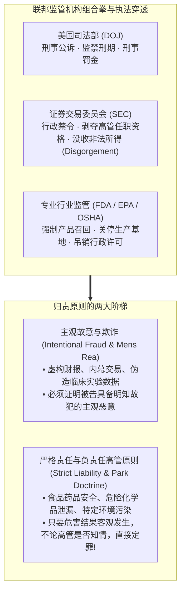
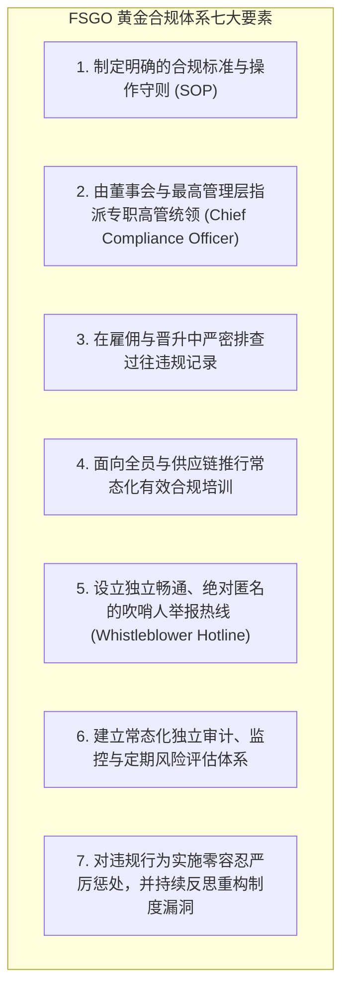

# Lec 3 监管硬约束与白领犯罪防范 (The Hard Edge of Regulation)

> MIT Sloan 15.615 · Law for the Entrepreneur and Manager · 主讲 Dr. John Akula

## TL;DR

- 区分民商事民意纠纷与国家行政刑法强制之间的“监管硬边界”（Hard Edge）。
- 拆解白领犯罪的核心构成要件：主观犯罪意图（Mens Rea）与严格责任犯罪（Strict Liability）。
- 剖析雇主替代责任原则（Respondeat Superior），量化一线员工合规失误向公司法人与高管个人的法定穿透。
- 掌握美国《联邦量刑指南》（FSGO）下有效企业合规计划（Compliance Program）的核心减责机制。

## 从民事防线到国家机器：监管的硬度

在民商法体系中，违约责任或侵权责任的争夺通常以“经济赔偿”为终点，属于私人主体之间的利益再平衡；然而，一旦管理者的行为跨越红线触碰到了**行政监管规制与刑法边界**，企业面对的对手将变为手握调查传票、没收资产乃至剥夺人身自由国家公权力的联邦监管机构（如 SEC、DOJ、EPA、FDA、FTC）。

在 MIT Sloan 讲台上，John Akula 教授将这一领域定义为商业运行中不可试探的“硬边缘（The Hard Edge）”。

理解监管梯次的层级跃迁，是高级管理者在危机时刻作出正确研判的生死分水岭。许多初涉商业的管理者容易陷入法条轻视的致命误区，将一切纠纷误判为“只要有钱赔偿就能摆平”的普通民商事侵权。然而，现代合规环境早已告别了单纯的民事私力救济范式，形成了民事赔偿、行政牌照吊销与联邦刑事起诉层层锁定的三维惩处天网。

特别是在涉及证券虚假陈述、环保违规排放、出口管制封锁以及反海外腐败（FCPA）等核心监管领域，国家公权力的介入具有不可逆的穿透性。一旦监管风暴越过民事违约边界上升为刑事调查，大陪审团传票（Subpoena）、窃听记录与法证电子取证将彻底打破公司的日常经营节奏。更严酷的是，任何针对监管调查实施的迟疑、掩盖、删除邮件或伪造回溯日期的举动，往往会直接触犯司法妨碍（Obstruction of Justice）重罪，使单纯的经营不合规瞬间恶化为无法挽回的牢狱之灾。

## 替代责任与企业刑事风险穿透（Respondeat Superior）

在普通法系中，公司作为法律拟制的法人主体，其行为必须通过自然人代理人来实现。根据**雇主替代责任原则（Respondeat Superior）**，一家跨国公司要承担刑事责任，仅需检方证明满足以下三项标准：

::: definition 公司刑事责任成立三要素
1. **员工身份**：从事违法行为的人属于公司的雇员或授权代理人；
2. **职责范围**：其违法动作发生在公司授予的真实或表面工作职责权限范围之内（Within the scope of employment）；
3. **利己动机**：员工从事该违法行为时，至少部分动机是为了给公司带来某种商业利益（哪怕公司最高管理层明令禁止该行为）。
:::

这意味着，哪怕 CEO 在全体员工大会上三令五申“严禁向外国官员行贿”，只要驻外销售总监为了拿下海外政府订单私下支付了回扣，以美国《反海外腐败法》（FCPA）为代表的刑法利剑将直接穿透公司法人，开出数以亿计的巨额罚单。

## 负责人原则：达特威奇案与帕克案（The Park Doctrine）

高管往往认为：“只要我自己没有亲手在虚假单据上签字，我就能独善其身。”美国最高法院在 *United States v. Park* (1975) 案中彻底击碎了这一侥幸心理。

被告 John Park 是一家拥有 36,000 名员工、874 家连锁超市的大型食品零售巨头 Acme Markets 的首席执行官兼总裁。FDA 在对 Acme 位于巴尔的摩的中央食品分销仓库进行突击检查时，发现库房存在严重的鼠患污染。FDA 正式致函警告 Park 要求整改。Park 随即指示负责卫生的副总裁全权调查整改。但在随后的复查中，FDA 发现该仓库依然存在卫生缺陷。检方直接以违反《联邦食品、药品和化妆品法》对 CEO Park 个人提起刑事公诉。

Park 在法庭上辩称：自己管理着庞大的跨国企业，不可能亲自去仓库抓老鼠，且自己已经把整改任务委托给了专业副总裁，自己既无主观犯罪恶意，也未直接参与日常仓储。

最高法院最终维持了对 Park 个人的有罪刑事判决：

::: theorem 负责任高管学说 (Responsible Corporate Officer Doctrine)
对于关乎公众生命健康安全的特殊监管行业，在严格责任刑法规范下：**任何凭借自身在企业组织中所处的层级地位，享有预防、发现并纠正该违法行为的权力和法定职责的高管（Standing in responsible relation to the public danger），即使对具体违法事实完全不知情，也必须对法人的犯罪结果承担个人刑事责任**！
:::

## 美国《联邦量刑指南》（FSGO）与合规救赎之路

为了避免被企业员工的个人鲁莽行为送上审判席，企业必须构建符合美国《联邦量刑指南》（Federal Sentencing Guidelines for Organizations, FSGO）的**有效合规与伦理计划（Effective Compliance and Ethics Program）**：

若企业能证明自身在案发前已建立了实质运转的上述合规体系，在遭遇员工个人违法指控时，司法部可将企业的刑事罚金基准削减高达 **80%–90%**，并可免除对企业法人的刑事起诉，转为附条件不起诉协议（DPA）。

::: pitfall 仅停留在纸面上的“花瓶合规（Paper Compliance）”
安然（Enron）破产前曾拥有一本长达 64 页、印刷极其精美、由著名律师团队起草的《商业行为准则》，其 CEO 每年都在引言签名宣誓。但在实际经营中，董事会竟然连续多次开会投票豁免 CFO 参与账外特殊目的实体（SPE）的利益冲突限制。司法部明确指出：任何未深入业务考核肌理、仅用于应付公关的“纸面合规”，在法庭上不仅不能减轻刑责，反而会被检方作为“明知故犯掩耳盗铃”的致命反面证据。
:::

::: insight 合规是企业高管的人身安全带
许多技术创业者与销售型高管往往把合规法务部门视为“阻碍业务冲刺的刹车片”。然而在现代高强度监管执法环境下，一套能够独立运作、享有直接向董事会审计委员会单线汇报特权的合规体系，绝非业务的绊脚石，而是高管保护企业免遭系统性清算、保护自身免遭牢狱之灾的最可靠人身安全带。
:::
