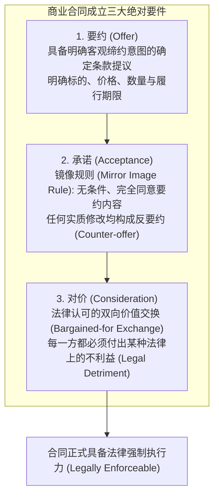
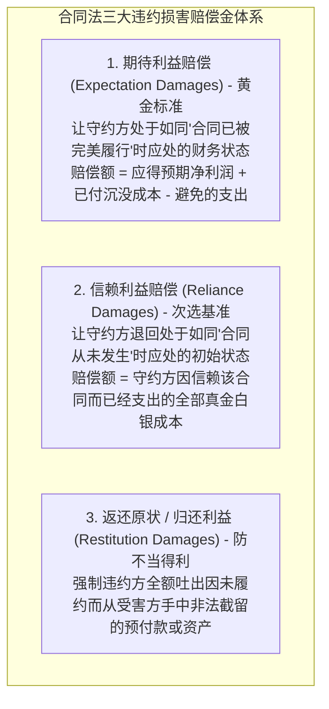

# Lec 4 商业合同法基石：要约、对价与违约救济 (Contracts I: Formation, Consideration & Remedies)

> MIT Sloan 15.615 · Law for the Entrepreneur and Manager · 主讲 Dr. John Akula

## TL;DR

- 掌握商业合同成立三大绝对构成要件：要约（Offer）、承诺（Acceptance）与对价（Consideration）。
- 厘清英美普通法“对价理论”（Doctrine of Consideration）的经济学本质：区分无偿赠与诺言与受法律保护的严肃交易。
- 掌握信赖保护例外：不可抗辩的允诺禁反言原则（Promissory Estoppel）。
- 建立合同法救济体系的量化心智：以期待利益损失（Expectation Damages）为基准计算违约赔偿金。

## 交易的底层骨架：什么是受法律约束的合同

商业世界的一切资产转移与价值交换，必须依托合同（Contract）完成。合同绝不仅仅是一张盖了章的纸，它的法律定义极其精炼：**具有法律强制执行力的一项或一组允诺（A promise or set of promises for the breach of which the law gives a remedy）**。

在英美法系中，一项口头陈述或书面备忘录要演变成一份受法院强制保护的商业合同，必须严格同时跨越三大法定门槛：

合同成立的核心流程展示了法律如何将两颗独立的大脑通过清晰的要约与承诺严密缝合。在快速迭代的商业实践中，很多初创团队在尚未签署正式长篇协议时，就已经在日常电子邮件、即时通讯工具甚至口头会议中频繁使用“同意推进”、“没问题”、“按此执行”等具有强约束力意向的措辞。根据普通法客观标准，法官并不探究当事人内心深处的真实保留意见，而是以一个“理性的第三人”视角，依据双方外部表达的客观言行来推导是否存在受约束的合意（Meeting of the Minds）。

此外，对价（Consideration）要件构成了英美法与大陆法最显著的制度分水岭。法律不保护单纯的无偿承诺或冲动赠与，必须存在“诱导受约人作出牺牲的互惠交易机制”。这意味着在合同起草与重组过程中，任何补充协议或免责变更，若无新增对价支持，都可能在未来的法庭抗辩中被认定为无对价的无效承诺（Nudum Pactum）。管理者必须确保商业交易的每一个权利让渡环节都具备坚实的对价锚点。

## 对价理论（Doctrine of Consideration）的奥秘

对价是普通法系最独特的法律发明。它的核心逻辑在于：**法院的司法资源极其昂贵，法律绝不替单纯的冲动赠与、道德许诺或无偿恩惠背书**。

::: definition 严肃对价的标准
一项有效的对价必须满足“议价交换（Bargained-for Exchange）”检验：
- 提议方付出允诺，是为了换取受诺方付出的某项资产、服务、或者是受诺方**放弃自身原本在法律上享有的一项法定权利（Forbearance）**。
- 法院只审查对价的“合法存在性”（Legal Sufficiency），而**从不审查对价在经济上是否等价对等（Adequacy of Consideration）**。哪怕你为了 1 美元把价值 1,000 万美元的专利转让给他人（著名的“一粒胡椒子对价 Peppercorn Theory”），只要双方真诚议价达成一致，合同即完全成立。
:::

### 经典先例：*Hamer v. Sidway* (1891)

富有的叔叔对 18 岁的侄子承诺：“如果你在 21 岁生日前绝不抽烟、绝不饮酒、绝不赌博，在你满 21 岁那天我奖励你 5,000 美元（在当时是一笔巨款）。”侄子严格照办。叔叔死后，遗产执行人拒绝支付该款项，辩称叔叔的承诺缺乏对价，因为不抽烟不喝酒对侄子的身心健康有百利而无一害，侄子并未付出任何实际财产，叔叔也未从中获得任何经济收益。

纽约上诉法院裁定侄子胜诉：

::: theorem 放弃合法权利构成充分对价
只要受让方**限制了自身原本在法律上被允许行使的自由行动权利**（即不抽烟不喝酒放弃了法定自由），无论这种限制是否给对方带来直接金钱收益，也无论它是否有利于受让方的个人健康，在法律上均构成完全合法且不可推翻的充分对价！
:::

## 衡平法补救：允诺禁反言（Promissory Estoppel）

如果一项商业诺言由于缺乏严格对价而无法按合同法立案，但受诺人出于对该诺言的真诚合理信赖，已经付出了不可挽回的实质性金钱投入，法律该如何救济？

美国《合同法重述（第二次）》第 90 条确立了著名的**允诺禁反言原则（Promissory Estoppel）**：

::: definition 允诺禁反言成立四要素
1. 允诺人做出了一项明确清晰的允诺；
2. 允诺人应当合理预见到，受诺人会基于对该允诺的信赖而采取行动；
3. 受诺人事实上真诚且合理地依赖该允诺，付出了重大实质性不利益（Detrimental Reliance）；
4. 唯有强制执行该允诺，才能避免非正义的结果发生。
:::

例如：某跨国连锁零售巨头高管口头承诺一位农场主：“只要你投资 200 万美元引进专用有机草莓冷链设备，我们下个月保证全量采购你的草莓。”农场主依约抵押房产采购了设备，巨头随后以“双方尚未签署正式书面合同缺乏对价”为由拒绝签约。法院将果断激活允诺禁反言，强制巨头赔偿农场主因合理信赖而遭受的全部重资产资本损失。

## 违约救济的经济学：三大损害赔偿金模型

英美合同法从来不以“惩罚违约方”为目的（除极其罕见的欺诈外，合同法原则上绝对禁止惩罚性赔偿 Punitive Damages）。合同法的唯一目标是将受害方恢复到原本应处的财务平衡点：

::: example 期待利益赔偿的经典测算
软件开发商 A 与某物流公司 B 签约，约定以 50 万美元总价为 B 研发一套全自动调度系统。
- 预计开发商 A 的总成本为 40 万美元，预期净利润为 10 万美元；
- 当 A 完成了一半工作、实际垫付工时成本 20 万美元时，B 公司突发毁约解除合同；
- A 随后停止开发，避免了后续原本需支出的 20 万美元后续成本。
按照期待利益赔偿金计算法则：
$$	ext{赔偿金额} = 	ext{已支出实际成本 } (\$200{,}000) + 	ext{合同预期全额净利润 } (\$100{,}000) = \$300{,}000$$
B 公司必须赔偿 A 公司 30 万美元，使 A 公司最终恰好实现合同履约完毕时预期的 10 万美元净利润。
:::

::: pitfall 忽视减损义务（Duty to Mitigate）导致的求偿落空
合同受害方常犯的致命错误是：“反正你违约了，我就躺在家里看着损失持续扩大，反正最后全找你报销。”在英美法系中，**守约方负有法定的减轻损害义务（Duty to Mitigate Damages）**。如果被解雇的员工在被辞退后故意拒绝其他合理可得的工作机会，或者厂房租赁方在租客搬走后拒绝重新挂牌招租，法官将从最终判赔金额中冷酷地扣除“受害方本可以通过合理努力自行避免的损失额”。
:::

::: insight 合同是风险分配的精密数学仪器
企业高管在审阅合同时，不应仅仅将其视为“写满法律免责声明的八股文”，而应将其解构为**针对未来所有可能黑天鹅事件的风险概率定价契约**。谁来承担原材料价格暴涨风险？谁来承担交期延误风险？每一项条款背后，都是真金白银的资产负债表转移。卓越的高管懂得用严密的对价结构与清晰的救济条款锁定上行收益，将致命的下行违约风险彻底隔离在企业防火墙之外。
:::
