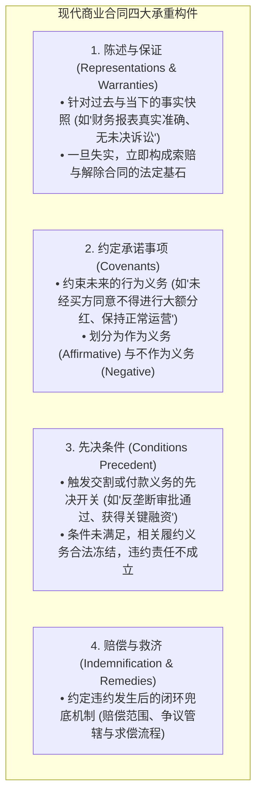
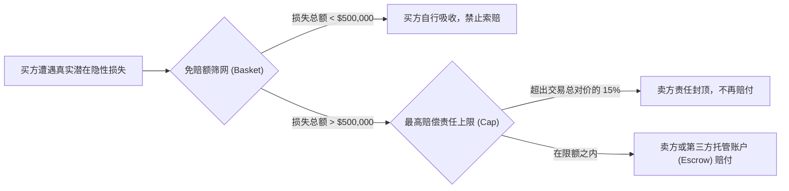
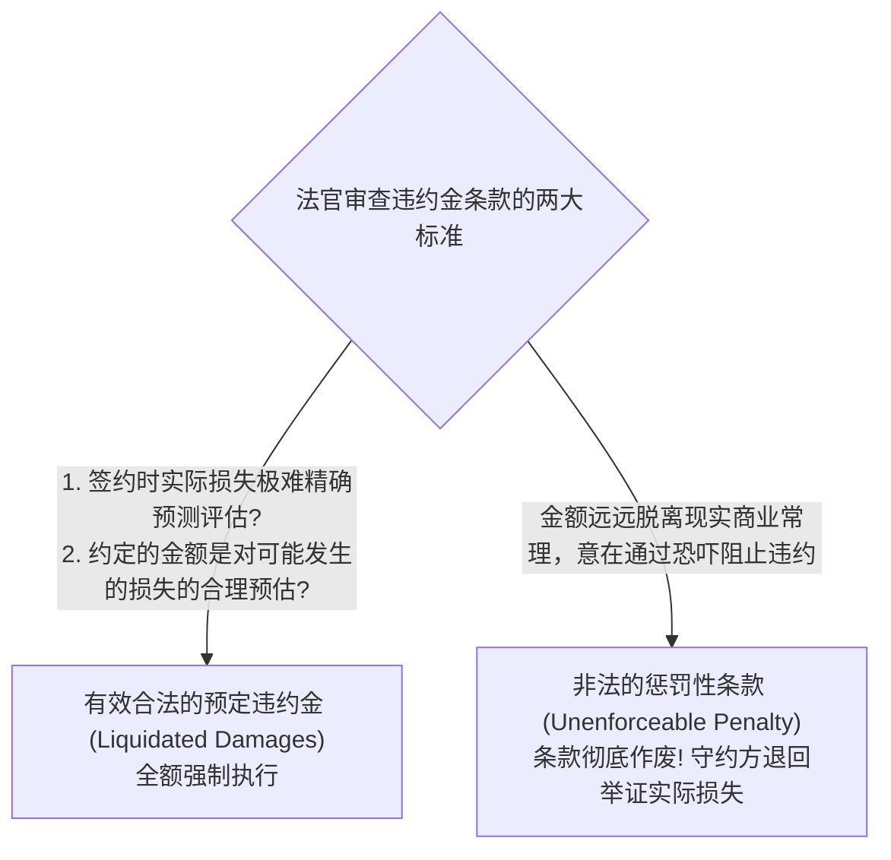

# Lec 5 复杂商业合同条款设计与起草陷阱 (Contracts II: Clause Structuring & Drafting Traps)

> MIT Sloan 15.615 · Law for the Entrepreneur and Manager · 主讲 Dr. John Akula

## TL;DR

- 剖析大型商业交易与并购合同的解剖学结构：陈述与保证、先决条件与约定承诺。
- 严密设计赔偿保障条款（Indemnification）：设定索赔上限（Cap）、免赔起赔额（Basket）与存续期（Survival Period）。
- 厘清预定违约赔偿金（Liquidated Damages）与非法惩罚性条款（Penalties）的司法红线。
- 掌握完整协议条款（Merger / Integration Clause）与口头证据规则，封堵法庭外的缔约口头争议。

## 现代商业合同的解剖学结构

在动辄数百页的跨国并购协议、合资协议或大型采购合约中，不同段落并非平铺直叙，而是构成了严密的逻辑拓扑网络。高管必须掌握识别合同核心四大“功能构件”的能力：

审视这一模块化解剖图，专业管理者应当掌握超越单线条法务审阅的系统化全局思维。一份精密的商业合同从来不是机械堆砌的生硬法言法语，而是一座权衡商业风险、资产估值与履约救济的精巧建筑。陈述与保证（Reps & Warranties）确立了签约当下的事实基准面，直接决定了交易资产的定价底线；先决条件（Conditions Precedent）充当着交易交割的安全离合器，确保外部审批或监管尽调不到位时交易可以安全中止而不构成违约；承诺事项（Covenants）则规训着交割过渡期内资产价值的完整保全。

而在合同尾部的责任限制条款（Limitation of Liability）与违约救济机制，则是整栋商业大厦的避雷针与安全气囊。商业世界的未知风险无处不在，供应链中断、市场剧变甚至不可抗力都可能导致履约受阻。缺乏免除附带间接损失（Consequential Damages）与设立赔偿责任总额封顶（Liability Cap）的保护，一次偶发的履约迟延就可能引发数十倍于合同标的额的巨额衍生索赔，将企业拖入万劫不复的深渊。

## 陈述与保证（Reps & Warranties）的攻防博弈

在企业收购或大宗交易中，“陈述与保证”是买卖双方争夺最激烈的战场：
- **买方的诉求**：要求卖方做出绝对、全面、无死角的陈述（例如“目标公司完全遵守了所有的环境保护法律”）；
- **卖方的防御**：通过引入两大缓冲阀门限制自身责任——**重大性限定（Materiality Qualifier）**与**知情限定（Knowledge Qualifier）**：
  - *改造前（卖方危险）*：“公司目前未面临任何未决诉讼。”
  - *改造后（卖方安全）*：“据公司最高管理层所知（To the best of company's knowledge），公司目前不存在任何可能对公司经营产生**重大不利影响（Material Adverse Effect, MAE）**的未决诉讼。”

## 赔偿条款（Indemnification）的风险过滤网设计

商业交易的核心艺术在于“给不确定性划定财务边界”。在赔偿条款中，高管必须学会熟练组合运用三大过滤工具：

::: definition 赔偿条款三大核心量化工具
1. **起赔额 / 免赔额（The Basket）**：
   - **免赔扣除型（Deductible Basket）**：类似商业车险，损失超过 50 万美元后，卖方仅就**超出 50 万的差额部分**进行赔偿。
   - **门槛跳板型（First-dollar / Tipping Basket）**：一旦损失累计突破 50 万美元，卖方必须从**第 1 美元起对全部 50 万及以上金额**负全额赔偿责任。
2. **最高责任上限（The Cap）**：
   - 严格约定卖方的累计赔偿总额不得超过交易对价的特定比例（通常在常规商业交易中设定为交易金额的 10%–20%）。
3. **存续期限（Survival Period）**：
   - 约定交割后陈述保证条款的“有效追责保质期”。常规商业事项通常存续 12–24 个月；而涉及公司根本股权合法性、税务（Tax）与环保责任的核心陈述，通常约定存续至法定诉讼时效届满。
:::

## 违约金的司法红线：预定违约金 vs. 非法罚金

企业管理层在签署合同时，经常希望加上一句：“若乙方延期交货，必须向甲方支付每天 100 万美元的巨额违约金以示惩戒。”

在英美合同法中，这种条款属于典型的**非法惩罚性条款（Unenforceable Penalty）**，法官将以违背公序良俗为由直接判令全额无效！

因此，起草违约金条款时，必须在文本中详细写明该计算金额与可能发生的场地闲置、客户索赔之间的合理对应依据，严禁使用“罚金（Fine / Penalty）”等具有惩戒色彩的措辞。

## 完整协议条款（Merger / Integration Clause）与口头证据规则

在商业谈判中，销售代表往往会热情洋溢地做出各种口头保证：“您放心，这个服务器系统我们承诺每周提供免费上门维护，三年内免费升级。”但最终签署的正式合同中对此字句未提。

一旦发生争议，买方能否在法庭上出示微信记录、谈判录音或往来邮件来推翻纸面合同？

根据**口头证据规则（Parol Evidence Rule）**：

::: theorem 口头证据排除与完整协议条款
只要正式合同中包含了**完整协议条款（Merger / Integration Clause）**，即明确声明：“*本协议构成双方就本交易达成的完整且唯一的最终协议，在此之前双方达成的任何口头陈述、谈判草案、宣传材料或往来邮件均被本协议彻底吸收并完全废止*”，法官将**绝对禁止当事人向法庭提交任何合同签订之前的口头陈述作为改变合同文字的证据**！
:::

::: pitfall 忽视“修改必须书面（No Oral Modification, NOM）”条款的漏洞
许多企业在合同中写了“本合同的任何修改必须经双方书面签署方可生效”。然而在商业实务中，两家公司的项目经理经常通过微信沟通同意了延期两周交付。当纠纷发生时，一方往往主张对方通过口头默示行为“放弃了权利（Waiver）”。高管必须教育一线团队：重大变更必须严格签署正式的《补充协议书（Amendment）》，切忌在日常即时通讯工具中随意做出模糊承诺。
:::

::: insight 严密的合同起草是商业防卫的终极闭环
起草一份商业合同，绝不是文字游戏，而是一场在纸面上推演未来全部商业战争的兵棋推演。每一个逗号的位置、每一个重大性限定词的增删、每一个免赔额的测算，都直接决定了当危机爆发时，企业是处于被对方随意拿捏的被动死局，还是立于进退自如的不败之地。商业合同的起草，要求高管兼备宏观商业大局观与微观法学显微镜的双重洞察。
:::
