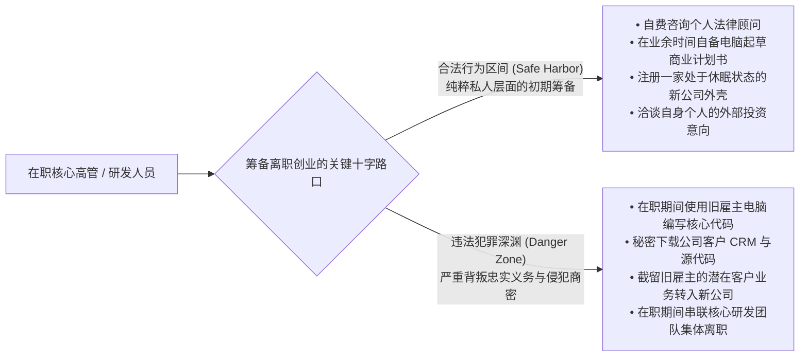
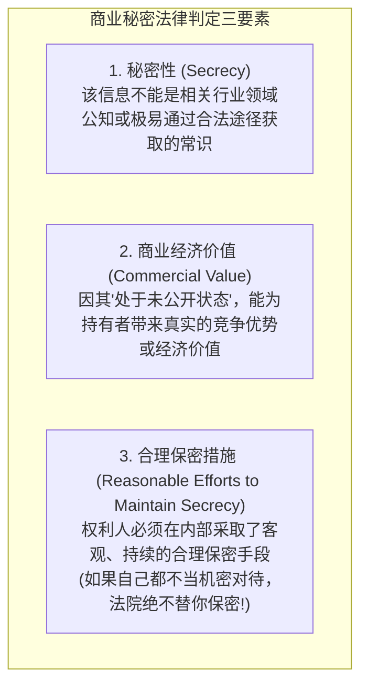

# Lec 6 离职创业法律边界：商业秘密与受托义务 (Leaving a Company I: Trade Secrets & Fiduciary Traps)
> MIT Sloan 15.615 · Law for the Entrepreneur and Manager · 主讲 Dr. John Akula

## TL;DR

- 梳理高管与核心技术人员从旧雇主离职设立竞争性初创公司的法律雷区。
- 厘清“合法的个人离职筹备”与“违法的在职利益冲突”之间的司法分水岭。
- 掌握美国《统一商业秘密法》（UTSA）与《经济间谍法》对商业秘密构成的三要素检验。
- 严密防范“公司商业机会侵占”（Corporate Opportunity Doctrine）与离职前非正常团队集体跳槽（Raid）。

## 离职创业的商业现实与法律张力

在硅谷、波士顿 128 号公路与全球各大创新集群中，大量具备突破性活力的独角兽企业，最初都诞生自资深技术骨干或销售高管从成熟巨头内部的“出走（Breakaway）”。

然而，这种创新扩散机制在法律上面临极度尖锐的张力：
- **公共政策（Public Policy）倾向于保护人才流动与自由竞争**：法律不承认人身依附，劳动者有权凭借自身积累的通用职业技能开拓新事业；
- **商业法与产权制度必须严厉保护雇主的合法知识财产与受托诚信**：旧雇主花费数千万研发沉淀的技术图纸、客户名单与专有算法，决不能被离职员工以廉价偷盗的方式据为己有。

## 准备竞争 vs. 实际竞争：司法裁量的微观分水岭

在普通法系中，员工在正式离职生效前，依然对现任雇主负有基本的忠实义务（Duty of Loyalty）。法院严格区分两类行为：

::: definition 合法筹备与违规竞争的法定界限
1. **纯粹离职筹备（Mere Preparation, 合法）**：员工在工作之余、使用完全独立的个人资金与设备，为未来可能开展的业务做初始规划（如租用办公室、联系风险投资、注册商标）。只要这些行为没有直接抢夺雇主的现有业务，且未在工作时间内消耗雇主工时，法律予以保护。
2. **在职实质竞争（Active Competition, 违法）**：如果在离职交接完毕之前，员工已经开始招揽雇主的现有客户、向客户分发新公司的报价单、或者劝说客户推迟与原公司签约，哪怕一分钱利润都尚未赚取，也构成对受托义务的绝对背叛。
:::

## 商业秘密的法律定义（The UTSA Framework）

根据美国《统一商业秘密法》（Uniform Trade Secrets Act, UTSA）与《保护商业秘密法》（Defend Trade Secrets Act, DTSA），一项技术或经营信息要被认定为受法律保护的**商业秘密（Trade Secret）**，必须同时满足以下三大绝对标准：

::: example 什么是“合理保密措施”？
如果原告公司声称某套客户定价算法是核心商业秘密，但法庭调查发现：
- 任何实习生无需输入密码即可在内网公开下载该算法文件；
- 算法打印稿被随意丢弃在公共打印机旁；
- 员工入职时未签署专门的保密协议（NDA），离职时未进行任何涉密排查交接；
**法院将直接判定该信息丧失商业秘密保护资格**！合理保密措施包括：强制签署 NDA、设立物理与网络访问权限分级、加盖“机密”水印、在离职流程中要求彻底清空设备。
:::

## 公司商业机会侵占（Corporate Opportunity Doctrine）

在职高管（尤其是董事与副总裁级别）离职时最容易踩中、赔偿金额最惊人的法律陷阱，莫过于**侵占公司商业机会（Corporate Opportunity Doctrine）**。

### Guth 检验法则（The Guth Rule）

如果一个商业项目满足以下特征：
1. 公司在财务上有能力承担该项目；
2. 该项目处于公司当前的主营业务领域，或符合其战略延展方向（Line of Business）；
3. 公司对该项目享有合理的商业期待或利益关注；
4. 受托人擅自截留该机会，将使其个人利益与公司整体利益产生直接对抗冲突。

::: pitfall 离职高管私吞业务的惨痛代价
某医疗软件公司首席技术官在职期间，接待了一家大型三甲医院的特殊定制开发需求。该 CTO 认为公司现有产线做这个项目太麻烦，遂私下对医院宣称“我们公司接不了这个单”，随后自己火速离职成立新公司承接了该医院 5,000 万元的项目。老东家随后提起诉讼。法院判定该机会完全属于原公司的商业机会，裁定 CTO 新公司获取的全部 5,000 万元收入连同利息全部作为**拟制信托（Constructive Trust）**财产返还给老东家，CTO 团队不仅一无所获，更背负了巨额诉讼债务。
:::

::: insight 干净出走的制度化护城河
真正的连续创业家懂得“宁可牺牲一个月的时间，也要换取整套新架构绝对法律洁净度（Pristine Cleanliness）”的哲学。离开旧公司时，务必做到：**使用自己掏钱购买的全新电脑；绝不携带旧公司的任何哪怕一页纸质或电子文档；老老实实完成交接流程；在正式离职生效前绝不签署新合同**。只有让新公司的第一行代码和第一份客户合同建立在完全干净的法律基石之上，未来在面对顶级红杉、高瓴等顶级 VC 的投后尽职调查（Due Diligence）时，才不会遭遇一票否决的灭顶之灾。
:::
