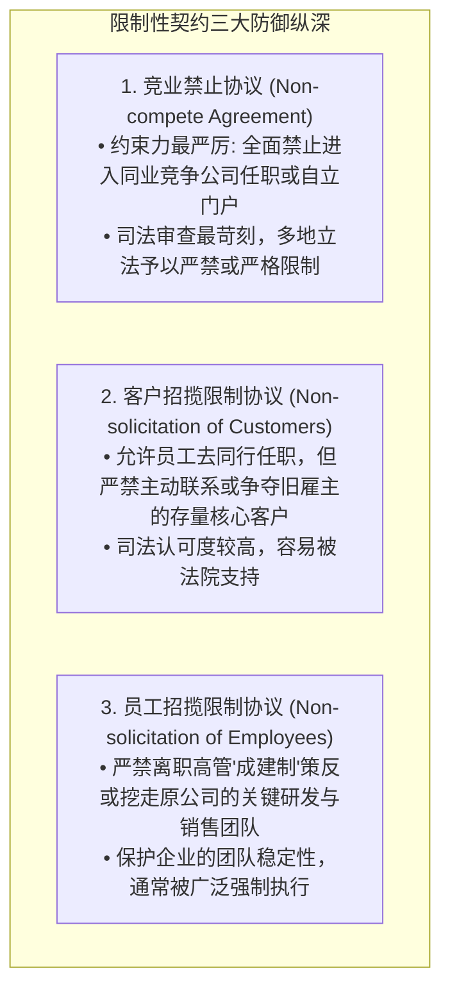
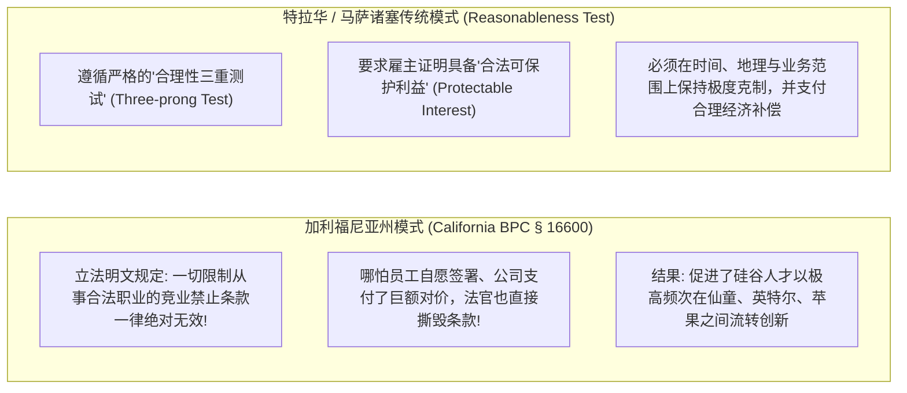

# Lec 7 竞业禁止条款与员工招揽限制 (Leaving a Company II: Non-compete & Non-solicitation)
> MIT Sloan 15.615 · Law for the Entrepreneur and Manager · 主讲 Dr. John Akula

## TL;DR

- 剖析限制性契约（Restrictive Covenants）三大核心武器：竞业禁止、客户招揽限制与员工招揽限制。
- 深度对比全美各辖区对竞业禁止的极端分歧：加利福尼亚州绝对无效原则 vs. 特拉华/马萨诸塞州合理性测试。
- 掌握竞业禁止条款有效成立的“三维合理性空间”：时间跨度、地理范围与业务界定。
- 解析员工非招揽条款（Non-solicitation of Employees）在防范初创团队“成建制挖角”中的防护网效应。

## 契约自由 vs. 生计权利：限制性契约的冲突核心

当企业雇佣一名核心高管或顶尖科学家时，通常会在劳动合同中嵌入严密的**限制性契约（Restrictive Covenants）**，要求其在离职后一定期限内，不得加入竞争对手，不得挖走老同事，不得拉走老客户。

这类条款在法理上引发了极具争议的博弈：
- **雇主主张契约自由（Freedom of Contract）**：员工在签署合同时获得了高额薪酬甚至股权激励，理应恪守承诺；
- **司法政策维护公共利益（Public Policy）**：宪法与普通法深恶痛绝阻碍公民运用个人技能自食其力的“经济农奴制”。任何过度剥夺劳动者生存权利的排他性协议，原则上被视为对抗竞争的垄断行为。

## 司法管辖区大裂谷：加州模式 vs. 传统合理性模式

在全球科技创新格局中，对竞业禁止条款的法律态度，甚至直接重塑了区域经济的兴衰版图：

加州与特拉华/麻省在竞业禁止立法上的深层分裂，本质上反映了两种截然不同的经济发展哲学与制度竞争策略。以加州为代表的自由主义模式坚信：知识、创意与人才的无障碍自由流动是孕育高科技产业集群（如硅谷）的终极动力；任何试图以契约锁定员工大脑的做法，都是对全社会创新活力的扼杀。而在传统普通法模式下，制度设计更倾向于保护雇主在前瞻性研发、客户资源网络与商业机密培育上的重资本投入，防止恶意搭便车破坏投资积极性。

这种剧烈的管辖区大裂谷为跨地区科技企业的合规运作带来了极其复杂的法律冲突。一家注册于特拉华州、总部位于波士顿的科技公司，如果其远程雇佣的软件工程师位于旧金山，公司即便在合同中明文约定适用麻省法律与管辖，加州法院依然会基于加州的“强行公共政策（Fundamental Public Policy）”认定麻省法律选择无效，强行击穿竞业禁止条款。企业家在制定跨区域人才战略时，必须精准识别雇员物理居住地的法律强行法规则。

## 竞业禁止协议的“合理性三维测试”

在承认竞业禁止合法性的州（如特拉华州、马萨诸塞州、纽约州），一项竞业禁止条款要获得法院支持，雇主必须证明其并未超出保护自身合法商业利益（如真正的商业秘密或商誉）所必需的最低限度：

| 审查维度 | 法院通常支持的合理边界 | 必然被法院直接废除的越界条款 |
| :--- | :--- | :--- |
| **1. 时间跨度（Duration）** | **6 个月至 1 年**（高管股权退出通常允许 2–3 年）| 动辄要求长达 5 年甚至终身禁止从业 |
| **2. 地理范围（Geography）** | 仅限于员工过往实际负责的特定核心销售大区 | “全球范围内”或员工从未涉足的虚幻海外市场 |
| **3. 业务定义（Scope of Activity）** | 严格限定在与员工原岗位直接冲突的细分业务条线 | 笼统写成“不得在任何涉及互联网或计算机的企业任职” |

::: definition 司法裁量权：蓝铅笔规则 vs. 彻底废除
- **蓝铅笔规则（Blue Pencil Doctrine）**：若条款过宽，法官有权拿起“蓝铅笔”划掉不合理的部分（如将 3 年强行改成 1 年，将全球改成特定州），保留剩余合理部分继续执行；
- **完全废除规则（All-or-Nothing Rule）**：若雇主在条款中存在贪婪越界，法官拒绝替雇主重写合同，直接判令整个竞业禁止协议自始彻底无效！
:::

## 员工招揽限制（Non-solicitation of Employees）的边界防线

离职创业者最常见的动作，是拉拢在老东家共事多年的技术大牛“一起干”。这也往往是触发老东家提起紧急临时禁抗令（Preliminary Injunction）的最核心引线。

::: definition 什么是合法的“自然流动”与违法的“恶意挖角”？
1. **被动响应（Passive Hiring, 合法）**：新公司在公开招聘网站发布广告，老同事主动投递简历并参加面试入职，离职高管未主动私下劝诱，不违反员工招揽限制。
2. **主动策反与集体倒戈（Active Raid, 违法）**：离职高管在在职期间建立秘密微信群，分发新公司期权方案，带走核心代码贡献者名单，甚至教唆骨干员工在同一天上午向老东家提交辞职信（所谓的“集体跳槽 Mass Exodus”）。这种行为不仅直接违反非招揽协议，更将面临侵犯受托责任与不正当竞争的重罪民事指控。
:::

::: pitfall 忽视“跨州管辖权冲突”的诉讼反杀
许多波士顿或纽约的初创企业雇佣了一名前往加州远程办公的高管，并在合同中写明“适用马萨诸塞州法律管辖”。当该高管在加州跳槽至竞品时，雇主在波士顿提起诉讼；而该员工立即在加州法院反诉，要求加州法院依据 BPC § 16600 裁定波士顿合同中的竞业禁止条款违反加州公共政策而无效。加州法院往往直接签发对反诉的保护令，导致跨国雇主的跨州追责陷入昂贵的管辖权死锁。
:::

::: insight 留住人才靠愿景与利益，而非手铐
现代科技企业治理最深刻的共识在于：**竞业禁止协议本质上是一副脆弱的纸手铐**。如果一个团队的心已经离散，哪怕用最昂贵的律师团队将其锁在冷板凳上支付一年的竞业补偿金，企业除了收获一个充满怨恨的离职者和巨额账单外一无所获。顶级的创新企业应当学会像加州科技巨头一样：用持续滚动的激进股权绑定（Restricted Stock Units）、富有挑战性的前沿命题以及充满信任的文化土壤，让最优秀的人才发自内心地选择留下。
:::
