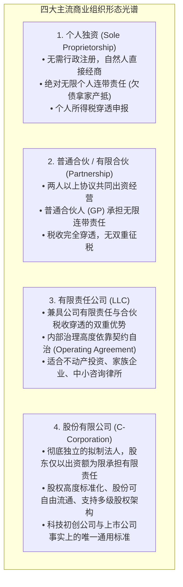
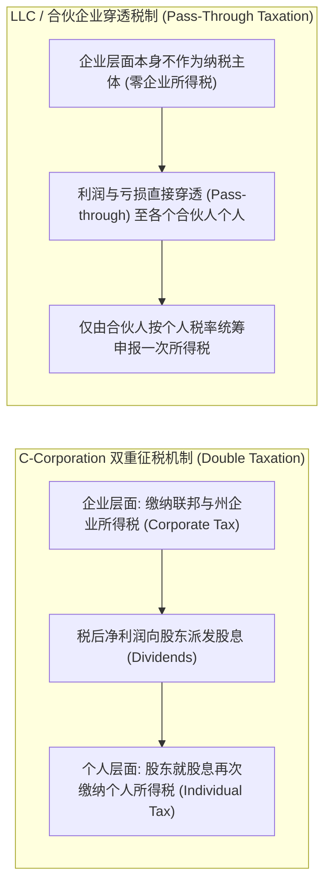
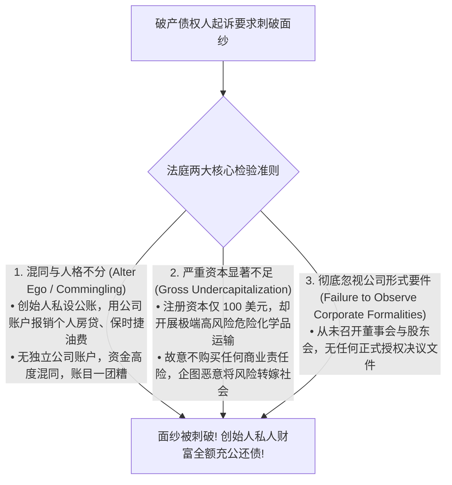

# Lec 8 企业组织形式选择：独资、合伙、LLC 与 C-Corp (Forms of Doing Business)
> MIT Sloan 15.615 · Law for the Entrepreneur and Manager · 主讲 Dr. John Akula

## TL;DR

- 掌握现代商业法四大主流企业形态：个人独资、普通/有限合伙、有限责任公司（LLC）与股份有限公司（C-Corp）。
- 拆解两大底层决策杠杆：债务有限责任屏障（Limited Liability）与税收穿透机制（Pass-through Taxation）。
- 剖析初创科技企业为何几乎清一色选择注册为特拉华州 C-Corporation（Delaware C-Corp）。
- 掌握“刺破公司面纱”（Piercing the Corporate Veil）的司法条件，建立规范法人财产独立的合规纪律。

## 企业的法律基因：组织形态的四象限

创立一家新企业，首当其冲的战略决策是选择**企业法律实体形态（Choice of Legal Entity）**。选择何种外壳，不仅决定了创始人的个人财富是否需要对公司债务承担连带赔偿责任，更深刻决定了公司未来的税收负担、股权分配、管理权分配以及引入风险投资（VC）的能力。

这一四象限矩阵清晰描摹了现代商业实体法的发展光谱。在选择组织载体时，创业者最常犯的战略错误就是单纯盯着眼前的“注册简便性”或“省税”，而忽视了企业长期成长所必须依赖的股权激励与外部股权融资通道。独资企业与普通合伙虽然设立门槛极低，但无限连带责任的幽灵随时可能让企业债务直接穿透到创始人的个人住宅与银行储蓄，彻底摧毁家庭财富。

而对于志在引入风险投资并最终迈向公开资本市场的科技创业团队而言，特拉华州 C-Corporation 是几乎无可替代的制度黄金标准。风险投资基金（VC Funds）受制于其有限合伙人（LP）中的免税机构（大学捐赠基金、养老金）约束，法律上无法持有穿透纳税的 LLC 权益；同时，期权池设立（Option Pool）、多轮次优先股发行（Series A/B/C Preferred Stock）以及反稀释工具的精密运作，全部依赖于现代公司法所建立的高度成熟的股份资本体系。

## 核心博弈一：双重征税 vs. 穿透税制

税收结构是区分不同实体的最主要经济动因：

如果从税收角度看，LLC 的穿透税制显然优于 C-Corp 的双重征税。那么，**为什么面向 VC 融资的科技初创企业依然必须设立为 C-Corporation？**

::: definition 科技独角兽非 C-Corp 不选的三大不可抗力
1. **VC 基金设立架构的刚性限制**：绝大多数风险投资基金（Venture Capital）的出资人包含大量免税机构投资人（如哈佛大学捐赠基金、公共养老金计划基金）。根据美国税法，如果 VC 投资了 LLC，这些免税机构将被迫面临“不相关商业应税所得（UBTI）”而必须向联邦报税纳税，这在机构章程中是被绝对禁止的；
2. **期权池（Stock Option Pool）激励机制**：C-Corp 拥有成熟、标准、可享受税收递延优惠的法定激励期权（ISO / NSO），而 LLC 的“利润权益（Profits Interests）”计算复杂，员工极难理解；
3. **合格小型企业股票（QSBS）税收豁免**：美国税法第 1202 条规定，投资符合条件的 C-Corp 小型企业股票持有满 5 年，投资人退出时可享受最高 **1,000 万美元或投资原值 10 倍资本利得税的完全免税待遇**！这一天文级税收减免彻底抹平了双重征税的劣势。
:::

## 核心博弈二：刺破公司面纱（Piercing the Corporate Veil）

有限责任是现代资本主义制度最伟大的发明之一：股东以其认缴的出资额为限对公司债务承担责任，哪怕公司破产负债 10 亿美元，债权人也无权查封股东个人的房产、存款与个人汽车。

然而，如果创始人滥用公司外壳作为欺诈工具，法官将毫不犹豫地动用衡平法利刃——**“刺破公司面纱”（Piercing the Corporate Veil）**，剥离有限责任外壳，强制股东个人对公司全部未清偿债务承担无限连带赔偿责任！

::: pitfall 初创团队“左右口袋不分”的低级毁灭
很多年轻创始人拿到天使投资后，为了图省事，直接拿公司的借记卡刷个人日常餐饮，或者将客户支付给公司的货款直接打入联合创始人的个人微信/银行卡中，事后再以“大家都是自己人”为由做一笔模糊的内部账。这种做法在法庭证据链中构成了无可辩驳的**财产混同（Commingling of Assets）**。一旦公司未来陷入重大侵权纠纷（如产品致人重伤或陷入巨额版权索赔），法官将毫不留情地刺破面纱，让创始人的个人全部身家瞬间归零。
:::

::: insight 组织架构是资本流转的法律漏斗
从法律视角审视，企业实体绝非简单的工商登记证书，而是一个连接资本、劳动、风险与政府税权的精密法律漏斗。不同的组织形式在法律摩擦力、税务摩擦力与治理摩擦力上有着截然不同的分布。高管与创始人的首要职责，是在企业诞生的第一天，根据自身业务的资本属性（是追求分红现金流的小微企业，还是追求跨越式股权增值的科技初创企业），选择最精准匹配的法律架构载体。
:::
