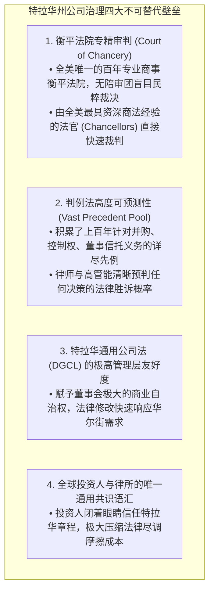
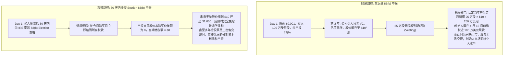

# Lec 9 新公司设立与创始人股权绑定架构 (Setting up a New Company: Founder Equity & Vesting)
> MIT Sloan 15.615 · Law for the Entrepreneur and Manager · 主讲 Dr. John Akula

## TL;DR

- 掌握新设立公司全套核心法律文件架构：公司章程、附则与创始人股权认购协议。
- 解构科技初创企业经典“4 年成熟期 + 1 年悬崖”（4-year Vesting with 1-year Cliff）防散伙机制。
- 深度解析创始人税务核弹——美国税法第 83(b) 条款申报（Section 83(b) Election）的核心机理。
- 剖析特拉华州（Delaware）成为全美 68% 财富 500 强与科技独角兽共同注册地的制度秘诀。

## 为什么是特拉华州（Why Delaware?）

无论是设立在硅谷的科技企业，还是麻省理工衍生孵化的高科技项目，超过 90% 的风险投资支持的初创企业都选择将公司注册在位于美东的微型小州——**特拉华州（Delaware）**。

这背后体现了极具战略性的制度套利选择：

特拉华州之所以能在全美乃至全球企业注册地竞争中傲视群雄，绝非单纯依靠廉价的规费，而是凭借其百余年来精心构筑的“法治生态护城河”。特拉华州衡平法院（Court of Chancery）是全美独一无二的专门商事法院，这里没有对复杂并购交易一无所知、容易受同情心煽动的平民陪审团，全部案件均由经验极其老道、精通金融资本运作的资深衡平法官（Chancellors）独立裁决，从而保证了商事纠纷解决的高确定性与超强可预期性。

与此同时，特拉华州普通公司法（DGCL）以其极致的“私法自治与管理层友好”著称。从允许设立分期改选董事会（Staggered Board）、毒丸防御计划，到免除董事注意义务个人民事赔偿责任的 Exculpation 条款（DGCL § 102(b)(7)），特拉华州法律为企业管理层在资本市场的惊涛骇浪中提供了最坚固的法律庇护所。在华尔街投资人与顶尖律所眼中，特拉华注册不仅是合规标配，更是一种衡量企业是否具备现代公司治理成熟度的制度通行证。

## 新公司设立的三件套（The Core Documents）

新设股份有限公司绝不仅是在州政府网站上填张表，其法律大厦由三份基石协议共同构筑：

1. **公司章程（Certificate of Incorporation / Charter）**：
   - 向特拉华州州务卿正式提交备案的法定公开文件；
   - 规定公司的法定授权股份总数（Authorized Shares，通常初始设定为 1,000 万股普通股，以便于拆分分配）；
   - 规定普通股与优先股的面值（Par Value，通常设为极微小值如 $0.0001/股，以最小化特拉华特许经营税 Franchise Tax）。
2. **公司附则 / 组织细则（Bylaws）**：
   - 公司内部的运行宪章（不对外公开）；
   - 详尽约定股东大会通知期、法定表决人数、董事会席位变更规则、委员会设立权限等日常治理细则。
3. **首任董事会书面决议案（Action by Incorporator & Initial Board Consent）**：
   - 发起人卸任，正式选举出第一届董事会，任命 CEO、CFO 等公司高管，并正式批准向创始人发行初始股权。

## 股权成熟机制（Vesting Schedule）：防范“死骑之灾”

创业最惨烈的悲剧莫过于：三位联合创始人平分了 100% 的股权（每人 33.3%）。公司刚开工 3 个月，CTO 嫌太辛苦决定退出并加入大厂，但他坚决拒绝交出手中的 33.3% 股权。剩余两位创始人为了实现公司价值每天通宵达旦，而那个仅干了 90 天的人却永远躺在股权架构表上享受 1/3 的果实。后续没有任何风险投资人愿意给这样的僵尸企业注资。

为根治这一顽疾，现代公司法确立了**受限制股票股权成熟机制（Restricted Stock Vesting）**：

::: definition 经典 4 年成熟 + 1 年悬崖规则
- **股份购买（Stock Purchase）**：创始人在 Day 1 以名义对价（如以 $1,000 购买 1,000 万股）买下全部股票，拥有完整的股东投票权；
- **回购权（Repurchase Option）**：但是，如果创始人在 4 年内离职，公司享有以**原始购买价格（即接近 0 元）强制回购未成熟部分股票的法定权利**；
- **1 年悬崖（1-Year Cliff）**：工作未满整整 12 个月者，成熟度为 0%，离开时一股也拿不走；满 12 个月当天瞬间成熟 25%；随后 36 个月内，每月均等成熟 $1/48$（约 2.08%）。
:::

## 创始人的税务核弹：Section 83(b) Election

伴随股权成熟机制而来的，是美国税法中最凶险、无数年轻创业者曾惨痛中招的税务陷阱。

根据美国税法第 83(a) 条款：如果员工获得了附带重大转让限制与没收风险的财产（受限股），**税局将在该股票“解除限制并成熟（Vesting）”的那个纳税年度，按照股票在成熟当天的公允市场价值（FMV）减去初始购买对价的差额，视为当年的普通薪酬所得征收高达 37%+ 的联邦所得税**！

::: pitfall 无法挽回的 30 天绝对硬性时效
美国税法第 83(b) 条款的执行极其冷酷：**从股票购买转让协议签署生效之日起算，必须在整整 30 个日历日内（Calendar Days），将纸质 83(b) 申报信函通过邮局挂号信寄达美国国税局（IRS）**。哪怕只超过了 1 天，或者只是邮局延误，国税局和联邦法官也绝对没有任何法定自由裁量权予以宽限！这一张小小的信封，价值往往高达数百万美元。
:::

::: insight 好的法律架构让创业团队保持纯粹
很多创始人认为，在刚起步连产品原型都还没做出来的时候，坐下来严肃谈判股权成熟期和离婚财产协议是“破坏兄弟情谊”。事实恰恰相反：**真正的专业主义，是在阳光灿烂的时候修葺屋顶**。通过规范的特拉华公司章程、透明的 4 年成熟机制与及时的 83(b) 税务申报，所有创始人从第一天起就彻底锁死了后顾之忧。当每个人都知道同伴如果不全力以赴就无法带走股权时，团队内部才能建立起最坚不可摧的终极信任。
:::
