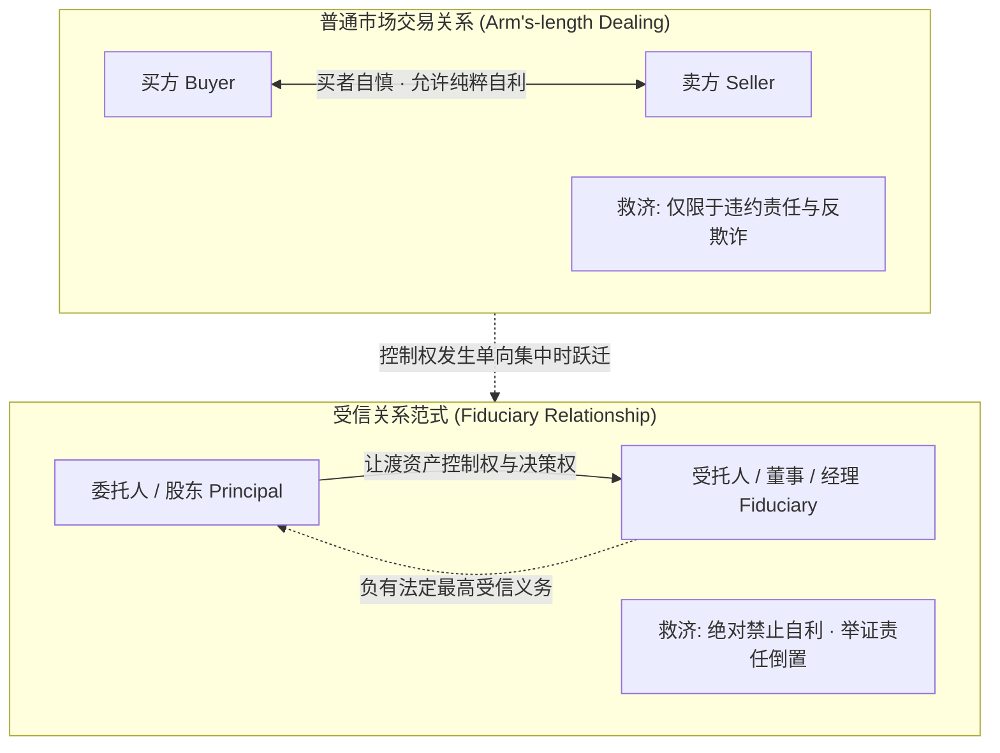
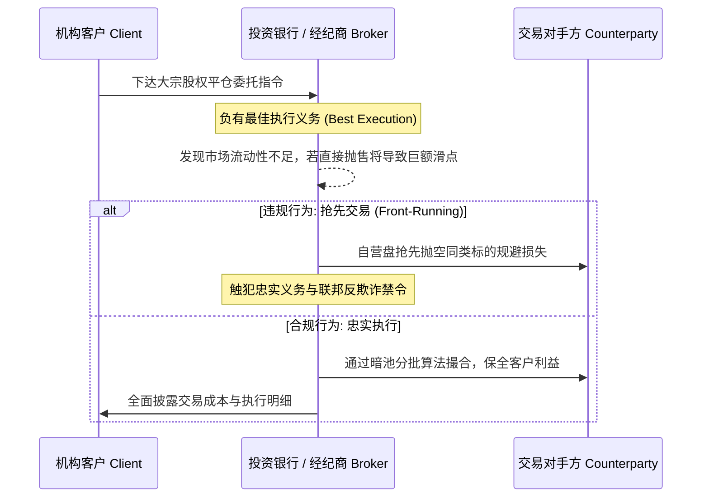

# Lec 1 商业受信义务与受托责任导论 (Introduction & The Law of Duties)

> MIT Sloan 15.617 · The Law of Corporate Finance and Financial Markets · 主讲 Dr. John Akula

## TL;DR

- 资本市场交易与金融契约的核心制度基石是解决所有权与控制权分离引发的代理问题。
- 受信义务（Fiduciary Duties）构成了普通法对高管、董事与财务中介自由裁量权的最高约束。
- 区分普通合同关系的“各怀鬼胎、自担风险”与受信关系的“最高敏感之荣誉准则”。
- 忠实义务（Duty of Loyalty）严禁未披露的利益冲突与自我交易，举证责任由受托人自证完全公允。

## 金融、交易与法律的共生网络

在麻省理工学院斯隆管理学院，15.617（交易、金融与公司法）开篇确立了贯穿全课的核心命题：现代金融资本的高效流转，离不开精密的法律工程架构。无论是数百亿美元的跨国并购（M&A）、杠杆收购（LBO），还是高频对冲基金运作，交易双方在博弈中所追求的经济利益，最终都必须翻译为具有法律执行力的合约权利与义务。

资本市场的一切交易与代理安排，本质上都面临着深刻的**代理人问题（Agency Problem）**。当投资人将数亿美元委托给基金经理，或者股东将跨国公司的经营控制权托付给职业董事会时，受托方拥有巨大的信息优势与处置自由度。普通民商事合同法假定双方平起平坐、自利自担风险（Caveat Emptor）；但当这种假定面对管理层对他人资产的单方控制时，普通合同法的救济机制便捉襟见肘。

如上图所示，当交易形态从横向平等博弈跃迁为纵向代理控制时，英美法系确立了位阶最高的法律规则体系——**受信义务（Fiduciary Duties）**。受托人不再被允许仅仅追求自身利益最大化，而必须将其自由裁量权严格绑定于委托人利益之上。

## 受信义务的双支柱架构

在英美法系中，受托人的法定义务被拆解为两大不可分割的支柱：

| 义务类型 | 核心法律内涵 | 司法审查标准 | 违约法律后果 |
| :--- | :--- | :--- | :--- |
| **忠实义务 (Duty of Loyalty)** | 受托人必须将公司及委托人的利益置于个人利益之上；杜绝一切未经事先充分披露并获独立审批的自我交易 | **内在公允标准 (Entire Fairness)**：受托人承担证明交易在价格与程序上均达到绝对公允的完全举证责任 | 没收全部非法获利（Disgorgement）、交易撤销、设立拟制信托（Constructive Trust） |
| **注意义务 (Duty of Care)** | 受托人在作出重大商业决策时，必须秉持具有通常理性的审慎商人在同类情境下的合理关切，尽职调查并获取充分信息 | **商业判断法则 (Business Judgment Rule)**：推定董事决策出于善意且程序勤勉，除非原告能证明存在重大过失（Gross Negligence） | 董事个人民事赔偿责任（但在多数法域受公司章程免责条款 DGCL § 102(b)(7) 庇护） |

::: definition 忠实义务的核心禁令：绝对杜绝未披露的自我交易
受托人不得处于自身利益与受托责任发生冲突的境地。未经受益人（或无利害关系独立董事多数）在完全知情基础上的独立授权，受托人不得利用受托地位、公司财产或公司信息为自己或第三方谋取任何私利。
:::

### 司法裁量里程碑：*Meinhard v. Salmon*

本杰明·卡多佐（Benjamin Cardozo）大法官在 1928 年针对合伙人受托责任所写下的经典判词，至今仍是全美金融法官审理利益冲突纠纷时的法理圣经：

> “商业世界中许多在寻常市场交易中被允许的自利手段，在受托人之间是严格被禁止的。受托人所受约束的准则，绝非集市上尔虞我诈的寻常道德，而是某种**最为敏感的荣誉准则（A punctilio of an honor the most sensitive）**。唯有通过确立这种毫无妥协余地的严苛标准，法院才能有效维系受托关系的纯洁与崇高。”

卡多佐大法官确立的规则极其冷酷：Salmon 作为掌握日常运营的合伙人，在商业地产租约到期前私自接受房东扩建街区的整体新租约，哪怕 Salmon 投入了个人资金与全部精力，只要他没有在签约前向合伙人 Meinhard 作出**全面、诚实的事先披露**，该商业机会在法律上就属于合伙企业整体，其全部收益必须全额与合伙人均分。

## 代理法与现代金融机构的责任扩散

在现代金融交易中，受信义务不仅存在于企业董事与股东之间，更广泛渗透于投行承销商、资产管理机构、主经纪商（Prime Broker）与客户之间。

如上流程清晰说明：作为经纪商或受托中介，金融机构在撮合资产交易时不仅承担合同约定的技术操作责任，更受到“最佳执行义务（Best Execution）”与“严禁利益冲突”的强行法约束。自营交易与受托资管业务之间的“信息防火墙（Chinese Wall）”若是存在哪怕一丝缝隙，便会瞬间引爆监管调查与客户的巨额民事索赔。

::: pitfall 误以为“合同免责条款可以全额规避受信义务”
在复杂金融交易和有限合伙协议（LPA）中，许多基金发起人（GP）试图在合同文本中写入“合伙人全面放弃一切普通法忠实义务”的霸王条款。特拉华州法律虽然允许在有限合伙（LP）与有限责任公司（LLC）中以合同形式合理限缩受信义务，但**绝对禁止排除诚信与公平交易的默示契约义务（Implied Covenant of Good Faith and Fair Dealing）**！任何包含恶意、欺诈或掠夺性自我交易的免责条款，在法庭上都将被判定为违反强行法而自始无效。
:::

::: insight 信任是资本市场最高昂也是最脆弱的货币
现代金融的魔力，在于能将素不相识的储户与投资者的数万亿美元，交由毫无血缘关系的专业人士运作。这种跨越时空的资金配置效率，完全建立在对受信法律制度的信仰之上。对于未来的交易架构师与金融家而言，敬畏受托责任不是出于道德感化，而是因为深知：一旦击穿了受信义务的法律红线，资本市场将以极速的信用挤兑与严酷的司法清算，彻底剥夺违约者的从业生命。
:::
