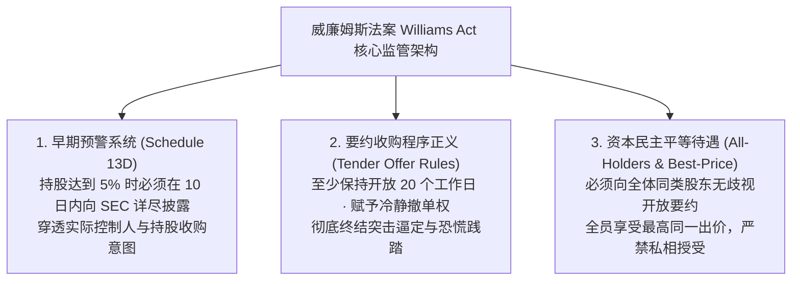
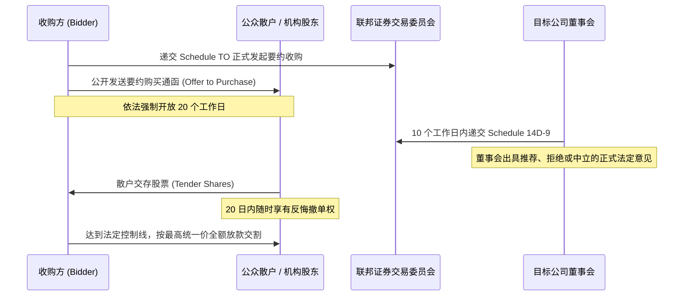

# Lec 10 上市公司收购实务 I：要约收购与威廉姆斯法案 (Buying a Publicly-Held Company I: Tender Offers & Williams Act)

> MIT Sloan 15.617 · The Law of Corporate Finance and Financial Markets · 主讲 Dr. John Akula

## TL;DR

- 上市公司收购遵循极其特殊的公共法律规则：一交割即终局，绝无事后赔偿（Indemnification）与托管金。
- 1968 年《威廉姆斯法案》（Williams Act）终结了华尔街野蛮人突袭时代，构筑信息透明与公平受领秩序。
- Schedule 13D 确立 5% 股权穿透披露天网，遏制袭击者在暗处神不知鬼不觉构筑绝对控股仓位。
- 深度拆解要约收购（Tender Offer）核心规则：20 个工作日底线、最高对价规则与中型合并 DGCL § 251(h)。

## 上市公司收购的独特性：一锤定音的终局世界

收购一家拥有成千上万分散公众股东的上市公司，与收购一家私人家族企业存在本质的天壤之别。在私人并购中，协议交割后通常伴随着长达数年的陈述保证存续期、设立在独立银行账户的托管金（Escrow）以及详尽的违约追索条款。

然而，在上市公司收购中：
1. **绝无事后赔偿机制（No Post-Closing Indemnification）**：一旦资金电汇、股票过户，数以万计的公众散户与共同基金便各自散去，买方根本无法在交割后向散户追讨所谓的“陈述不实赔偿”；
2. **陈述保证在交割瞬间彻底死亡（Reps Terminate at Closing）**：所有的陈述保证唯一的作用仅仅充当“交割先决条件”——若发现造假，买方只能在交割前宣布毁约退单，交割后一切风险自负；
3. **公共证券法规的强行介入**：美国联邦证券法（1934 年证券交易法）与 SEC 制定了密不透风的强行规则，将交易置于全社会的聚光灯下。

## 威廉姆斯法案的诞生背景：终结“星期六晚间特大袭击”

在 20 世纪 60 年代之前，华尔街的掠夺者经常采用极具侵略性的“突袭战术（Saturday Night Special）”：
- 收购方在周五收盘后突然向公众发布通告：“本公司以高于市价 30% 的现金，先到先得收购目标公司 51% 股份，要约截止时间为下周一早八点！”
- 面对巨大的信息空白和恐慌心理，普通股东根本来不及评估公司真实价值，生怕自己落后排在 51% 之外沦为惨遭收割的少数派散户，只能仓皇将股票按折价抛售给袭击者。

针对这种掠夺性强制收购，美国国会于 1968 年雷霆出台了著名的**《威廉姆斯法案》（Williams Act）**，彻底重构了上市公司收购的游戏规则。

## Schedule 13D：资本大鳄的隐形斗篷在此失效

威廉姆斯法案的核心支柱之一是 1934 年法案第 13(d) 条款：

::: definition Schedule 13D 详式大额持股披露规则
任何个人或联合行动人（Group），一旦直接或间接取得一家上市公司**超过 5% 的有表决权普通股**，必须在达到门槛后的 **10 个日历日之内（SEC 新规限缩为 5 个工作日）**，向 SEC 提交详尽的 **Schedule 13D 报告**并向公众公开：
1. 申报人的真实身份与最终受益所有人（Beneficial Owners）；
2. 购买该等股份的资金来源（自有资金还是杠杆借款）；
3. **持股的核心战略目的（Purpose of the Transaction）**：究竟是纯粹被动财务投资，还是计划谋求董事席位、合并公司、撤换管理层或推动资产剥离。
:::

一旦跨过 5% 的警戒线，掠夺者的战略意图将大白于天下。目标公司管理层在获得预警后，即可立即启动毒丸防御计划，或寻找竞争买家展开白热化竞标。

## 要约收购（Tender Offer）的核心法定规则

当买方决定绕开目标公司董事会直接向全体公众股东发出买股呼吁时，必须严格遵守以下法则：

| 规则名称 | 联邦法规条款 | 核心法律要求与防范风险 |
| :--- | :--- | :--- |
| **最低存续期规则** | Rule 14e-1(a) | 要约必须自发出之日起，面向全体股东**持续开放至少 20 个完整工作日**；任何重大提价或条款修改，必须额外展期至少 10 个工作日 |
| **冷静撤回权 (Withdrawal Rights)** | Rule 14d-7 | 在要约开放的整个 20 个工作日期间，**已经交存股票的股东有权随时无条件反悔撤回其股票**，防范股东在恐慌中草率受领 |
| **全员平等要约规则 (All-Holders Rule)** | Rule 14d-10(a)(1) | 要约收购必须平等面向目标公司**同类股票的每一位持有人**开放，严禁针对特定友好股东定向要约 |
| **最佳价格规则 (Best-Price Rule)** | Rule 14d-10(a)(2) | 在要约期间向任何股东支付的每股价格，**必须自动全额适用于在要约中接受收购的任何其他股东**；买方若在最后一天提价，之前所有交股者同等享受最高价 |
| **比例受领规则 (Pro-Rata Rule)** | Rule 14d-8 | 若要约仅收购 51% 股权，而实际交存股票达到 80%，买方严禁按“先到先得”排队，**必须严格按比例均等受领每一位股东的股票** |

## 两步要约合并：DGCL § 251(h) 的提速革命

在传统并购实践中，要约收购往往伴随着一个极具杀伤力的两步走难题：
- **第一步**：买方通过要约收购，买下了目标公司 65% 的股份成为控股股东；
- **第二步**：买方为了吃掉剩余 35% 钉子户股份，必须召开目标公司股东大会进行二步吸收合并。

在过去，准备股东大会、撰写冗长代理声明书（Proxy Statement）并接受 SEC 审查，至少耗时三个月之久，导致买方背负沉重的过桥贷款利息风险。为了彻底破局，特拉华州公司法于 2013 年通过了划时代的 **DGCL § 251(h)** 修正案：

::: theorem DGCL § 251(h) 快速中型合并通道
在友好达成合并协议的前提下，只要买方在第一步公开要约收购中成功获得了**足以通过合并方案所需的法定最低表决股份比例（通常为 50.1%）**：
- **买方依法完全无需召集任何股东大会！**
- **买方有权在要约交割完成的同一天，直接以法定合并方式强制将所有剩余股份注销**，并向未交股股东发放同等现金对价！
:::

这一制度创新将上市公司友好收购的交割周期从半年压缩至短短 25 个工作日，使两步要约合并一跃成为美股并购最主流的提速利器。

::: pitfall 忽视“附带补偿”对最佳价格规则（Best-Price Rule）的引爆
在要约收购谈判中，买方经常向目标公司的创始人或兼任高管承诺：“交割后继续留任并享有天价留任奖金或顾问费”。在过去，激进对冲基金律师常常据此向法院起诉，主张该天价顾问费实质上是对高管股票的隐蔽提价，严重触犯了最佳价格规则，要求法院强制买方将等额差价补发给全体公众股东！如今虽然 SEC 修改了 Rule 14d-10(d) 确立了薪酬委员会独立核验的避风港，但任何未经独立薪酬委员会专业论证的私下利益输送，依然会引发数十亿美元的级联诉讼。
:::

::: insight 信息对称是资本公义的唯一起点
威廉姆斯法案的灵魂，从来不是阻碍控制权市场的优胜劣汰，而是将阳光引入原本充满弱肉强食与密谋欺诈的资本深渊。在强大的证券监管网络下，资本大鳄可以凭借真金白银公开叫价，而最弱小的散户也能获得充分的时间与透明的信息从容抉择。唯有建立在程序正义与信息充分基础之上的资本流转，才能真正释放现代金融催生繁荣的伟大力量。
:::
