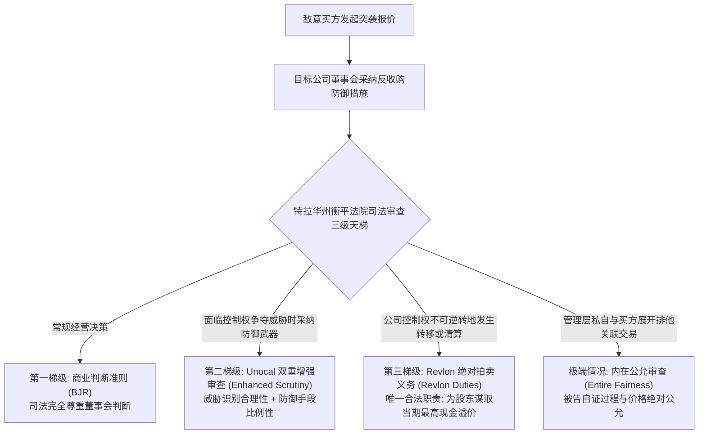
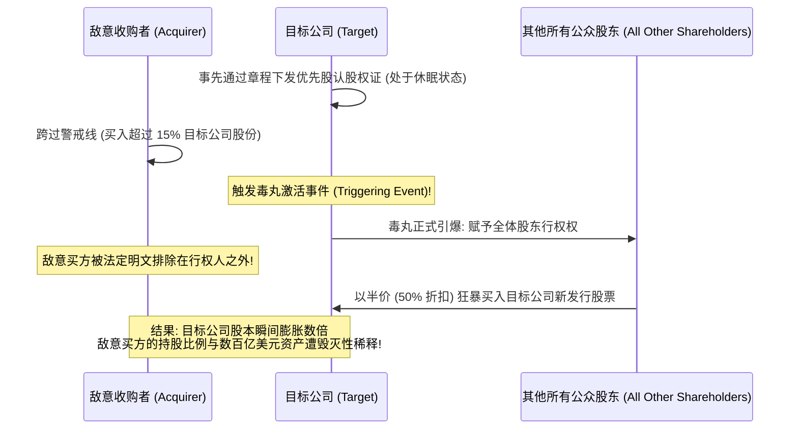
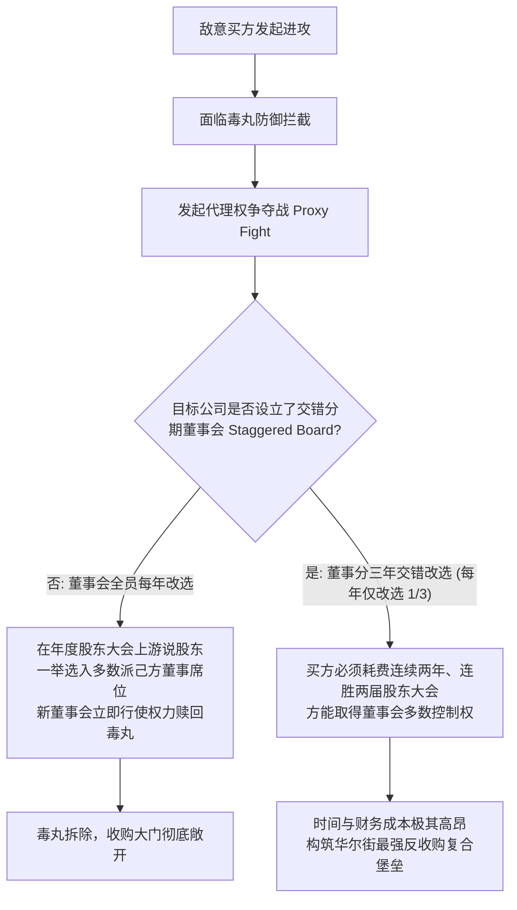

# Lec 11 上市公司收购实务 II：敌意收购、毒丸计划与特拉华审查标准 (Buying a Publicly-Held Company II: Hostile Takeovers & Defensive Duties)

> MIT Sloan 15.617 · The Law of Corporate Finance and Financial Markets · 主讲 Dr. John Akula

## TL;DR

- 敌意收购是资本市场最残酷的权力搏杀，目标公司董事会在防御时面临深刻的“自保位育（Entrenchment）”利益冲突。
- 特拉华州法院确立司法审查三级天梯：商业判断准则（BJR）、双重增强审查（*Unocal*）与最高出价拍卖义务（*Revlon*）。
- 深入解剖毒丸计划（Poison Pill）：Flip-in 与 Flip-over 稀释机制如何构筑让任何掠夺者瞬间消化不良的核武防线。
- 代理权争夺（Proxy Contest）与交错分期董事会（Staggered Board）的攻防博弈构成了击穿毒丸防御的唯二解法。

## 敌意收购与董事会利益冲突的深层矛盾

当收购方绕过目标公司管理层、不顾董事会的明确反对，强行向全体股东发起要约收购或代理权争夺战时，一场惊心动魄的**敌意收购（Hostile Takeover）**便正式打响。

在这类极端对抗中，公司法面临着最深刻的法理撕裂：
- 一方面，现任董事会作为全体股东的受托人，有权且有责任抵御低价掠夺、保护公司的长期战略发展规划；
- 另一方面，一旦敌意收购成功，现任董事与高管几乎必然面临被集体解雇、丧失丰厚薪酬与社会地位的结局。董事会所采取的一切反收购抵御措施，究竟是为了保护股东利益，还是为了**保住自身官位（Management Entrenchment）**？

## *Unocal* 双重增强审查标准：防御措施的合法界限

在 1985 年标志性的 *Unocal Corp. v. Mesa Petroleum Co.* 案中，特拉华州最高法院清醒地看到了董事会防御行为中潜藏的自利动机，断然拒绝直接适用宽松的商业判断准则，创立了著名的**双重增强审查标准（Unocal Standard）**：

::: theorem *Unocal* 双重增强审查要件
目标公司董事会要想证明其反收购防御手段合法，必须承担举证责任证明以下两点：
1. **合理威胁的存在（Reasonable Grounds for Believing a Threat Existed）**：
   董事会必须在经过善意和合理调查（Good Faith and Reasonable Investigation）之后证明，收购方的提议对公司的企业政策与股东利益构成了实质性威胁（如掠夺性削价、胁迫性两阶梯要约或对公司长期战略的破坏）；由**独立董事占多数**的董事会批准是满足本要件的关键证据；
2. **防御手段的比例性（Proportionality Review）**：
   董事会所采取的防御手段必须与该威胁的性质和严重程度保持**合理的比例平衡（Reasonable in Relation to the Threat Posed）**；防御措施绝不能具有**强制性（Coercive）**或**彻底封死性（Preclusive）**，不能彻底剥夺股东未来在代理权竞争中进行投票表决的民主权利。
:::

## 华尔街终极核武器：毒丸计划（Poison Pill）的精密解剖

由传奇交易律师马丁·利普顿（Martin Lipton）发明的**股东权利计划（Shareholder Rights Plan，俗称“毒丸计划”）**，被公认为现代公司治理史上最具杀伤力的防御武器。

毒丸计划的核心在于让掠夺者在吞下目标公司的瞬间“消化不良、毒发身亡”：
1. **内翻毒丸（Flip-in Pill）**：一旦任何收购主体未经董事会事先批准，买入股票跨越了设定的门槛（通常为 10% 至 15%），除该收购者之外的**所有其他股东均享有以半价（50% 折扣）认购公司巨额新增普通股的特权**。收购者持有的股份比例将被瞬间从 15% 稀释至 3% 以下，收购成本呈几何级数暴增；
2. **外翻毒丸（Flip-over Pill）**：若收购者在跨过门槛后强行将目标公司吸收合并入自身母公司，毒丸权利转为：除该买方之外的全体原股东，**有权以半价狂暴购买买方母公司的普通股股票！**直接将致命毒液反向注入掠夺者自身的母体。

由于毒丸的稀释效应在数学上是不可承受的毁灭性打击，自诞生至今，**华尔街没有任何一位理性的掠夺者敢于在未经董事会赎回毒丸的前提下强行触发毒丸！**

## *Revlon* 规则：从战略防御向拍卖师角色的终极蜕变

董事会是否可以凭借毒丸计划永久抵御一切收购？答案是否定的。特拉华州最高法院在 *Revlon, Inc. v. MacAndrews & Forbes Holdings, Inc.* (1986) 案中划定了董事会权力的绝对终点：

::: theorem *Revlon* 绝对出价最大化义务（Revlon Duties）
当目标公司董事会认识到公司的出售、分拆或控制权变更已经不可避免（Incredible / Inevitable）时，**全体董事的核心角色立即发生根本性突变——从抵御外敌的“公司城堡卫士”，转变为替全体股东争取最高清偿价值的“拍卖师（Auctioneer）”！**
此时：
- 董事会的一切长期战略规划、员工利益考虑、客户情感统统必须退居二线；
- 董事会唯一的法定受托职责，就是**以最理性、最充分竞争的方式，为全体股东争取当时合理可获得的最高当期现金对价（Highest Transaction Value Reasonably Available）**；
- 董事会严禁利用毒丸计划私相授受偏袒特定的“白衣骑士（White Knight）”，必须向所有合格竞标者开放公平透明的竞拍通道。
:::

## 击穿防御的唯一通路：代理权争夺与交错董事会

既然毒丸计划坚不可摧，敌意买方究竟如何破局？唯二的解法是将法律战与资本民主相结合：

正如现代公司治理实证研究所揭示：**“毒丸计划 + 交错分期董事会（Staggered Board）”的组合**，是抵御一切外部敌意收购最难以攻破的马奇诺防线。

::: pitfall 盲目签署含有“死手毒丸（Dead-Hand Pill）”的违法条款
在 20 世纪 90 年代末，一些公司为了防止股东改选董事会拆除毒丸，设计出了“死手毒丸（Dead-Hand Pill）”与“慢手毒丸（Slow-Hand Pill）”——约定毒丸只能由最初采纳它的那届老董事赎回，新选出的董事无权拆解。特拉华州最高法院在 *Quickturn* 案中坚决裁定：**死手毒丸严重非法剥夺了新任董事法定的自由裁量权与受托责任，自始绝对无效！**
:::

::: insight 控制权市场的动态博弈是商业繁荣的生命线
特拉华州公司法的非凡伟大，就在于其在保护长期创业远见与防范管理层腐败僵化之间建立起了近乎神圣的动态平衡。它用毒丸计划赋予董事会从容抵御短期资本收割的坚固盾牌，但又通过 *Revlon* 规则与代理投票机制为资本民主保留了最终罢免昏聩者的利剑。正是这种在攻守之间保持的极度张力，维系了美国资本市场半个世纪以来经久不衰的活力与生机。
:::
