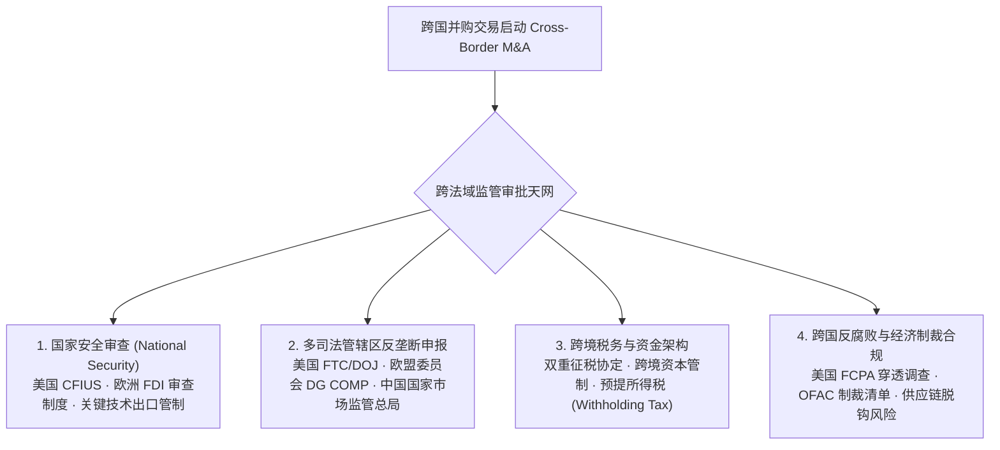
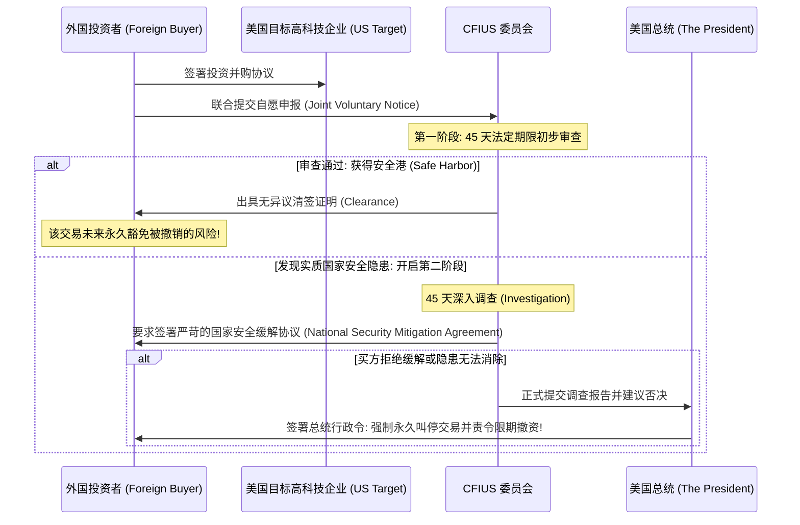

# Lec 12 跨国并购、合资企业与国家安全审查 (International M&A, Joint Ventures & CFIUS)

> MIT Sloan 15.617 · The Law of Corporate Finance and Financial Markets · 主讲 Dr. John Akula

## TL;DR

- 跨国并购不仅面临商业文化的碰撞，更受到多法域反垄断、外汇管制与跨国合规的重重绞杀。
- 美国外国投资委员会（CFIUS）与 FIRRMA 法案确立了全球最严苛的国家安全审查天网，拥有总统级一票否决权。
- 合资企业（Joint Venture）是化解跨国准入限制的经典载体，其成败核心取决于精密的僵局化解机制（Deadlock Provisions）。
- 《反海外腐败法》（FCPA）在跨国交易中具有致命的继承责任（Successor Liability），详尽前置调查不可或缺。

## 跨国并购的独特暗礁：主权意志与跨法域撕裂

当并购交易跨越主权国家的地理边界时，纯粹商业逻辑的算盘往往在国家安全、地缘政治与产业保护政策面前被击得粉碎。近年来，无论是半导体产业链、人工智能、生物医药还是新能源领域，跨国并购的难度与合规审查周期呈指数级攀升。

一家跨国收购方必须在签约前精确协调全球多维度的监管阻力：

在经济全球化与地缘政治博弈交织的当代背景下，跨国并购的法律复杂性早已超越了单纯的合同起草范畴。跨国买家不仅要面对目标国当地工会、劳工保护法规与企业文化的深层碰撞，更要承受来自多国监管部门的重重围堵。特别是在反垄断申报领域，不同司法辖区对于市场集中度的界定与救济措施（如剥离特定业务线）可能存在严重冲突。

更深层的挑战来自于国家安全概念的无限泛化。过去仅局限于军工与国防采购的传统安全审查，如今已全面渗透至尖端半导体、量子计算、生物制药以及涵盖数亿用户的社交平台与大数据服务。一旦交易被目标国监管机构贴上“危害国家安全”的标签，任何精巧的商业闭环都将瞬间化为乌有。企业在制定全球化战略时，必须将地缘法律合规置于核心战略评估的首位。

如上图所示，任何一个主权国家监管机构的否决，都足以导致全盘交易瞬间流产，并触发高达数亿美元的**反向分手费（Reverse Break-up Fee）**。

## 全球最强投资审查哨卡：CFIUS 与 FIRRMA 体系

在所有跨国投资壁垒中，美国外国投资委员会（Committee on Foreign Investment in the United States, CFIUS）是最令全球跨境买家敬畏的监管中枢：

::: definition CFIUS 的法定职权与运作机制
CFIUS 是一个由美国财政部牵头、跨越国防部、司法部、国土安全部等 16 个联邦部门的跨部会联合机构。根据 2018 年《外国投资风险审查现代化法案》（FIRRMA），其核心管辖权覆盖：
1. **控制权交易**：外国投资者取得任何美国企业“控制权”的交易；
2. **非控制权但涉及敏感核心领域的投资（TID 业务）**：哪怕外国资本仅持有 1% 的微小股权、只要获得了获取**关键技术（Technology）**、参与**关键基础设施（Infrastructure）**运营、或接触美国公民**敏感个人数据（Data）**的权利，即自动触发 CFIUS 管辖！
:::

如果外国买方选择“赌一把”不向 CFIUS 主动申报，CFIUS 拥有**无限期的事后追溯管辖权**！历史上曾有多起外国资本在收购美国科技公司数年之后，被 CFIUS 突击立案调查并由总统下令强制全额剥离资产的惨痛先例。

## 合资企业（Joint Venture）的治理精粹与僵局化解

当目标国法律对外国资本控股实施强制性准入限制（例如要求本国资本必须持有 51% 股权），或者双方意图通过优势互补共同开拓新市场时，**合资企业（Joint Venture, JV）**成为了跨国商业合作的最核心载体。

然而，合资企业被称为商业世界中“最容易破裂的婚姻”。由于双方各自拥有强大的母体集团，战略重心一旦发生分歧，50:50 的股权对等架构将不可避免地陷入彻底的**决策僵局（Deadlock）**。

| 僵局化解条款名称 | 运作机制与执行逻辑 | 适用场景与制度威力 |
| :--- | :--- | :--- |
| **俄罗斯轮盘赌 (Russian Roulette / Shotgun)** | 股东 A 向股东 B 提出以每股 \$X 的价格购买其全部股权；**股东 B 必须在规定期限内二选一：要么按该价格将自己的股权卖给 A，要么以完全相同的每股 \$X 价格将 A 的股权全额买下！** | 极度考验双方对企业价值的真实定价与现金流动性；有效防止出价方恶意压低估值 |
| **德州枪战 (Texas Shoot-out / Auction)** | 双方分别向独立第三方托管人提交一份不公开的密封收购报价；**出价最高的一方，必须强制按自身所报的最高价现金买断另一方的全部股权！** | 适合双方资金实力雄厚、均极度渴望获得企业绝对控制权的对决场景 |
| **独立调解与升级阶梯 (Escalation to CEOs)** | 发生僵局后，首先在 30 天内交由双方母集团的最高首席执行官（CEO）展开一对一面谈；若仍无法达成一致，方可触发退出或清算 | 滤除基层运营人员的情绪摩擦，为合作保留最高层面的战略政治缓冲 |

## 跨国追责的红色风暴：FCPA 继承责任（Successor Liability）

美国《反海外腐败法》（Foreign Corrupt Practices Act, FCPA）是跨国并购中毁灭性极强的隐形地雷。根据美国司法部（DOJ）的执法先例，**并购不仅承接标的公司的资产，更依法继承其在交割前实施的一切海外行贿违法责任（Successor Liability）**！

::: pitfall 忽视并购尽调中的 FCPA“原罪传染”
若一家欧洲跨国巨头以 20 亿美元收购了一家在东南亚拥有大量基建项目的工程公司。交割后六个月，DOJ 查出该标的公司在并购前曾向当地政府官员行贿以获取特许经营权。哪怕该收购方在交割前对此完全不知情，**DOJ 依然会以继承责任为由向合并后的集团处以数亿美元的天价刑事罚款，并由法院强制指派外部独立合规监督官（Compliance Monitor）进驻总部长达三年**！
:::

因此，在任何跨国并购最终协议中，买方必须设置极其严苛的前置排查机制：
1. **专项 FCPA 陈述与保证**：覆盖所有第三方中介代理人（Agents）的聘用合规性；
2. **反向排他交割条件**：一旦在尽调中发现系统性行贿证据，买方保留无条件撤出交易且不承担任何赔偿的特权。

::: insight 商业智慧的边界，在于对主权政治规则的深层敬畏
跨国商业博弈的终极魅力，在于它从不单单是一场资产定价的数字游戏，而是一次在不同文明、法治传统与国家地缘利益缝隙中的惊险穿行。真正伟大的跨国交易架构师，既要在商业条款上锱铢必较，又要有俯瞰全球地缘政治天际线的从容气魄。唯有将对国家主权规则的敬畏内化为严密的合规基因，跨国商业资本才能在全球化的惊涛骇浪中行稳致远。
:::
