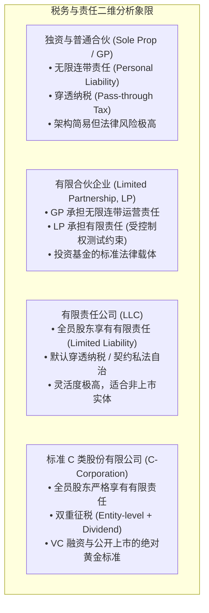
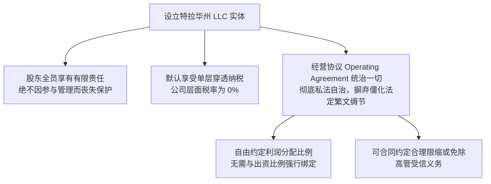
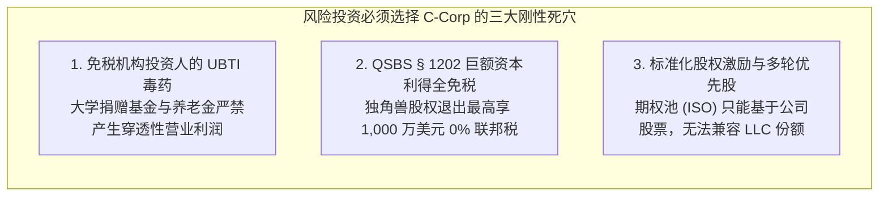

# Lec 13 企业组织形式选择与穿透实体 (Forms of Doing Business: Partnerships, LLCs & Corporations)

> MIT Sloan 15.617 · The Law of Corporate Finance and Financial Markets · 主讲 Dr. John Akula

## TL;DR

- 商业组织形式的选择是企业法律基因的奠基，直接决定有限责任边界、税务负担与资本扩张潜力。
- 普通合伙（GP）具有无限连带责任的致命硬伤；有限合伙（LP）确立了 GP 运营与 LP 纯财务出资的二元架构。
- 有限责任公司（LLC）融合了公司层面的有限责任与合伙层面的穿透纳税（Pass-through），私法自治空间极大。
- 为什么科技独角兽与 VC 资本必须选择特拉华州 C-Corp：标准股权期权池、多轮优先股与规避免税机构的 UBTI 限制。

## 企业的法律基因库：组织形态四象限

在开启任何商业冒险或设立投资基金之前，创始人与投资家面临的第一个制度抉择，就是为企业挑选何种法律载体。法律实体的选择绝不是简单的工商行政登记，它在底层深度绑定了企业的责任防火墙、利润分配机制、现金流征税方式以及未来的股权激励通道。

英美商业实体法历经百余年演化，形成了横跨“有限责任”与“穿透纳税”的完备光谱：

从制度成本与发展潜力的维度审视这四种法律容器，商业领袖必须跳出短期行政规费的狭隘视角。组织载体的选择实质上是在企业内部权力的集中与制衡之间做出的战略权衡。独资与普通合伙虽然几乎零设立门槛，但无限连带责任的利剑始终高悬在所有参与者的头顶，任何一次偶发的生产事故或员工侵权都足以彻底摧毁创始人的家庭财富。

而对于志在涉足多轮机构融资、股权激励与资本市场运作的企业家而言，特拉华州 C-Corporation 展现出无与伦比的制度生命力。股份有限公司历经数百年的严密司法检验，其股份的可自由转让性、法定法人独立资格、永久存续属性以及清晰的董事会受托治理结构，为全球资本的大规模无摩擦流入提供了最高级别的安全庇护。

在上述四象限中，商业法律的核心发展脉络，就是不断尝试在“降低投资者责任风险”与“避免政府两道抽税”之间寻找最优平衡点。

## 传统合伙企业的缺陷与有限合伙（LP）的崛起

在最原始的普通合伙（General Partnership）中，法律将合伙人视为彼此的法定代理人。这意味着任何一个合伙人在合伙业务范围内的鲁莽举动或侵权债务，**所有合伙人必须以个人全部身家财产承担连带清偿责任！**这种连带责任的毁灭性，催生了**有限合伙（Limited Partnership, LP）**的诞生：

| 实体角色 | 法律责任承担 | 经营管理权力与行为边界 |
| :--- | :--- | :--- |
| **普通合伙人 (General Partner, GP)** | **无限连带责任**；对合伙企业的全部债务承担终极清偿义务 | 享有对合伙企业日常业务运营与投资决策的**独家垄断控制权** |
| **有限合伙人 (Limited Partner, LP)** | **有限责任**；仅以其认缴的出资额为限承担风险 | **纯粹被动投资人**；严禁参与合伙企业的日常管理与控制 |

::: definition 控制权测试准则（The Control Rule）
在传统有限合伙法中，若一名有限合伙人（LP）按捺不住，直接插手合伙企业的日常经营、发号施令或签署合同，一旦第三人在合理信赖下认定该 LP 具备控制权，**法院将直接剥夺其有限责任特权，强制其就相关债务承担与 GP 完全同等的无限连带责任！**
:::

现代金融实践通过精密的嵌套架构彻底化解了 GP 的个人风险：**发起人设立一家特拉华州 LLC 或 C-Corp 来担任基金的 GP**，从而将无限责任完全封印在空壳法人实体内部。

## 有限责任公司（LLC）：现代私法自治的王冠

20 世纪 70 年代末诞生于怀俄明州、并在 90 年代席卷全美的**有限责任公司（Limited Liability Company, LLC）**，被誉为美国实体法最伟大的制度创新。

LLC 的宪法是其**经营协议（Operating Agreement）**。与股份有限公司受制于特拉华普通公司法（DGCL）成文法条的严苛规训不同，LLC 法律奉行极度的契约自由：
1. **利润分配自由**：出资 10% 的技术合伙人，可以通过协议明文约定享有 50% 的经营利润分配权；
2. **免受繁琐手续打扰**：无需强制召开年度股东大会、无需设立固定席位的董事会，管理形式完全由当事人自由定制。

## 独角兽悖论：为什么风险投资（VC）对 LLC 敬而远之？

既然 LLC 既能有限责任又能避免双重征税，为什么几乎所有的科技独角兽（如 Uber、Airbnb）和顶尖 VC（如红杉、Andreessen Horowitz）在投资时，都无一例外地强制要求企业设立为特拉华州 **C-Corporation**？

如上图所示，这一选择由三个底层金融现实所决定：
1. **未关联商业应税所得（UBTI）封杀**：VC 基金背后最大的金主是哈佛/斯坦福等大学捐赠基金与公共养老金。作为免税实体，它们如果投资了穿透纳税的 LLC，将被国税局强行课征惩罚性的 UBTI 商业税，因此基金合同明文禁止直投 LLC；
2. **合格小企业股票（QSBS, IRC § 1202）**：对于创立初期净资产低于 5,000 万美元的 C-Corp，投资人持有股票满 5 年后出售，**前 1,000 万美元资本利得享受 100% 联邦免税待遇！**这是资本市场最诱人的税务红包；
3. **可预测性与标准化**：特拉华州普通公司法拥有上百年的成文判例，任何优先股清算、董事会决议的法律效力高度确定，而每一份 LLC 经营协议都是非标定制合同，机构资本无法承受逐字审查上百份个性化非标协议的尽调成本。

::: pitfall 创业早期草率设立 S-Corp 带来的融资阻碍
许多本土创始人为了省税设立了 S-Corporation。但联邦税法严厉规定：S-Corp 股东不得超过 100 人、**股东必须全员为美国公民或税法居民、严禁任何机构或法人入股、且只能发行单一种类的普通股！**当海外资本、风险投资基金或意图发行 Series A 优先股的机构介入时，S-Corp 架构将立即触法爆雷，迫使企业承担昂贵复杂的税务重组成本。
:::

::: insight 组织架构是商业抱负的第一张无声名片
实体的选择，本质上是企业商业蓝图的基因投影。如果你创办的是一家追求稳定现金流分红的咨询顾问律所、房地产投资平台或家族私塾，特拉华 LLC 是无可争议的省税神器；但如果你怀揣着打造下一个科技巨头、吸引全球顶级风险投资并最终叩响纽交所大钟的宏伟梦想，特拉华 C-Corp 则是你必须支付制度成本、但能换取无限资本杠杆的唯一通道。
:::
