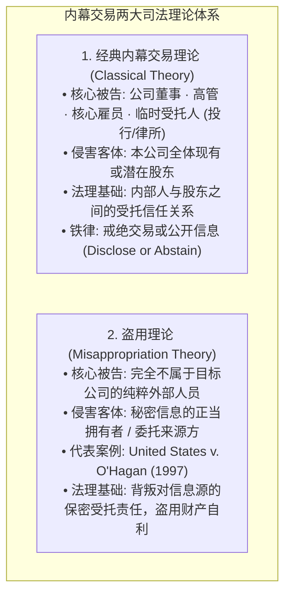
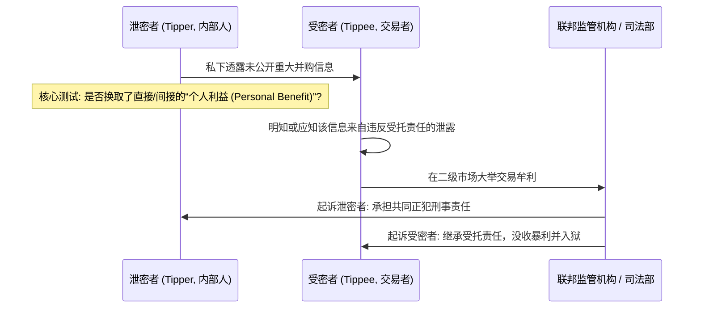

# Lec 14 公众公司运作 I：内幕交易理论与 10b-5 规则 (The Publicly-Held Corporation I: Insider Trading & Rule 10b-5)

> MIT Sloan 15.617 · The Law of Corporate Finance and Financial Markets · 主讲 Dr. John Akula

## TL;DR

- 1934 年《证券交易法》第 10(b) 条与 SEC Rule 10b-5 构成了全美资本市场反欺诈的最高纲领。
- 内幕交易经典理论（Classical Theory）规训企业内部人对本公司股东的受托信息披露义务。
- 盗用理论（Misappropriation Theory, *O'Hagan* 案）将反欺诈天网扩展至侵犯外部信息来源方信任的外部人员。
- 重大非公开信息（MNPI）认定遵循概率与幅度测试（*Basic* 案）；Rule 10b5-1 预先交易计划是高管的法定防火墙。

## 资本市场的反欺诈宪法：Rule 10b-5 的诞生与演进

美国联邦证券法典中，没有任何一条规则能像 1934 年《证券交易法》第 10(b) 条及其下属的 **SEC 规则 Rule 10b-5** 那样，对全球金融市场的交易行为产生如此深远而持久的统治力。

令人惊叹的是，国会在 1934 年立法时，全篇法条甚至从未出现“内幕交易（Insider Trading）”这四个字。现代内幕交易的庞大判例体系，完全建立在 SEC 规则中那段宽泛严谨的概括性反欺诈禁令之上：

::: definition SEC 规则 Rule 10b-5 的核心禁令
任何人直接或间接利用任何州际商业工具、邮件或全国性证券交易所设施，就任何证券的买卖实施下列行为均属联邦违法：
1. 使用任何欺诈手段、计谋或花招；
2. **对重大事实作出任何不实陈述（Misstatement），或者遗漏了为使该陈述在当时情境下不致产生误导所必需的重大事实（Omission）**；
3. 从事任何在实质上产生或意图产生欺诈结果的行为、实务或业务活动。
:::

正是借助这一开放式的法律授权，联邦法院在过去半个世纪中，将利用重大非公开信息谋取不当交易暴利的行为，全面定性为违反对投资公众或信息源受托信义义务的严重联邦证券欺诈。

## 内幕交易的两大传世司法理论

联邦最高法院在数十年激烈的司法博弈中，确立了打击内幕交易的两大并行理论支柱：



### 1. 经典理论（Classical Theory）
以首席执行官、首席财务官或负责重组的投资银行家为代表。高管因受托地位获得了公司尚未公开的重磅利好信息（如巨额盈利或被溢价收购）。内部人若在信息公开前私下在公开市场吸筹，或者在利空爆发前抛盘套现，其行为在法律上构成对股东受托责任的严重背叛。其法定底线是：**要么向市场彻底公开信息，要么绝对戒绝进行任何交易（Disclose or Abstain）！**

### 2. 盗用理论（Misappropriation Theory）与 *O'Hagan* 案里程碑
在 1997 年震撼全美的 *United States v. O'Hagan* 案中，被告奥哈根是一家顶尖律所的资深合伙人。该律所受聘担任英国大急流（Grand Met）拟敌意收购 Pillsbury 公司的买方法务顾问。奥哈根个人完全未参与该项目，且其本人及所属律所对目标公司 Pillsbury 及其股东**不负有任何受托责任**。奥哈根私下偷听到了收购机密，在二级市场疯狂建仓买入 Pillsbury 股票和看涨期权，在交易公开后狂赚 430 万美元净利润。

联邦最高法院最终确立了**盗用理论**：
- 奥哈根虽然不对目标公司股东负有受信义务，但他对其所在律所及律所客户负有严格的保密与忠实义务；
- 公司的未公开战略机密属于公司的专属专有财产；**奥哈根背着客户与律所，秘密盗用这一专有财产用于个人二级市场投机，构成对信息来源方的恶意欺骗（Deception）**，毫无争议地触犯了 Rule 10b-5！

## 泄密者与受密者责任（Tipper / Tippee Liability）

如果内部人自己不买股票，而是将机密“透露”给高尔夫球友或对冲基金经理，法律责任如何划分？联邦最高法院在 *Dirks v. SEC* (1983) 案中确立了经典的判定法则：



根据 *Dirks* 规则，受密者承担内幕交易责任必须同时满足两个互为前提的要件：
1. **泄密者必须实质违反了受托责任**：证明泄密者通过泄露信息获得了某种直接或间接的**“个人利益（Personal Benefit）”**（包括金钱回报、商业声誉提升、甚至是向有亲密关系的亲朋好友赠送有价值的商业机密）；
2. **受密者明知或应知该泄露构成了违信行为**：且受密者依然利用该信息进行了交易。

## 什么是重大非公开信息（MNPI）？

并非任何未公开的风吹草动都属于受法律惩戒的内幕信息。信息必须具备两大核心属性：

::: theorem 重大非公开信息（MNPI）的法律测试
1. **非公开性（Non-Public）**：信息尚未通过官方新闻通稿、SEC 8-K 披露文件或全国性主流财经媒体向广大投资公众充分扩散，且市场尚未有合理时间吸收消化；
2. **重大性（Materiality, *TSC Industries* 标准）**：如果一名理性的普通投资者在作出买入、卖出或持有决策时，**有极大的实质可能性（Substantial Likelihood）会认为该事实是重要的**；
3. **推测性事件的概率/幅度折现公式（*Basic Inc. v. Levinson*）**：
   $$	ext{重大性} = 	ext{事件发生的客观概率（Probability）} 	imes 	ext{事件一旦发生对全公司的财务与经营冲击幅度（Magnitude）}$$
:::

根据上述折现逻辑，哪怕一项价值 100 亿美元的跨国重组谈判目前仅处于极其早期的初步接触阶段（发生概率仅为 20%），但由于一旦成交对公司估值的冲击将是翻天覆地的（冲击幅度极大），两项相乘依然在法律上被直接认定为**具备高度重大性（Highly Material）**！任何人此时买卖股票均属违法。

## 高管的免死金牌：SEC Rule 10b5-1 预先交易计划

公众公司的高管几乎一年 365 天都处于知晓各类未公开业绩数据的“内幕人”状态。若彻底禁止交易，高管将无法合法套现其薪酬中占据大头的股票期权以支付税款或购买住宅。为了解决这一两难，SEC 制定了著名的避风港制度——**Rule 10b5-1 交易计划**：

```mermaid
graph TD
    A[高管在完全不知晓任何 MNPI 的窗口期] --> B[设立书面具有不可撤销性的 10b5-1 计划]
    B --> C[将交易指令完全托付给独立外部经纪商<br/>预先写死严格的数学算法公式<br/>(例如: 每月首个交易日无论涨跌自动出售 5,000 股)]
    C --> D[高管彻底丧失对后续具体交易的任何自由裁量权]
    D --> E[严守法定冷静期 Cooling-off Period<br/>董事与高管设立计划后至少等待 90-120 天方可首笔交易]
    E --> F[未来即便交易发生在前夜爆雷前夕<br/>高管依法享有无懈可击的绝对免责抗辩权!]
```

只要该计划是在善意且毫无内幕信息的窗口期内订立，哪怕未来某笔股票自动抛售发生在公司发布巨亏财报的前一天，高管依法享有绝对的民事与刑事责任豁免。

::: pitfall 随意修改或终止 10b5-1 计划引爆刑事起诉
很多投机高管在设立了 10b5-1 计划后，一旦私下探知公司即将发布超越预期的重磅利好，便私下打电话给经纪商要求“紧急暂停本周的卖出计划”。这种随意取消或微调计划的行为，在 SEC 与联邦检察官眼中直接被判定为**恶意操纵计划的虚假伪装（Sham）**，直接导致整个 10b5-1 避风港全盘瓦解，高管将直接面临大陪审团以证券欺诈罪名起诉！
:::

::: insight 市场的生命，在于对信息披露公正底线的敬畏
资本市场从来不承诺所有人在商业眼光或分析智力上平起平坐，但它必须保证所有人站在同一条起跑线上起跑。允许掌握特权内幕信息的人在暗处肆意收割毫不知情的公众投资人，无异于在全社会的赌场中公然出千。Rule 10b-5 的威严不仅是悬在贪婪者头顶的一柄利剑，更是现代文明资本主义保护全社会信任基石的最强盾牌。
:::
