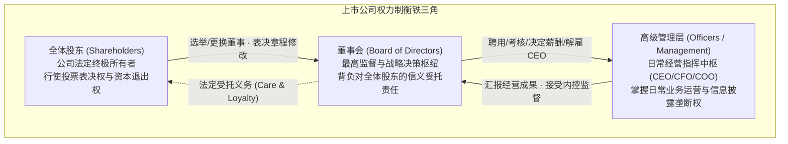
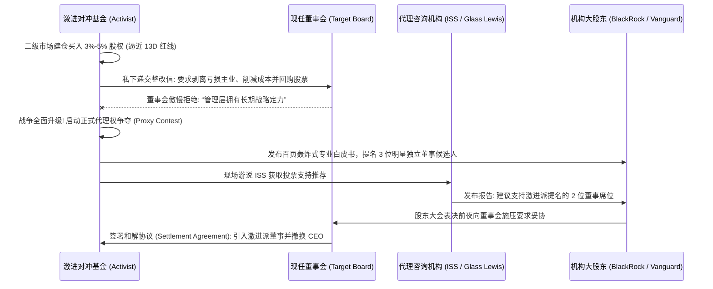

# Lec 15 公众公司运作 II：治理问责、代理投票与股东激进主义 (The Publicly-Held Corporation II: Governance, Accountability & Shareholder Activism)

> MIT Sloan 15.617 · The Law of Corporate Finance and Financial Markets · 主讲 Dr. John Akula

## TL;DR

- 现代公众公司所有权与控制权的高度分离，催生了严密的法定治理问责与外部监督机制。
- 代理投票制度（Proxy Voting）与 SEC 代理规则（Section 14(a)）构成了股东行使资本民主的法定通道。
- 机构股东（先锋领航、贝莱德）与代理咨询巨头（ISS、Glass Lewis）掌握着董事会改选的生杀大权。
- 激进对冲基金（Activist Hedge Funds）通过发动闪电代理权争夺战，成为倒逼董事会重组的最强外部催化剂。

## 现代公众公司的三角治理图景

伴随着跨国公众公司的规模急剧扩张，股权结构呈现出前所未有的分散化与机构化特征。一家市值上千亿美元的企业，往往拥有数百万名散户和成百上千家养老金、主权财富基金。在这艘庞大的商业航母内部，权力制衡严格运行在法定的铁三角框架之下：

在深入剖析具体的表决机制之前，我们必须理解这种三角架构背后深刻的法理制衡。与传统私营企业由大股东一人说了算不同，公众公司的所有权高度分散在数以百万计的指数基金与散户手中。由于“理性的冷漠（Rational Apathy）”，单个散户往往缺乏足够的经济激励去花费数月时间监督管理层的每一个经营细节。

正因如此，独立董事制度与专业委员会构成了防止管理层形成内部人控制的法定防火墙。外部董事不仅承担着对管理层战略规划的理性审议，更在审计内控、高管薪酬与接班人选拔中发挥着中流砥柱的作用。唯有当董事会真正保持其客观独立性、代表全体股东的长期福祉而非 CEO 的私人偏好时，这艘巨型商业航母才能在资本市场上免于偏航。

在这一架构中，董事会的核心法定职责不是事无巨细地指挥日常生产，而是行使**独立的监督职能（Oversight Function）**。为了防止管理层将董事会变成唯唯诺诺的“橡皮图章”，纽交所（NYSE）与纳斯达克（NASDAQ）强制要求上市公司董事会中必须有**过半数的独立董事**，且审计、薪酬、提名三大核心委员会必须全员由独立董事组成。

## 代理投票（Proxy Voting）与资本民主的实际运作

分散在世界各地的公众股东几乎不可能为了参加一次两小时的年度股东大会，而专门飞往公司注册地特拉华州。因此，现代资本民主的基石建立在**代理投票制度（Proxy System）**之上：

::: definition 代理投票委托书（Proxy）的法律机制
根据 1934 年《证券交易法》第 14(a) 条及其法规：
- 公司在召开股东大会前，必须向全体股东寄送详尽的**代理投票委托说明书（Proxy Statement，即 SEC Form DEF 14A）**；
- 说明书必须巨细靡遗地披露董事候选人背景、高管天价薪酬构成、关联交易及各项表决议案；
- 股东签署代理卡（Proxy Card），正式授权管理层或指定代理人依照股东的具体指示在大会时代行表决权。
:::

### 代理咨询机构（Proxy Advisors）的霸权崛起

在实际运作中，掌控美股 70% 以上投票权的并非散户，而是贝莱德（BlackRock）、先锋领航（Vanguard）和道富（State Street）这“三巨头”被动指数基金。面对每年成千上万家被投企业的数万项表决提案，机构投资者普遍将研究与投票建议外包给两家垄断性的独立第三方**代理咨询机构——机构股东服务公司（ISS）与 Glass Lewis**。

如果 ISS 发布报告建议其机构客户对某位连任董事投反对票，或者对公司的天价高管薪酬方案发布“拒绝推荐（Against）”，该提案在股东大会上被直接否决的概率将高达 80% 以上！代理咨询巨头事实上成为了华尔街最有权势的“影子法官”。

## 股东激进主义（Shareholder Activism）的攻防实务

在过去的二十年里，以埃利奥特（Elliott Management）、卡尔·伊坎（Carl Icahn）、潘兴广场（Pershing Square）为代表的**激进对冲基金（Activist Hedge Funds）**，彻底打破了传统董事会沉闷的官僚运作。

从实战博弈的角度剖析这一对抗流程，激进投资人的真正杀伤力并不在于其持有的股份数量，而在于其作为“资本侦察兵”揭示公司价值折损的专业能力。埃利奥特或卡尔·伊坎在发起进攻前，往往会组建由前行业高管、法证会计师与投行精英组成的攻坚小组，对目标公司的资本分配失误、臃肿成本和亏损业务展开外科手术式的深度剖析。

当这份逻辑严密、直击管理层软肋的百页白皮书公之于众时，那些平时沉默寡言的贝莱德、先锋领航等被动巨头便获得了强大的问责依据。面对来自代理咨询机构 ISS 的严厉推荐信和广大机构投资人的集体倒戈，董事会若依然采取鸵鸟政策拒不妥协，其结果必然是在年度股东大会的选票清点中惨遭罢免。激进主义的倒逼，构成了资本市场最有效的自我净化机制。

激进投资人的典型打法不是追求全面收购，而是凭借微小的股权杠杆，通过精准的舆论公关与战略分析，动员广大对管理层失望的机构股东在年度股东大会上发起**代理权争夺战（Proxy Contest）**。管理层若不想在全华尔街面前被公开罢免，往往被迫在表决日前夜与激进派达成和解，让出关键董事席位并启动重大资本重组。

## 股东提案权：Rule 14a-8 的合规角力

除了争夺董事席位，普通股东行使监督权的最重要法定武器是 SEC 规则 **Rule 14a-8（股东提案权）**：
- 任何连续持有公司法定最低金额股份（如 2.5 万美元持有至少一年）的合格股东；
- 有权要求公司将其起草的一份**不超过 500 字的股东提案（Shareholder Proposal）**；
- **强制印制在公司官方出资编制的代理说明书上**，并在年度大会上向全体股东提交公开发表决。

为防范恶意骚扰，公司法务最核心的实战任务就是依据法定的 13 项排除事由向 SEC 申请**不采取行动函（No-Action Letter）**以合法剔除提案：

| 常见合法剔除事由 | 法律规定依据 | 实务认定与排除边界 |
| :--- | :--- | :--- |
| **常规商业运营排除 (Ordinary Business)** | Rule 14a-8(i)(7) | 提案若涉及微观日常经营（如特定产品的定价、商店营业时间、低级员工排班），公司有权合法直接剔除；但若触及**重大社会政策议题（Significant Social Policy Issues，如气候变化披露、反劳工歧视）**，则属于不可剔除的合法提案 |
| **缺乏实质相关性 (Relevance)** | Rule 14a-8(i)(5) | 提案所涉及的业务占公司总资产、净收益及营业收入均不足 5%，且在其他方面缺乏重大的商业关联性 |
| **缺乏提案权限 (Improper Under State Law)** | Rule 14a-8(i)(1) | 提案试图以强制性命令剥夺特拉华州法赋予董事会的法定裁量权；必须起草为“建议性/咨询性（Precatory）”措辞方能合规 |

## 董事会监督职责的终极裁判：*Caremark* 诉讼天网

当企业爆发灾难性内控爆雷事件（如药企篡改临床数据导致病人死亡、银行系统性开设虚假账户）时，股东往往会向董事个人发起衍生诉讼，追究其未尽监督义务的失职赔偿责任。特拉华州法院确立了极其著名的 **Caremark 监督责任审查框架**：

::: theorem *In re Caremark International Inc. Derivative Litigation* (1996)
董事若想抵御失职索赔，必须证明其履行了监督的忠实义务。股东要想追究董事个人民事赔偿责任，必须承担证明董事存在“恶意（Bad Faith）”的极高举证责任：
1. **彻底缺乏内控系统（Information System Failure）**：董事会完全没有建立哪怕是最基础的合规汇报与信息监控体系；或者
2. **故意忽视系统性红旗警示（Conscious Failure to Monitor）**：董事会虽然建立了合规体系，但在面对内部法务、审计师或监管机构反复出具的严重违规**“红旗预警信号（Red Flags）”**时，故意不作为、置若罔闻，从而放任危害结果的发生。
:::

在近年来的 *Marchand v. Barnhill* (2019) 蓝钟冰淇淋李斯特菌致死案中，特拉华州最高法院坚决判定：对于一家以食品安全为核心生命线的企业，董事会若长达数年从未在议程中设立过一次食品安全专项内控汇报，构成对 Caremark 监督义务的恶意违背，全体董事个人将被迫承担巨额司法和解赔偿！

::: pitfall 误以为“Say-on-Pay 投票失败会导致高管薪酬协议无效”
根据多德-弗兰克法案（Dodd-Frank Act），上市公司必须定期就高管薪酬包接受股东咨询性表决（Say-on-Pay）。许多管理者在遭遇 60% 股东投反对票时陷入恐慌。事实上，**Say-on-Pay 表决在法律上仅具“咨询建议效力（Advisory Only）”**，并不直接导致已经签署的高管劳动合同失效。但若董事会事后依然执迷不悟拒绝整改，在下一届改选中，全体薪酬委员会独立董事必将被愤怒的机构股东一举清洗出局。
:::

::: insight 治理问责是驾驭巨量资本航母的重力发生器
现代大公司的庞大规模，使得任何微小的管理傲慢与监督真空，都会在复利的作用下演变为数万亿美元的财富浩劫。完善的公司治理体系，从来不是为了剥夺管理层的商业进取心，而是通过机构股东的理性问责、激进资本的当头棒喝以及特拉华司法审查的严苛标尺，在资本市场的太空舱中人工制造出不可或缺的制度重力。敬畏股东的每一张选票，是商业巨轮能够长久穿越风浪的唯一保证。
:::
