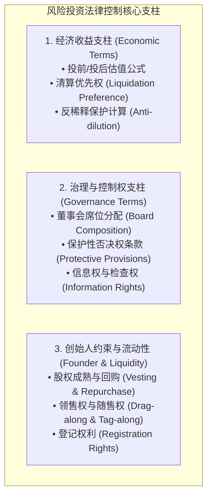
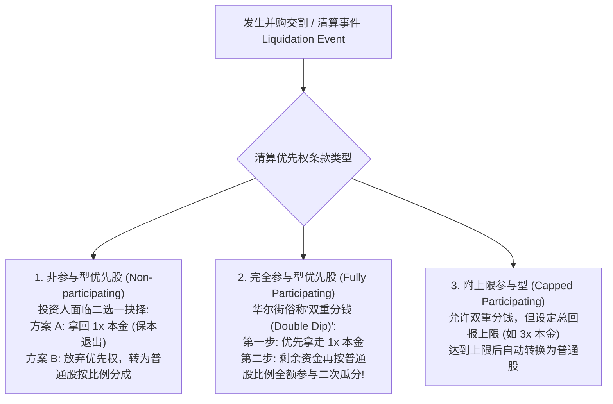
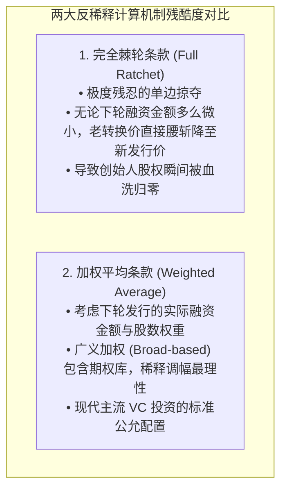

# Lec 16 风险投资法律实务：Term Sheet 架构与优先股权利 (Venture Capital: Term Sheet Mechanics & Preferred Stock)

> MIT Sloan 15.617 · The Law of Corporate Finance and Financial Markets · 主讲 Dr. John Akula

## TL;DR

- 风险投资（VC）构成了科技金融创新的资本孵化器，其核心法律载体是精密的投资条款清单（Term Sheet）。
- 可转换优先股（Convertible Preferred Stock）是 VC 投资的绝对标准工具，横跨债权安全性与股权暴利。
- 深入拆解清算优先权（Liquidation Preference）：参与型 vs 非参与型优先股的实际退出分配断层。
- 反稀释保护（Anti-dilution）：完全棘轮（Full Ratchet）的毁灭性与广义加权平均（Broad-based WA）的数学推导。

## 风险投资的商业本质与金融法律闭环

风险投资（Venture Capital, VC）是现代金融史上最令人着迷的高风险、高回报游戏。顶尖 VC 基金的运作逻辑建立在极度极端的“幂次法则（Power Law）”之上：在一期包含 30 家被投企业的基金中，往往有 20 家彻底破产归零、5 家勉强保本，而唯有一到两家能够成长为数百亿美元的超级独角兽，单笔投资所产生的惊人回报足以覆盖全基金的所有亏损并赚取数倍超额利润。

正是由于绝大多数初创企业生还率极低，VC 在向企业注资时绝不接受普通的普通股（Common Stock），而是通过数十年实战演变出了一套集**资本保全、超额收益捕获与绝对控制权锁定**于一身的法律武器库——**可转换优先股（Convertible Preferred Stock）**。

上述三大支柱，构成了 VC 与创始人签署的**投资条款清单（Term Sheet）**的全部实质内容。

## 估值公式与期权池洗牌游戏（Option Pool Shuffle）

在进行股权计算时，初涉资本市场的创业者最常犯的错误就是混淆“投前估值”与“投后估值”的概念，并在期权池设定中惨遭暗算：

::: definition 基础估值恒等式
$$	ext{投后估值（Post-Money Valuation）} = 	ext{投前估值（Pre-Money Valuation）} + 	ext{本轮新增投资额（Investment Amount）}$$
$$	ext{投资人持股比例（Investor Ownership \%）} = rac{	ext{本轮投资额}}{	ext{投后估值}}$$
:::

### 经典陷阱：期权池洗牌（Option Pool Shuffle）
VC 在 Term Sheet 中通常会约定：“投前估值 1,000 万美元，投资 250 万美元，占股 20%；**但前提是在交割前必须设立一个占投后股权 15% 的未分配员工期权池（Unallocated Option Pool）**”。

表面上看，期权池是用来未来吸引顶级技术高管的；但在数学实质上，由于期权池被强制要求在**“投资前（Pre-money）”**设立，这意味着**期权池所造成的全部 15% 股权稀释，由原有创始人团队 100% 单独肉身承担！**VC 的 20% 股权在入场瞬间毫发无伤。这在实质上将创始人的真实投前估值暗中压低了数百万美元！

## 清算优先权（Liquidation Preference）的精算法则

清算优先权是优先股最具杀伤力的保底防线。一旦公司遭遇资产出售、并购或破产解散，优先股股东有权优先于普通股（创始人及员工）分钱：

### 真实博弈案例推演
假设 VC 出资 **500 万美元**获得某公司 **20% 优先股**，创始人持有剩余 80% 普通股。五年后公司以 **1,500 万美元**平庸对价整体出售：

| 清算优先权类型 | 优先股分得现金 | 普通股（创始人）分得现金 | 最终博弈结果分析 |
| :--- | :--- | :--- | :--- |
| **标准 1x 非参与型优先股** | 500 万美元（因为转为普通股仅分得 1,500 万 × 20% = 300 万，故选择拿走 1x 本金） | **1,000 万美元** | 保护了资方本金，剩余 1,000 万全归创始人，较为公允 |
| **完全参与型优先股 (Double Dip)** | **700 万美元**（先拿走 500 万本金；剩余 1,000 万中再按 20% 分走 200 万） | **仅剩 800 万美元** | 资方分走总池近半资金，极度压榨了创始团队五年的血汗成果 |

在健康成熟的市场中，**“1x 非参与型优先股（1x Non-participating Preferred）”**是全美风险投资协会（NVCA）推荐的行业公允黄金标准。

## 反稀释保护（Anti-dilution）：下轮低价融资的防爆盾

当公司因市场寒冬或业绩滑坡，被迫以低于上一轮估值的价格进行新一轮融资（Down Round）时，上一轮优先股股东的股份价值将被严重稀释。反稀释条款通过**动态调低优先股转换为普通股的转换价格（Conversion Price）**，赋予老资方免费补发股票的特权：

### 广义加权平均（Broad-based Weighted Average）的标准数学公式
$$CP_2 = CP_1 	imes \left( rac{A + B}{A + C} 
ight)$$
其中：
- $CP_2$：本轮调整后的全新有效转换价格；
- $CP_1$：调整前的原始转换价格；
- $A$：本次融资前完全稀释（Fully-diluted）下的普通股总股数（包含所有已发行股票、已授予及期权池未分配份额）；
- $B$：按老转换价 $CP_1$ 计算，新投资人所注入的全部新增现金本应购买的理论普通股股数；
- $C$：新投资人在本轮 Down Round 中实际新发行取得的普通股股数。

广义加权平均公式的精妙之处在于，它将新发行的股票在全公司庞大股本池中的实际“物理权重”纳入了考量，有效防止了早期投资人凭借严苛的完全棘轮条款将创始人全盘踢出局的悲剧。

## 控制权攻防：保护性条款与领售权（Drag-Along）

除了经济分配，Term Sheet 最激烈的战场在于公司控制权：

1. **保护性条款（Protective Provisions / 负面否决权）**：
   优先股作为一个独立类别，在公司发生下列重大事件时享有**一票否决权**：修改章程削弱优先股权利、增发新一轮具有更高清偿顺位的股份、公司整体出售、举借超过特定额度的银行贷款、以及变更公司核心主营业务；
2. **领售权（Drag-Along Rights）**：
   若董事会与过半数优先股股东决定以合理价格向第三方出售公司，**领售条款赋予其强制命令所有创始人与普通股员工必须同时在收购协议上签字、一同卖掉名下股份的绝对特权**，彻底粉碎了少数创始股东试图当钉子户敲诈买方的意图。

::: pitfall 忽视创始人股权成熟（Vesting）中的单重 vs 双重加速条款
在接受 VC 投资时，资方通常强制要求创始人的既有股份重新进入“四年成熟期（Four-Year Vesting）”。创始人必须据理力争在协议中写入**双重触发加速（Double Trigger Acceleration）条款**：即公司一旦发生被收购（第一重触发），且创始人在交割后 12 个月内被新买家无正当理由解雇或被迫降薪（第二重触发），其未成熟的全部股票将**立即 100% 自动瞬间完全成熟**！若缺乏此项保护，创始人辛勤创业数年，极易在并购交割第二天被买方无情扫地出门并被强制以 1 元名义价格没收所有未成熟股权。
:::

::: insight 好的条款清单，是伟大商业探险的婚前协议
风险投资与创业者的结合，是世界上最极致的资本共谋。在掌声与高估值的鲜花背后，充斥着高度的不确定性与利益分歧。一份优秀的 Term Sheet 从来不是单方面的资本霸凌，而是用深邃的博弈论智慧，预先为可能到来的风暴甚至离异设定清晰理性的财产与权力边界。懂得用法律语言保护自身尊严的创业者，才能赢得资本市场最深层的敬意与长久的信任。
:::
