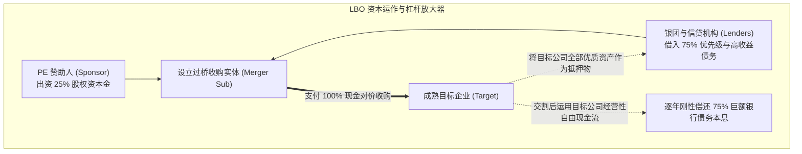
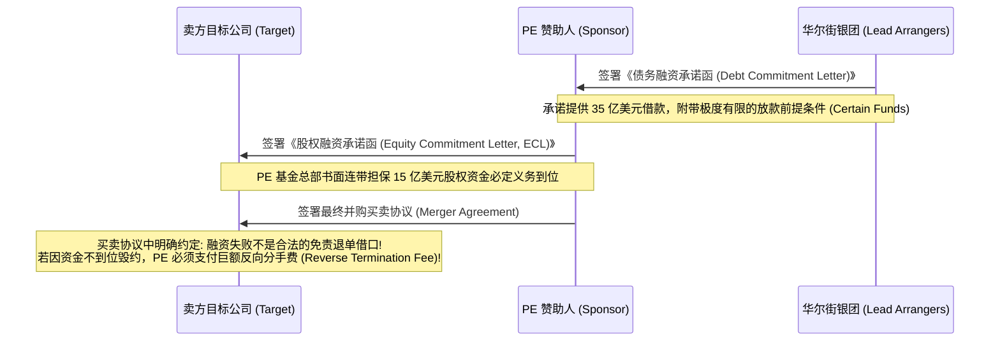

# Lec 17 私募股权投资与杠杆收购法律架构 (Private Equity & Leveraged Buyouts - LBO)

> MIT Sloan 15.617 · The Law of Corporate Finance and Financial Markets · 主讲 Dr. John Akula

## TL;DR

- 私募股权（PE）杠杆收购（LBO）的核心逻辑是运用 60% 至 80% 的高额债务杠杆收购成熟且现金流充沛的企业。
- 深度拆解 LBO 资本结构堆叠（Capital Structure Stack）：从优先担保贷款、夹层债到赞助人股权。
- 债务融资承诺函（Debt Commitment Letter）与股权承诺函（Equity Commitment Letter）构成闭环资金担保。
- 欺诈性转让（Fraudulent Conveyance）构成了过度激进 LBO 最致命的破产司法追索雷区。

## 杠杆收购（LBO）的金融哲学与商业逻辑

如果说风险投资（VC）是在荒野中寻找具备百倍爆发力的幼苗，那么**私募股权并购（Private Equity Buyout）**则是在成熟的森林中寻找被市场低估、管理低效但拥有澎湃现金流造血能力的成熟大树。

杠杆收购（Leveraged Buyout, LBO）的本质，是运用少量的自有股权资本金（Sponsor Equity，通常仅占 20% 至 30%），通过向华尔街投行、商业银行及高收益债券市场大规模借入**巨额非流动性债务（占交易对价的 70% 至 80%）**，强行将一家大型甚至数百亿美元的上市公司私有化收购下市：



在 LBO 的魔法运作下：目标公司交割后产生的庞大经营性现金流，不再用于分红或盲目扩张，而是被优先强制用于清偿收购时借入的巨额债务。经过 3 至 5 年的残酷去杠杆，当债务本金大幅削减、企业运营利润率在严苛重组下有所改善时，PE 赞助人再将公司重新推向 IPO 上市或出售给战略买家，其原始出资的股权价值便可产生惊人的 3 至 5 倍甚至更高的资本收益率（IRR）。

## 资本结构的层级堆叠（Capital Structure Stack）

LBO 的成败，完全取决于其精密的资本结构堆叠设计。从顶层的银行低成本资金到底层的纯股权风险，不同资金来源的求偿顺位与权利限制泾渭分明：

| 资本层级 | 资金提供方 | 利率与成本 | 担保与清偿顺位 | 核心契约与权利特征 |
| :--- | :--- | :--- | :--- | :--- |
| **第一级：优先担保银行贷款 (Senior Secured Credit Facilities)** | 商业银行银团、机构信贷基金 | 最低（通常为 SOFR + 250-350 bps） | **最高首位担保（First Lien）**；以目标公司所有厂房、设备、应收账款与股权为质押 | 包含循环信贷额度（Revolving Facility）与定期贷款（Term Loan A/B）；附带严苛的维护型财务指标（Maintenance Covenants） |
| **第二级：第二留置权债务 (Second Lien Debt)** | 专业困境信贷机构、对冲基金 | 中等（SOFR + 600-800 bps） | **第二顺位担保（Second Lien）**；清偿顺位严格位于一级银团之后 | 债权人必须与一级银行签署严苛的**债权人协议（Intercreditor Agreement）**，约定长达 180 天的行权冻结期（Standstill） |
| **第三级：次级高收益债券 / 夹层债 (Mezzanine Debt / Junk Bonds)** | 机构高收益债投资人、保险资管 | 极高（固定票息 8%-12% + 认股权证 Warrant） | **完全无担保（Unsecured）**；法律顺位彻底次级化（Subordinated） | 通常包含实物支付利息机制（PIK, Payment-in-Kind），允许公司在现金流紧张时直接以增发新债券替代现金付息 |
| **底层：赞助人股权资本 (Sponsor Equity)** | PE 并购基金本身、共同跟投机构、管理层翻转股权 | 最高（追求 20%+ 的净内部收益率 IRR） | **完全劣后（First Loss Piece）**；承担全盘破产爆雷的第一损失风险 | 拥有对重组后董事会的 100% 绝对控制权；享有企业成功重组后的所有剩余暴利 |

## 交易资金承诺的法律闭环：两份决定生死的承诺函

在大型 LBO 中，卖方董事会最核心的恐惧在于：**“你承诺出价 50 亿美元，但其中 35 亿需要去向银行借，万一交割前夕华尔街爆发信贷危机银行突然拒不放款，我们岂不是被你放了鸽子？”**

为了打消卖方的顾虑，PE 必须在签署并购协议的同一秒钟，向卖方出具两份具有严密法律约束力的承诺文件：



### 欧洲“确定性资金（Certain Funds）”原则的普及
现代并购协议对银行的债务承诺函提出了极其严苛的要求：**严禁银行在承诺函中加入任何“需视宏观信贷市场波动而定”或“需经银行信贷委员会最终审批”的软性借口**。银行的放款条件必须与最终买卖协议中的交割先决条件做到 1:1 的完美背靠背镜像挂接。一旦签约，银行必须强制放款，这就是华尔街著名的“确定性资金（Certain Funds）”原则。

## LBO 终极法律审判：欺诈性转让（Fraudulent Conveyance）的索赔风暴

如果一家被 PE 实施 LBO 的公司，在交割后因债务负担过重，在短短两年内轰然倒闭进入破产清算，破产法院将启动整个商业法中最令 PE 胆战心惊的法律调查——**欺诈性转让审查（Fraudulent Transfer, 11 U.S.C. § 548）**。

```mermaid
flowchart TD
    A[PE 完成巨额高杠杆 LBO 并购] --> B[目标公司资产负债表被强加 40 亿美元新增负债]
    B --> C[该 40 亿美元借款全部被拿去支付给原股东作为现金收购对价]
    C --> D[目标公司法人自身没有从这 40 亿借款中获得任何一分钱实际对价 (No Fair Consideration)]
    D --> E[两年后目标公司资金链断裂陷入破产清算]
    E --> F[破产受托人 Trustee 代表债权人提起破产撤销权之诉!]
    
    F --> G{破产法院法庭审查两要件}
    G --> H1["1. 目标公司在 LBO 交割后是否陷入资产负债表破产<br/>或者资本显著不足 (Unreasonably Small Capital)?"]
    G --> H2["2. 目标公司背负巨债是否获得了公允等价对价 (Reasonably Equivalent Value)?"]
    
    H1 & H2 --> I[判定构成建设性欺诈转让 Constructive Fraud!]
    I --> J[法院强制下令: 追回原股东拿到手的所有卖股现金!<br/>彻底剥夺银行借款的抵押优先权并将其债权降为最劣后!]
```

在著名的 *TOUSA* 案与 *Lyondell* 破产案中，法院向全行业敲响了警钟：**如果交易各方明知目标公司的现金流在极度高压下无法支撑庞大的债务利息，依然为了达成交易强行实施过度杠杆，该交易在破产法下即被依法认定为对破产前旧有商业债权人的非法掠夺！**这一机制迫使 PE 与投行在每一次 LBO 建模中，必须开展详尽严密的“偿债能力测试（Solvency Opinion）”，由独立财务顾问出具具有法律效力的偿付能力保证书。

::: pitfall 忽视管理层翻转股权（Management Rollover）中的受信义务背叛
在 LBO 中，PE 往往要求现任 CEO 和管理团队将其名下价值数千万的原有股权“翻转（Rollover）”为新公司的股权，并许诺在交割后给予管理层极度丰厚的高管股权激励池。此时，现任管理层极易陷入严重的利益冲突：为了让自己未来能够以更低估值入股新公司，管理层可能会故意向公众股东隐瞒公司的增长潜力，甚至在尽调中暗中配合 PE 压低收购对价。一旦被股东查实，管理层将因恶意违背忠实义务而面临集体诉讼的惩罚性判赔。
:::

::: insight 杠杆是放大商业智慧与贪婪欲望的制度放大镜
杠杆收购是金融工程中最强劲的双刃剑。在卓越的产业运营家手中，债务杠杆是一道驱散管理惰性、迫使企业极度专注于现金流管理与核心主业精进的强效清醒剂；但对于急功近利、企图通过高杠杆金融游戏榨取被投企业每一滴血汗的投机者而言，杠杆则是通往破产深渊与司法清算的催命符。在金融法学的森严法网下，唯有建立在真实产业造血能力之上的杠杆运作，才经得起周期与法律的无情洗礼。
:::
