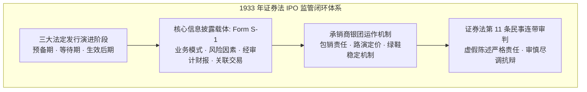
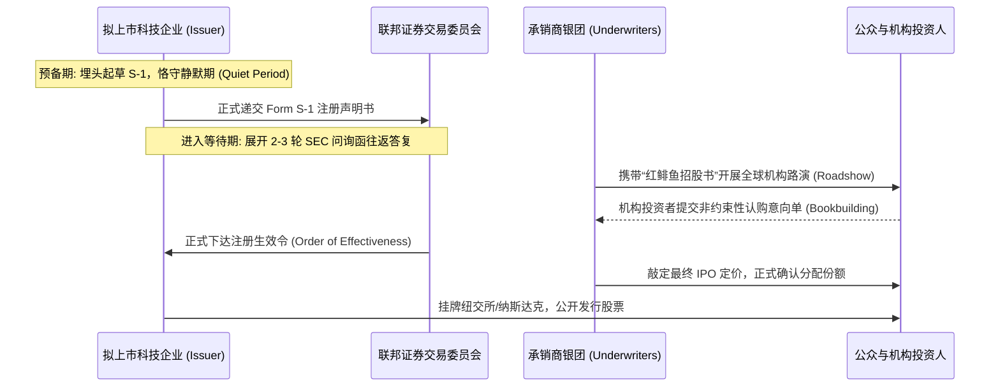
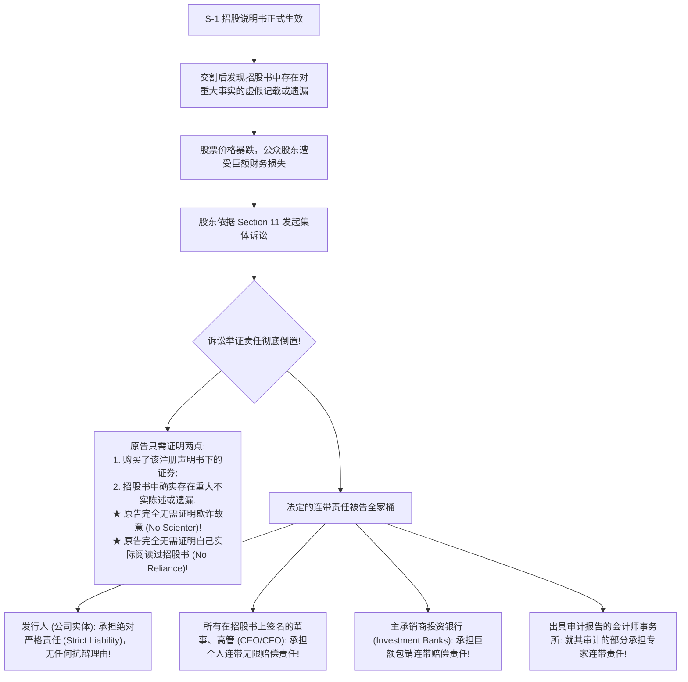

# Lec 18 公开发行上市 (IPO) 与投资银行承销法律责任 (Public Offerings and Investment Banking)

> MIT Sloan 15.617 · The Law of Corporate Finance and Financial Markets · 主讲 Dr. John Akula

## TL;DR

- 首次公开发行（IPO）是企业生命周期中从私人封闭走向公众资本市场的神圣成年礼。
- 1933 年《证券法》以“彻底信息披露（Full Disclosure）”为核心哲学，设立严密的发行三阶段流水线。
- 严密解析静默期（Quiet Period）与未批先宣（Gun-jumping）红线，防范发行前不当煽动市场狂热。
- 深入拆解证券法第 11 条的严酷民事责任体系，以及承销商、会计师与董事赖以护身的“审慎尽责抗辩（Due Diligence Defense）”。

## 资本市场的成年礼：IPO 的制度哲学与演进

对于一家高成长型企业而言，在纽交所或纳斯达克敲响开市钟声的首次公开发行上市（Initial Public Offering, IPO），是其商业生命中最辉煌的转折点。IPO 不仅为企业开辟了近乎无限的公开股权再融资通道，为早期风险投资人与创业元老提供了数十亿美元现金退出的流动性大门，更赋予了企业全社会的信誉背书与全球顶尖品牌影响力。

然而，公开发行绝非单纯的庆祝派对。1933 年美国《证券法》（Securities Act of 1933）确立了一套冷酷而崇高的法哲学：**既然企业决定向广大对技术细节一无所知的普通公众募集一生的积蓄，法律就绝不允许任何信息的隐瞒、粉饰与虚妄！**

如上图所示，整部证券法并不评判一家初创科技公司是否“具有商业盈利前景”，法律把判断企业价值的权力完全留给自由市场；法律唯一强行介入的，是强制要求发行人履行**彻底、真实、毫无遗漏的信息公开（Full and Fair Disclosure）**。

## 证券法规定的 IPO 三大阶段与抢跑禁令（Gun-Jumping）

为了防止发行人与承销商在官方招股书尚未核准之前，通过虚假公关和媒体炒作人为煽动市场狂热，1933 年法案第 5 条将 IPO 流程切分为三个界限森严的法定阶段：

| 法定阶段划分 | 时间节点边界 | 法律允许的行为 (Permitted) | 绝对禁止的违法红线 (Prohibited) |
| :--- | :--- | :--- | :--- |
| **1. 预备备案期 (Pre-Filing Period)** | 公司内部决定启动 IPO 之日起，直至向 SEC **正式递交 S-1 注册声明书之前** | 开展常规的日常产品商业广告；依据 JOBS Act 规则向合格机构买家开展保密的“试水试探（Testing-the-Waters）” | **严禁任何形式的抢跑营销（Gun-jumping）！**严禁发表任何关于未来估值、融资规模或鼓吹上市前景的公开演讲或采访 |
| **2. 等待期 (Waiting Period)** | 自正式向 SEC 递交 S-1 表格之日起，直至 SEC 宣布该注册声明书**正式生效（Effective）之前** | 仅允许使用已递交的**初步招股说明书（Preliminary Prospectus，俗称“红鲱鱼 Red Herring”）**展开非约束性口头询价与机构路演（Roadshow） | 严禁签署任何有约束力的证券买卖合同！严禁接收任何投资款项；严禁寄送任何红鲱鱼招股书之外的书面推介材料 |
| **3. 生效后期 (Post-Effective Period)** | SEC 宣布注册文件正式生效之日起，股票在交易所挂牌交易及后续配售期 | 允许向投资人正式确认股票分配并正式放款交割；允许公开发布最终版招股说明书（Final Prospectus） | 任何股票买卖确认书的寄送，**必须同时或事先向买方交付了最终生效版招股说明书**，否则买方享有法定无条件退单权 |

## 投资银行的承销模式与绿鞋机制（Green Shoe）

在公开发行中，投资银行（如高盛、摩根士丹利）组建承销银团（Syndicate），主要通过以下机制护航资本运作：

1. **确定包销（Firm Commitment Underwriting）**：
   在绝大多数美股主流 IPO 中，承销商与发行人签署的是“确定包销合同”——承销银团按照约定的折扣价（通常为官方发行价折让 7% 的承销佣金，Underwriting Spread），**先以自身信用将发行的全部股票全额买下，再由承销商转手在市场上向公众与机构分销**。若市场爆冷卖不掉，剩余破发股票由承销商自行承担巨额包销亏损；
2. **超额配售选择权（Overallotment Option / 绿鞋机制 Green Shoe）**：
   发行人通常会赋予承销商一项特权：在 IPO 挂牌后 30 天内，承销商有权**按原发行价格额外追加认购最多 15% 的股票**。

::: definition 绿鞋机制的后市稳定运作机理
承销商在上市首日故意超额配售 115% 的股票，即自身账面上建立了 15% 的无风险裸空头：
- **若股票首日暴涨**：承销商立即行使绿鞋期权，按原发行价从上市公司手中买下这 15% 的新股去平仓交付，赚取稳健的承销差价；
- **若股票首日跌破发行价（破发）**：承销商断然不行使绿鞋期权，而是直接动用这笔超额资金，**在公开二级市场上按暴跌折价大举买入股票进行护盘**！既平掉了自身的空头仓位赚取差价，又强行支撑了二级市场买盘、阻止了股价恶性雪崩，实现了多方共赢。
:::

## 证券法的终极达摩克利斯之剑：Section 11 严酷连带责任

1933 年《证券法》第 11 条（Section 11），是全美民商事侵权与合同法中杀伤力最为恐怖的法条之一。它为所有受到招股书欺骗的投资人确立了极其不对称的索赔通道：

在深入剖析具体的抗辩标准之前，我们必须认识到 Section 11 在英美法系民事诉讼中独一无二的威慑力。在普通法的传统欺诈诉讼（Common Law Fraud）中，原告必须承担极其严苛的举证责任——不仅必须证明被告存在主观欺诈恶意（Scienter），还必须证明原告自己在作出决策前切实信赖了该不实陈述，并证明该不实陈述直接导致了损失的发生。

然而，1933 年《证券法》第 11 条为了保护广大处于信息绝对劣势地位的公众投资人，彻底粉碎了这些传统的诉讼壁垒。只要注册声明书中的某一句话存在客观重大不实，全美所有从公开市场上购买了该股票的投资者，无论其本人是否阅读过招股书、无论其是专业机构还是退休老人，均依法享有对所有签字高管、全体董事和主承销商的直接追索索赔权！这种近乎严苛的连带责任机制，正是迫使华尔街在招股书中对每一处陈述开展数月尽职调查的终极动力。

## 救命盾牌：审慎尽责抗辩（Due Diligence Defense）

在 Section 11 的灭顶之灾面前，除发行人自身（承担无条件严格责任）之外，所有签字董事、承销商投行与会计师唯一的免责生路，是证明其行使了**审慎尽调抗辩（Due Diligence Defense）**：

| 被告群体 | 审查对象分类 | 审慎尽责抗辩的法定证明标准 (Section 11(b)) |
| :--- | :--- | :--- |
| **投行承销商与企业董事** | **非专家认证部分 (Non-expertised portions)** （如管理层对行业前景的讨论、核心客户业务数据、供应链依赖度） | 必须证明：其经过了**合理且充分的独立调查（Reasonable Investigation）**，并且有合理理由真诚相信、且在事实上切实相信，截至招股书生效之日，该部分陈述是完全真实且无重大遗漏的 |
| **投行承销商与企业董事** | **专家认证部分 (Expertised portions)** （如四大会计师事务所出具审计意见的经审计财务报表） | 门槛显著降低：必须证明其**没有合理理由怀疑该专家报告存在不实**，且有理由相信该报告公允反映了专家意见，无需外行去重新审计会计师底稿 |
| **独立注册会计师 (专家)** | **其出具专家意见的部分 (Expertised portions)** （三年连带财务报表与核心内控指标） | 必须证明：其在审计过程中严格遵循了公认审计准则（GAAS），进行了**合理谨慎的专业核查**，有合理理由相信其出具的财务审计报告公允无误 |

在里程碑判例 *Escott v. Barchris Construction Corp.* (1968) 案中，法院以极其冷酷的口吻判决：**承销商与董事如果仅仅满足于口头询问管理层“财务数据是否真实”，而未要求其出具原始销售合同、银行对账单进行交叉比对核验，其所谓的尽调在法律上属于形同虚设的重大过失！所有承销商与独立董事全盘败诉，承担数百万美元个人连带赔偿！**这一判例彻底确立了华尔街投行在每一次 IPO 中编制长达千页的《尽职调查工作底稿（Due Diligence Defense Binder）》的行业标准。

::: pitfall 忽视“锁定期（Lock-up Period）”违约引发的内部人爆雷
在绝大多数 IPO 承销协议中，投行承销商都会强制要求公司创始人、核心高管与早期持股超过 1% 的老股东签署**《禁售锁定期协议（Lock-up Agreement）》**——承诺在挂牌后 180 天内，绝不在二级市场抛售、转让或质押任何名下股份，以确保上市初期市场流通盘稳定。若有高管私下通过场外衍生品或远期合约（Forward Sale）规避锁定期，不仅属于重大合同违约，更会被 SEC 直接认定为不当套现与虚假披露的严重欺诈行为。
:::

::: insight 走向公众资本市场，是用绝对的透明换取无限的自由
敲响交易所钟声的那一刻，对于商业领袖而言不是狂欢的终点，而是一份神圣公共契约的正式生效。从闭门创业的独行侠，蜕变为直面全球数百万普通储户期许的公众守护人，这种身份的跃迁要求管理者将内心的格局提升至前所未有的高度。证券法森严的第 11 条与严苛的披露规则，表面上看似捆绑双手的锁链，但它所守护的，正是让素昧平生的全社会大众敢于将信任与财富毫无保留地托付给优秀企业家的最神圣契约。
:::
