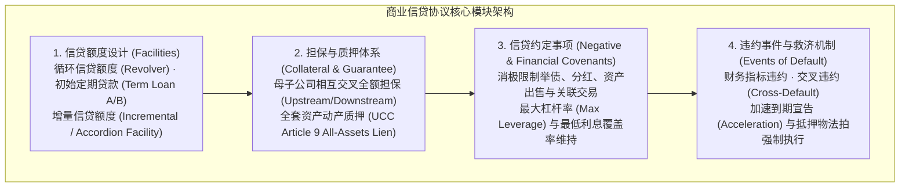
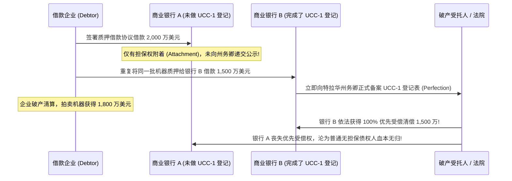
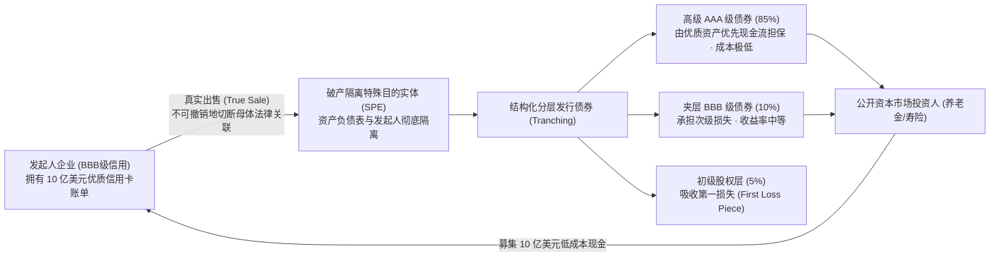

# Lec 19 商业贷款、信贷约定与资产证券化 (Commercial Lending, Covenants & Securitization)

> MIT Sloan 15.617 · The Law of Corporate Finance and Financial Markets · 主讲 Dr. John Akula

## TL;DR

- 商业银团贷款协议（Credit Agreement）是全球万亿美元级企业信贷市场的基石法律文本。
- 信贷约定事项（Covenants）通过消极约束与财务指标维持，将企业的杠杆与现金流严格限制在安全轨道。
- 动产抵押担保（UCC Article 9）确立了权利附着（Attachment）与登记公示（Perfection）的首位清偿排他权。
- 资产证券化（Securitization）通过设立破产隔离的特殊目的实体（SPE）与真实出售，实现底层资产与发起人的信用彻底脱钩。

## 商业信贷市场的法律大厦：银团贷款协议（Credit Agreement）

在公司金融的世界里，债务融资的规模远超股权融资。无论是财富五百强跨国公司，还是被 PE 杠杆收购的中型企业，其日常流动资金与重大并购开支主要依赖于由商业银行牵头组建的**银团贷款协议（Syndicated Credit Agreement）**。

这份长达数百页的金融合同决不是简单的借据，而是一座权衡违约风险、流动性控制与企业经营自由度的宏伟建筑：

从金融契约理论的深层维度剖析这一借贷网络，我们会发现银团贷款协议的实质是建立一套高度敏感的“控制权动态转移机制”。在企业经营繁荣、现金流充沛时，银行作为高级债权人退居幕后，仅按期收取约定的固定利息，公司战略与日常营运的全部自由裁量权牢固掌握在董事会手中。

然而，当宏观逆风来袭、息税折旧摊销前利润（EBITDA）下滑导致杠杆率逼近警戒线时，协议中精密设计的消极承诺与维持型财务指标便会瞬间收紧。此时，银团无需等到企业实际违约拒付本息，就可以凭借财务指标破线直接切断新增信贷额度、冻结借款人的对外重大并购，甚至强制要求借款人将非核心子公司挂牌变现用于强制提前还贷（Mandatory Prepayment）。这种契约机制在最大程度上保障了全社会信贷资本的安全。

从金融法律的角度审视，商业贷款合同的本质是银行通过契约条款对借款人管理层的自由裁量权实施长期的“远程遥控”。只要借款人的财务健康度处于约定区间，管理层享有充分的经营自主权；但一旦特定财务指标触碰红线，协议中的控制权将迅速向银团倾斜。

## 信贷约定的三大铁笼：积极、消极与财务维持指标

银团对借款人的约束主要通过三类**信贷约定（Covenants）**来实现：

| 约定类别 | 核心约定条款与内容 | 法律功能与对借款人的约束力 |
| :--- | :--- | :--- |
| **积极承诺 (Affirmative Covenants)** | 按期提交经审计的季度与年度财务报表；维持核心资产保险；合法纳税并维持企业存续合法性 | 确保银行拥有畅通的信息获取管道，及时获悉借款人的经营异动 |
| **消极承诺 (Negative Covenants)** | **严禁限制事项**： • 严禁举借除特定篮子（Baskets）之外的任何新增债务； • 严禁在公司资产上设立新的抵押权（Negative Pledge）； • 严禁向普通股股东派发现金股息（Restricted Payments）； • 严禁未经银行同意出售核心生产设施或合并公司 | 封死借款人通过增发债务或掏空资产将价值转移给股东、从而损害债权人清偿能力的道德风险通道 |
| **财务维持指标 (Financial Covenants)** | **量化财务硬杠杆**： • **总杠杆率（Total Leverage Ratio）**：总债务 / EBITDA $\le 4.5	imes$； • **利息覆盖率（Interest Coverage Ratio）**：EBITDA / 利息支出 $\ge 3.0	imes$； • **固定费用偿付比率（Fixed Charge Coverage Ratio）** | 充当最敏锐的早期地震仪；在企业尚未真正发生现金流断裂之前，提前引爆违约谈判 |

### 维护型契约（Maintenance） vs 触发型契约（Incurrence）
在以高收益债券（Junk Bonds）和宽松型贷款（Cov-lite Loans）为主的成熟资本市场中，借款人极力争取**触发型契约（Incurrence Covenants）**——即企业日常只需正常经营，只有当主动做出“增发债务”或“对外收购”的动作时，才检验财务比率是否超标；而传统商业银行则坚持**维护型契约（Maintenance Covenants）**——每个季度末必须准时向银团出具合规证明书（Compliance Certificate），一旦指标破线，即使按期付息也直接构成违约！

## 动产担保与质押：UCC 第 9 篇的严密规则

向企业放款必须拥有坚固的资产抵押作为防线。在美国，动产（包括机器、应收账款、存货、专利与股权）的担保完全受制于《统一商法典》第九篇（UCC Article 9）：

::: theorem UCC 第 9 篇担保物权确立的两大门槛
1. **担保权附着（Attachment）**：确立抵押权在借款人与银行之间的有效成立。必须满足三要件：(1) 银行支付了对价（放款）；(2) 借款人对抵押物拥有合法权益；(3) 借款人签署了明确记载抵押物范围的《书面担保协议（Security Agreement）》；
2. **担保权完善公示（Perfection）**：确立抵押权对抗外部第三人及未来破产受托人的绝对优先受偿权。
   最核心途径：**向特拉华州州务卿办公室正式递交 UCC-1 融资声明书（UCC-1 Financing Statement）**！
:::

上述案例生动展示了商业法律中的“登记公示优先原则”：**先行登记公示者胜出（First to File or Perfect Rule）**。疏忽了一张单页 UCC-1 表格的及时备案，数千万美元的优先债权将在瞬间沦为一文不值的普通坏账。

## 资产证券化（Securitization）：信用脱钩的金融炼金术

对于拥有大量优质应收账款或汽车贷款但自身主体信用评级较低（如 BBB 级）的企业而言，资产证券化（Asset Securitization）是一场惊艳的金融工程：

资产证券化的灵魂，在于让底层优质资产**“在法律上逃离发起人的破产泥潭”**：
1. **破产隔离实体（Bankruptcy-Remote SPE）**：设立一家独立受托人持有的特殊目的法人（SPE），其公司章程明文禁止从事除持有该批应收款之外的任何业务，且章程规定申请自愿破产必须获得**独立董事的一致赞成票**；
2. **真实出售（True Sale）**：发起人向 SPE 转让资产的行为，在法律上必须被认定为不可撤销的“所有权买卖”，绝不能被法院事后定性为“抵押借款”。一旦发起人母体未来轰然破产倒闭，这批价值 10 亿美元的优质现金流依法**绝对不属于母公司的破产财产**，不会受到破产自动中止令的冻结，能够继续分秒不差地向债券持有人兑付本息！

::: pitfall 交易结构被破产法庭定性为“实质合并（Substantive Consolidation）”
在资产证券化中，若发起人母公司为了省事，让自己的员工兼任 SPE 高管、两家公司资金账户混用、或由母公司向 SPE 提供了全额兜底担保，一旦母公司破产，破产法院将启动衡平法上的**实质合并原则（Substantive Consolidation）**——判定 SPE 仅仅是母公司的傀儡分身，强行将已被证券化的优质资产重新拖回母公司的破产大池子中去偿还母公司的全盘旧债，直接引发 AAA 级债券持有人的毁灭性违约！
:::

::: insight 商业信用的尽头，是资产边界的绝对确权
信贷与证券化的全部精密设计，本质上是对资产财产权归属与清偿顺位的严谨数学建构。商业世界从来不缺乏雄心勃勃的借款人，缺乏的是在狂热中依然能够严密锁定现金流回流闭环的清醒法律架构。懂得用信贷约定规范企业自由度、用破产隔离技术对冲系统性风险，是现代金融工程能够穿越牛熊周期、维系全社会信贷流动性的最高法宝。
:::
