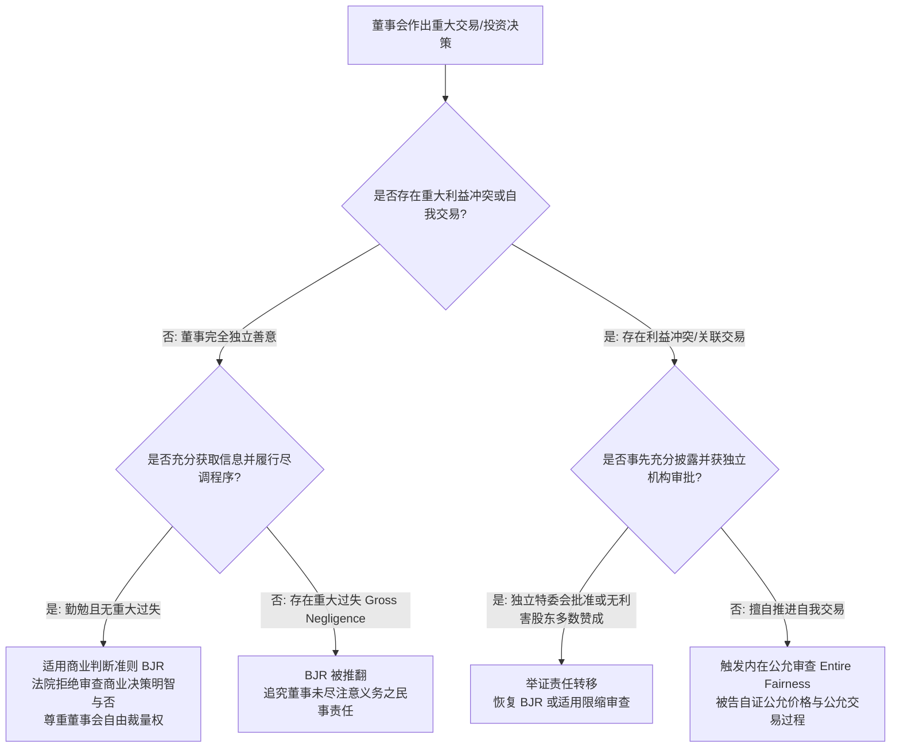
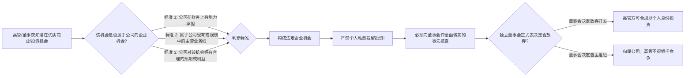

# Lec 2 商业判断准则与利益冲突治理 (The Law of Duties: Business Judgment & Conflicts)

> MIT Sloan 15.617 · The Law of Corporate Finance and Financial Markets · 主讲 Dr. John Akula

## TL;DR

- 商业判断准则（BJR）推定董事在知情、善意且无重大利益冲突的前提下作出商业决策，免受法院事后干预。
- 审慎决策的程序要求高于实质结果：董事必须证明其在决策前获取了充分信息（Informed Decision）。
- 一旦决策存在董事自我交易或利益输送，BJR 保护伞瞬间瓦解，触发严苛的“内在公允（Entire Fairness）”审查。
- 企业机会原则（Corporate Opportunity Doctrine）严防高管截留属于公司的潜在战略投资或商业标的。

## 商业风险与司法审查的边界

现代商业探索充满剧烈的不确定性。若资本市场与司法系统依据“事后诸葛亮（Hindsight Bias）”的标准，在投资失败后随意惩罚决策失误的董事与高管，全社会的经理人必将滑向极度保守、风险厌恶的官僚作风。为了给企业家的前瞻性冒险提供坚固的庇护所，特拉华州法院确立了公司法最著名的基石准则——**商业判断准则（Business Judgment Rule, BJR）**。

如上图所示，BJR 本质上是一项**司法审判的推定（Presumption）**：法院推定独立董事的决策出于善意、充分知情，并真诚相信该决策符合公司的最佳利益。除非原告能够举证证明董事存在重大过失、恶意或严重利益冲突，否则法官绝不越俎代庖去评判某项并购或巨额研发投入是否“明智”。

## 注意义务与“知情决策”的法律门槛

BJR 绝非懒汉和渎职者的避罪金牌。根据特拉华州最高法院在 *Smith v. Van Gorkom* (1985) 一案中的历史性判决，注意义务的核心衡量标准在于**决策程序的严谨性与信息的充分性（Informed Decision）**。

### 震撼华尔街的先例：*Smith v. Van Gorkom* (1985)

Trans Union 公司的首席执行官 Van Gorkom 即将达到法定退休年龄，在未聘请外部独立财务顾问、未开展严谨估值模型推算的前提下，擅自草拟了一份每股 55 美元的现金并购方案，并私下与企业收购大鳄 Pritzker 达成默契。随后，Van Gorkom 紧急召集了一次仅持续两小时的临时董事会：
1. 董事们在开会前**未收到任何书面并购协议文本或财务估值报告**；
2. 会上仅由 Van Gorkom 进行了 20 分钟的口头汇报；
3. 没有任何外部投资银行出具“公允性意见书（Fairness Opinion）”；
4. 董事会草率表决全票通过了这一项价值近 7 亿美元的巨额并购。

尽管每股 55 美元的收购价相较当时公开市场股价存在高达近 50% 的可观溢价，特拉华州最高法院依然裁定：**全体董事未能在决策前获取所有合理可得的重大信息（Material Information），其行为构成重大过失（Gross Negligence），因此丧失 BJR 庇护，董事个人对股东承担数千万美元的民事赔偿责任！**

::: definition 重大过失与知情决策的标准
在特拉华州法下，董事违反注意义务的责任门槛为“重大过失”。这意味着单纯的判断偏差不违法，但如果在决策前故意忽视预警信号、盲目信任管理层口头陈述而未阅读核心合同条款、或未给予充分审议时间，法院将坚决打破 BJR 的保护。
:::

## 利益冲突与“内在公允（Entire Fairness）”审查

一旦交易中存在关联交易、董事双重身份或大股东利益输送，案件将直接脱离温和的 BJR 轨道，坠入司法审查最深沉的炼狱——**内在公允标准（Entire Fairness Standard）**。

| 审查维度 | 公允交易过程 (Fair Dealing) | 公允交易价格 (Fair Price) |
| :--- | :--- | :--- |
| **核心审查内容** | 交易是如何发起、构思、谈判与起草的？信息是如何向董事会披露的？管理层何时以及如何获取审批？ | 交易在财务实质上是否反映了资产在正常独立市场交易中的真实公允价值？估值倍数与未来现金流折现是否客观？ |
| **典型缺陷特征** | 仓促推进、向独立董事隐瞒核心财务预测、施加不当时间压力、阻挠第三方竞标 | 严重偏离可比交易中位数、关联方以压低价格剥夺少数股东资产溢价 |
| **举证责任** | **被告受托人必须承担无可辩驳的完全举证责任**；若无法自证，交易将被法院直接撤销并判赔 |

### 利益冲突的消毒机制（Cleansing Mechanisms）

为了在关联交易中避免陷入杀伤力巨大的内在公允审查，现代交易通常设计两道严密的“消毒机制”：
1. **设立完全独立的特别委员会（Special Committee of Independent Directors）**：赋予独立董事自主选聘独立投行与独立律师、独立开展实质性价格谈判、并拥有一票否决权的全权授权；
2. **获得无利害关系少数股东的多数表决赞成（Majority-of-the-Minority Vote）**：在控股股东收购少数股权（Freeze-out Merger）时，明确将“无利害关系公众股东多数赞成”作为不可豁免的交割先决条件（*MFW* 案件确立的避风港规则）。

## 企业机会原则（Corporate Opportunity Doctrine）

除了关联买卖，高管与董事最常触犯的忠实义务是**截留公司商业机会**。

如果一名生物医药公司的研发副总裁在行业研讨会上接触到一项极具前景的专利转让机会，该技术与公司现有产品高度协同。该高管若绕开公司，私下成立自己的壳公司买下专利并对外高价转售，即构成对企业机会的严重侵占。法院将直接裁定：该专利及产生的所有利润，全部依法推定由其代原公司以信托方式持有（Constructive Trust），无条件全额剥夺归还公司。

::: pitfall 创业投资中“一人跨任多职”的潜在企业机会爆雷
在风险投资（VC）行业，投资机构合伙人经常同时兼任数家被投企业的董事。当一个新的并购标的或技术合作机会出现时，合伙人面临严重的“双重受托冲突”：该机会究竟应该引荐给 A 公司还是 B 公司？若处理不当，两家公司的少数股东均可以违背忠实义务为由向该董事提起诉讼。最佳解决方案是在投资入股时，依法要求被投公司在章程中明确写入**企业机会豁免条款（Corporate Opportunity Waiver, DGCL § 122(17)）**。
:::

::: insight 程序的尊严是商业实体的最高护甲
许多具有天才商业直觉的高管往往轻视繁琐的董事会审议程序，认为“只要最终给股东赚到了钱，程序细节不值一提”。然而，百年公司法的血泪教训表明：实质的商业正确无法洗脱程序失职的法律原罪。现代公司法最深刻的智慧，就在于用严密的程序正义（独立调查、充分知情、利益回避）去约束人性的贪婪与自大。遵循程序不是繁文缛节，而是商业领袖抵御一切法律暗礁最坚不可摧的铠甲。
:::
