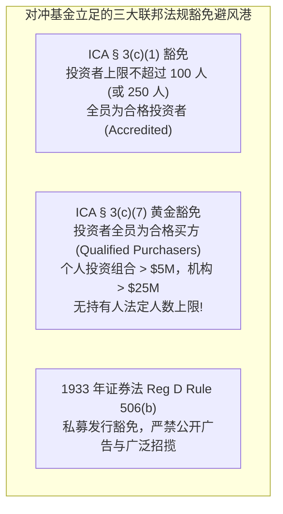
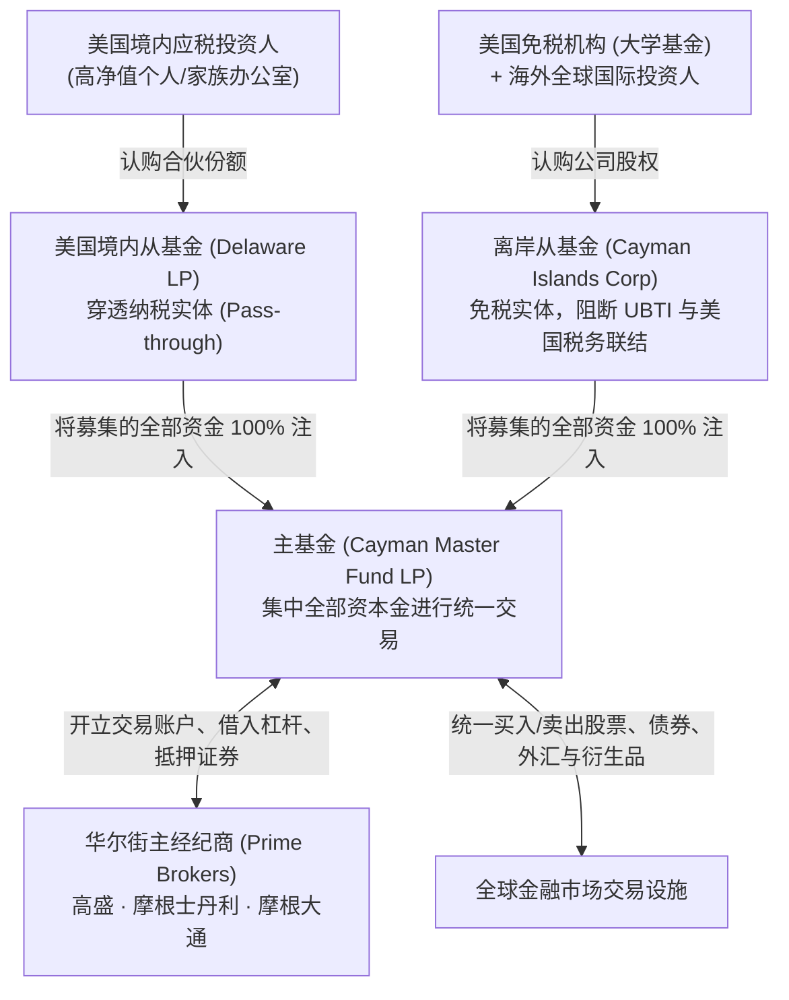
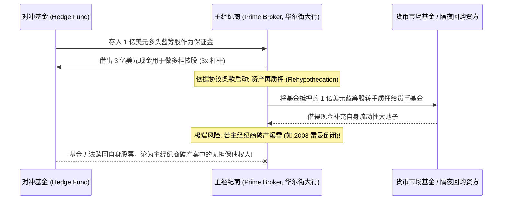

# Lec 20 对冲基金设立、监管与交易策略法律合规 (Hedge Funds: Formation, Regulation & Trading Strategies)

> MIT Sloan 15.617 · The Law of Corporate Finance and Financial Markets · 主讲 Dr. John Akula

## TL;DR

- 对冲基金（Hedge Funds）以追求绝对收益为目标，运用高杠杆、多空对冲与复杂衍生品进行灵活运作。
- 经典主从双层结构（Master-Feeder Structure）完美化解美国境内免税机构、应税个人与海外离岸投资人的税务冲突。
- 1940 年《投资顾问法》（IAA）确立了基金管理人的受信受托底线与多德-弗兰克法案后的注册合规要求。
- 主经纪商（Prime Broker）协议与资产再质押（Rehypothecation）构成了杠杆交易的金融血脉与破产风险放大器。

## 对冲基金的本质：无限制自由度与合格投资者避风港

与公募共同基金（Mutual Funds）受制于《1940 年投资公司法》（ICA）关于杠杆率上限、个股分散度要求及严格流动性约束不同，**对冲基金（Hedge Funds）**自诞生之日起，就建立在对常规金融监管的全面豁免基础之上。

对冲基金经理拥有极度自由的战术牌照：可以 100% 满仓做空单只股票、可以运用 10 倍杠杆押注信用违约互换（CDS）、也可以持有流动性极差的未上市股权。这种超强自由度的法律前提是——**对冲基金绝不向普通散户募资，仅面向法律认定的合格富豪与顶级机构投资者（Accredited Investors / Qualified Purchasers）**。

通过上述豁免，对冲基金成功摆脱了繁重的招股书备案与日常投资组合公开披露义务，在私密的暗室中运转数十亿美元的高频量化与全球宏观策略。

## 国际标准架构：离岸主从结构（Master-Feeder Structure）

对冲基金在全球募集资金时，面临着最棘手的税务利益分裂：
- **美国本土应税高净值个人**：渴望享受合伙制企业穿透纳税的长期资本利得优惠；
- **美国本土免税机构（大学捐赠基金/养老金）**：极度恐惧杠杆交易产生的**未关联商业负债应税所得（UBTI）**；
- **非美国海外离岸投资者**：绝对不能直接在美国本土产生商业联结，否则将被国税局强行扣缴预提税甚至要求申报美国所得税。

为了同时满足这三群截然不同的金主，国际顶尖律所发明了经典的**离岸主从基金架构（Master-Feeder Structure）**：

在上述精巧的架构中：所有的交易指令与投资组合全部集中在唯一的**主基金（Master Fund）**层面统一执行，极大降低了交易与结算成本；而利润则按照出资比例倒流回两个不同的从基金（Feeder Funds），各自满足其背后的税务要求，达成了完美的制度和谐。

## 商业分配机制：高水位线与跨栏率（High-Water Mark & Hurdle）

对冲基金最核心的商业魅力在于其著名的“2/20”收益分成模式，而该模式的合法合规运转依赖于两个关键的数学约束锁：

::: definition 高水位线与跨栏率机制
1. **高水位线（High-Water Mark, HWM）**：
   基金经理只有在基金资产净值（NAV）**超越历史最高峰值时**，方能就新增净利润提取 20% 的业绩表现费（Performance Fee / Carried Interest）。若第一年亏损 30%，第二年反弹 20%，经理在第二年拿不到一分钱业绩提成，必须先把历史亏损完全填平；
2. **硬跨栏率 vs 软跨栏率（Hard vs Soft Hurdle Rate）**：
   协议通常约定一个最低门槛基准收益率（如联邦无风险利率或 6%）。**硬跨栏率**下，经理仅就超过 6% 门槛以上的超额阿尔法收益提取 20% 提成；**软跨栏率**下，一旦总收益超过 6%，经理直接就从 0% 起算的全部利润提取 20% 提成。
:::

## 华尔街的血液中枢：主经纪商（Prime Brokerage）与再质押风险

对冲基金自身并不拥有庞大的清算网络，其杠杆交易全部依托于**主经纪商（Prime Broker）**服务。双方签署的《主经纪商协议（Prime Brokerage Agreement）》是基金最重要的生存命脉。

在 2008 年雷曼兄弟倒闭事件中，数百家顶级对冲基金惊恐地发现：由于合同中包含了**资产再质押条款（Rehypothecation Clause）**，雷曼早已将基金存放在雷曼账户里的数百亿美元抵押品转手质押了出去！在雷曼破产清算的大池子里，这些对冲基金丧失了对自身资产的物权所有权，直接被降级为雷曼破产财产中的普通无担保债权人，数周之内无法动用任何资金，引发行业系统性地震。

## 交易策略的合规红线：市场操纵与幌骗交易（Spoofing）

在算法交易与高频交易时代，交易员面临严酷的联邦证券法与大宗商品法合规审查：

::: pitfall 算法高频交易中的“幌骗罪（Spoofing）”
根据《多德-弗兰克法案》修正的《商品交易法》（7 U.S.C. § 6c(a)(5)(C)），**幌骗交易（Spoofing）**属于联邦刑事重罪：
- 交易员编写算法，在毫秒级时间内在订单簿上虚假挂出数万手巨额买单，人为制造市场买盘极度强劲的虚假假象，诱骗其他高频算法跟风抬高买价；
- 随后在真实交易成交前的数毫秒内，**闪电撤销全部虚假挂单**，并在高位反向反手沽空获利！
:::

美国司法部与 CFTC 运用大数据回溯分析，对任何“下单时缺乏真实成交意图（Intent to Cancel before Execution）”的挂单算法展开常态化刑事穿透起诉。涉案的华尔街量化对冲基金高管不仅将面临数亿美元的巨额没收罚金，还将面临长达数年的联邦监禁。

::: insight 绝对收益的尊严，源自对金融边界的绝对克制
对冲基金是金融丛林中最敏锐的狼群。它们凭借精密的数学算法与极度的灵活性，在市场的每一个定价缝隙中嗅探微弱的阿尔法收益。然而，自由从来不等于放纵。在多德-弗兰克法案与全球反洗钱合规的天网下，任何试图通过内幕信息、虚假挂单操纵或暗箱自我交易攫取暴利的基金经理，最终都不可避免地沦为国家刑法机器的猎物。唯有将对法治规则的敬畏内化为算法底层代码的机构，才能在风云变幻的资本大海中实现真正的长存长青。
:::
