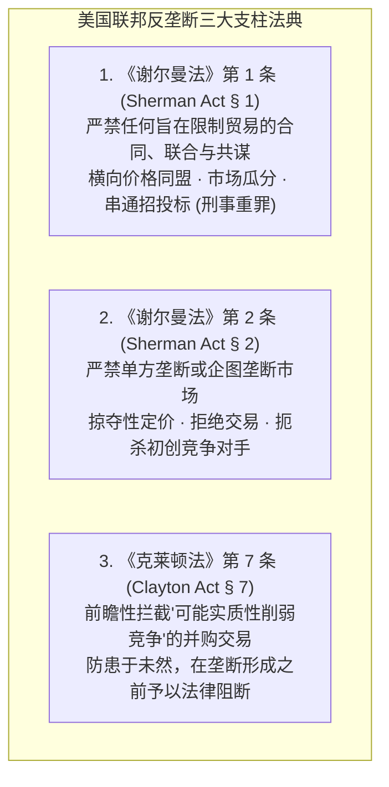
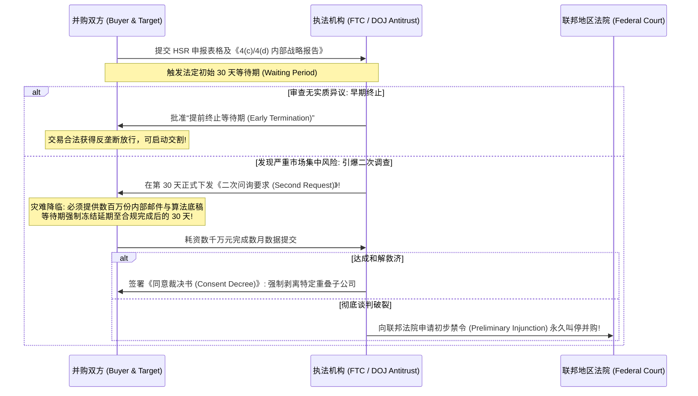
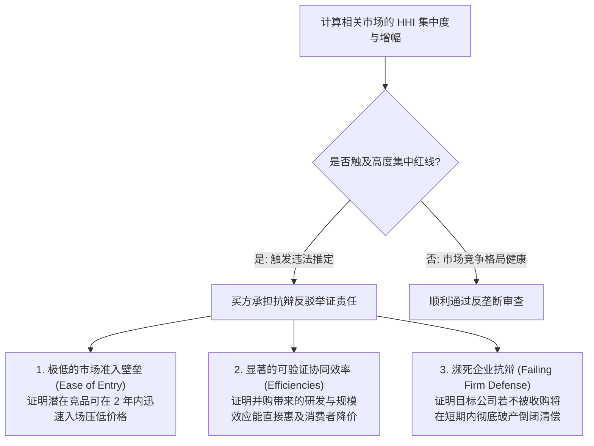

# Lec 21 反垄断法在金融市场与并购中的规制 (Antitrust in Financial Markets & Mergers)

> MIT Sloan 15.617 · The Law of Corporate Finance and Financial Markets · 主讲 Dr. John Akula

## TL;DR

- 反垄断法（Antitrust Law）是市场经济的宪制基石，旨在保护竞争秩序本身而非保护个别弱小竞品。
- 《谢尔曼法》（Sherman Act）确立了打击横向卡特尔操纵的当然违法（Per Se）原则与滥用垄断地位规则。
- 《克莱顿法》第 7 条严密防范实质性削弱竞争的横向并购，以赫芬达尔指数（HHI）为核心量化审查指标。
- 《哈特-斯科特-罗迪诺法》（HSR Act）确立并购交易的事前强制申报与静默审查等待期（Waiting Period）。

## 资本主义的经济宪法：反垄断法律体系总览

在跨国并购与大宗金融资本运作中，商业团队即使在估值、税务和公司治理上达成了一致，整笔交易依然高悬着一把致命的制度悬剑——**反垄断审查（Antitrust Review / Merger Control）**。

反垄断法被称为现代自由市场的“经济宪章”。其底层法哲学坚定地假定：不受约束的私人垄断与共谋，将必然导致全社会的产量收缩、价格飙升、创新阻滞与社会福利的净损失。美国联邦反垄断法律大厦建立在三大支柱法案之上：

在并购实务中，执法机关（司法部反垄断局 DOJ 与联邦贸易委员会 FTC）依据《克莱顿法》第 7 条行使极其强大的行政与司法干预权。执法者甚至完全无需证明垄断已经发生，**只要证明该并购在未来“具有实质性削弱竞争的合理概率（Reasonable Probability of Lessening Competition）”**，法庭就有权直接下达永久禁令强制叫停并购！

## 并购反垄断审查的守门人：HSR 法案与强制申报程序

在 1976 年之前，许多巨头在周五晚上突击完成合并交割，等政府发现时双方的厂房和团队已经彻底打散揉合（俗称“鸡蛋已经炒成了炒蛋 Unscrambling the Eggs”），导致事后司法拆解极其困难。

为了彻底扭转这种被动局面，国会出台了著名的**《哈特-斯科特-罗迪诺反托拉斯改进法》（HSR Act）**：

::: definition HSR 事前强制申报与等待期制度（15 U.S.C. § 18a）
只要并购交易满足以下两项法定门槛（每年随通胀动态调整）：
1. **交易规模门槛（Size-of-Transaction Test）**：交易总价值超过法定最低额度（约 1.195 亿美元）；
2. **当事人规模门槛（Size-of-Person Test）**：一方年销售额或总资产超过约 2.39 亿美元，且另一方超过约 2,390 万美元；
**买卖双方必须在正式签署最终协议后，强制向 FTC 与 DOJ 提交极为详尽的 HSR 反垄断申报文件，并支付最高数百万元的法定审查规费！**
:::

### 致命的 4(c) 与 4(d) 文件排查陷阱
在递交 HSR 申报时，法律强制要求双方交出所有由高管或董事审阅过的内部战略文档（涵盖商业计划书、投行汇报 PPT、竞争对手分析）。如果投行顾问在某页 PPT 上写着诸如“收购目标后，我们在该省的定价权将达到绝对统治，可随时提价 20%”，这页纸将成为反垄断检察官在法庭上击沉这笔交易的决定性铁证！

## 市场集中度量化的数学标尺：HHI 指数与审查指南

DOJ 与 FTC 如何科学评判一笔横向并购是否具有垄断倾向？核心依赖于**赫芬达尔-赫希曼指数（Herfindahl-Hirschman Index, HHI）**：

::: theorem HHI 集中度指数数学计算公式
$$HHI = \sum_{i=1}^{n} s_i^2 = s_1^2 + s_2^2 + s_3^2 + \dots + s_n^2$$
其中 $s_i$ 代表市场上第 $i$ 家企业的**百分比市场份额（Market Share %）**。HHI 的取值范围从 0（完全竞争）到 10,000（单一家绝对垄断，$100^2$）。
:::

根据联邦《横向并购指南》（Horizontal Merger Guidelines）的司法审查标准：

| 交易后市场集中度 | 交易后 HHI 数值 | 并购引发的 HHI 增幅 ($\Delta HHI$) | 司法审查态度与法律推定 |
| :--- | :--- | :--- | :--- |
| **高度集中市场 (Highly Concentrated)** | **$HHI > 1,800$**（新指南下调至 $1,500$） | **$\Delta HHI > 100$** | **法律推定该并购很可能产生严重反竞争效应！**执法机构将有极大可能主动提起诉讼叫停 |
| **中度集中市场 (Moderately Concentrated)** | $1,000 \le HHI \le 1,800$ | $\Delta HHI > 100$ | 引发潜在反垄断审查关切，要求企业展开严谨的竞争抗辩论证 |
| **非集中市场 (Unconcentrated)** | $HHI < 1,000$ | 任何增幅 | 通常无需进一步调查，直接安全通关 |

## 救济方案博弈：结构性剥离 vs 行为性限制

当反垄断风暴来袭时，交易双方为了避免数亿美元的并购彻底告吹，通常会主动向监管机构开出**和解救济清单（Remedies）**：

1. **结构性救济（Structural Remedies）**：
   华尔街最经典的妥协方案。双方承诺将重叠的某些重磅业务线、特定工厂或知识产权，**不可撤销地全额剥离出售给具有独立运营能力的第三方竞争对手**。例如，两大饮料巨头合并时，同意将其中一个著名的茶饮料品牌整体卖给第三方；
2. **行为性救济（Behavioral Remedies）**：
   双方承诺在未来数年内维持开放接口、向竞争对手发放公平合理的交叉许可（FRAND 原则）、或不实施任何搭售。但由于行为性救济需要监管机构投入极其繁重的人力进行日常持续监控，现代 FTC 和 DOJ 对行为性承诺持极度怀疑态度，绝大多数情况下只接受干脆利落的“刀开肉绽式”资产剥离。

::: pitfall 忽视抢先实施整合的“抢跑违规（Gun-Jumping）”天价罚单
很多合并方在签署协议后、等待 HSR 审查期间，便迫不及待地让双方销售团队联合开会拜访客户、共享敏感定价数据、甚至让买方管理层进驻目标公司行使经营否决权。这种在等待期届满前提前实施控制的行为，构成极其严重的**反垄断抢跑违规（Antitrust Gun-Jumping）**！司法部曾对多家违规巨头处以按日累计计算的高达数千万美元的巨额民事罚金！
:::

::: insight 自由的竞争，是激发商业创新生生不息的活水源头
反垄断法的崇高价值，不在于惩罚卓越的成功，而在于遏制通往垄断的非正当特权。在资本集中与规模效应被无限推崇的金融战场上，反垄断审查如同一道庄严的制度分水岭——它迫使巨头将精力投向真正的技术创新与价值创造，而不是通过密谋与吞并封死后来者的上升通道。敬畏竞争秩序的边界，是每一场宏大交易能够真正经受住历史检验的法治基石。
:::
