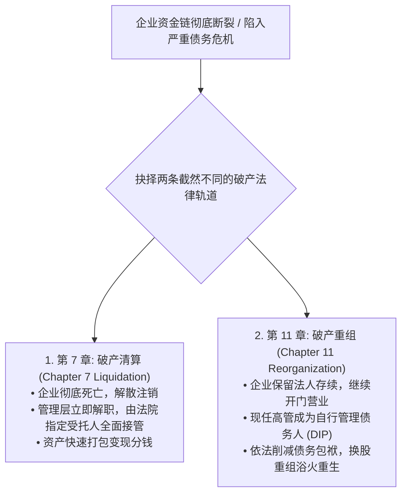
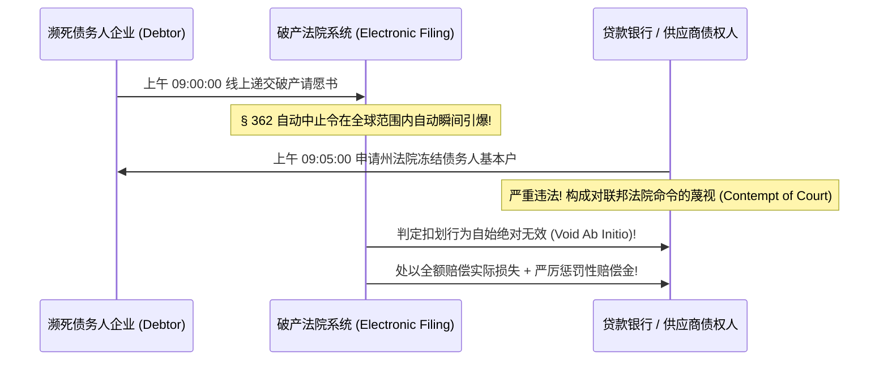
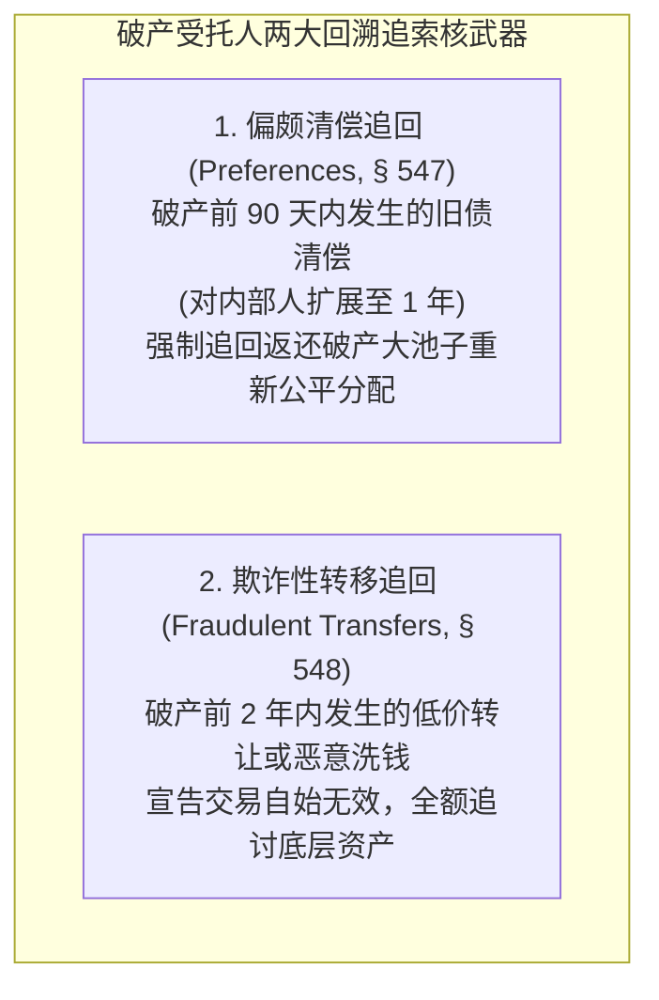

# Lec 22 破产与企业困境重组 I：破产程序启动与自动中止 (Bankruptcy & Financial Distress I: Petitions, Stay & Claims)

> MIT Sloan 15.617 · The Law of Corporate Finance and Financial Markets · 主讲 Dr. John Akula

## TL;DR

- 美国联邦破产法典（Title 11, U.S.C.）确立了兼顾债务人崭新开端与债权人公平有序受偿的宏伟框架。
- 破产申请一旦递交，立即激活全球生效的**自动中止令（Automatic Stay, § 362）**，瞬间冻结所有诉讼与追债。
- 破产财产（Estate）范围包罗万象，破产受托人享有强大的回溯撤销权以保全破产财产的完整性。
- 深度拆解偏颇清偿（Preferences, § 547）与欺诈性转让（Fraudulent Transfers, § 548）的追回闭环。

## 商业困境与破产法的制度转向

在商业世界的跌宕起伏中，由于技术颠覆、行业周期崩塌或资本运作失误，没有任何一家商业实体能够永生不死。当一家企业的负债远远超过其资产变现价值，或者其经营现金流彻底断裂无法兑付下周到期的巨额银行贷款时，企业便无可挽回地滑入了**财务困境（Financial Distress）**的深渊。

若没有破产法，商业世界将退化为弱肉强食的黑暗森林：所有债权人将陷入极端的囚徒困境，人人争先恐后地向法院申请冻结公司银行账户、扣押厂房设备、查封核心专利。这种无序踩踏不仅会导致原本尚有一线生机的优良企业瞬间分崩离析，更会导致全社会资产价值的大幅贬损。

如上图所示，联邦破产法为现代商业文明贡献了最精密的制度发明：**第 11 章（Chapter 11）破产重组**。它将破产从传统的“死亡宣判”升华为一场在法治庇护下的“新生手术”。

## 破产程序的启动：自愿 vs 强迫破产

破产程序的正式大门可以通过两条途径叩响：

1. **自愿破产申请（Voluntary Petition, 11 U.S.C. § 301）**：
   由公司董事会依法正式通过决议，主动向联邦破产法院提交破产请愿书。极具商业智慧的是：**特拉华州法与联邦破产法均明确规定，债务人申请破产在法律上完全无需预先证明自己已经“资不抵债”！**只要公司合理预见到未来即将出现流动性危机，即可依法提前申请破产保护；
2. **强迫破产申请（Involuntary Petition, 11 U.S.C. § 303）**：
   由绝望的债权人联合发起，强行将债务人拖入破产法庭。为了防范恶意竞争对手滥用破产武器搞垮企业，法律设置了极高的法定门槛：**必须有至少 3 家持有合计不低于法定最低额度（约 1.86 万美元）无可争议到期债权的独立无担保债权人**联合签署申请，且必须证明债务人在商业常态下确实“普遍未能按期清偿到期债务”。

## 破产法的超级核盾牌：自动中止令（Automatic Stay, § 362）

在破产法典所有的法律条款中，威力最大、救济最为迅速的是第 362 条规定的**自动中止令（Automatic Stay）**：

::: definition 自动中止令的绝对效力（11 U.S.C. § 362）
从破产请愿书递交至破产法院电子系统的**那一微秒起，一项具有全球法定强制约束力的禁令自动瞬间生效**，无需破产法官单独签署裁决书：
- 严禁任何债权人继续推进任何针对债务人的民事诉讼、仲裁或执行程序；
- 严禁担保物权人查封、没收、拍卖债务人的任何机器、房产或专利资产；
- 严禁商业银行单方面扣划债务人在银行的存款账户资金用于抵销债务；
- 严禁供应商实施任何催款、断供威胁或在债务人门口拉横幅讨债。
:::

自动中止令为奄奄一息的企业构筑了一道绝对防弹的法律安全屋，让管理层从无休止的诉讼应诉与资金封锁中解脱出来，集中精力在平静的环境中推演重组方案。

## 破产财产的完整性与强力追回权（Avoidance Powers）

破产程序一旦启动，债务人名下所有的不动产、动产、无形资产与诉讼索赔权，自动合并为一个具有独立法律人格的**“破产财产独立实体（Bankruptcy Estate, § 541）”**。

为了防止企业管理层在破产前夕私自转移资产、或者某些强势大债权人通过逼迫手段提前抽干企业资金，破产法赋予了破产受托人强大的**回溯撤销追回权（Avoidance Powers）**：

### 1. 偏颇清偿（Preferences, 11 U.S.C. § 547）
如果一家公司在申请破产前第 30 天，由于某家长期供货的核心供应商以断供相逼，公司私下向其提前全额支付了 1,000 万美元的历史货款。破产法认为：这笔清偿使得该供应商获得的清偿比例，显著高于其他同等地位的无担保债权人，破坏了受偿平等正义。受托人有权在破产后直接起诉该供应商，**强制将其银行账户里的 1,000 万美元依法原路追回（Clawback）并倒充公归入破产大池子！**

### 供应商的法定抗辩盾牌：常规商业交易抗辩
供应商要想保住货款，唯一的免死金牌是证明该清偿符合**常规商业交易抗辩（Ordinary Course of Business Defense）**：
- 该笔债务是在双方常规日常经营中产生的（如日常订购原材料）；
- 支付的时间与方式完全契合双方历史上一贯的结算惯例（例如以往一直都是月结 45 天付款，本笔款项同样在第 45 天支付）；
- 没有任何破产前夕非同寻常的暴力催讨或特殊安排。

::: pitfall 濒危时刻向亲友股东提前还债的灭顶之灾
许多创始人眼见公司行将破产，良心不安，赶在递交破产申请前三个月，将账面仅剩的数百万现金优先归还给当初借钱给自己的亲戚、好友或天使投资人。在破产法第 547(b)(4)(B) 条下，**针对董事、高管及其关联亲友等“内部人（Insiders）”所做的债务清偿，偏颇清偿的法定追回期直接从 90 天狂暴延伸至整整 1 年！**受托人不仅会无情追回全部亲友款项，还会以恶意违背受托义务为由，直接判令创始人个人承担无限侵权赔偿责任！
:::

::: insight 困境中的正义，是克制个体的自私以维系群体的秩序
破产法最深邃的法哲学，就在于它在商业世界面临整体崩溃时，强行切断了人性的踩踏冲动。自动中止令与追回权的存在，如同一记沉重的制度警钟：它告诫每一位商海中的航行者，在灾难降临的时刻，任何企图利用特权抢先跳上救生艇、甚至在暗处私相授受分割战利品的行径，都将在法治的审判席前被无情剥夺。唯有将所有权利人置于公平透明的受偿阶梯之上，真正的商业重生才具备合法性与尊严。
:::
