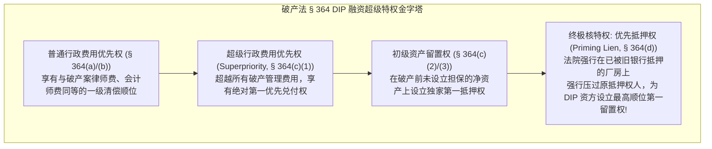
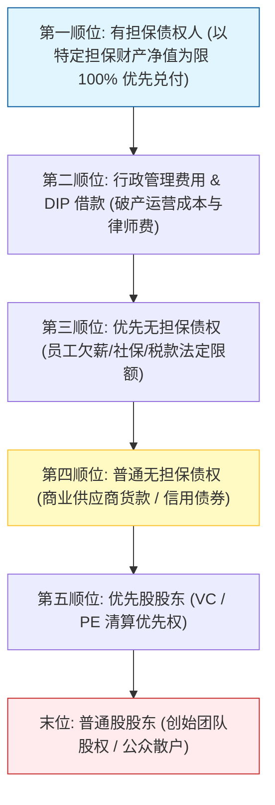
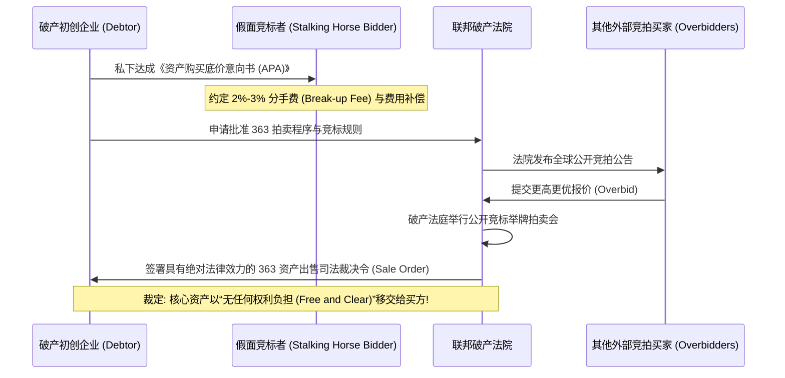

# Lec 23 破产与企业困境重组 II：DIP 融资、绝对优先原则与 363 资产出售 (Bankruptcy & Financial Distress II: Reorganization & Dealmaking)

> MIT Sloan 15.617 · The Law of Corporate Finance and Financial Markets · 主讲 Dr. John Akula

## TL;DR

- Chapter 11 重组的核心特征是债务人自行管理（DIP），管理层在法院监督下拥有双重受托人身份。
- DIP 融资（11 U.S.C. § 364）凭借超级优先权（Superpriority）与优先抵押权（Priming Lien），成为重组维持生命的输血管道。
- 绝对优先原则（Absolute Priority Rule）是资本秩序的铁律：高顺位异议债权人未获全额清偿前，低顺位与原股东必须 100% 股权清零。
- 破产法第 363 条款出售（Section 363 Sale）以“无权利负担（Free and Clear）”快速拍卖优质资产，重塑困境并购格局。

## Chapter 11 自行管理与 DIP 融资的法律特权

在传统的破产清算中，管理层被视为导致企业失败的罪人而被立即扫地出门。但在 Chapter 11 框架下，现代公司法确立了惊人的制度信任：**现任管理层原则上继续掌权，转型为法定的“自行管理债务人（Debtor-in-Possession, DIP）”**。

因为法官深知：没有人比现任管理层更熟悉公司的复杂软件架构、全球客户名单与生产制造工艺。只要消除了利益冲突，赋予其在破产法院监督下的合法运营权，更有利于保全企业作为持续经营实体（Going Concern）的整体价值。

然而，破产重组中的企业普遍面临严重的流动性枯竭。供货商要求现款现货，员工需要按周发薪。为了让华尔街信贷资本敢于向濒死企业注入流动性，破产法第 364 条赋予了极其霸道的**DIP 融资（DIP Financing）特权阶梯**：

在优先抵押权（Priming Lien）的庇护下，困境投资基金（Distressed Debt Funds）敢于以极具吸引力的利率向重组企业开出数亿美元的借款支票，从而为企业的供应链维持提供了最关键的生命血液。

## 执行中合同（Executory Contracts）的断舍离法则

重组不仅仅是借钱，更是全面摆脱历史亏损包袱的绝佳契机。破产法第 365 条赋予了债务人极其强大的**合同选择权（Executory Contracts Powers）**：

::: definition 执行中合同的“承认与拒绝权”（Assumption or Rejection）
凡是在破产申请时，**双方均存在重大未履行义务的合同**（如长期亏损的专卖店租赁合同、高价长期原材料采购协议、昂贵的高管雇佣合同）：
- **拒绝合同（Rejection）**：债务人有权单方宣布合同废止！合同拒绝在法律上被视为破产申请前夕的违约。**对方当事人无法要求强制履行，其遭受的所有未来租金损失，一律降格为普通的第四顺位无担保债权**，在重组计划中通常仅能分得几美分的残羹冷炙！
- **承认合同（Assumption）**：对于盈利丰厚的优质客户订单或核心知识产权许可，债务人有权继续强制执行该合同，对方不得擅自因破产而单方解约。
:::

大型航空公司（如美航、联航）在历次破产重组中，正是凭借 § 365 条款，在数周内合法退租了数百架高租金老旧客机、单方面废除了不可承受的昂贵工会养老金协议，从而实现了在轻装上阵后的奇迹重生。

## 重组计划、绝对优先原则与强行批准（Cram-Down）

重组的终极产物，是一份由债务人起草的**重组计划（Plan of Reorganization）**。计划将所有债权人划分为不同的类别（Classes），并由受损类别进行投票表决。

若有一类债权人（如普通无担保供应商）坚决反对该方案，破产法院要想依据第 1129(b) 条越过反对者强行裁定方案生效（即**强行批准 Cram-Down**），必须严格恪守现代金融资本秩序的基石宪法——**绝对优先原则（Absolute Priority Rule, APR）**：

::: theorem 绝对优先原则（Absolute Priority Rule, 11 U.S.C. § 1129(b)(2)）
在一项重组方案中，**任何顺位较低的权利类别（如劣后级债权人、优先股股东、普通股股东），在所有顺位高于其的异议类别（Dissenting Class）获得 100% 全额清偿之前，绝对不得从破产财产中获得或保留任何财产权益！**
:::

清偿层级与绝对优先规则执行严格如下：

在 99% 的破产案件中，破产资产连第四顺位普通无担保债权的本金都无法全额覆盖。根据绝对优先原则，**原普通股股东（包括创始团队名下的全部股权）依法必须 100% 彻底注销归零（Wipe Out）！**企业走出破产后发行的新股票，将全额按照“债转股（Debt-for-Equity Swap）”分配给原高级债权人，高级债权人成为重组后新公司的全新股东。

## 困境并购的最强通道：破产法第 363 条款出售（Section 363 Sale）

对于许多拥有顶尖核心技术、但现金流已经枯竭的初创科技企业而言，耗时两年的 Chapter 11 漫长重组将导致核心工程师全员流失。为此，华尔街普遍采用极速变现通道——**破产法第 363 条款资产出售（Section 363 Sale）**。

### § 363 资产出售的核心制度杀伤力
1. **无权利负担出售（Free and Clear of All Liens）**：买方所收购的服务器代码、专利技术与品牌，**被法院裁定彻底剥离所有历史抵押、历史劳动仲裁与陈年侵权诉讼**！历史烂账全部被封死在旧壳公司内，由拍卖换来的现金按破产顺位分给债权人；
2. **免除股东投票要求**：只要破产法官批准，交易完全无需目标公司股东大会表决，彻底粉碎了钉子户股东勒索索赔的企图；
3. **假面竞标者（Stalking Horse）机制**：通过给予首个出底价的买方 2% 至 3% 的分手费激励其承担尽调成本，再通过公开法庭举牌拍卖确保债权人利益实现最大化变现。

::: pitfall 忽视 363 出售中的“串通竞标（Collusive Bidding）”重罪
破产法第 363(n) 条严厉禁止潜在买家私下串通操纵拍卖价格（例如买方 A 私下向买方 B 支付 500 万美元，要求 B 退出竞拍以压低中标价）。一旦被受托人或法官查实，破产法院有权直接**撤销该交易、强制追回资产，并判令串通各方承担高达三倍的惩罚性赔偿金及刑事起诉**！
:::

::: insight 商业生命的轮回，在绝对理性的法律秩序中获得永生
破产法庭上的每一次法槌落下，都标志着商业资本秩序对过剩与错误的最冷酷纠偏。在绝对优先原则面前，再光鲜的独角兽神话与资本大鳄都必须向严密的契约顺位低头；但与此同时，DIP 融资与 § 363 资产出售又展现了人类制度智慧最优雅的慈悲——它如同森林中的一场自然山火，将坏账与枯枝败叶焚烧殆尽，同时将凝聚着无数人心血的技术火种从灰烬中迅速剥离保全，为下一轮商业文明的拔节生长孕育最肥沃的土壤。
:::
