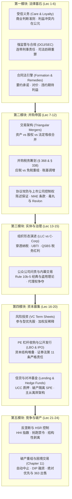
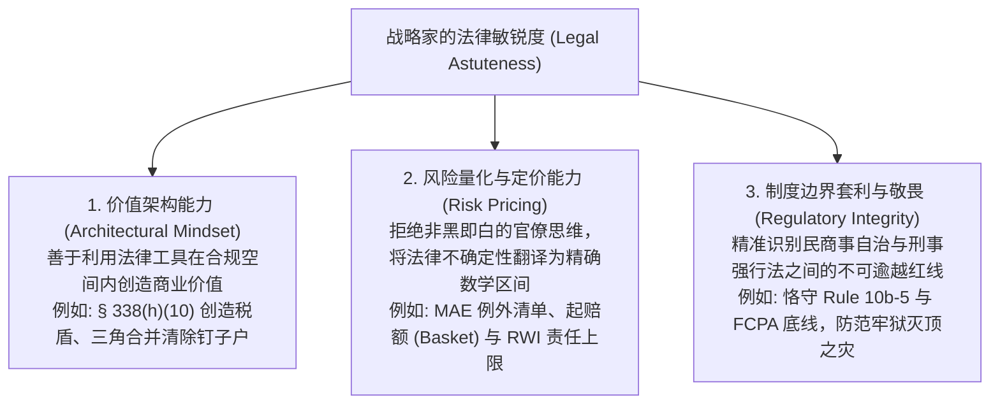

# Lec 24 课程总结：战略交易架构与金融法律思维精粹 (Course Wrap-up: Strategic Dealmaking & The Legal Mindset)

> MIT Sloan 15.617 · The Law of Corporate Finance and Financial Markets · 主讲 Dr. John Akula

## TL;DR

- 全课五大模块知识网络融会贯通：从基础受托契约、M&A 并购帝国、公众公司合规到创投资本与破产突围。
- 确立顶尖金融家与战略决策者的核心法律心法：法律敏锐度（Legal Astuteness）作为核心战略资产。
- 交易的本质是运用合同法、税法与公司法工具，将不可预测的商业风险转化为精确锁定的数学区间。
- 寄语未来商业领袖：敬畏法治底层规则，在制度的严密护航下勇敢驾驭资本的未来。

## 15.617 知识版图的宏伟全景全域巡礼

历经二十四讲的深度探索，MIT 15.617（交易、金融与公司法）为我们完整拼接起了一幅现代资本市场运行的制度全景图。这些曾经看似分散、晦涩的成文法典与判例规则，在真实商业资本的流动中，彼此紧密咬合为一台永不停歇的精密仪器：

纵览这一贯穿企业资本生命的五大模块，我们能够清晰地洞察到现代公司金融法律演进的内在自洽性。普通法受托责任（Fiduciary Duties）与合同救济原则充当了全系统的细胞与基石；在此之上，并购交易架构（M&A Structuring）与税务筹划（Tax Planning）构建起资本扩张的躯干；公众公司证券监管与治理问责（Rule 10b-5 & Governance）铸就了面向全社会的透明胸膛；风险投资与杠杆收购（VC & LBO）输送着高风险创新的血液；而破产重组法典（Chapter 11）则构成了系统面临不可逆崩塌时进行自我清创与重生的免疫防线。

在这一宏伟体系中，任何一个局部的法学盲区，都会在资本运作的放大镜下演变为致命的系统性崩溃。不懂受托责任的董事会在并购中极易遭遇集体诉讼与巨额判赔；不精通税务税基调增的架构师会白白流失数亿美元的税盾财富；而轻视破产优先原则与信贷质押的资方则将在潮水退去后沦为血本无归的受害者。唯有以全局全域的眼光审视资本流转，方能真正领悟交易法学的精髓。

从一名初出茅庐的创业者设立第一家特拉华 C-Corporation，到多轮引入 VC 优先股资本；从企业迈向纽交所公开发行敲钟，到百亿美元级横向跨国吸收合并；直至在宏观萧条与周期巨浪中面临违约、借由 Chapter 11 破产重组与 363 快速拍卖实现金蝉脱壳——**在这场跨越企业全生命周期的资本史诗中，法律从来不是被动的外部约束，而是构筑一切财富流转与控制权权柄的终极底层代码。**

## 卓越战略家的三大核心法学素养（Legal Astuteness）

在 MIT Sloan 讲台上，John Akula 博士反复强调：本课程的终极目标，决不是把商学院精英培养成抠法条的初级文书律师，而是赋予未来的首席执行官、首席投资官与顶级银行家以**“法律敏锐度（Legal Astuteness）”**这一无价的战略心智模型：

拥有法律敏锐度的商业领袖，在与顶级律所合伙人对话时，永远掌握着战略主动权。他们不会被动询问律师“我能不能做这件事？”，而是坚定地指出商业目标：“我想实现这一资本配置格局，请通过精密的条款设计为我构筑一道不可击穿的合规护甲！”

## 交易的终极哲学：在不确定的荒野上构筑秩序

商业世界是一片充满剧烈波动、信息不对称与人性贪婪的浩瀚荒野。没有任何商业计划书能够完全预测三年后的技术迭代、地缘冲突或信贷危机。

然而，正是有了成文公司法、信贷协议、陈述保证与破产法典，人类才得以在充满未知的虚空之上，建造起数万亿美元规模的跨国协作体系。
- 一份精密的商业合同，是在为最坏的可能预先购买保险；
- 一项严谨的受托责任约束，是在为最脆弱的信任提供制度抵押；
- 一场残酷的 Chapter 11 破产清偿，是在为整个经济体的自我纠偏保留重生的火种。

## 结语：乘风破浪，恪守底线

金融的本质是跨越时空的资源配置，而法律的本质是维系文明的契约秩序。当金融资本插上法律工程的翅膀，它便拥有了重塑产业、颠覆技术与创造空前社会财富的伟力。

走出 15.617 的课堂，当你们在未来的岁月中踏上华尔街的交易大厅、步入跨国巨头的董事会会议室、或是创办属于你们自己的科技独角兽时，愿你们时刻铭记：
**最伟大的交易者，永远是规则的深邃洞察者；最长存的商业帝国，永远奠基于对受托责任与法治底线的至高敬畏！**

::: insight 法律是商业文明在时间河流中沉淀的最强防线
当我们站在资本市场的浩瀚星空下回望整门课程，我们会深刻认识到：商业探索不仅是一场向外征服未知市场的壮阔远航，更是一场向内约束人性贪婪、建立信任契约的理性修行。成文法典与衡平法裁判并非冰冷的束缚，而是人类数百年商海沉浮所凝结出的生存智慧。懂得在法治秩序中寻找确定性、用精湛架构对冲未知风暴的商业领袖，才能在时代的大风大浪中行稳致远，构筑起真正跨越周期的伟大基业。
:::

---

> “受托人所受约束的准则，绝非集市上尔虞我诈的寻常道德，而是某种最为敏感的荣誉准则。”
> —— 本杰明·N·卡多佐大法官，*Meinhard v. Salmon* (1928)
