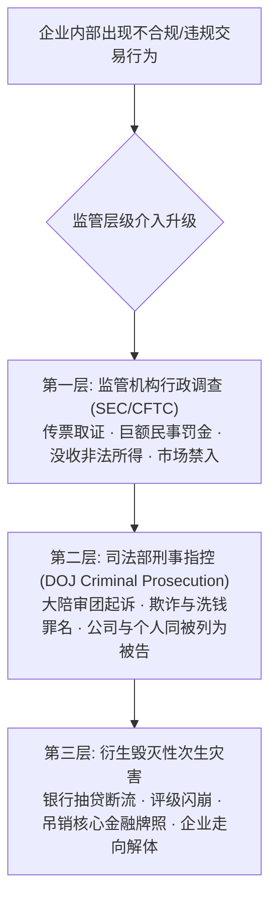
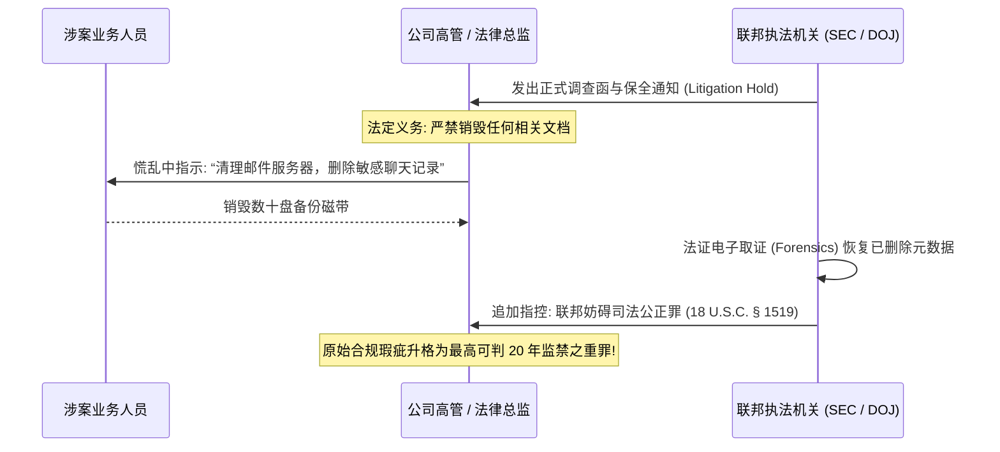

# Lec 3 监管强硬边界与企业白领合规 (The Hard Edge of Regulation)

> MIT Sloan 15.617 · The Law of Corporate Finance and Financial Markets · 主讲 Dr. John Akula

## TL;DR

- 现代金融监管不再停留在民商事私力救济，而是以强大的国家刑法机器作为刚性执法后盾。
- 刑事归责机制（Respondeat Superior）确立：员工在职权范围内为公司利益实施的违法行为，公司整体承担连带刑事责任。
- 司法妨碍（Obstruction of Justice）是华尔街大案中毁灭性极强的高频罪名，擅自销毁底稿将招致灭顶之灾。
- 健全有效的内部合规机制（Federal Sentencing Guidelines）是企业在面临联邦调查时争取免罪或减刑的核心筹码。

## 监管的刚性本质：从民事赔偿到刑事铁窗

许多习惯于商业博弈的管理者容易产生致命的思维定势，将所有法律争端视为“有价可循的商业成本”——只要潜在收益高于违约金或民事罚款，就值得铤而走险。然而，在以美国证券交易委员会（SEC）、司法部（DOJ）以及商品期货交易委员会（CFTC）为代表的强监管网络面前，这种算盘将招致粉身碎骨的下场。

金融监管具有**不可逾越的强硬边界（The Hard Edge）**。一旦企业的商业行为跨过了民商事欺诈的红线，面对的将不再是要求补偿损失的民事原告，而是拥有传票权、线人窃听、资产冻结以及剥夺人身自由权力的国家暴力机关。

如上图所示，当监管调查从行政问责升级为刑事指控时，企业的生存空间将被瞬间压缩。全球五大会计师事务所之一的安达信（Arthur Andersen），并非倒闭于无法赔偿安然投资者的民事损失，而是在被联邦大陪审团以“妨碍司法公正”刑事起诉的那一刻，瞬间丧失了所有公众公司的审计资质，拥有八万多名全球员工的百年巨头在数周之内分崩离析。

## 企业刑事归责机制：员工犯法为何公司买单？

联邦普通法确立了极其严苛的企业刑事连带责任原则（Corporate Criminal Liability）：

::: definition 企业刑事归责的三要件（Respondeat Superior）
只要满足以下三项标准，任何基层员工（哪怕是初级交易员或海外销售员）的刑事犯罪行为，其刑事责任将**无条件归属于公司法人自身**：
1. **员工身份**：违法行为由公司的正式员工或具有代理权的中介人实施；
2. **职务范围**：行为发生在员工实际或表见的职权范围（Scope of Employment）之内；
3. **利企动机**：员工实施违法行为的主观动机中，哪怕仅有微不足道的一部分是“为了让公司获得利益（To Benefit the Corporation）”。
:::

即使公司董事会此前三令五申严禁任何违法行为、即使公司合规手册明文禁止行贿或操纵市场，只要基层员工为了冲刺公司业绩而私下行贿，公司在刑法上依然构成犯罪主体！

## 致命的“次生灾难”：司法妨碍与掩盖罪行

在无数耸人听闻的企业白领犯罪历史中，往往不是最原始的业务违规打垮了公司，而是高管在面对调查时愚蠢的掩盖行径将整个管理层送入了监狱。

联邦法律对破坏证据的惩罚极其严酷：
- **毁灭、篡改或伪造记录罪（18 U.S.C. § 1519）**：任何人明知处于联邦调查之中，故意销毁、篡改、隐匿任何文件或有形记录以阻碍调查的，**单项罪名最高可处 20 年联邦监禁**；
- **虚假陈述罪（18 U.S.C. § 1001）**：在接受联邦调查人员面谈时，即使未在法庭宣誓，只要口头故意作出虚假陈述，即可判处 5 年监禁。

::: pitfall 忽视“诉讼保全通知（Litigation Hold）”的系统性灾难
当企业收到监管机构的问询函或潜在诉讼通知时，首要法律动作不是召开公关危机发布会，而是**立即由法务部向全公司下达书面诉讼保全通知（Litigation Hold）**，并通知 IT 部门立即冻结所有自动删除、覆盖旧邮件的定时脚本。如果在此之后仍有员工因“例行系统维护”清空了关键服务器日志，法院将直接作出对公司最不利的事实推定（Adverse Inference），甚至直接判决公司败诉并承担惩罚性赔偿。
:::

## 救命稻草：《联邦组织犯罪量刑指南》与内控防线

面对企业刑事责任的达摩克利斯之剑，企业的唯一合法避风港是建立经得起检验的内部合规体系。美国量刑委员会制定的《联邦组织犯罪量刑指南》（Federal Sentencing Guidelines for Organizations, FSGO）确立了关键的防卫机制：

| 合规七大核心要素 | 实务落地要求 | 监管减刑效力 |
| :--- | :--- | :--- |
| **1. 确立明晰准则** | 制定涵盖反洗钱、内幕交易、反海外腐败等领域的详细合规政策 SOP | 若企业能证明其建立了真诚有效的合规系统，联邦检察官可自由裁量**免予刑事起诉公司整体** |
| **2. 高层领导监督** | 指定专职合规总监（CCO），直接向董事会审计委员会汇报，人事独立于 CEO | 达成**递延起诉协议（DPA）**或**不起诉协议（NPA）**，以巨额民事罚金与外部合规监管官替代刑事定罪 |
| **3. 尽职调查把关** | 严禁提拔有严重诚信违规前科的人员进入关键资金与交易岗位 | 在罪责积分（Culpability Score）计算中，健全的合规项目最高可**削减 60% 至 80% 的罚金基数** |
| **4. 全员培训沟通** | 针对交易员、高管定期开展模拟实战培训，签署年度合规确认函 | 保护无辜董事个人免于被追究监管疏忽的 *Caremark* 衍生诉讼民事连带赔偿责任 |
| **5. 监控审计评估** | 定期展开内部突击飞行检查，建立法证级内部交易审查算法 | — |
| **6. 奖惩激励分明** | 将合规红线与绩效奖金强制挂钩，违规者坚决予以解雇与奖金追索（Clawback） | — |
| **7. 迅速纠偏响应** | 发现内部舞弊后，绝不捂盖子，在聘请外部独立律所完成尽调后**主动向监管机关自首（Self-Reporting）** | — |

::: insight 合规不是抑制盈利的刹车，而是保障赛车全速行驶的底盘
在狂飙突进的资本市场中，平庸的交易者往往嘲弄合规风控人员是“商业绊脚石”。但纵观百年金融兴衰史，无数曾不可一世的投资巨鳄与神童交易员，最终都是在监管边界的阴沟里翻船身败名裂。真正的金融领袖深刻懂得：风控合规从来不是企业被动应付官僚的公关成本，而是为巨型商业航母在狂风暴雨中抵御毁灭性系统性风险的钢铁龙骨。
:::
