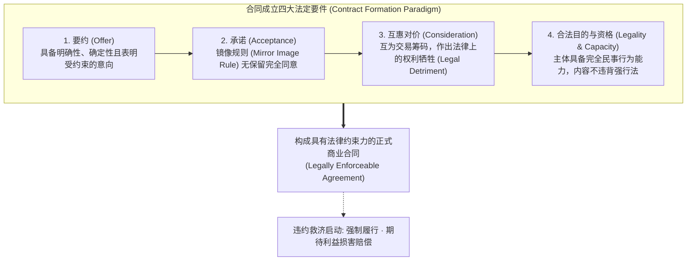
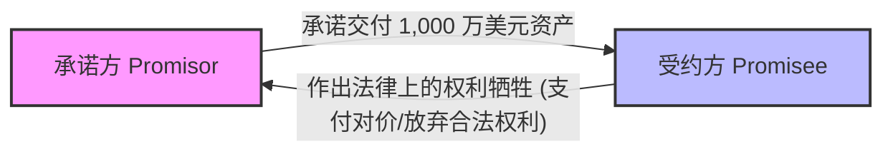

# Lec 4 现代商业合同基础与要件 (Commercial Contracts I: Formation & Consideration)

> MIT Sloan 15.617 · The Law of Corporate Finance and Financial Markets · 主讲 Dr. John Akula

## TL;DR

- 现代商业交易的骨架是合同法，其核心是赋予私人当事人通过合意创设具有国家强制力约束的法律规则。
- 严密解析合同订立四大核心要件：要约（Offer）、承诺（Acceptance）、对价（Consideration）与法定资格（Capacity）。
- 深入拆解英美法独特的对价原则：对价必须具备法律上的充分性（Legal Sufficiency），拒绝单纯的道德义务。
- 不可撤销的信赖保护：允诺禁反言（Promissory Estoppel）作为缺乏对价时的重要衡平法救济支柱。

## 交易的底层骨架：什么是受法律约束的合同？

在金融工程与并购交易中，所有精巧的金融衍生品、银团贷款与股权收购协议，其法律本质无一例外都是**合同（Contracts）**。合同绝不仅仅是一纸盖了公章的文本，在法理学上，合同是主权国家向私人交易主体让渡的一项神圣立法特权：**只要当事人的合意不触犯强行法与公共政策，法律赋予其协议条款如同法律条文一般的绝对强制执行力。**

然而，商业世界中充斥着成千上万封意向邮件、口头磋商、备忘录与会议纪要。法庭究竟凭借何种标准，从复杂的谈判言行中判定双方何时真正越过了“非正式磋商”与“具有法律约束力的合同”之间的楚河汉界？

在现代公司金融与交易实务中，这一成立框架的严格性体现得尤为深刻。金融交易往往涉及数千万甚至数十亿美元的资本配置，任何一个要件的缺失都会在资产负债表上撕开巨大的黑洞。特别是在涉及结构化衍生品或过桥贷款时，投资银行家与公司财务总监必须确保每一个签署步骤都在法定的授权轨道内运行。

此外，当事人的外部客观行为在普通法下享有绝对的裁决优先权。法官不会听信任何一方在事后声称“我当时只是在开玩笑”或“我内心并没有真正打算履约”的主观辩解。只要一位理性第三方在特定商业背景下有理由相信该要约或承诺是真诚严肃的，当事人就必须为其白纸黑字或言行举止承担全部违约法律后果。

## 要约与承诺的博弈规则

要约（Offer）是点燃合同引擎的第一颗火花。一个有效的商业要约必须满足两个基本门槛：
1. **受约束意图的客观表达（Manifestation of Intent to be Bound）**：法律不探究当事人内心深处的暗自保留，而是依据一个“理性的受要约人”在当时情境下是否合理认定该表达具有法律拘束力；
2. **核心条款的确定性（Definiteness of Essential Terms）**：必须包含交易标的、价格、数量、交付期限等核心要素。

::: definition 承诺与“镜像规则（Mirror Image Rule）”
在传统普通法下，有效的承诺必须是原要约的完全“镜像”。受要约人如果对要约中的任何条款作出了实质性增加、删除或修改（例如：“我同意以每股 50 美元买入，但交割时间必须提前三天”），在法律上**该行为不构成承诺，而是对原要约的直接拒绝并构成反要约（Counter-Offer）**！原要约在反要约发出的瞬间在法律上彻底死亡失效。
:::

### UCC 第 2 篇与“表格之战（Battle of the Forms）”

在现代商业货物采购中，买方发送其标准《采购订单》（PO），卖方回复其标准《销售确认函》（Sales Confirmation），两张格式单据背面的细则条款（如违约赔偿责任、争议解决地、质保期）往往南辕北辙。针对这种现实冲突，美国《统一商法典》（UCC § 2-207）彻底废除了严苛的镜像规则：
- 只要卖方的回复表达了明确且及时的承诺意向，哪怕包含附加或不同条款，合同依然有效成立；
- 双方商事主体之间，附加条款自动成为合同的一部分，除非：(1) 原要约明文限定仅接受原条款；(2) 该附加条款构成了**重大变更（Material Alteration）**（例如苛刻的仲裁条款或免除人身伤害赔偿）；(3) 对方在合理时间内提出了明确异议。

## 对价原则（Consideration）：拒绝无偿承诺

对价（Consideration）是英美法系合同法最独特的基因，它将普通法与大陆法系彻底区别开来。

::: theorem 对价的互惠交易理论（Bargained-for Exchange Theory）
一项受法律保护的承诺必须由某种对价予以支持。对价必须包含两层核心结构：
1. **互为交易对象（Bargained-for）**：承诺人之所以作出该项承诺，是为了换取受约人的某种对价；受约人之所以提供该项对价，是被承诺人的承诺所引诱诱导；
2. **法律上的权利牺牲（Legal Detriment）**：受约人必须放弃了某种其原本有权保留的合法权利，或者承担了其原本并无法定义务承担的作为或不作为。
:::

### 商业金融中常见的“假对价”陷阱

管理者在重组债务或签署补充协议时，最容易踩中由于缺乏有效对价而导致协议无效的陷阱：
1. **既有法定义务准则（Pre-existing Duty Rule）**：如果一家总包商在建设数据中心过程中，因钢材价格上涨威胁停工，要求客户追加 20% 工程款，客户在恐慌中签署了追加协议。在普通法下，**该追加协议自始无效！**因为总包商本来就负有按原合同完工的既有合同义务，其并未提供任何新增对价（法律牺牲）；
2. **过去对价（Past Consideration）**：若公司董事在老员工退休时感念其过去三十年的卓越贡献，口头签署协议“终生每月发放 5,000 美元津贴”。该协议在法律上不具备强制执行力，因为员工过去的劳务在当年已经完成兑付，不能被“回溯”用作支持今天新承诺的有效对价。

## 衡平法的神来之笔：允诺禁反言（Promissory Estoppel）

当商业合同因为技术性的“缺乏对价”而面临无效、但受约人已经基于该承诺付出了惨痛代价时，普通法法院设立了一套强大的衡平法补救机制——**允诺禁反言（Promissory Estoppel）**。

::: definition 允诺禁反言的构成四要素（Restatement (Second) of Contracts § 90）
1. 承诺人作出了明确清晰的承诺；
2. 承诺人有充分理由预见到受约人将信赖该承诺并采取行动；
3. 受约人合理且切实地信赖了该承诺，并**遭受了实质性损害（Detrimental Reliance）**；
4. 唯有强制执行该承诺，方能避免实质性非正义（Injustice）。
:::

在经典的商业借贷案例中，若商业银行的高管向房地产开发商承诺“只要你们完成拆迁，5,000 万美元的过桥贷款下周一必定放款”。开发商基于该确定性承诺砸入数百万完成拆迁并回绝了其他资方。即使双方此时尚未正式签署长达两百页的借款协议，法院依然会基于允诺禁反言原则，强制判定银行必须赔偿开发商基于信赖所遭受的全部实际损失（Reliance Damages）。

::: pitfall 电子邮件交流中的“意外缔约（Accidental Contract）”
很多项目经理在与供应商就补充工作量谈判时，在邮件中随手回复“Approved”（已批准）或“Let's proceed on this basis”（按此推进）。在客观理性人标准下，这些言辞已被无数法庭判定为构成了具有完全约束力的合同承诺。如果邮件签名档中没有固定标注明确的法律免责声明（如“Subject to Final Execution of Definitive Agreement”），这种不经意的确认将直接使公司背负数百万美元的法定义务。
:::

::: insight 商业契约是文明战胜丛林法则的最高仪式
在古老的丛林社会中，合作依赖于血缘、人质与武力恐吓；而在现代文明社会中，成千上万从未谋面的商业主体能够横跨大洋开展数十亿美元的协同，其唯一依靠的就是合同法所赋予的确定性预期。每一份字斟句酌的商业合同，都是在用理性的文字驱散未来的商业迷雾。懂得用合同规则严密保护自己、同时信守承诺的商界领袖，才是资本市场长存不败的真正赢家。
:::
