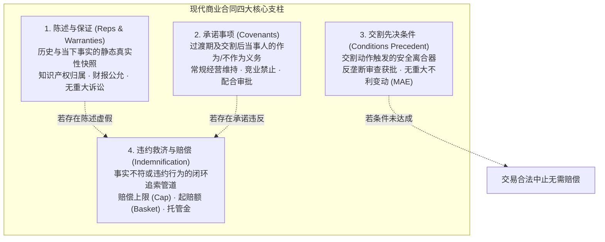
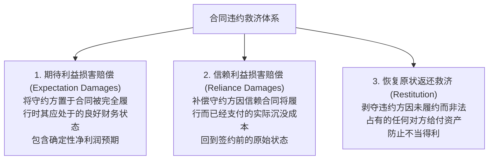

# Lec 5 复杂商业合同条款与违约救济 (Commercial Contracts II: Breach, Remedies & Risk Allocation)

> MIT Sloan 15.617 · The Law of Corporate Finance and Financial Markets · 主讲 Dr. John Akula

## TL;DR

- 现代复杂商业与并购合同是一座权衡风险与资产定价的精密建筑，由四大核心模块构成。
- 陈述与保证（Reps & Warranties）锁定签约基准事实，并与交割前承诺事项（Covenants）协同运转。
- 深刻理解普通法合同救济金字塔：期待利益（Expectation Damages）是救济的绝对核心。
- 附带与衍生损失（Consequential Damages）的免除与赔偿上限（Cap），构成了防范天价索赔的避雷针。

## 现代商业合同的模块化解剖学

在投行并购、私募股权投资以及大型技术转让交易中，一份动辄两三百页的最终协议（Definitive Agreement）决不是机械堆砌的法律废话。从金融工程与风险控制视角审视，商业合同本质上是**一份关于未来不确定性风险的定价与分配清单**。

从法律工程学的高度来剖析这份协议架构，我们会发现它实际上是一部精密的动态风险分流机器。陈述与保证负责将历史信息的不对称性转化为清晰的定价折价；承诺事项确保在复杂的反垄断审查与股东会批准期间，标的资产的商业价值不被管理层私自掏空；交割条件则赋予买方在遭遇不可抗力或外部灾难时优雅离场的安全阀门。

而在协议尾部的救济与赔偿条款，则是所有前期尽调与谈判成果的终极变现管道。缺乏与陈述保证条款相咬合的赔偿机制，哪怕发现对方存在严重的欺诈性披露，买方在漫长的事后诉讼中也将面临极其高昂的举证成本。正是这四大支柱的精密啮合，才使得复杂的跨国交易得以在法治秩序的护航下平稳着陆。

如上图所示，这四大核心支柱环环相扣：
1. **陈述与保证**确定了资产的质量与风险基准面，买方依据卖方的陈述进行估值报价；
2. **先决条件**确保买方在外部监管未获批或标的公司突发火灾时，有权“合法安全退单”而不构成违约；
3. **承诺事项**防止卖方在签约后到交割前的数月过渡期内偷偷将公司现金分红分光或贱卖资产；
4. **赔偿条款**则构成了整个交易风险追索的终极安全网。

## 违约行为的分水岭：重大违约 vs. 轻微违约

当履约出现瑕疵时，商业管理者面临的第一个决断是：对方的瑕疵是否赋予了我“立即终止合同并停止付款”的权利？

| 违约层级 | 法律判定门槛 | 守约方享有的法定权利 | 典型商业场景 |
| :--- | :--- | :--- | :--- |
| **根本/重大违约 (Material Breach)** | 违约行为击穿了合同的核心目的，守约方在实质上无法获得其依据合同有权期待的核心利益 | 1. **立即中止或解除合同**； 2. 全面免除自身后续一切履约义务； 3. 起诉追索全部违约损害赔偿 | 并购交割时发现标的公司核心发明专利权属存在致命缺陷，根本不归公司所有 |
| **轻微/次要违约 (Minor / Partial Breach)** | 违约行为仅涉及非核心的细节瑕疵，当事人已经完成了**实质履行（Substantial Performance）** | 1. **必须继续履行自身义务**（不得擅自拒付货款）； 2. 仅有权就瑕疵部分的实际损失提起损害索赔或价款抵扣 | 厂房施工中承建方擅自更换了水管品牌，但替代管道在质量、寿命与抗压上完全等同 |

::: pitfall 遭遇轻微违约时“擅自断供”招致的责任反转
很多缺乏经验的企业管理者，在对方出现微小迟延或轻微文档格式瑕疵时，便愤怒地单方面通知“由于你们严重违约，我方宣布合同终止并拒绝支付尾款”。在法庭审理中，如果法官认定对方仅构成轻微违约且已完成实质履行，**该管理者单方面拒付尾款的行为将被判定为重大违约！**原本的受害方在一夜之间沦为承担全部赔偿责任的加害方。
:::

## 普通法违约救济的三大维度

与侵权法侧重于“填平损害、惩罚恶行”不同，普通法合同救济的法哲学宗旨是**保护交易期待，实现资本财富的最佳配置**。合同救济严禁惩罚性赔偿，主要由三个梯次构成：

### 传世先例：*Hadley v. Baxendale* (1854) 与间接损失规则

一家磨坊的蒸汽机曲轴断裂，委托承运人送往格林威治铸造厂作为样板铸造新轴。承运人发生严重违约迟延，导致磨坊停工数周，磨坊主起诉要求承运人全额赔偿停工期间的全部营业利润损失。英国法院确立了流传百年的**衍生/间接损失可预见性规则（Consequential Damages Foreseeability Rule）**：

::: theorem *Hadley v. Baxendale* 规则
因违约引发的损害赔偿仅限于：
1. **通常损失（General Damages）**：违约行为在通常情况下自然而然、理所当然必然引发的损失；
2. **特殊/间接损失（Consequential Damages）**：只有在**签约时**双方当事人已经明确预见到了某种特殊情况的存在，或者守约方在签约前已经将该特殊商业风险明确告知了违约方，违约方才承担赔偿责任。
:::

由于磨坊主在托运时并未向承运人明确说明“没有这根轴整个磨坊将陷入停工”，承运人无需对这笔天价停工营业利润损失买单。

## 责任限制（Limitation of Liability）的防雷设计

正是基于 *Hadley* 规则的启发，每一位精明的交易律师在起草合同时，都会将以下两项条款视为公司的免死金牌：

1. **附带与衍生损失的全面免除条款（Waiver of Consequential Damages）**：
   明确约定：“任何一方对另一方所遭受的任何间接损失、附带损失、惩罚性赔偿、业务中断损失或商业机会与利润损失，均不承担任何责任，无论是否已被告知该等损失的可能性”；
2. **总责任封顶（Liability Cap）**：
   明确约定：“在任何情况下，一方因本协议引起或与本协议相关的全部累计赔偿责任，在任何法理下均不得超过买方过去十二个月内实际支付的总服务费”。

::: insight 合同条款不是束缚创新的链条，而是量化风险的算盘
在没有责任限制条款的荒野上开展商业交易，犹如在没有安全绳的高空走钢丝。一个看似只有五十万美元利润的软件交付订单，若因系统宕机导致客户跨国供应链停摆数日，潜在的衍生索赔可能高达数千万美元。优秀的商业法务架构师，其价值绝不在于阻碍生意成交，而在于用精湛的条款设计为企业建立起一道道防火墙，确保无论外部风浪多大，公司的最大风险始终处于数学上精确锁定的可承受区间之内。
:::
