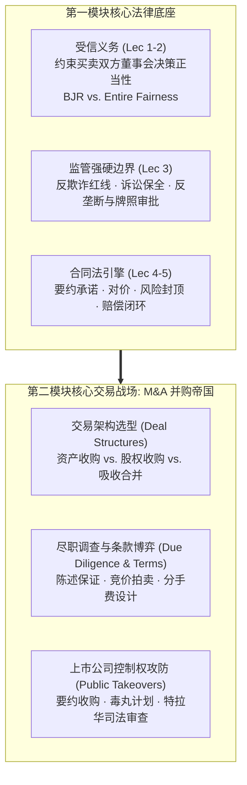
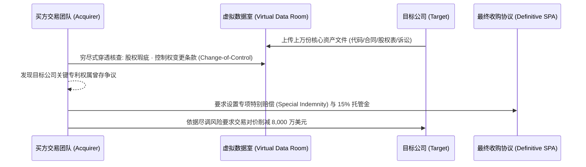

# Lec 6 基础法学体系总结与并购交易前瞻 (Module I Wrap-up & Transition to Dealmaking)

> MIT Sloan 15.617 · The Law of Corporate Finance and Financial Markets · 主讲 Dr. John Akula

## TL;DR

- 梳理第一模块核心法学工具箱：受信义务、监管刚性红线与商业合同法如何协同构建交易底层逻辑。
- 确立并购交易（M&A）的三维决策矩阵：法律权属合规、税务穿透优化与控制权溢价分配。
- 介绍尽职调查（Due Diligence）的法证穿透功能：从事实摸底到合同陈述保证（Reps）的精准勾稽。
- 开启第二模块并购专题：从友善磋商到敌意收购（Hostile Takeovers）的资本攻防预演。

## 第一模块法学思维的融会贯通

在前五讲的学习中，15.617 搭建起了现代商业金融法学的核心底座。这些基础概念决非孤立的法律教条，而是每一场百亿级并购与重组交易中必不可少的战术零件：

从基础法学理论向高阶交易实务的跨越，本质上是一场思维维度的升华。在传统法律实务中，律师往往被视为“挑刺者”或事后的纠纷收拾者；但在现代并购与资本运作领域，顶级的交易律师与商业领袖必须化身为“价值架构师”。他们不仅要通晓特拉华州公司法对于董事会受信义务的严苛裁判尺度，更要善于利用合同条款的巧妙设计去对冲未知的商业暗礁。

因此，对基础法学工具箱的熟练掌握，构成了穿透复杂并购迷局的 X 光透视仪。在即将展开的第二模块中，无论是数百亿美元的友善吸收合并，还是硝烟弥漫的恶意敌意收购，一切惊心动魄的资本博弈，最终都将在本模块所建立的合同法、受托责任与监管红线之中找到最深层的制度答案。

在接下来的第二模块中，我们将全方位切入资本市场最激动人心的领域——**企业并购与控制权交易（Mergers & Acquisitions）**。当两家企业决定走向联姻或展开殊死搏杀时，之前所学的一切规则都将被推向极限：
- 董事在决定出售公司时，是否履行了注意义务？是否背负了为全体股东争取最高价格的 *Revlon* 绝对义务？
- 交易文本中关于重大不利变动（MAE）的定义，是否能赋予买方在市场崩盘时安全脱身？
- 历史上的环保违规与员工诉讼，如何在收购协议中通过特别赔偿条款（Special Indemnity）精准剥离？

## 尽职调查（Due Diligence）：法律与商业的侦察战

在任何正式并购协议签署之前，买方必须组建由投资银行、法务律师与法证会计师构成的联合舰队，展开极其详尽的**法律尽职调查（Legal Due Diligence）**。

尽职调查的核心任务不是泛泛而谈的“了解公司”，而是开展冷酷的法证排雷：
1. **控制权变更条款（Change-of-Control Provisions）**：目标公司与核心大客户签署的数亿元销售合同中，是否潜藏着“一旦公司发生并购，客户有权单方无偿解约”的致命毒丸？
2. **知识产权链条完整性（IP Chain of Title）**：每一位离职工程师是否均已签署无可挑剔的知识产权转让协议？是否有核心开源代码违反了 GPL 传染性协议？
3. **资本架构真实性（Capitalization Table Integrity）**：期权、可转债、认股权证是否存在未予披露的稀释条款？创始人是否有私下代持股份的抽屉协议？

## 并购的三种基本架构雏形

在步入第七讲的深入探讨之前，管理者必须建立对三大交易形态的基础直觉：

| 交易架构 | 交易实质与操作机制 | 历史负债隔离效果 | 股东审批与少数派阻力 |
| :--- | :--- | :--- | :--- |
| **资产收购 (Asset Purchase)** | 买方挑选购买目标公司的特定资产（机器、品牌、存货），并承接特定负债 | **极佳**：未被买方明确同意承接的历史负债原则上留在原目标公司壳内 | 极为繁琐：每项土地、租约、知识产权均需单独办理过户审批与客户同意 |
| **股权收购 (Stock Purchase)** | 买方直接从目标公司的全体股东手中逐一购买股份，目标公司成为买方的子公司 | **较差**：目标公司名下的所有历史潜在负债（包括未爆发的税务与诉讼）全盘保留 | 存在阻力：必须逐一获得 100% 股东签字，否则无法彻底清退少数钉子户股东 |
| **法定合并 (Statutory Merger)** | 根据州公司法规定，两家公司通过股东大会表决，法定融合为一家存续实体 | **全盘承接**：存续公司依法无条件继承被合并方的一切权利、财产与全部债务 | **最高效**：只要获得法定多数股东赞成，少数反对股东将被依法强制换股出局 |

::: pitfall 忽视“事实合并（De Facto Merger）”招致的负债反扑
在资产收购中，买方本以为“只买资产、不买旧债”。但如果买方买下了目标公司的全部资产、雇佣了原班人马、让原股东换得了买方的股份、并让原目标公司迅速注销解散，法院将依据衡平法认定该交易构成了“事实上的合并（De Facto Merger）”，判决买方必须为目标公司昔日的重大人身伤害赔偿或环境污染承担全部继承债务！
:::

::: insight 交易的灵魂在于看透纷繁数据背后的权力结构
随着第一模块的落幕，我们已经跨越了法学理论的学徒期。在接下来的章节中，我们将看到法律不再是静态的条文约束，而是顶级金融家手中最灵巧的手术刀。并购不是简单的数字拼接，而是一场关乎数万人命运、数以百亿计财富重新洗牌的资本史诗。掌握了法律逻辑的交易者，才能在混乱的博弈风暴中游刃有余地驾驭资本的未来。
:::
