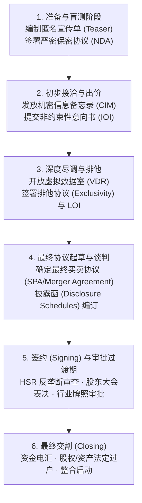
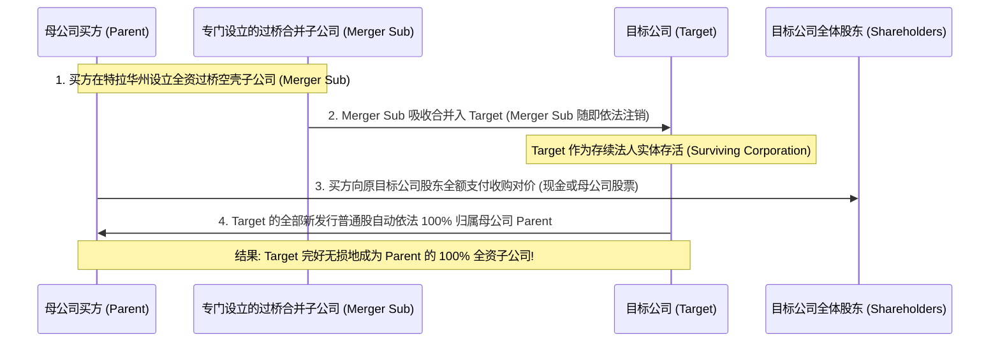

# Lec 7 并购核心主体、阶段与交易架构 (M&A Key Players, Stages and Deal Structures)

> MIT Sloan 15.617 · The Law of Corporate Finance and Financial Markets · 主讲 Dr. John Akula

## TL;DR

- 并购交易是一场由战略买方、PE、投资银行、顶级律所与审计师紧密协作的复杂制度交响乐。
- 完整并购生命周期涵盖项目盲测、保密协议（NDA）、意向书（LOI）、尽调、最终协议（SPA）与交割。
- 深度对比三大基础交易形态：资产收购（Asset Deal）、股权收购（Stock Deal）与法定合并（Statutory Merger）。
- 反向三角合并（Reverse Triangular Merger）融合了债务隔离与无需逐一换约的优势，成为现代商业并购的黄金标准。

## 并购战场的关键参与者与角色矩阵

企业并购（Mergers & Acquisitions, M&A）是资本市场最壮观也是风险最集中的资本运作形态。一次数百亿美元的交易，牵涉到数以万计的员工、复杂的专利技术、庞大的供应链网络以及两家甚至数家不同企业文化的融合。在开启一场并购之前，决策者必须清晰识别驱动这台庞大机器运转的核心参与主体：

| 核心主体 | 职责分工与利益诉求 | 核心法律与交易文件 |
| :--- | :--- | :--- |
| **战略买方 (Strategic Buyer)** | 追求产业协同效应（Synergies）、技术填补或市场垄断份额；看重长期整合与业务连贯性 | 长期战略规划书、反垄断承诺函、业务整合协议 |
| **财务赞助人 (Financial Sponsor / PE)** | 追求资本增值与高内部收益率（IRR）；高杠杆介入，精算现金流并在 3 至 5 年内谋求退出 | 杠杆融资承诺函（Debt Commitment Letter）、管理层股权激励协议 |
| **投资银行 (Investment Banks)** | 担任买方/卖方财务顾问；负责估值建模、组织竞价拍卖、出具公允性意见书（Fairness Opinion） | 财务尽调报告、估值分析底稿、银行承销协议 |
| **交易律师 (M&A Counsel)** | 交易架构设计、主导法律尽职调查、撰写并谈判买卖协议、协调反垄断审查与交割 | 保密协议（NDA）、意向书（LOI）、最终买卖协议（SPA/Merger Agreement） |
| **法证会计师 (Forensic Accountants)** | 审计历史财务报表、审查营收确认合规性、设定营运资金调整（Working Capital Adjustment） | 质量收益报告（QoE Report）、税务尽调备忘录 |

这些专业主体通过精密的制度分工，将充满商业不确定性的交易逐步推向合规封闭的法律交割通道。

## 经典并购交易的生命周期与关键里程碑

无论是双边排他性谈判（Bilateral Deal）还是公开竞价拍卖（Broad Auction），现代并购交易普遍遵循严谨的阶段演进：

从制度经济学角度审视这一推进流水线，我们会发现每一个阶段都在解决特定的信息不对称难题。在准备与盲测阶段，卖方通过匿名宣传单（Teaser）测试潜在受众的兴趣，同时通过高度限制性的保密协议（NDA）防范核心商业机密泄露给竞争对手。只有签署了 NDA 的实质买家，才能获得详尽的机密信息备忘录（CIM）并提交非约束性初步报价。

随着交易逐步收窄至少数入围买家，虚拟数据室（VDR）的开放标志着法律与财务尽调的全面展开。此时，买方团队必须调动所有专业中介，在极度有限的排他期（Exclusivity Period）内对成千上万份历史合同、专利权属和财报底稿展开地毯式排查。这一阶段发现的每一个潜在瑕疵，都将直接转化为最终收购协议（SPA）中估值对价的削减或专项赔偿条款的筹码。

在这一漫长流程中，交易双方从早期的信息试探逐步过渡到法律层面的深度绑定。每一阶段都伴随着法律文本的升级——从仅约束保密义务的单页协议，演进为长达数百页、涉及数千个风险免责细节的最终交割协议。

## 三大基础交易形态的终极博弈

交易架构（Deal Structuring）的选择，直接决定了历史债务的承担主体、税务成本的高低以及股东批准的通过难度：

```mermaid
graph TD
    subgraph AssetDeal["1. 资产收购 (Asset Purchase)"]
        A_Buyer["买方实体"] -->|精选购买核心资产/承接指定负债| A_Target["目标公司 (壳留在原处)"]
        A_Target -.->|交易现金留在公司内| A_Shareholders["目标公司股东"]
    end

    subgraph StockDeal["2. 股权收购 (Stock Purchase)"]
        B_Buyer["买方实体"] -->|直接出资购买股份| B_Shareholders["目标公司全体股东"]
        B_Shareholders -.->|交出股票凭证| B_Target["目标公司成为买方子公司 (旧债全保留)"]
    end

    subgraph Merger["3. 法定合并 (Statutory Merger)"]
        C_Buyer["合并方 / 存续公司"] <-->|法定吸收融合| C_Target["被合并公司 (法人注销解散)"]
        C_Target -.->|法定强制换股| C_Shareholders["原股东换得买方现金或股票"]
    end
```

### 1. 资产收购（Asset Purchase）
- **核心优势**：买方可以像在超市购物一样“挑拣”资产，明确约定仅购买特定知识产权、存货与设备，并将未明确列入清单的历史诉讼、环境污染责任留在卖方壳公司内；
- **致命弱点**：每一份租约、每一项专利、每一个重要客户合同都需要办理过户转让手续，若合同中包含“严禁未经同意转让（Anti-Assignment）”条款，买方必须逐一获得数以百计第三方的书面同意，操作摩擦成本极高。

### 2. 股权收购（Stock Purchase）
- **核心优势**：目标公司整体法人地位不变，其名下的各类资质牌照、客户合同在法律上通常无需逐一办理过户，交易流程极为干净利落；
- **致命弱点**：目标公司历史上的所有隐性负债（未申报的陈年税款、潜在产品责任）在交割后依然全部挂在公司账上，买方必须承担全盘风险；且若有少数“钉子户”股东拒绝卖股，买方将无法实现 100% 绝对控股。

## 现代并购的制度发明：反向三角合并（Reverse Triangular Merger）

为了完美融合股权收购与法定合并的优点，华尔街交易律师发明了当代并购史上最经典的制度结构——**反向三角合并（Reverse Triangular Merger）**。

通过这一精巧的法律安排：
1. **合同与牌照不受震荡**：由于存活下来的法人依然是目标公司（Target）自身，业务合同和行业许可在法律上无需转让，规避了第三方反转让限制；
2. **强制清理少数派钉子户**：根据特拉华州公司法（DGCL § 251），只要合并方案在目标公司股东大会上获得法定多数赞成票，哪怕有少数股东投反对票，其股权也会在合并生效瞬间依法被**强制注销并转为领取现金对价的权利（Squeeze-out）**；
3. **母公司债务防火墙**：目标公司的历史潜在债务全部被锁定在目标公司法人实体内部，不会击穿上传到买方母公司（Parent）的资产负债表上。

::: pitfall 忽视“控制权变更（Change-of-Control）”对三角合并的阻击
很多买方团队误以为：既然反向三角合并中目标公司没有发生“合同转让（Assignment）”，就无需理会旧合同中的限制。然而，成熟商业合同中通常会同时设置两个并列条款：“严禁转让”与**“未经同意严禁控制权发生实质变更（Change-of-Control）”**。反向三角合并虽然绕过了转让条款，但必然触发控制权变更条款！若未在签约前开展尽调排查，交割后核心客户依然有权合法单方面解除合同。
:::

::: insight 交易架构是金融工程与法律秩序的最高结晶
并购交易的艺术，从来不是靠蛮力砸钱，而是用最高效的制度设计去化解各方看似不可调和的利益冲突。反向三角合并等精巧架构的诞生，深刻展现了英美法系在私法自治与商业效率之间不断进化的惊人生命力。掌握交易架构的底层逻辑，就是在商业棋局中掌握了将复杂风险拆解为标准数学题的高维能力。
:::
