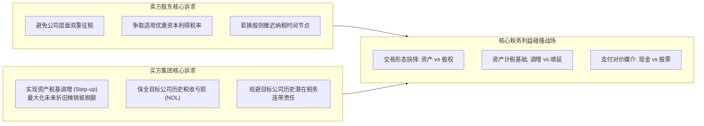
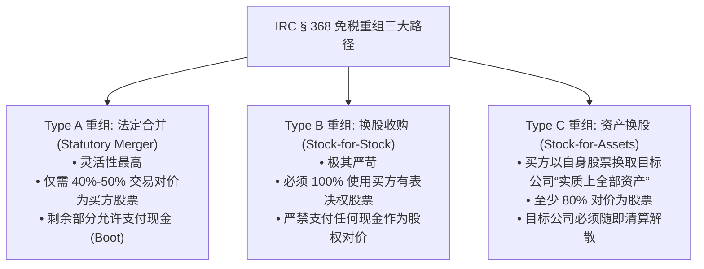
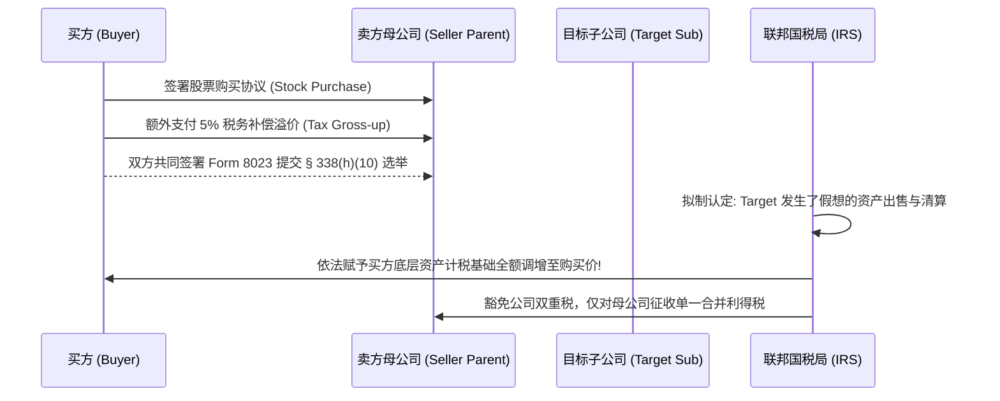

# Lec 8 并购交易的税务考量与架构设计 (Tax Considerations in Structuring a Deal)

> MIT Sloan 15.617 · The Law of Corporate Finance and Financial Markets · 主讲 Dr. John Akula

## TL;DR

- 税务结构往往是决定一笔并购交易能否落地、对价高低的最核心经济驱动要素。
- 区分应税交易（Taxable Transactions）与美国国内税收法典（IRC）§ 368 免税重组。
- 买卖双方的根本税务冲突：卖方追求单层资本利得税，买方追求资产税基调增（Step-up in Basis）。
- IRC § 338(h)(10) 选举提供了在法律形式上买股票、在税务实质上按资产收购调增税基的双赢通路。

## 税务对并购估值的绝对支配力

在百亿美元级的并购交易中，税率的微小变动往往意味着数亿美元真金白银的得失。正如华尔街并购老手所言：“不考虑税务的交易架构，纯属纸上谈兵”。一笔在商业逻辑上看似完美的并购，如果因为税务设计缺陷导致标的公司被双重征税，原本诱人的协同效应将被巨额税负彻底吞噬。

税务架构的核心命题，是在美国联邦国内税收法典（IRC）的严苛规则下，平衡买卖双方在现金流出、资产税基与纳税时间节点上的剧烈利益冲突。

在深入剖析具体的税法条款之前，财务总监与交易架构师必须建立起宏观的税务估值直觉。税收绝非单纯的财务扣除项，其实质是主权政府作为“隐形优先合伙人”参与企业全部现金流分配的法定特权。在资产收购中，买方之所以愿意支付更高的溢价，很大程度上正是因为预期到了未来数十年通过折旧摊销所带来的可观税盾（Tax Shield）现值。

相反，卖方股东对于双重征税的恐惧同样深刻地塑造着交易的边界。如果一项交易在公司实体层面被征收一次高达 21% 的联邦企业所得税，随后在向股东派发清算股利时再次被征收 20% 的个人资本利得税，最终留给股东的税后收益将被削减近半。因此，理解双方在税基调增与单层税制之间的博弈逻辑，是破解任何复杂并购僵局的钥匙。

如上图所示，买方与卖方在税务愿景上存在天然的张力：卖方极力避免产生两道税，而买方则渴望拉高资产的计税基础以换取未来数十年的折旧抵税现金流。

## 应税交易 vs 免税重组（IRC § 368）

美国税法将并购交易划分为两大根本类别：

| 交易类别 | 支付对价要求 | 卖方纳税时点与负担 | 买方资产计税基础 (Tax Basis) |
| :--- | :--- | :--- | :--- |
| **应税交易 (Taxable Deal)** | 主要以现金（Cash）、商业本票或债券作为收购对价 | 卖方股东在交割当期立即确认资本利得或普通所得，依法全额缴纳当期税款 | 买方获得**资产计税基础调增（Step-up in Basis）**至收购成交价，未来折旧抵税大幅增加 |
| **免税重组 (Tax-Free Reorganization)** | 绝大部分或全部对价必须是买方的**有表决权股票（Voting Stock）** | 卖方股东在交割当期**不确认资本利得**，税负递延至未来卖出买方股票之日 | 买方继承目标公司的**历史原计税基础（Carryover Basis）**，丧失未来新增折旧抵税机会 |

::: definition 什么是计税基础调增（Step-up in Basis）？
若目标公司拥有一座十年前建成的芯片工厂，账面历史计税净值仅剩 1,000 万美元，但在本次并购中按公允价值作价 1 亿美元收购。
- 若无税基调增（Carryover Basis）：买方未来只能以 1,000 万美元为基数计提折旧；
- 若获得税基调增（Step-up to \$100M）：买方的计税基础拉高至 1 亿美元，新增的 9,000 万美元折旧额在未来十几年内每年可抵扣数百万美元的企业所得税！
:::

## IRC § 368 免税重组的三大标准形态

为了符合联邦税法 § 368 的免税重组资格，交易必须满足极其严苛的法定“格式化三剑客”：

除了上述明文规则，法院还确立了三大普通法免税原则，缺一不可：
1. **商业目的原则（Business Purpose Doctrine）**：交易必须具备真实的非税商业运营动机，纯粹为了避税的重组自始无效；
2. **股东权益持续性原则（Continuity of Interest, COI）**：卖方原股东必须在交割后继续持有买方相当比例的实质性股权风险暴露；
3. **企业经营持续性原则（Continuity of Business Enterprise, CBE）**：买方在交割后必须继续维持目标公司的核心历史主业，或在业务中使用其历史资产。

## 制度神来之笔：IRC § 338(h)(10) 联合税务选举

在非上市公司或子公司出售中，买方极度渴望获得税基调增，但卖方股东坚决拒绝出售资产（因为资产出售面临公司层与股东层双重征税）。针对这一僵局，美国税法第 338(h)(10) 条提供了令人惊叹的化解方案：

::: theorem § 338(h)(10) 选举的法律拟制（Legal Fiction）
买卖双方共同向美国国税局（IRS）提出书面选举申请：
1. **在公司法与民事法律形式上**：买方从卖方母公司手中购买目标公司的全部**股票**（享受股权收购的过户简便与合同连贯性）；
2. **在联邦税法实质认定上**：IRS 法律拟制目标公司将其全部资产出售给一家新公司，然后目标公司在免税框架下注销解散；
3. **经济结果**：**买方成功实现了全部底层资产的税基调增（Step-up）**，而卖方股东仅承担单一层面的综合利得税！
:::

作为商业博弈的对价，买方通常需要向卖方支付一笔**税务补偿溢价（Tax Gross-up Payment）**，将买方未来因税基调增所节省的部分现金流折现提前补贴给卖方，从而达成皆大欢喜的双赢格局。

::: pitfall 忽视 IRC § 382 对历史税收亏损（NOL）的封杀
许多成长型科技公司拥有数千万美元的历史累计净经营亏损（Net Operating Loss, NOL），原本可用来抵扣未来的盈利税额。买方若为了抢夺这些 NOL 而发起并购，必须警惕 **IRC § 382 条款的死亡限制**：一旦公司三年内股权所有权变动超过 50 个百分点，目标公司每年度被允许使用的历史 NOL 额度将被强制限制为“目标公司在控制权变更时的企业估值 × 联邦长期免税利率”。在低利率周期下，这一限制直接导致价值数千万的 NOL 每年仅能抵扣数十万美元，瞬间失去大部分商业价值！
:::

::: insight 税务架构是商业智谋对法律规则的极致雕刻
税收不是凭空消失的黑洞，而是可以通过精妙的架构设计进行合法疏导的商业变量。在并购的世界里，顶级交易大师从不把税法视为被动的沉没成本，而是将其作为撬动估值博弈、弥合买卖双方价格分歧的最强杠杆。深刻洞悉税法背后的政策诱因与拟制规则，是每一位卓越金融领袖从容跨越交易僵局的必胜法宝。
:::
