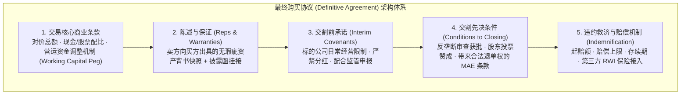
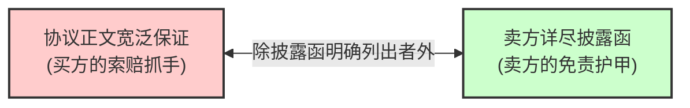
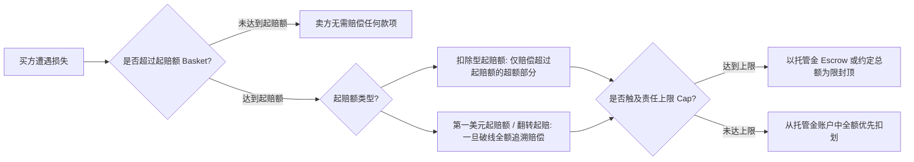

# Lec 9 收购协议核心条款深度攻防 (The Basic Terms of a Purchase Agreement)

> MIT Sloan 15.617 · The Law of Corporate Finance and Financial Markets · 主讲 Dr. John Akula

## TL;DR

- 最终买卖协议（SPA / Merger Agreement）是并购交易全部博弈成果的最终集大成者。
- 陈述与保证（Reps & Warranties）与披露函（Disclosure Schedules）构成阴阳共生的免责拼图。
- 重大不利变动（MAE）是买方在签约后到交割前合法离场的终极刹车，司法裁定门槛极高。
- 赔偿条款通过起赔额（Basket）、责任上限（Cap）、托管金以及陈述保证保险（RWI）实现风险量化封闭。

## 并购协议的宏伟法典架构

当投资银行完成了估值竞价、律师团队完成了虚拟数据室（VDR）中的尽职调查后，所有的商业共识都必须凝结为具有终局约束力的**最终购买协议（Stock/Asset Purchase Agreement 或 Merger Agreement）**。

在长达两百余页的并购合同中，任何一个标点符号或词组的微调，都可能在交割后引发上千万美元的赔偿责任转移。

审视这一宏伟的合同法典，高阶交易者应当理解其背后蕴含的动态权力平衡机制。陈述与保证（Reps & Warranties）并非静态的法律宣誓，而是买方利用信息优势倒逼卖方自我排雷的战略武器；承诺事项（Covenants）则如同一张严密的监控网络，将过渡期内管理层的自由裁量权严格限制在常规经营（Ordinary Course of Business）的窄轨之内。

与此同时，交割先决条件（Conditions Precedent）与赔偿条款（Indemnification）构成了交易的终极安全垫。当宏观环境突变或不可抗力发生时，交割条件为守约方提供了全身而退的合法跳板；而当交割后隐性瑕疵爆发时，经过精密计算的起赔额与责任上限则确保了各方风险始终处于可预期的可控范围之内。这四大模块相互勾连，共同维系着资本交易的安全与尊严。

这一精密的架构确保了交易在签约（Signing）到交割（Closing）的长达数月的过渡期内，标的公司的资产价值处于绝对的冷冻保护状态。

## 陈述与保证（Reps）与披露函的阴阳对冲

陈述与保证不仅是买方用于索赔的抓手，更是迫使卖方全面吐露历史瑕疵的“测谎仪”：

::: definition 披露函（Disclosure Schedules）的免责机制
收购协议正文中通常包含极其宽泛苛刻的陈述：“卖方特此陈述与保证，公司不存在任何未结诉讼、行政调查或违反环境保护法的行为”。
但在该条款末尾会加上一句关键短语：**“除第 3.12 节披露函所明确披露者外”**。
卖方随后编制一份长达百页的附录《披露函》，将公司历史上发生的所有工伤官司、排污超标历史巨细靡遗地逐一列明。**凡是诚实写入披露函的已知瑕疵，买方交割后一律丧失以此为由提起赔偿索赔的权利！**
:::

通过这一攻防机制，未被披露的隐性炸弹全部由卖方承担赔偿责任，而公开透明的已知瑕疵则反映在买方的估值定价扣减之中。

## 重大不利变动（MAE / MAC）：买方的紧急制动阀

从签约到交割往往需要历经三到九个月的反垄断与行业审批。若在此期间爆发全球金融危机、疫情蔓延或标的公司主要工厂被龙卷风摧毁，买方是否能合法宣布合同作废并拒绝交割？

这一终极救济完全维系于**重大不利变动条款（Material Adverse Effect / Event, MAE）**的设计：

| 条款要素 | 核心约定逻辑 | 利益倾斜与博弈结果 |
| :--- | :--- | :--- |
| **基础定义 (Base Definition)** | 任何对标的公司的业务、资产、财务状况或经营成果造成重大不利影响的事件、变动或后果 | 买方极力拓宽词义，卖方极力限定必须是“长期的、跨越数年的根本性摧毁” |
| **例外排除清单 (Carve-outs)** | 明确约定下列宏观事件即使造成巨额亏损，**也绝对不构成 MAE**： • 全球或区域整体宏观经济下滑； • 证券或信贷市场的全面动荡； • 行业普跌现象； • 战争、恐怖袭击、自然灾害； • 交易本身公开发布引发的员工或客户流失 | **极度偏向卖方**；买方无法仅仅因为行业周期性熊市或大盘暴跌而合法毁约 |
| **不成比例例外 (Disproportionate Impact)** | 上述例外排除只有在**对标的公司的负面冲击并未不成比例地显著高于同行业其他竞争对手**时才有效 | **买方的反击抓手**：若地震摧毁了标的公司所有厂房，而竞品安然无恙，买方仍可主张触发 MAE 退单 |

### 特拉华衡平法院的司法天平：*Akorn v. Fresenius* (2018)

在特拉华州公司法历史上，法院极少轻易支持买方以 MAE 为由悔约。然而，在 2018 年德国药企费森尤斯（Fresenius）以 43 亿美元收购美国仿制药企阿肯（Akorn）一案中，衡平法院作出了历史性判决：
- 阿肯在签约后营收断崖式暴跌超过 50%，营业利润蒸发 86%，且暴跌并非全行业普遍现象；
- 内部吹哨人揭露阿肯在 FDA 数据完整性上存在系统性造假，面临监管撤销牌照风险；
- 法院判定该等缺陷持续时间跨越数年、触及企业价值基石，**历史性地裁定构成 MAE，费森尤斯有权合法终止并购协议且无需支付任何分手费！**

## 赔偿机制（Indemnification）与 RWI 保险的行业革命

在传统非上市并购交易中，针对陈述保证不实的索赔设定了重重防线：

1. **存续期（Survival Period）**：常规商业陈述的索赔时效通常限定为交割后 12 至 18 个月，重大陈述（组织合法性、税收、股权权属）通常存续至法定诉讼时效届满；
2. **起赔额（Basket）**：设立相当于交易额 0.5% 至 1% 的门槛，防止买方就鸡毛蒜皮的琐碎费用无休止纠缠；
3. **赔偿上限（Cap）**：常规索赔总额通常严格封顶于交易总额的 10% 左右。

### 颠覆游戏规则的金融创新：陈述保证保险（RWI）

在近年来的私人股权并购市场中，**陈述与保证保险（Representation and Warranty Insurance, RWI）**彻底颠覆了上述传统格局：
- 买方向 AIG、安联等大型承保人购买专项并购保险；
- 一旦交割后发现卖方陈述不实引发巨额损失，**买方直接向保险公司索赔理赔款**；
- 卖方的托管金（Escrow）被压缩至接近 0（仅保留名义自负额），卖方股东在交割当天即可将 100% 卖股资金全额落袋为安，极大加速了复杂交易的促成效率。

::: pitfall 忽视“欺诈例外（Fraud Carve-out）”击穿赔偿上限
卖方谈判代表通常为协议中谈妥了“10% 赔偿上限（Cap）”而沾沾自喜。但所有专业收购协议在赔偿上限末尾都会无一例外地注明：**“本节所约定的任何赔偿上限与存续期限制，均不适用于因故意欺诈（Fraud）引起的索赔”**。一旦买方在诉讼中证明卖方管理层明知核心专利存在严重侵权风险而故意隐瞒不报，欺诈指控将彻底击碎赔偿上限与免责协议，卖方将被迫承担无限个人民事赔偿责任！
:::

::: insight 完美的协议不是消灭风险，而是给风险标上精准的价码
商业世界没有零风险的奇迹。一份优秀的并购协议，其至高境界不是把对方逼进死角，而是像经验丰富的外科医生一样，通过精密的陈述、科学的起赔额与现代保险工具，将混沌未知的商业灾害转化为概率可测、损失有界、责任清晰的数学模型。只有在风险被精确锁定的那一刻，真正的商业价值创造才得以从容起步。
:::
