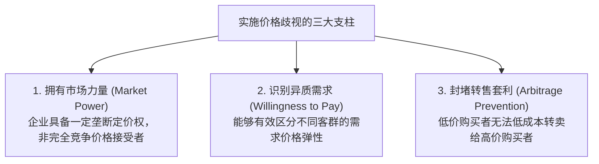

# Lec 10 价格歧视与市场细分（Pricing with Market Power I: Price Discrimination）

> MIT 15.010 · Economic Analysis for Business Decisions · 模块二：需求特征与定价获取

## TL;DR

- 价格歧视的核心在于打破单一统一定价约束，通过向不同客群或不同消费量制定差异化价格来榨取消费者剩余。
- 实施价格歧视必须同时具备三大前提：企业拥有市场力量、能够识别支付意愿差异、且能有效杜绝跨市场套利转售。
- 一级歧视实现完全剩余剥夺且无死重损失，二级歧视依赖版本设计促成自选择，三级歧视依据可观测标签实施弹性反比定价。
- 故意降低产品性能的“受损品（Damaged Goods）”策略，是企业在高低端客群自选择中保护高毛利旗舰款的有效武器。

## 价格歧视的经济学本质与可行性条件

在传统统一定价下，企业若想提高销量，就必须对所有单元实施降价，这导致边际收益始终低于价格（$MR < P$），并留存了大量消费者剩余（Consumer Surplus）。价格歧视（Price Discrimination）旨在实现“对每一位客户按其最高支付意愿定价”。

::: definition 价格歧视
企业销售相同的产品（或物理生产成本差异极小的产品变体）时，针对不同的消费者、不同的购买数量或不同的消费场景，制定**不同价格或不同的价格/边际成本比率**。
:::

实施价格歧视必须在商业与法律上同时满足**三大必要条件**：

::: pitfall 套利（Arbitrage）对价格歧视的瓦解
若防套利机制失效，低价市场的买家将转变为“倒爷/黄牛”，在二手市场上将产品以略低于高价市场的价格转售。此时高价市场需求迅速崩塌，最终迫使企业退回统一定价。企业常用的防套利手段包括：绑定身份认证（实名制机票）、空间与法律壁垒（DVD 区域码、处方药跨境进口限制）、物理消耗与服务化（现场餐饮、体验式演出）。
:::

## 庇古三级价格歧视体系

阿瑟·庇古（Arthur Pigou）将价格歧视划分为三种经典形态：

| 歧视类型 | 识别机制 | 核心操作手段 | 消费者剩余 ($CS$) 与福利表现 | 典型商业场景 |
| :--- | :--- | :--- | :--- | :--- |
| **一级价格歧视 (完全价格歧视)** | 完美获知每位买家的保留价格 | 对每个人、每件商品单独议价 | $CS = 0$，生产者捕获全社会剩余，**$DWL = 0$（产量达竞争最优）** | 私人高管猎头、顶级定制艺术品拍卖、高阶医疗手术议价 |
| **二级价格歧视 (非线性定价 / 版本化)** | 无法直接识别用户画像 | 设计多元合约菜单，诱导用户**自选择（Self-Selection）** | 提取大部分剩余，向低端妥协以保障高端自愿付费 | 阶梯电价、航空两舱布局、软件功能解锁、故意减配的受损品 |
| **三级价格歧视 (市场细分 / 组别定价)** | 依据外部客观身份标签分组 | 对不同细分市场独立核算弹性并加成定价 | 部分提取剩余，低弹性客群承担高价 | 学生/老人票、跨国软件区域定价、工作日商务客 vs 周末休闲客 |

### 1. 一级价格歧视的极端效率

在一级价格歧视下，企业向每位消费者索取其保留价格（Reservation Price）。
- 此时销售最后一单位的边际收益直接等于该买家的支付意愿，即 $MR = P(Q)$；
- 利润最大化条件 $MR = MC$ 演化为 $P(Q^*) = MC$；
- **惊人的福利结论**：一级价格歧视的总产量与完全竞争市场的最优产量 $Q_c$ **完全相等**，全社会**无谓损失为零（$DWL = 0$）**！社会福利实现了帕累托最优，但其分配极度不平等——所有消费者剩余被垄断资本全额转化为生产者利润。

### 2. 二级价格歧视与“受损品（Damaged Goods）”

当企业无法区分用户是高估值商业客户还是价格敏感型个人用户时，若强行推行差异化，高估值客户必然伪装成低端客户以享受低价。

::: definition 受损品策略 (Damaged Goods)
为了防止高端客户“向下套利”，企业**故意投入额外成本去破坏、降频或阉割原有优质产品的部分功能**，制作出体验糟糕的廉价版。
:::

::: example IBM 激光打印机的固件降速
在 1990 年代，IBM 推出两款打印机：面向高端企业的 LaserPrinter E（每分钟打印 10 页，售价 2,395 美元）和面向家庭的低配版（每分钟仅 5 页，售价 1,495 美元）。拆机分析揭示，两款打印机的主板和物理引擎完全一致，IBM 额外设计了一枚微代码芯片专门插入低端型号中，其唯一功能是**强制打印控制器在每行之间空转等待**！IBM 宁愿承担更高的生产复杂度，也要制造出性能缺陷，因为只有让低端产品足够难用，身价高昂的企业高管才不会为了省下 900 美元去购买低配版。
:::

## 三级价格歧视的数理联立推导

在 Recitation 6 中，三级价格歧视（Third-Degree Price Discrimination）是重点考察的数理模型。

假设企业面对两个相互隔离的细分市场 1 和 2，各自面临独立的反需求函数 $P_1(Q_1)$ 与 $P_2(Q_2)$。全公司的总生产成本为 $TC(Q_1 + Q_2)$。

企业总利润最大化方程为：

$$\max_{Q_1, Q_2} \Pi = TR_1(Q_1) + TR_2(Q_2) - TC(Q_1 + Q_2)$$

分别对销售量 $Q_1$ 与 $Q_2$ 求偏导数并令其为零：

$$\frac{\partial \Pi}{\partial Q_1} = \frac{dTR_1}{dQ_1} - \frac{dTC}{dQ} \cdot \frac{\partial Q}{\partial Q_1} = MR_1(Q_1) - MC(Q_1 + Q_2) = 0$$

$$\frac{\partial \Pi}{\partial Q_2} = \frac{dTR_2}{dQ_2} - \frac{dTC}{dQ} \cdot \frac{\partial Q}{\partial Q_2} = MR_2(Q_2) - MC(Q_1 + Q_2) = 0$$

联立得到三级价格歧视的核心配置定理：

$$MR_1(Q_1^*) = MR_2(Q_2^*) = MC(Q_1^* + Q_2^*)$$

结合边际收益与需求弹性的关系公式 $MR = P \left(1 + \frac{1}{E_d}\right)$：

$$P_1 \left(1 - \frac{1}{|E_{d1}|}\right) = P_2 \left(1 - \frac{1}{|E_{d2}|}\right) = MC$$

两市场售价比率为：

$$\frac{P_1}{P_2} = \frac{1 - \frac{1}{|E_{d2}|}}{1 - \frac{1}{|E_{d1}|}}$$

::: theorem 细分市场弹性反比定价法则
在三级价格歧视下：**需求越缺乏弹性（$|E_d|$ 越小）的细分客群，企业制定的销售价格必须越高；需求越富有弹性（$|E_d|$ 越大）的客群，制定的价格越低**。
:::

## 经典商业案例：博士伦隐形眼镜的歧视定价丑闻

1993 年《商业周刊》（Business Week）曝光了全球光学巨头博士伦（Bausch & Lomb）的经典案例：
1. **多重包装与惊人价差**：博士伦在市场上同时销售三款针对不同换戴周期的隐形眼镜：
   - 传统年抛型（Annual Wear）：单副售价高达 70–90 美元；
   - 两周抛型（Two-Week Disposable）：单片约 7–9 美元；
   - 每日抛型（Daily Wear / SeeQuence）：30 片盒装单片折合仅约 3 美元。
2. **实验室拆解真相**：消费者组织与独立光学实验室对三款产品进行光谱与聚合材料分子检测，震惊全美地证实：**这三款标称不同使用寿命、售价相差数十倍的产品，其流水线成型材料、含水量与光学透气指标完全 100% 相同**！
3. **商业逻辑 vs 法律诉讼**：从经济学视角看，博士伦针对高频重度用户（价格敏感、易算账）和偶发佩戴的高净值用户实施了精准的二级/三级歧视；但在法律与公共道德层面，由于其涉嫌欺诈和虚假陈述安全周期，最终遭到全美 17 个州联合发起的集体诉讼，被迫支付数千万美元和解并统一标签。

## 我的理解

::: insight 商业智慧：让每一分钱都在道德与法律安全区内高效变现
在当代数字化商业中，价格歧视已经无处不在（如网约车动态加价、机票大数据画像、电商千人千面折扣券），管理者必须掌握高维定价的艺术：
1. **从“对人歧视”升华为“对版本歧视”**：直接依据用户手机型号（如 iPhone 15 Pro Max 用户加价 15%）实施硬性价格歧视，极易引发公关雪崩并触碰反垄断底线；而通过构建**自选择版本菜单**（如普通会员 vs 极速发货 VIP、基础版功能 vs 专属客服版），让高支付意愿用户“自愿且体面地多花钱”，才是合规而持久的商业设计。
2. **切记对低端版本的“性能约束保护”**：设计产品矩阵时，企业研发部门往往出于工程师洁癖，试图把低端免费版也做得尽善尽美。但商业逻辑要求，低端版本必须留有明确的痛点（如带水印、限速、排队），否则企业的高端付费基本盘将在瞬间被自己生产的低端产品蚕食殆尽。
:::
