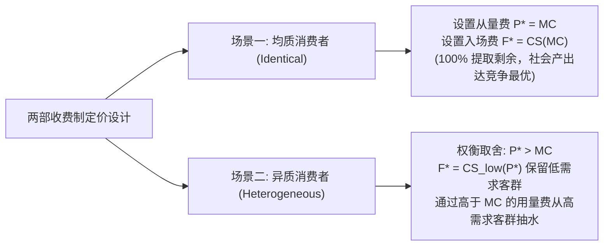
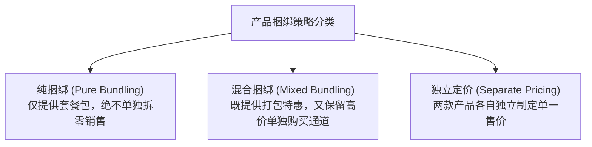

# Lec 11 两部收费制、批量折扣与捆绑销售（Pricing with Market Power II: Two-Part Tariffs and Bundling）

> MIT 15.010 · Economic Analysis for Business Decisions · 模块二：需求特征与定价获取

## TL;DR

- 两部收费制通过固定准入门槛费与从量使用费的解耦，在均质消费者场景下可完全提取全部消费者剩余。
- 面对异质需求客群时，两部收费制的最优从量单价必须高于边际成本，以平衡高低需求两端的剩余榨取与客户留存。
- 捆绑销售的超额套利价值建立在多商品估值的负相关性之上，能够有效抚平异质买家保留价格的方差。
- 搭售（Tying）通过耐用设备与易耗耗材的强绑定，充当隐性计量器以实现对高频用户的深度剩余提取。

## 两部收费制（Two-Part Tariffs）的数理设计

两部收费制是一种经典的非线性定价结构，消费者必须先支付一笔固定的入场费/准入费（Fixed Fee, $F$），方可获得以从量单价（Usage Fee, $P$）购买具体产品或服务的权利。消费者的总支出方程为：

$$E(Q) = F + P \cdot Q$$

### 1. 均质消费者基准模型

在 Recitation 6 中，两部收费的均质基准被严格推导：假设市场中有 $N$ 位需求函数完全相同的独立消费者，其个体需求曲线均为 $q = d(P)$。企业的单位边际成本恒定为 $MC$。

若企业制定从量价格 $P$：
- 消费者的净剩余为 $CS(P) = \int_P^{P_{max}} d(t) \, dt$；
- 企业能收取的最高入场门槛费为 $F = CS(P)$（若 $F > CS$，消费者直接放弃入场）；
- 单客利润为 $\pi = F + (P - MC) q(P) = CS(P) + (P - MC) q(P)$。

对从量单价 $P$ 求一阶导数：

$$\frac{d\pi}{dP} = \frac{d CS}{dP} + q(P) + (P - MC) \frac{dq}{dP}$$

根据莱布尼茨积分法则，$\frac{d CS}{dP} = -q(P)$。代入化简可得：

$$\frac{d\pi}{dP} = -q(P) + q(P) + (P - MC) \frac{dq}{dP} = (P - MC) \frac{dq}{dP} = 0$$

由于需求曲线向右下方倾斜（$\frac{dq}{dP} < 0$），一阶最优解在数学上**必须满足**：

$$P^* = MC$$

代回可得最优固定入场费：

$$F^* = CS(P^*) = CS(MC)$$

::: theorem 均质两部收费分离定理
当所有买家需求偏好一致时，**两部收费制的最优策略是：将从量使用费定在边际成本上（$P = MC$），将全社会生产效率推至竞争最优边界；同时通过固定入场门槛费 $F$ 将产生的全部消费者剩余完整抽干，实现无死重损失（$DWL = 0$）的最大化利润垄断**。
:::

### 2. 异质消费者下的最优权衡

现实中客户需求存在两极分化：设市场由高需求客群 1（$q_1(P)$）与低需求客群 2（$q_2(P)$）各占 50% 构成。
- **困境**：若仍设定 $P = MC$，为了让低需求客群不退网，固定费只能定为 $F = CS_2(MC)$。这会导致高需求客群保留大量的未被捕获的消费者剩余 $CS_1(MC) - CS_2(MC)$。
- **最优解：$P^* > MC$**：
  - 适度上调使用单价至边际成本之上（$P > MC$），虽然轻微压缩了低需求客群的规模，使门槛费降至 $F = CS_2(P)$；
  - 但由于高需求客群消费量巨大，企业通过在每一个使用单元上赚取 $(P - MC)$ 的利差，从高需求客群身上挽回并创造了远超门槛费损失的超额收益。

::: example 迪士尼乐园定价策略（The Disneyland Dilemma）
在 1970 年代之前，迪士尼乐园采用“低门票入场 + 单项游乐设施买票（Ticket A-E）”模式。随着园区游客特征变化，迪士尼将模式切换为著名的两部收费经典形态：极高的一票制全天通票（$F$），而园区内除餐饮外的所有旋转木马、过山车等设施使用费全部降为零（$P = 0 \approx MC$）。这一模式不仅大幅提升了游客客单价，更彻底消除了每个游乐项目门口排队验票的巨大人力交易成本。
:::

## 批量定价与阶梯计费（Volume Pricing）

当企业无法收取固定年费，但单客消费量连续可分时，可采用**递减式分段计价（Declining Block Pricing）**：
- 第一区间（$0$ 到 $Q_1$ 单位）：按最高单价 $P_1$ 计费；
- 第二区间（$Q_1$ 到 $Q_2$ 单位）：按优惠单价 $P_2 < P_1$ 计费；
- 边际消费增量按更低价格结转，逐步逼近边际成本。这种定价方式在自来水、民用电网、云计算存储与 CDN 流量带宽采购中被制度化采用。

## 商品捆绑销售（Commodity Bundling）的增效边界

在多产品组合销售中，企业常常将两款或多款独立商品打包成套装（Bundle）出售。

### 负相关估值（Negatively Correlated Reservation Prices）

捆绑销售能够带来超越独立定价利润的根本数理前提是：**不同买家对不同商品的支付意愿存在负相关性（即所谓的“互补偏好错位”）**。

::: example 好莱坞电影大包售卖（Block Booking）案例
假设好莱坞制片厂向两家地方电视台（A 台与 B 台）推销两部电影：《乱世佳人》（经典大片）与《吉姆历险记》（二线小众片）。两台对两部影片的独立最高保留价格如下：

| 电视台买家 | 《乱世佳人》估值 | 《吉姆历险记》估值 | 捆绑包总估值 |
| :--- | :--- | :--- | :--- |
| **A 电视台** | 8,000 美元 | 2,500 美元 | **10,500 美元** |
| **B 电视台** | 7,000 美元 | 3,000 美元 | **10,000 美元** |

- **策略一：独立分别定价（Separate Pricing）**
  - 《乱世佳人》定价若为 8,000，仅 A 购买，收入 8,000；若定为 7,000，两台均买，收入 $7,000 \times 2 = 14,000$ 美元；
  - 《吉姆历险记》定价若为 3,000，仅 B 购买，收入 3,000；若定为 2,500，两台均买，收入 $2,500 \times 2 = 5,000$ 美元；
  - 独立定价最高总收入为：$14,000 + 5,000 = 19,000\text{ 美元}$。
- **策略二：纯捆绑打包销售（Pure Bundling）**
  - 制片厂规定两片不拆卖，套装统一打包售价为 $P_{bundle} = 10,000\text{ 美元}$；
  - A 电视台总估值为 10,500，B 电视台总估值为 10,000，两台均欣然全款买下捆绑包！
  - 捆绑总收入为：$10,000 \times 2 = 20,000\text{ 美元}$！
:::

::: theorem 捆绑销售的降噪机制
捆绑销售的本质是**利用大数定律抚平异质买家保留价格的方差**。通过将两款偏好互补的商品捆绑，组合资产的估值方差显著小于单个商品的方差，企业得以用一个极具侵略性的套餐总价，一次性榨干两类异质客户的全部盈余。
:::

### 混合捆绑（Mixed Bundling）的适用边界

当产品的边际生产成本显著大于零（$MC > 0$）且存在极度偏科的“单品狂热型客户”时，纯捆绑可能会迫使企业向不需要某产品的用户低效供给高边际成本商品。此时，**混合捆绑（Mixed Bundling）**——设定极高的单品零卖价（如汉堡 20 元、可乐 15 元），同时设定具有吸引力的套餐价（套餐仅需 25 元）——能够在保护单品超额溢价的同时，将中间主流客群全量赶入套餐通道。

## 搭售（Tying）作为隐性计量器

::: definition 搭售契约 (Tying)
消费者在购买基础耐用商品（主机设备）时，被合约条款或物理技术专利强制要求：必须全部搭配采购该生产商的专用消耗品或售后维保服务。
:::

在施乐（Xerox）复印机与专用复印纸、直觉外科（Intuitive Surgical）达芬奇手术机器人与一次性高值机械臂的商业实践中，搭售实质上扮演了**隐性计量器（Metering Device）**：
- 企业将昂贵的主机设备以极低利润甚至平价卖出；
- 客户使用设备越频繁（估值越高、对业务依赖越深），消耗的配套耗材就越多；
- 企业无须与每位客户繁琐协商价格，直接通过向耗材加价 500%–1000%，自动实现了针对客户使用频度的完美歧视定价。

## 我的理解

::: insight 商业模式设计：从“卖产品”到“设计价值捕获网络”
两部收费与捆绑搭售理论揭示了优秀商业模式与平庸商业模式的代际差距：
1. **Costco 与亚马逊 Prime 会员的底层逻辑**：Costco 之所以能够维持全卖场 10%–14% 的极低综合毛利率（几乎按 $P \approx MC$ 销售大宗消费品），核心就在于其牢牢锁死了每年高达 60–120 美元的会员费（$F$）。固定会员费沉没之后，会员进店采购的边际心理成本极低，反而刺激了超高频次的巨额消费，形成了坚不可摧的飞轮。
2. **警惕反垄断监管对搭售与捆绑的致命红线**：正如后续 [Lec 15](./lec15.md) 微软案所展示的，捆绑与搭售虽然在商业上具备极强的剩余榨取能力，但一旦企业在基础设备/平台侧拥有无可替代的垄断力量，强行绑售周边独立生态软件（如 Windows 强绑 IE 浏览器），就会直接触犯《谢尔曼法》第一条关于“不正当搭售扼杀竞争”的法律红线。战略家在享受捆绑红利时，必须清晰界定反垄断合规边界。
:::
