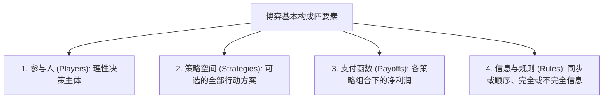
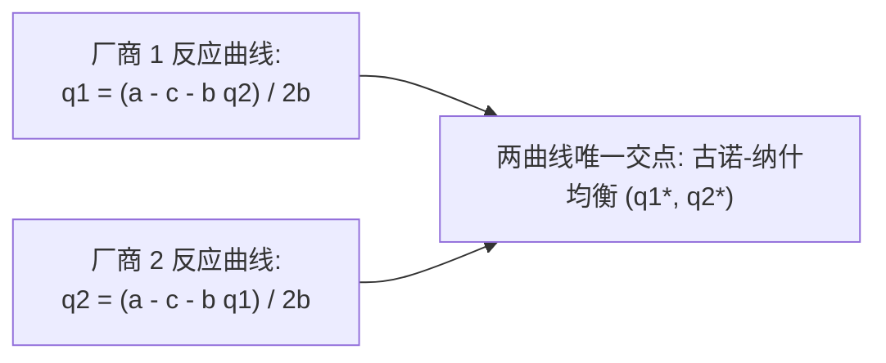

# Lec 12 博弈论与静态寡头竞争（Game Theory and Competitive Strategy I: Static Oligopoly）

> MIT 15.010 · Economic Analysis for Business Decisions · 模块三：战略博弈与寡头竞争

## TL;DR

- 寡头垄断市场的核心特征是厂商之间的战略依存性，纳什均衡刻画了各方在给定对手策略下的单边最优稳定状态。
- 古诺模型刻画了同步产量博弈，两厂商通过各自最优反应函数的交点达成介于完全垄断与完全竞争之间的中间均衡。
- 斯塔克尔伯格模型展示了顺序决策下的先动优势：先行领导者通过激进扩大产能，不可逆地迫使追随者削减产出。
- 伯川德模型揭示了价格战的毁灭性悖论，同质商品仅需两家企业即可将行业利润降至边际成本地板。

## 战略思考与博弈论基础

在寡头垄断（Oligopoly）市场中，竞争者数量极少。任何一家企业在调整价格、研发新产品或扩建厂房时，其收益不仅取决于自身的行动，更取决于对手的报复性反应。

::: definition 纳什均衡 (Nash Equilibrium)
在一组策略配置 $s^* = (s_1^*, s_2^*, \dots, s_n^*)$ 中，若对每一个参与人 $i$，在其他所有对手策略 $s_{-i}^*$ 保持不变的前提下，没有任何单方面改变自身策略以获得更高支付的动机：

$$\Pi_i(s_i^*, s_{-i}^*) \ge \Pi_i(s_i, s_{-i}^*) \quad \forall s_i \in S_i$$

则策略组合 $s^*$ 构成就该博弈的**纳什均衡（Nash Equilibrium）**。纳什均衡代表了战略互动的自洽与稳态，各方没有单边偏离的激励。
:::

## 古诺双寡头模型（Cournot Duopoly）

古诺模型是分析寡头企业**同步产量竞争（Simultaneous Quantity Setting）** 的经典基准。

### 1. 模型假设与需求结构

设市场上存在两家生产同质产品的厂商（厂商 1 与厂商 2），各自决定产量 $q_1$ 与 $q_2$。全市场总产量为 $Q = q_1 + q_2$。
- 市场反需求函数为：$P(Q) = a - b(q_1 + q_2)$；
- 两厂商具有完全相同的常数边际成本：$MC_1 = MC_2 = c$（其中 $a > c > 0$），无固定成本。

### 2. 反应函数（Reaction Functions）的严谨推导

Recitation 7 重点演示了古诺反应函数的微积分联立求解过程。

厂商 1 求解自身利润极大化，将对手产量 $q_2$ 视为外生给定参量：

$$\max_{q_1} \Pi_1 = [a - b(q_1 + q_2) - c] q_1 = (a - c - b q_2) q_1 - b q_1^2$$

求一阶导数（FOC）并令其为零：

$$\frac{\partial \Pi_1}{\partial q_1} = (a - c - b q_2) - 2 b q_1 = 0$$

解出厂商 1 的**最优反应函数（Best Response Function, $R_1(q_2)$）**：

$$q_1 = R_1(q_2) = \frac{a - c - b q_2}{2b}$$

同理，由于对称性，厂商 2 的最优反应函数为：

$$q_2 = R_2(q_1) = \frac{a - c - b q_1}{2b}$$

### 3. 古诺-纳什均衡解

联立求解对称方程 $q_1^* = q_2^*$：

$$q_1^* = \frac{a - c - b q_1^*}{2b} \implies 2b q_1^* + b q_1^* = a - c \implies q_1^* = q_2^* = \frac{a - c}{3b}$$

市场汇总指标如下：
- **市场总产量**：$Q_{Cournot}^* = q_1^* + q_2^* = \frac{2(a - c)}{3b}$；
- **市场均衡售价**：$P_{Cournot} = a - b \cdot \frac{2(a - c)}{3b} = \frac{a + 2c}{3}$；
- **各厂商净利润**：$\Pi_1^* = \Pi_2^* = (P - c) q_1^* = \frac{a - c}{3} \cdot \frac{a - c}{3b} = \frac{(a - c)^2}{9b}$。

::: theorem 古诺产量与 N 家厂商扩展
将模型扩展至 $N$ 家对称厂商：
$$q_i^* = \frac{a - c}{(N+1)b}, \quad Q_{total}^* = \frac{N}{N+1} \cdot \frac{a - c}{b}, \quad P^* = \frac{a + N c}{N+1}$$
- 当 $N = 1$（完全垄断）时：$Q_m = \frac{a-c}{2b}, P_m = \frac{a+c}{2}$；
- 当 $N = 2$（双头古诺）时：总产量为完全竞争的 $2/3$；
- 当 $N \to \infty$（充分竞争）时：$Q \to \frac{a-c}{b}, P \to c$，古诺均衡在极限状态下完美收敛于完全竞争市场。
:::

## 斯塔克尔伯格模型与先动优势（Stackelberg Model）

在许多重资产与技术演进产业中，决策并非同时做出，而是存在**领导者（Leader）与追随者（Follower）的先后顺序**。

### 逆向归纳法（Backward Induction）求解

设厂商 1 为先行领导者，率先宣布其不可逆产能 $q_1$；厂商 2 观察到 $q_1$ 后再做选择。

1. **第二阶段（追随者决策）**：厂商 2 只能在其既定的古诺反应线上选择：
   $$q_2(q_1) = \frac{a - c - b q_1}{2b}$$
2. **第一阶段（领导者前瞻决策）**：厂商 1 预判到厂商 2 的妥协反应，直接将 $q_2(q_1)$ 代入自己的利润函数中：
   $$\Pi_1(q_1) = [a - c - b(q_1 + \frac{a - c - b q_1}{2b})] q_1 = \left(\frac{a - c - b q_1}{2}\right) q_1$$
3. **领导者利润极大化**：
   $$\frac{d \Pi_1}{d q_1} = \frac{a - c - 2b q_1}{2} = 0 \implies q_1^* = \frac{a - c}{2b}$$
4. **追随者被动应对**：
   $$q_2^* = \frac{a - c - b \cdot \frac{a - c}{2b}}{2b} = \frac{a - c}{4b}$$

| 竞争形态 | 领导者产量 $q_1^*$ | 追随者产量 $q_2^*$ | 市场总产量 $Q$ | 市场价格 $P$ | 厂商 1 利润 $\Pi_1$ | 厂商 2 利润 $\Pi_2$ |
| :--- | :--- | :--- | :--- | :--- | :--- | :--- |
| **古诺同步博弈** | $\frac{a-c}{3b} \approx 0.33$ | $\frac{a-c}{3b} \approx 0.33$ | $\frac{2(a-c)}{3b} \approx 0.67$ | $\frac{a+2c}{3}$ | $\frac{(a-c)^2}{9b} \approx 0.111$ | $\frac{(a-c)^2}{9b} \approx 0.111$ |
| **斯塔克尔伯格顺序博弈** | $\frac{a-c}{2b} = 0.50$ | $\frac{a-c}{4b} = 0.25$ | $\frac{3(a-c)}{4b} = 0.75$ | $\frac{a+3c}{4}$ | $\frac{(a-c)^2}{8b} \approx 0.125$ | $\frac{(a-c)^2}{16b} \approx 0.0625$ |

::: theorem 先动优势（First-Mover Advantage）的机制
先行者生产了**相当于全市场垄断产量的规模（$\frac{a-c}{2b}$）**，由于反应曲线向下倾斜（战略替代性），领导者产量的扩张直接逼迫追随者削减一半份额。领导者获得了显著高于古诺均衡的超额利润，而追随者的利润几乎被腰斩。
:::

## 伯川德模型与价格悖论（Bertrand Paradox）

约瑟夫·伯川德（Joseph Bertrand）提出：若寡头企业竞争的决策变量不是**产量**，而是**价格（Price Competition）**，博弈结果将发生翻天覆地的巨变。

::: definition 伯川德悖论
假设两家生产完全同质商品的厂商同时公布售价 $P_1$ 与 $P_2$。消费者没有任何品牌黏性，仅依据最低价购买：
- 若 $P_1 < P_2$：厂商 1 吃下 100% 市场需求，厂商 2 销量为零；
- 若 $P_1 = P_2$：两厂商平分市场；
- 若 $P_1 > P_2$：厂商 1 销量为零。
:::

### 价格战下切均衡

任何高于边际成本的定价（$P > c$）都无法成为纳什均衡。只要对手报价 $P_2 > c$，厂商 1 永远有动机报出微弱下切价格 $P_1 = P_2 - \epsilon$，从而实现销量从 50% 跃升至 100%，利润翻倍。

这种单边下切激励不断重复，直至逼入绝境：

$$P_1^* = P_2^* = c \implies \Pi_1^* = \Pi_2^* = 0$$

::: insight 伯川德悖论的现实破局
仅仅两家企业，就能导致完全竞争的结果且经济利润为零，这在直觉上被称为“悖论”。在现实中，企业破除该恶性循环的三大战略路径是：
1. **产能约束（Edgeworth Solution）**：单家企业由于设备产能上限，根本无法独自吃下全市场 100% 的订单，使得高价在位者依然能够存活；
2. **产品差异化（Product Differentiation）**：通过品牌壁垒、服务溢价与客户转换成本，使消费者不至于为了 1 分钱的价差全量倒戈；
3. **无限期重复博弈与默契合谋**：正如后续 [Lec 14](./lec14.md) 展开的，企业通过长期博弈中的报复威胁阻断自杀性降价。
:::

## 我的理解

::: insight 战略先动权不等于“盲目抢跑”
许多互联网创业者将斯塔克尔伯格模型的“先动优势”口号化，误以为只要抢先开工就能锁定胜局，这忽略了先动优势成立的核心微观假设：
1. **先动必须具备不可逆承诺（Commitment）**：在模型中，领导者之所以能吓退对手，是因为其扩大产能的行为是沉没且可被观察的真实资产（如台积电直接砸下 200 亿美元开工建造巨型晶圆厂）。如果所谓的“抢先”只是一句无法验证的公关口号，对手根本不会改变反应函数，博弈将迅速退回古诺对称互砍。
2. **警惕后发技术优势的致命背刺**：在技术迭代极其剧烈的行业中，先行者按旧工艺重资产锁死了产线（承担巨额不可逆折旧），而后发追随者往往能以更低成本采购下一代先进制造机台，实现性能与成本的双重反超（后发优势，Second-Mover Advantage）。战略决策必须在“锁定市场先发权”与“规避技术代差陷阱”之间做出精密的期权平衡。
:::
