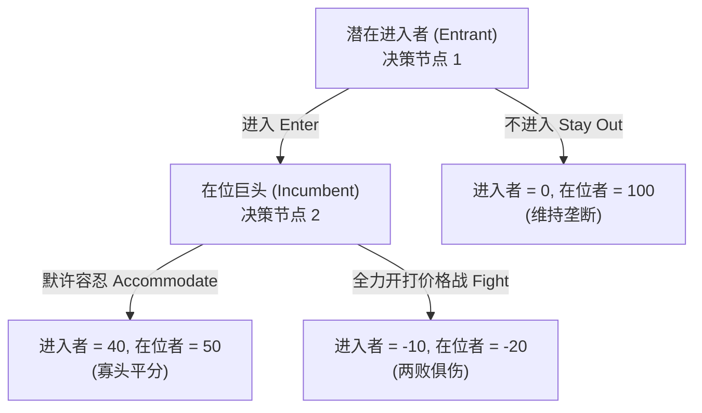
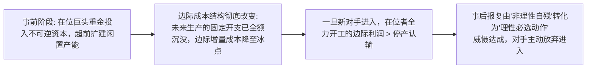

# Lec 13 动态博弈、可信承诺与进入威慑（Game Theory and Competitive Strategy II: Dynamic Games and Credibility）

> MIT 15.010 · Economic Analysis for Business Decisions · 模块三：战略博弈与寡头竞争

## TL;DR

- 动态博弈通过博弈树展开时间序列，子博弈精炼纳什均衡利用逆向归纳法系统性剔除不可信威胁。
- 战略威胁的有效性取决于其是否具备自利可信度，理性在位者口头宣称的“同归于尽”会被对手识破。
- 可信承诺通过主动削减自身未来退路（破釜沉舟）或沉没不可逆产能，实质性改变对手的事后最优预期。
- 万宝路星期五闪电降价展示了行业霸主通过自我施加短期巨亏确立不可动摇的声誉壁垒，成功击退仿制烟挑战。

## 囚徒困境与个体理性背离

在静态博弈中，最广为人知的形态是**囚徒困境（Prisoners' Dilemma）**：

| 厂商 1 \ 厂商 2 | 合作（维持高价） | 背叛（削价降价） |
| :--- | :--- | :--- |
| **合作（维持高价）** | (10, 10) | (-2, 15) |
| **背叛（削价降价）** | (15, -2) | **(2, 2)** |

无论对手选择合作还是背叛，“削价降价”都是两家企业的严格优势策略（Dominant Strategy）。然而，当两家厂商均遵循个体理性最大化时，达成的纳什均衡是双方收益仅为 $(2, 2)$ 的恶性价格战，系统性落后于帕累托最优的联合维持高价 $(10, 10)$。

在单次静态博弈中，合作无法自发达成；但在长期博弈与动态互动中，时间序列与报复威胁彻底改变了支付结构。

## 动态博弈树与子博弈精炼纳什均衡（SPNE）

动态博弈强调决策的**先后顺序（Sequential Moves）** 与**信息演进**，标准分析工具是**博弈扩展型（Extensive Form / 博弈树）**。

### 1. 不可信威胁（Non-Credible Threats / Empty Threats）

在上述博弈树中，在位巨头在事前向公众发表声明：“只要有任何新企业敢踏入本行业，我必将掀起全面价格战，打到双方彻底破产也在所不惜！”
- **纳什均衡的盲区**：如果进入者相信这句声明，选择“不进入”，在位者得到 100，这确实在数学上构成一个纳什均衡。
- **逆向归纳法（Backward Induction）的穿透**：
  进入者深入思考后会发现，一旦自己真正“进入”并到达节点 2，在位巨头面临着两个现实选择：
  - 若选择“开打价格战”，自身净亏损为 $-20$；
  - 若选择“默许容忍”，自身净盈利为 $+50$。
  作为一个理性的利润最大化企业，在位者在事后**绝无可能自残式选择 $-20$**。其事前所谓的“血战到底”只是一句**不可信的空头威胁（Paper Tiger）**！进入者洞察到这一点后将果断选择“进入”，而在位者将被迫选择“默许”。

### 2. 子博弈精炼纳什均衡（SPNE）

莱因哈德·泽尔腾（Reinhard Selten）提出了**子博弈精炼纳什均衡（Subgame Perfect Nash Equilibrium, SPNE）**。

::: definition 子博弈精炼纳什均衡 (SPNE)
在动态博弈中，一个策略组合若是子博弈精炼的，当且仅当它在原博弈的**每一个可能到达的子博弈中都构成一个纳什均衡**。通过从博弈树末端终端节点向根节点反向逆推（逆向归纳法），不可信的威胁与承诺被完全剥除，留下的解才是动态博弈中唯一具有执行力的稳定策略。
:::

## 可信承诺机制与进入威慑（Entry Deterrence）

如果口头宣称的报复是不可信的，在位企业如何在不违法的前提下，让威慑变得坚不可摧？托马斯·谢林（Thomas Schelling）提出了**可信承诺（Credible Commitment）** 理论。

::: theorem 战略承诺的本质：自我束缚（Burning Bridges）
战略威胁要变成可信的，**决策者必须在事前主动采取某种公开、不可逆的行动，改变自己未来的支付矩阵，使得在事后执行报复变成自身的最优自利选择**。
:::

### 迪克西特产能超前投资模型（Dixit Capacity Model）

阿维纳什·迪克西特（Avinash Dixit）提出了经典的产能承诺进入威慑模型：

1. 在进入者出现之前，在位者主动投入巨额不可逆沉没资本，建造远超当前垄断需求的庞大工厂；
2. 此时，在位企业后续生产每一件产品的**增量边际成本（Marginal Cost）被大幅压低**（因为所有厂房与机台折旧已经变为沉没成本）；
3. 若新对手进入，在位者全面开工倾销产品的边际收益已然大于其微弱的边际可变成本；
4. 此时“开打价格战”不再是亏损行为，而成了在位者在节点 2 上的自利最优解！进入者提前测算出在位者的边际成本优势，将主动选择放弃进入。

## 经典商战复盘：万宝路星期五（Marlboro Friday）

1993 年 4 月 3 日，全球消费品巨头菲利普·莫里斯（Philip Morris）上演了商业史上最震撼的战略威慑战役。

### 1. 战役背景与危机

万宝路（Marlboro）当时是全美第一大香烟品牌，长期维持着 40% 以上的暴利价格。然而，随着 RJR 纳贝斯克等对手推出廉价平替无名烟（Generics），万宝路在美国的市场份额从 26% 逐步蚕食至 22%，且下滑速度不断加快。

### 2. 闪电行动与惨烈代价

在 1993 年 4 月 3 日星期五早晨，菲利普·莫里斯管理层突然宣布：**将旗舰品牌万宝路每包零售价直接下调 40 美分（降幅约 20%），并匹配数亿美元的线下促销与渠道补贴**。
- **资本市场的恐慌**：华尔街被彻底震动，菲利普·莫里斯股价在单日内暴跌 23%，市值瞬间蒸发 130 亿美元，同时带动全美消费品板块连环崩跌，该事件被金融界称为“万宝路星期五”。

### 3. 动态博弈收益收割

短期看似自杀的策略，在动态重复博弈中取得了辉煌的长期战略战果：
- **消灭平替烟的生存空间**：廉价通用烟的唯一卖点是“相比万宝路有 50 美分价差”，当万宝路主动降价 40 美分后，消费者仅需多付 10 美分就能享受顶级品牌，平替烟供应链遭遇毁灭性打击；
- **确立不可动摇的凶悍声誉（Reputation for Toughness）**：这一举动向全行业所有潜在竞争对手发出了无可置疑的可信信号——菲利普·莫里斯宁愿单日蒸发百亿市值，也绝不容忍自身市场份额跌破底线；
- **长期均势重组**：数月之后，中小竞争对手纷纷破产倒闭或退守狭窄缝隙，万宝路的全美市场份额迅速反弹并稳定在 30% 以上的高位，随后稳步回调价格，实现了全行业利润的长期重新收割。

## 我的理解

::: insight 商业承诺的终极法则：没有代价的信号等于噪音
在现代商战（从滴滴快的价格战到外卖百团大战）中，许多创业公司的商业计划书里充斥着“对手若敢跟进，我们将不惜代价反击”的空洞宣誓。结合 15.010 的博弈模型，优秀的管理者应牢记两条铁律：
1. **廉价谈话（Cheap Talk）没有任何战略价值**：凡是没有抵押资产、没有不可逆前置投入的威胁，在博弈论中被称为廉价谈话，成熟的对手会将其视作纯粹的心理噪音并直接忽视。真正的进入威慑，必须体现为对手能够用肉眼看得到的硬资产投入——例如不可撤销的长期渠道独家排他协议、锁定核心供应链上游 5 年产能的长协订单、或是万宝路式的真金白银硬砸降价。
2. **战略声誉是一笔重资产投资**：菲利普·莫里斯在万宝路星期五单日损失百亿美元，本质上是支付了一笔昂贵的“声誉资产购置费”。在多市场、多周期的重复博弈中，一旦树立起“寸土必争且报复极具毁灭性”的不可逆商誉，后发对手在未来数十年内都不敢轻易踏足其核心腹地，这笔声誉投资将在未来的漫长时间跨度内持续产生巨额保护租金。
:::
