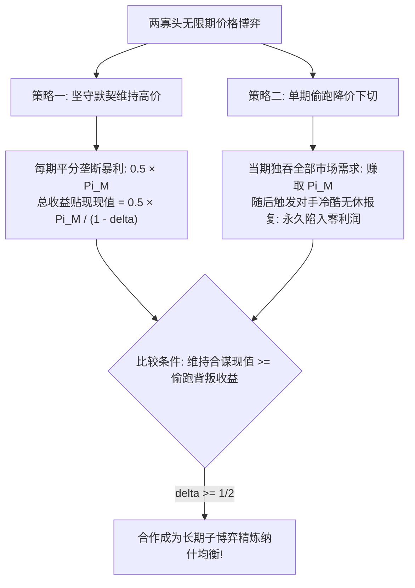

# Lec 14 寡头市场的合谋与竞争（Collusion and Competition in Oligopoly Markets）

> MIT 15.010 · Economic Analysis for Business Decisions · 模块三：战略博弈与寡头竞争

## TL;DR

- 卡特尔内部天然内生偷产降价的背叛动机，其内在不稳定性是所有显性与隐性合谋的宿命难题。
- 重复博弈民意定理证明：当企业对未来现金流具备足够耐心（贴现因子 $\delta \ge 1/2$）时，严厉的报复威胁足以支撑长期的默契合作。
- 市场透明度、订单碎片化与厂商对称性有助于维系合谋，而突发性大宗采购与经济下行产能过剩则是引爆价格战的催化剂。
- 20 世纪 50 年代重型电气设备串通案与 OPEC 配额偷跑史表明，缺乏合法强制力的卡特尔最终多走向阳奉阴违与周期性瓦解。

## 显性卡特尔与默契合谋的界定

在寡头垄断行业中，企业深知恶性价格竞争会导致行业利润全额蒸发。为了攫取垄断暴利，企业通常寻求通过两种机制实现联合限产保价：

::: definition 卡特尔与默契合谋
- **显性卡特尔（Explicit Cartels）**：竞争企业之间通过公开或私下的正式协议、口头约定，达成统一销售价格、划分地理势力范围或分配生产配额的垄断组织（如国际石油输出国组织 OPEC、国际钻石托拉斯 De Beers）。在绝大多数现代市场经济体中，此类协议均属非法刑事重罪。
- **默契合谋（Tacit Collusion / Conscious Parallelism）**：厂商之间没有任何口头、书面或直接沟通，仅通过观察对手公开报价与历史行为，达成心照不宣的价格协同（如价格领导制、保价条款协议）。
:::

## 重复博弈与无名氏定理（The Folk Theorem）

在单期静态博弈中，囚徒困境注定了合作的流产；但在无限期重复博弈（Infinitely Repeated Games）中，**“未来的阴影（Shadow of the Future）”** 改变了一切。

### 1. 冷酷触发策略（Grim Trigger Strategy）

在冷酷触发策略下：
- 在第 1 期，选择合作，制定垄断价格 $P_m$；
- 在随后的第 $t$ 期，若历史所有时期对手都严格执行垄断价格，则继续合作；
- 一旦发现对手在任何一期单方面削价背叛，企业立即永久将价格降至边际成本 $MC$（开启毁灭性伯川德价格战），此生永不原谅。

### 2. 贴现因子与合谋稳定条件

设每期全市场垄断利润为 $\Pi_M$。若双方合作，每期平分垄断利润，各得 $\frac{\Pi_M}{2}$。企业的时间贴现因子为 $\delta = \frac{1}{1 + r}$（其中 $r$ 为资本利率）。

- **恪守合谋的长期折现现值（$PV_{coop}$）**：
  $$PV_{coop} = \frac{\Pi_M}{2} + \delta \frac{\Pi_M}{2} + \delta^2 \frac{\Pi_M}{2} + \dots = \frac{\Pi_M / 2}{1 - \delta}$$
- **偷跑降价的当期套利现值（$PV_{cheat}$）**：
  若在当期偷跑下切 1 分钱，企业独吞全市场 100% 销量，当期卷走全部垄断利润 $\Pi_M$；但从下一期开始，由于对手触发冷酷报复，未来所有时期的利润直接归零：
  $$PV_{cheat} = \Pi_M + 0 + 0 + \dots = \Pi_M$$

企业选择维持合谋的充要条件为：

$$PV_{coop} \ge PV_{cheat} \iff \frac{\Pi_M / 2}{1 - \delta} \ge \Pi_M \iff \frac{1}{2(1 - \delta)} \ge 1 \implies \delta \ge \frac{1}{2}$$

::: theorem 无名氏定理在卡特尔维稳中的核心结论
只要企业的**时间贴现因子足够大（$\delta \ge 1/2$，即企业足够看重未来长期收益，资本利率 $r \le 100\%$）且博弈没有确定已知的终点**，合作与超额垄断利润就能自发维持。企业没有单方面偷跑的动力，因为未来永久丧失的租金总额远大于当期一次性偷跑的蝇头小利。
:::

## 卡特尔的内在不稳定性与维系因素

尽管长期收益诱人，但历史上的卡特尔大多寿命短暂，其根源在于**背叛的边际激励永远存在**：在卡特尔配额下，市场价格 $P_{cartel}$ 远高于单个厂商的边际成本 $MC$。此时在各自配额之外私下多生产一件产品，企业所获得的边际收益仍旧是暴利，这种“搭便车偷跑”的诱惑随着环境波动极易失控。

MIT 15.010 总结了影响卡特尔稳定性的关键商业环境要素：

| 促进合谋稳定的有利要素（Facilitating） | 加剧卡特尔瓦解的破坏要素（Inhibiting） |
| :--- | :--- |
| **厂商数量极少（2–3 家）**：沟通与互相监控成本低 | **厂商数量众多且分散**：小厂商往往自认“多卖一点没人注意” |
| **产品高度同质化**：价格指标唯一，偷跑无所遁形 | **产品高度定制或具有非价格维度**：通过延长保修、返利、信贷暗中降价 |
| **订单碎片化且高频日常交易**：单次偷跑收益微薄 | **“大宗离散采购”（Lumpy Orders）**：三年不开张，开张吃三年，抢单诱惑极大 |
| **生产成本与产能极度对称**：对“公平份额”有一致共识 | **成本结构严重不对称**：高成本厂商要求高价，低成本厂商希望冲量 |
| **交易价格完全公开透明**：偷跑能被对手在下一秒即刻察觉 | **暗箱私下回扣协议**：在位者无法确知客户流失是因自身原因还是对手偷跑 |

## 历史经典案例复盘

### 1. 20 世纪 50 年代美国重型电气设备串通案

通用电气（GE）、西屋电气（Westinghouse）、艾利斯-查尔默斯（Allis-Chalmers）三巨头垄断了全美电力系统的断路器与变压器。由于向各公用事业局投标采购均采取密封竞价方式，三巨头管理层在奢华酒店私下碰头，设计了一套令人咋舌的**“月相法则（Phase of the Moon）”**：
- 按照月相周期（新月、上弦月、满月、下弦月）每两周轮流指定一家企业为“当期低价中标者”；
- 另外两家公司则严格按约定提交故意高出 10%–20% 的“掩护标（Phantom Bids）”；
- 这一精密的跨国串通网络最终被联邦大陪审团一网打尽，多名涉案副总裁被直接判处实刑入狱，三巨头遭遇数亿美元的三倍惩罚性赔偿（Treble Damages）。

### 2. OPEC 石油输出国组织与“摇摆生产国”的困境

自 1973 年石油危机以来，OPEC 试图通过设定成员国原油日产量配额来操纵国际油价：
- **配额偷跑常态化**：委内瑞拉、尼日利亚等国受国内财政亏空驱动，常年暗中超额打油，并将现货折价卖向黑市；
- **沙特阿拉伯的摇摆成本**：沙特作为唯一拥有数百万桶闲置产能的“摇摆生产国（Swing Producer）”，为了保住油价，早期不得不单方面大幅压缩自身产量（从 1980 年的日产 1,000 万桶骤降至 1985 年的 250 万桶）；
- **惩罚性报复潮**：1985 年末，忍无可忍的沙特宣布彻底放弃摇摆角色，开足马力向全球倾销原油，国际油价从每桶 30 美元直接雪崩至 10 美元以下，重创所有偷跑成员国，直至全行业重新低头签署新配额协议。

## 我的理解

::: insight 商业实战：警惕“大客户大宗采购”对价格联盟的瞬间摧毁
在 B2B 工业品制造与企业级软件服务中，同行之间常常形成默契的“价格联盟”（谁也不主动打折，共同维持 35% 毛利）。然而管理者必须保持高度清醒：
1. **大宗离散订单（Lumpy Orders）是合谋的毒药**：如果客户群体由每天几千笔几百元的小订单构成，没有厂商会冒险为了偷跑几单而引爆价格战；但一旦市场上突然出现一个占全厂全年产能 40% 的巨型战略级大标（如国家电网集中集采），所有企业心里的折现逻辑会在瞬间瓦解——拿下这单就足够全厂满产开工吃两年，当期的暴利远超未来两败俱伤的恐惧，暗中私下折价 30% 抢标必然成为每一个理性的高管在午夜敲定的秘密决策。
2. **制度性保价条款（Most-Favored-Customer Clause）的防身术**：聪明的企业在合同中内嵌“最惠客户条款”（若我方未来向任何第三方提供更低价格，必须向您全额退还差价），这在表面上看似是向买方让利，但在经济学上实质是一个**反偷跑的自缚承诺**：它使企业未来降价的边际惩罚成本变得极为高昂，从而向竞争对手发出了坚如磐石的“我绝不可能私下偷跑”的默契合谋信号。
:::
