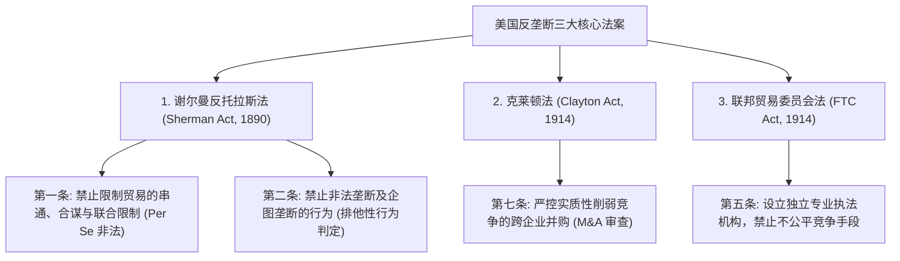
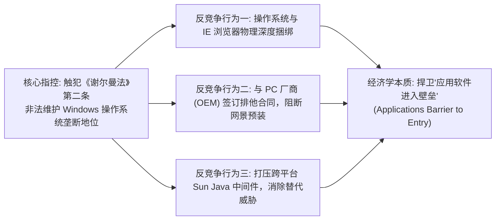
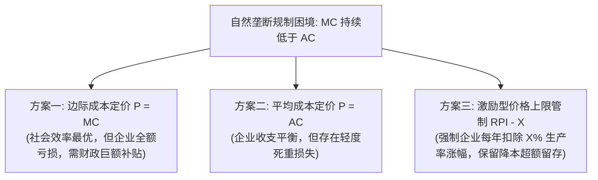

# Lec 15 市场力量限制与反垄断规制（Limiting Market Power: Antitrust and Monopolies）

> MIT 15.010 · Economic Analysis for Business Decisions · 模块三：战略博弈与寡头竞争

## TL;DR

- 反垄断法典的核心目标并非惩罚“企业规模大”，而是严厉制止滥用市场支配地位并扼杀竞争的排他性行为。
- 司法部与联邦贸易委员会利用赫芬达尔指数（HHI）量化评估产业集中度与企业并购（M&A）的反垄断审查红线。
- 微软反垄断世纪诉讼揭示了平台巨头如何通过技术搭售与排他性协议维护“应用软件进入壁垒”。
- 自然垄断规制在边际成本定价与平均成本定价之间权衡，价格上限机制（RPI - X）通过保留降本激励改善了传统回报率规制的资本虚增弊端。

## 反垄断法的法律柱石与审查原则

现代市场经济依赖反垄断法律体系（Antitrust Law）来约束过度集中且缺乏监督的私人垄断力量，保护消费者福利与市场创新活力。

### 自身违法原则 vs 合理原则

在司法审判中，法院对被指控的企业行为采用两种层级的检验标准：
- **自身违法原则（Per Se Illegal）**：凡是涉及直接横向价格串通（Price-Fixing）、分割销售领地或轮流围标的行为，一旦证据确凿，无须原告证明该行为是否产生了实际不良经济后果，法律上一律直接推定为重罪。
- **合理原则（Rule of Reason）**：对于纵向非价格限制（如独家分销协议、技术捆绑销售），法院必须权衡该行为所带来的**商业合理效率增益（Pro-competitive efficiencies）** 与其**反竞争排他危害（Anti-competitive harm）**，通过精细的实证经济学测算决定其合法性。

## 市场集中度测算与横向并购审查指引

美国司法部（DOJ）与联邦贸易委员会（FTC）在审查企业并购交易时，核心量化指标是**赫芬达尔-赫希曼指数（Herfindahl-Hirschman Index, HHI）**。

::: definition 赫芬达尔指数 (HHI)
设相关市场中共有 $N$ 家竞争企业，第 $i$ 家企业的市场份额百分比为 $s_i$（例如份额为 30%，则 $s_i = 30$），HHI 定义为全市场所有厂商份额的平方和：

$$HHI = \sum_{i=1}^N s_i^2$$

- HHI 理论取值范围为 $0$ 到 $10,000$；
- 若市场上存在 10,000 家份额均为 0.01% 的小商户，$HHI \to 0$（完全竞争）；
- 若全行业被单一独占巨头控制，$HHI = 100^2 = 10,000$（绝对垄断）。
:::

### 司法部横向并购审查安全港标准

根据横向并购指引（Horizontal Merger Guidelines），产业集中度分为三个梯队：

| HHI 分区区间 | 市场集中度定性 | 并购审查红线与监管干预概率 |
| :--- | :--- | :--- |
| **$HHI < 1,500$** | **低度集中（Unconcentrated）** | 处于安全港，并购交易通常不受反垄断阻挠 |
| **$1,500 \le HHI \le 2,500$** | **中度集中（Moderately Concentrated）** | 若并购导致 $\Delta HHI > 100$，监管机构将启动深度调查 |
| **$HHI > 2,500$** | **高度集中（Highly Concentrated）** | 若并购导致 $\Delta HHI > 200$，法律推定该并购实质性损害市场竞争，予以叫停或起诉强制剥离 |

::: example 并购导致 HHI 跃升的数理测算
假设某行业原本有 4 家企业，市场份额分别为 30%、30%、20%、20%。
- 并购前：$HHI_{pre} = 30^2 + 30^2 + 20^2 + 20^2 = 900 + 900 + 400 + 400 = 2,600$（已属高度集中）。
- 若两家 20% 份额的小巨头宣布合并，新主体份额为 40%：
  $$HHI_{post} = 30^2 + 30^2 + 40^2 = 900 + 900 + 1,600 = 3,400$$
- 指数跃升值：$\Delta HHI = 3,400 - 2,600 = 800 \gg 200$！该笔并购必将遭遇监管机构的严厉阻击与反垄断诉讼。
:::

## 世纪审判：美国政府诉微软反垄断案（US v. Microsoft）

在 1998 年至 2001 年间审理的微软案是数字经济反垄断史上最重要的里程碑。

1. **核心市场界定**：法庭将相关市场界定为“全球个人电脑桌面操作系统”，微软 Windows 长期占据 90% 以上的市场份额；
2. **应用软件进入壁垒（Applications Barrier to Entry）**：为 Windows 编写的上万款应用软件构成了强大的间接网络外部性。网景（Netscape）浏览器与 Sun 公司的 Java 技术倡导“一次编写，到处运行（Write Once, Run Anywhere）”，具备成为跨平台中间件（Middleware）的潜力，直接动摇了 Windows 生态的底层护城河；
3. **审判结果与和解**：初审法官曾作出将微软一分为二（拆分为操作系统公司与应用软件公司）的极端拆分裁决；上诉法院最终推翻了拆分令，但全票维持了微软非法排他维护垄断的第二条违法定性。最终微软与司法部达成和解，承诺向第三方全面开放系统底层 API，并解除针对 PC 硬件厂商的排他限制协议。

## 自然垄断与规制经济学

当特定行业存在极高的基础设施固定投资，且平均成本曲线（$AC$）在整个市场有效需求范围内呈现持续单调递减时，由单一企业提供服务是生产效率最高的，此即**自然垄断（Natural Monopoly）**（如长途输电网、自来水管网）。

### 价格上限规制（RPI - X）对回报率管制的替代

- **传统投资回报率规制（Rate-of-Return Regulation）的弊端**：允许企业在其资本基数上获得固定的合理回报率，导致企业故意采购极度昂贵的豪华冗余设备以虚增资产底座，此即**阿弗奇-约翰逊效应（Averch-Johnson Effect / 镀金效应）**。
- **价格上限规制（Price Cap Regulation / RPI - X）**：监管机构强制规定公用事业公司未来的服务价格涨幅不得超过当期通胀率（RPI）减去预期的行业生产率改进指标（$X$）。只要企业通过技术创新将实际成本降低幅度超过 $X$，超额结余的利润全额归企业自主留存，从而激活了垄断企业的内生降本动能。

## 我的理解

::: insight 商业实战：巨头的“红线自觉”与反垄断合规战略
在科技平台成长为行业绝对领头羊之后，商业竞争的底层逻辑将彻底被反垄断法律改写：
1. **反垄断惩罚的是“行为”而非“优势”**：许多企业家常常抱有侥幸心理，认为“我的垄断地位是因为我产品好、用户自发选出来的，所以法律不能动我”。然而反垄断法的真正陷阱在于：**一旦你被认定具备市场力量，过去普通中小企业可以自由采用的商业手段（如买赠捆绑、排他独家协议、二选一），在你身上将立即被定性为非法的滥用垄断地位行为**。
2. **并购战略的“监管雷达规避”**：现代科技巨头在开展外部并购时，应当避免去收购同赛道规模接近的直接竞争对手（引发 $\Delta HHI$ 暴增引火烧身），而应转向互补型技术团队或前沿早期实验室的收购（Acqui-hire），通过业务协同拓展自身范围经济，在监管的红线之外稳健筑牢生态壁垒。
:::
