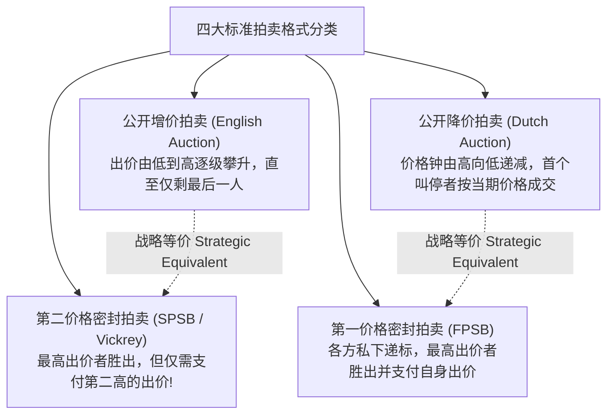
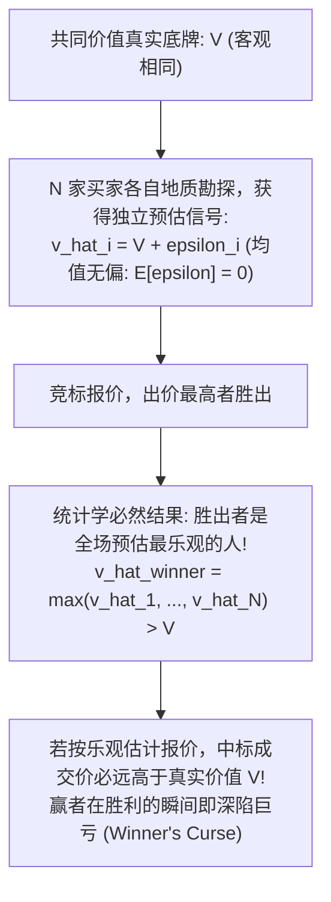

# Lec 16 拍卖机制设计与竞价策略（Auctions and Bidding Strategy）

> MIT 15.010 · Economic Analysis for Business Decisions · 模块四：机制设计与信息经济学

## TL;DR

- 拍卖机制是在卖方对买方真实保留价格完全无知的情形下，通过博弈规则提取买家私人信息的制度设计。
- 维克里第二价格拍卖使得如实出价（Truth-Telling）成为严格弱占优策略，极大简化了竞标者的认知博弈负担。
- 收益等价定理证明，在风险中性与独立私有价值假设下，四大经典拍卖制为卖方带来的期望收益完全等同。
- 共同价值拍卖中深陷“赢者诅咒”的根源在于忽视了条件期望偏误，参与竞标者越多，理性出价反而越应保守折价。

## 四大经典拍卖机制及其战略等价性

当待售商品具有非标准化特征（如艺术品、政府频谱牌照、离岸油气区块），且卖方无法提前推断买方的真实支付意愿时，拍卖（Auctions）是最高效的市场定价与资源分配工具。

| 拍卖机制 | 规则类型 | 信息透明度 | 竞标者最优出价策略 | 结算价格机制 |
| :--- | :--- | :--- | :--- | :--- |
| **英式拍卖（English）** | 升价公开拍卖 | 动态完全可见 | 坚守出价直至达到自身估值 $v_i$ 即离场 | 倒数第二位买家的最高估值（加微小步进） |
| **荷式拍卖（Dutch）** | 降价公开拍卖 | 动态时间窗口 | 权衡等待折扣与被截胡风险，适时按停 | 叫停者当下的报价 |
| **第一价格密封（FPSB）** | 密封单次投标 | 互不相知 | **向下压价出价（Bid Shaving）**：$b_i < v_i$ | 胜出者自身的出价 $b_{win}$ |
| **第二价格密封（Vickrey）** | 密封单次投标 | 互不相知 | **如实申报自身真实估值**：$b_i^* = v_i$ | 全场第二高的出价 $b_{(2)}$ |

## 维克里第二价格拍卖的真言优势

威廉·维克里（William Vickrey，诺贝尔经济学奖得主）提出的第二价格拍卖机制具有绝妙的博弈属性：

::: theorem 维克里拍卖弱占优策略定理
在独立私有价值（IPV）假设下，无论其他竞争对手采取何种出价策略，**如实申报自己的真实估值（$b_i^* = v_i$）是每一个竞标者的严格弱占优策略（Weakly Dominant Strategy）**。
:::

### 占优策略的严密证明

设买家 $i$ 的真实心理估值为 $v_i$，提交出价为 $b_i$。全场其他所有竞争对手中的最高出价为 $P^* = \max_{j \neq i} b_j$。
结算规则为：若 $b_i > P^*$，买家 $i$ 中标，净收益为 $v_i - P^*$；若 $b_i < P^*$，未中标，净收益为 $0$。

1. **若买家试图浮夸虚报高价（$b_i > v_i$）**：
   - 若 $P^* < v_i$：出价偏高或如实出价均中标，支付金额均为 $P^*$，收益相同；
   - 若 $P^* > b_i$：均未中标，收益均为 0；
   - 若 $v_i < P^* < b_i$：原本不会中标的买家强行中标，但结算必须支付 $P^*$，产生**净亏损** $v_i - P^* < 0$！
2. **若买家试图投机压价出价（$b_i < v_i$）**：
   - 若 $P^* < b_i$ 或 $P^* > v_i$：收益与如实出价无异；
   - 若 $b_i < P^* < v_i$：该买家原本可以以 $P^*$ 价格低位捡漏，却因为盲目压低出价痛失好局，收益由正变零！
综上所述，竞标者没有任何偏离真实估值的动力。

## 收益等价定理（Revenue Equivalence Theorem）

在微观拍卖理论中，一个看似违背直觉的深刻成果是迈尔森与维克里建立的**收益等价定理**。

::: definition 收益等价定理的前提假设
1. **风险中性（Risk Neutrality）**：所有竞标者均为纯粹风险中性，仅追求期望利润最大化；
2. **独立私有价值（Independent Private Values, IPV）**：每位买家对拍品的心理估值 $v_i$ 彼此独立，且来自相同的严格单调连续概率分布 $F(v)$；
3. **有效性配置**：拍卖机制最终确保将物品分配给具有最高估值的人。
:::

::: theorem 收益等价定理 (Revenue Equivalence Theorem)
在满足上述基本假设的前提下，**英式拍卖、荷式拍卖、第一价格密封拍卖以及第二价格密封拍卖，为卖方带来的期望总收益在数学上完全绝对相等**！
:::

### 第一价格密封拍卖的最优压价公式

在 Recitation 9 的经典算例中，假定有 $N$ 位风险中性的对称竞标者，各自的估值 $v_i$ 独立且均匀分布在区间 $[0, \bar{V}]$ 上。

在第一价格拍卖中，竞标者为了在中标时攫取剩余，必须进行压价出价（Bid Shaving）。最优出价函数为：

$$b_i^*(v_i) = \left(\frac{N - 1}{N}\right) v_i = v_i - \frac{v_i}{N}$$

- 当只有 2 位竞标者（$N = 2$）时，最优出价为自身估值的 $50\%$（$b = 0.5 v$）；
- 当竞标者激增至 10 人（$N = 10$）时，竞争压力迫使买家将出价提高到估值的 $90\%$（$b = 0.9 v$）；
- 当 $N \to \infty$ 时，$b \to v_i$，竞争压力逼迫买家彻底放弃剩余。

## 共同价值拍卖与赢者诅咒（The Winner's Curse）

现实中的许多重特大商业竞标（如墨西哥湾离岸油气开采权出让、5G 频谱牌照竞标、跨国上市公司股权收购）具有**共同价值（Common Value）** 属性：**该标的物的内在物理价值对所有买家客观上是完全一样的（例如地下究竟埋藏了多少桶石油），但在开拍前没有任何人知道真实底牌，各家仅能通过地震勘探队获得一个包含随机误差的私有预估信号** $\hat{v}_i = V + \epsilon_i$。

::: definition 赢者诅咒 (The Winner's Curse)
在共同价值拍卖中，中标者通常是所有竞标者中对该标的估值最高、最乐观的参与者。**若中标者没有在出价前对“自己能够胜出”这一事件内含的极度高估偏误进行充分的反向折价修正，中标将直接转化为商业灾难与净亏损**。
:::

### 破解赢者诅咒的战略出价法则

理性的职业投标团队必须采用条件概率思维思考出价：

$$\text{有效评估估值} = E\left[V \;\middle|\; \text{我的估计值是全场 } N \text{ 家中的最高值}\right] \ll \hat{v}_i$$

::: theorem 共同价值防诅咒准则
1. **竞标人数越多，出价必须越保守**：在私有价值拍卖中，竞争对手越多，出价应当越激进；但在共同价值拍卖中反向成立——竞标对手越多，全场最大值 $\max(\hat{v})$ 的统计正向偏差越大，若想不踩雷，**理性出价必须向下大幅折让更多**。
2. **警惕外行新手的自杀性搅局**：如果拍卖池中存在不理解赢者诅咒的非理性莽撞买家，理性企业的最优策略是**直接战略性退出**，因为理性出价绝对不可能从一个愿意按虚高估值出价的莽夫手中抢下项目。
:::

## 我的理解

::: insight 商业并购与政企集采中的博弈实战
现代企业在面临政府采购竞标或开展控制权收购时，必须对拍卖机制有深刻的敬畏：
1. **为什么跨国并购中 70% 的收购方在摧毁股东价值**：在激烈的上市企业并购暗战中，多方投行竞相角逐，最终胜出的买方支付了高达 50% 的控制权溢价。这正是教科书级别的赢者诅咒——你之所以能击败全球所有顶尖资本拿到标的，唯一的原因就是你对该业务的协同效应做出了全行业最不切实际的乐观幻想。
2. **政府采购“最低价中标”的反向逆淘劣币**：在许多工程集采招标中，由于缺乏对共同工程履约成本的赢者诅咒防范，往往是算错成本、管理混乱的低级施工方以远低于正常工料成本的荒谬超低价抢下项目，最终不可避免地导致项目烂尾、偷工减料或中途恶意索赔停工。成熟的招标方必须引入反异常低标淘汰法或综合评分制，以制度设计规避赢者诅咒引发的系统性风险。
:::
