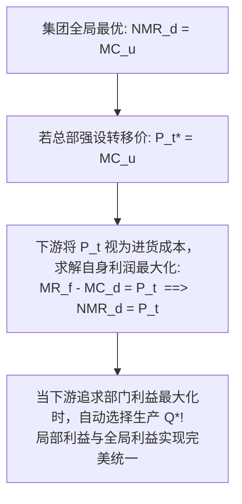
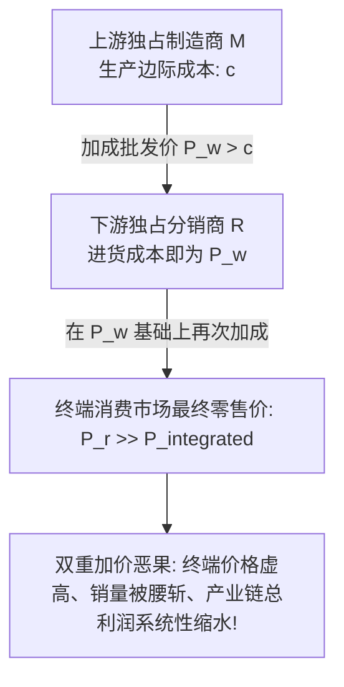

# Lec 17 内部转移定价与纵向一体化（Transfer Pricing and Vertical Integration）

> MIT 15.010 · Economic Analysis for Business Decisions · 模块四：机制设计与信息经济学

## TL;DR

- 内部转移定价的根本宗旨是消除部门壁垒，使分权事业部的局部最优选择与全集团综合利润最大化严格对齐。
- 当不存在外部交易市场时，上游转移价格必须严格锁定为上游边际生产成本，绝不能允许上游人为附加利润加成。
- 当存在完全竞争的成熟外部市场时，公允市场价格是最优转移价格，上下游可作为完全自主的独立利润中心运行。
- 独立上下游之间的双重边际化（Double Marginalization）导致价格虚高与产业链总利润缩水，纵向一体化或两部特许费能有效治愈这一协调失灵。

## 内部转移定价的组织机制与目标

在现代大型多事业部跨国集团（如通用汽车 GM、波音公司、索尼集团）中，通常由上游事业部（Upstream Division）专门制造核心零部件或中间品，再移交至下游事业部（Downstream Division）组装加工并面向最终消费市场销售。

::: definition 内部转移价格 (Transfer Price, $P_t$)
跨国公司内部独立核算的不同事业部之间，在跨部门流转、调拨半成品、中间零部件或共享中后台服务时，在管理会计与财务账目上采用的内部内部结算价格。
:::

集团总部的治理目标是：**设计一套制度规则确定 $P_t$，使得当上下游事业部各自为了最大化自身部门的奖金与账面利润时，其做出的最优产量选择恰好与集团总部站在全局视角的总利润最大化解完全重合**。

## 三大外部市场情景下的最优转移定价

在 Recitation 10 中，转移定价被严格解构为三类外部市场环境下的微积分极值问题。

### 场景一：不存在外部交易市场（No Outside Market）

中间品为高度定制的专有技术部件，全市场仅供集团内部使用。

设最终产品的终端反需求函数为 $P_f(Q)$，最终销售边际收益为 $MR_f(Q)$。
- 下游部门每加工一单位最终产品，需消耗一单位中间品，且产生下游组装边际成本 $MC_d$；
- 上游部门生产中间品的边际成本为 $MC_u$；
- 集团总利润最大化条件要求全链条边际收益等于全链条总边际成本：
  $$MR_f(Q^*) = MC_u(Q^*) + MC_d(Q^*)$$

定义下游部门的**净边际收益（Net Marginal Revenue, $NMR_d$）**：

$$NMR_d(Q) = MR_f(Q) - MC_d(Q)$$

全集团最优产出条件等价于：

$$NMR_d(Q^*) = MC_u(Q^*)$$

::: theorem 无外部市场下的转移定价铁律
当中间品没有外部公开流通市场时，**唯一能够实现集团利润最大化的最优内部转移价格，必须严格等于上游部门生产该中间品的边际成本（$P_t^* = MC_u$）**。
:::

::: pitfall 允许上游作为“独立利润中心”的内耗悲剧
若集团总部盲目倡导“各部门独立自负盈亏”，允许上游部门在 $MC_u$ 基础之上强行加价 20% 作为其内部结算利润（$P_t > MC_u$）：
- 下游部门面临虚高的进货成本，必然被动压缩最终产出规模至 $Q < Q^*$；
- 终端产品因成本虚增导致终端售价过高，市场份额遭遇竞品蚕食；
- 上游部门看似账面赚取了每件的暴利，但由于全集团总销量大幅萎缩，全集团综合利润发生不可挽回的净损失。
:::

### 场景二：存在完全竞争的成熟外部市场（Competitive Outside Market）

上游部门生产的中间品属于标准化工业品（如螺栓、大宗钢材），可在外部公开现货市场上自由买卖，现行市场公允价格为 $P_{market}$。

- **最优转移价格设定**：
  $$P_t^* = P_{market}$$
- **事业部完全自治与解耦**：
  - 上游部门开足马力生产，直至自身边际成本达到市场价（$MC_u(Q_u) = P_{market}$）。若内部下游消化不完，富余产能直接全额向外部市场抛售；
  - 下游部门根据自身最佳节拍生产，直至净边际收益达到市场价（$NMR_d(Q_d) = P_{market}$）。若内部上游供给不足，下游可直接从外部现货市场平价调货；
  - 内部交易不再受制于彼此产能的不对称，两部门均可真正作为完全独立的利润中心独立运营。

### 场景三：存在不完全竞争的外部市场（Imperfect Outside Market）

上游部门可以面向外部市场以向右下方倾斜的需求曲线销售中间品。
- 上游部门面对外部市场是一个具有定价权的垄断者，其向外部销售必须满足 $MR_{u, ext} = MC_u$；
- 而向集团内部下游调拨的内部转移价格，仍旧严格锚定在总产量对应的边际成本上（$P_t^* = MC_u(Q_{total})$）。

## 双重边际化（Double Marginalization）与纵向一体化

当产业链上游制造商（Manufacturer）与下游分销商（Retailer）属于两家法律上完全独立的垄断企业时，自由市场契约会陷入著名的**双重边际化陷阱（Spengler, 1950）**。

### 数理对比：双重加成 vs 纵向一体化

假定终端市场需求为 $P = a - b Q$，制造商生产边际成本为常数 $c$。

1. **纵向一体化单体垄断基准（Integrated Monopoly）**：
   若两家公司合并为单一实体，直接追求产业链总利润最大化：
   $$MR = a - 2b Q = c \implies Q_{integrated}^* = \frac{a - c}{2b}, \quad P_{integrated}^* = \frac{a + c}{2}$$
   产业链总利润为：$\Pi_{integrated} = \frac{(a - c)^2}{4b}$。
2. **两家独立运行的双重垄断（Double Marginalization）**：
   - **下游分销商决策**：面对批发价 $P_w$，其边际收益为 $a - 2b Q = P_w \implies Q(P_w) = \frac{a - P_w}{2b}$。
   - **上游制造商前瞻决策**：制造商将下游的反应作为自身面临的引致需求，其收益为 $\Pi_m = (P_w - c) \cdot \frac{a - P_w}{2b}$。求一阶导得最优批发价：
     $$P_w^* = \frac{a + c}{2}$$
   - **终端零售结果**：分销商在批发价基础上再次加成，最终零售价格为：
     $$P_r^* = \frac{a + P_w^*}{2} = \frac{a + \frac{a+c}{2}}{2} = \frac{3a + c}{4} > P_{integrated}^*$$
     终端总产出缩减至：$Q_{double}^* = \frac{a - c}{4b} = \frac{1}{2} Q_{integrated}^*$！
   - **产业链总利润崩溃**：两家企业合计总利润仅为 $\Pi_{total} = \frac{3(a - c)^2}{16b} = \frac{3}{4} \Pi_{integrated}$！

::: theorem 双重边际化的协调失灵
独立上下游之间各自追求局部加成，导致**终端价格显著偏高（零售价飙升），销量惨遭腰斩（降至最优水平的 50%），产业链总利润直接蒸发了整整 25%**！这是典型的双输困境。
:::

### 消除双重边际化的四大商业解决路径

1. **纵向一体化并购（Vertical Integration）**：直接通过股权收购将上下游合并为单一集团，消除外部交易摩擦；
2. **两部特许经营权费（Two-Part Franchise Fee）**：制造商按真实的边际成本向分销商批发产品（$P_w = c$），彻底打消分销商的终端加价扭曲；同时向分销商一次性收取等于全行业垄断暴利的固定特许加盟费（$F = \Pi_{integrated}$）；
3. **最高转售限价（Maximum Resale Price Maintenance, RPM）**：制造商在合同中强制限定零售商终端售价不得超过 $P_{integrated}^*$；
4. **配额保底兜底协议（Quantity Forcing）**：强制要求分销商必须承销不低于 $Q_{integrated}^*$ 的保底销量。

## 跨国公司全球避税与转移定价实务

在国际经贸中，跨国公司的转移定价往往超越了单纯的管理激励，演变为合法的税收套利工具。

::: example 通用汽车与跨国科技巨头的税收筹划
假设某跨国车企在上游高企业所得税国家（税率 35%）设有零配件制造厂，在下游低税率或避税地国家（如爱尔兰，税率 12.5%）设有组装和知识产权销售中心：
- **战略性扭曲转移价格**：集团在法律合规允许的范围内，**故意将上游向避税地子公司供货的内部转移价格 $P_t$ 压低至接近生产成本**；
- **利润大挪移**：高税率国家的制造部门账面几乎显示微利或零利润，而将全集团高达数十亿美元的核心利润合法留在低税率的海外子公司；
- 这种税收驱动的转移定价与管理会计激励往往产生激烈冲突，迫使跨国巨头在内部推行“管理考核账本”与“税务合规账本”双轨制运作。
:::

## 我的理解

::: insight 组织架构设计的经济学真谛：机制战胜说教
15.010 关于内部转移定价的分析，为现代企业管理提供了极其深刻的组织设计启示：
1. **警惕“伪市场化”制造的组织内卷**：许多大型传统企业热衷于模仿阿米巴经营，将公司内每一个行政职能部门、IT 运维部门甚至前置零部件车间都强行定性为“独立自负盈亏的利润中心”，要求各部门之间互相按市场价乃至加价收费。这种教条主义直接在组织内部人为制造了成千上万个双重边际化节点，员工将大量精力耗费在内部各部门结算撕扯上，推高全集团对外报价，削弱市场竞争力。
2. **正确区分利润中心与成本中心**：对于服务于企业核心竞争力的专有技术、内部平台组件（如互联网大厂的底层基础架构中台、车企的专用三电核心研发），总部必须将其明确划定为**战略成本中心**，内部调用严格执行边际成本甚至免费开放，彻底打通跨业务调用的摩擦；唯有当某项业务真正面向外部广阔市场展开商业化外售时，赋予其独立利润中心地位才具备经济学合理性。
:::
