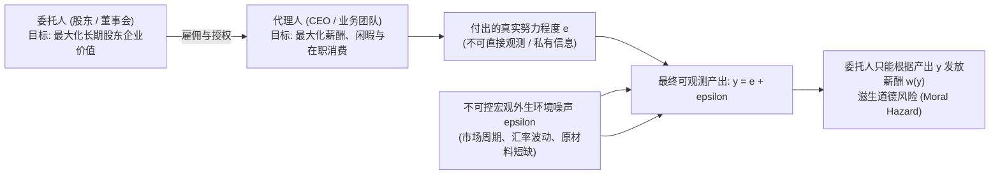
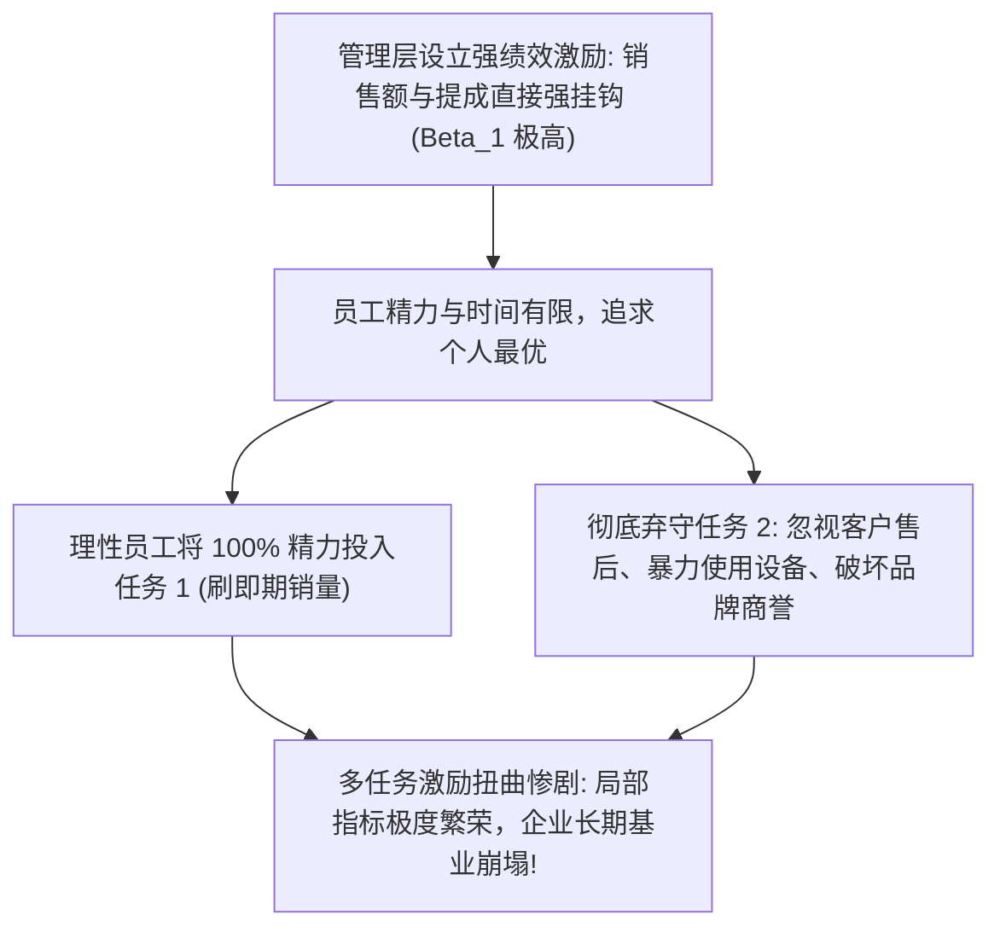

# Lec 18 委托代理问题与组织激励契约（Incentives and Information: The Principal-Agent Problem）

> MIT 15.010 · Economic Analysis for Business Decisions · 模块四：机制设计与信息经济学

## TL;DR

- 委托代理问题的根源在于利益目标错位与行为不可观测，信息不对称必然催生道德风险（Moral Hazard）。
- 最优薪酬契约是在激发代理人努力意愿与承担外生风险溢价之间的精密权衡，环境噪声越大，提成比例越应保守。
- 多任务代理冲突表明：对易度量指标（如即期销量）施加过高激励，必然诱发员工对难度量指标（如客户口碑与设备维护）的全面弃守。
- 晋升锦标赛与延期支付契约通过相对排名与隐性信誉质押，有效克服了宏观共性冲击与员工中途怠工的难题。

## 委托代理问题与道德风险

在现代商业社会中，企业所有权与经营权高度分离。股东（委托人，Principal）聘请职业经理人与核心员工（代理人，Agent）打理日常运营。

::: definition 委托代理问题与道德风险
- **委托代理问题（Principal-Agent Problem）**：当代理人代表委托人做出决策，且双方目标函数不一致、存在信息不对称（委托人无法低成本无缝监控代理人的真实行动细节）时产生的激励扭曲。
- **道德风险（Moral Hazard）**：契约达成后，由于自身行为后果的大部分由委托人承担，代理人在缺乏有效约束时主动选择偷懒、懈怠、转移资产或过度冒险的行为倾向。
:::

## 激励强度与风险分担的经典权衡（Incentives vs Risk-Sharing）

设代理人付出努力程度 $e$，产生个人负效用成本 $c(e) = \frac{1}{2} c e^2$。最终产出为 $y = e + \epsilon$，其中环境噪声 $\epsilon \sim N(0, \sigma^2)$。

委托人设计一套线性薪酬契约：

$$w(y) = \alpha + \beta y$$

- $\alpha$：固定基本底薪（无风险保障）；
- $\beta$：业绩提成比例（绩效激励强度，$0 \le \beta \le 1$）。

### 1. 风险中性 vs 风险厌恶的薪酬边界

- **若代理人纯粹风险中性**：最优解极其简单，令 $\beta^* = 1$（相当于把企业以固定租金“承包”给代理人，代理人自负盈亏享受 100% 边际剩余），此时代理人自动付出社会最优努力水平 $e^* = 1/c$。
- **若代理人具有绝对风险厌恶特征（风险厌恶度为 $r$）**：若设定极高的提成 $\beta$，代理人的实际收入将随环境方差 $\sigma^2$ 剧烈起伏。代理人将要求委托人支付一笔巨额的**风险溢价补偿（Risk Premium）**：
  $$RP = \frac{1}{2} r \beta^2 \sigma^2$$

### 2. 霍姆斯特姆最优激励强度定理

根据本特·霍姆斯特姆（Bengt Holmström，诺奖得主）的契约模型，综合考量努力成本与风险补偿后，最优绩效提成强度为：

$$\beta^* = \frac{1}{1 + r \cdot c \cdot \sigma^2}$$

::: theorem 激励强度的三大反比法则
1. **环境不确定性越强（噪声方差 $\sigma^2$ 越大），绩效提成比例 $\beta^*$ 必须越低**：在极度不可控的外贸或大宗周期行业，若将高管年薪全额与利润挂钩，不仅无法提升努力，反而迫使企业支付荒谬的风险保底溢价；
2. **代理人越厌恶风险（$r$ 越大），提成比例越低**，薪酬必须向固定底薪倾斜；
3. **努力的边际成本越高（$c$ 越大），激励强度越弱**。
:::

## 霍姆斯特姆-米尔格罗姆多任务冲突（Multi-Tasking Problem）

在现实商业管理中，几乎所有岗位都不是单一维度的机器人，员工在日常工作中必须同时处理多项任务：
- **任务 1（高可度量性）**：当期销售额、呼叫中心通话量、代码提交行数；
- **任务 2（低可度量性）**：维护长期客户信任、设备深度保养巡检、辅导新人与团队知识沉淀。

::: pitfall 盲目推行强 KPI 考核的灾难
若一项工作中存在难以精准量化但对企业生死攸关的隐性任务（如产品质检合规、医疗机构患者康复质量），**若对易度量指标施加极高强度的线性提成，会直接在员工内部制造灾难性的替代效应**。
解决多任务冲突的唯一经济学出路是：**全面压低所有任务的硬性考核提成强度，转而采用固定薪酬配合主观综合评价**。
:::

## 现代企业组织激励四大替代机制

除了简单的销售分成，现代管理学发展出四套精巧的制度安排以破解代理困境：

### 1. 晋升锦标赛理论（Tournament Theory / Lazear & Rosen）

在许多专业服务机构（如顶级律师事务所、麦肯锡咨询、投资银行），员工并不按绝对产出拿提成，而是参与一场向上的升职锦标赛：
- **只看序数排名，不看基数绝对值**：全组 10 名分析师，排名第一者晋升为合伙人并拿走数百万年薪，其余人原地留任或淘汰；
- **天然对冲行业系统性风险**：若遭遇全行业宏观大萧条，全员业绩普遍腰斩，锦标赛机制能够自动剔除共性噪声（Common Shocks），依然能精准识别出谁是同侪中相对最优秀的奋斗者；
- **潜在风险**：引发恶性内部政治倾轧与同僚暗中使绊（Sabotage）。

### 2. “不升即离”制度（Up-or-Out Policy）

在高校常任教职（Tenure-Track）与顶级律所中，员工入职 6 年后若未能通过评审升为合伙人，**必须在规定时间内无条件离职**。
- **经济学机制**：防止缺乏上进心的高年级老员工占据关键坑位（搭便车摸鱼），同时向底层新员工发出清晰承诺——锦标赛顶端的奖金名额绝不会被平庸前辈永久占有，从而维持长期的激烈竞争势能。

### 3. 团队生产与搭便车治理（Team Production）

阿尔奇安与德姆塞茨（Alchian & Demsetz）指出：在团队协作中，每个成员付出努力的边际成本由个人 100% 独自承担，但产出增量由全队 $N$ 个人平分（个人只能拿到 $\frac{1}{N}$）。随着团队规模放大，搭便车偷懒成为理性的劣币选择。解决团队生产必须设立**专职监督者（Monitor）**，并将剩余索取权（Residual Claim）赋予监督者以防止监督者自身懈怠。

### 4. 延期支付与后置薪酬契约（Back-Loaded Wages / Edward Lazear）

- **机制本质**：年轻时少拿钱，年老时超额拿钱。若员工在中途偷懒被开除，其沉淀在企业后置薪酬中的巨额隐性养老资产将被全额没收；
- 该契约充当了强大的内生自律质押物，同时极大压低了骨干员工的自发跳槽离职率。

## 我的理解

::: insight 组织治理启示：没有坏员工，只有失灵的契约结构
15.010 的契约理论为商业领袖提供了一剂审视组织内耗的清醒剂：
1. **不要试图用“道德说教”替代“机制设计”**：当企业内部出现推诿扯皮、短期利益冒进或部门壁垒时，平庸的管理者往往诉诸于文化宣讲和道德谴责。经济学视角告诉我们：**员工的一切行为都是对现有考核与薪酬矩阵的理性最佳反应**。如果你的销售提成机制只按签约总额发奖金而不管后续坏账，一线销售就必然会联合外部客户把烂账包装成大单。
2. **高明的高管薪酬设计必须引入长期闭锁期（Clawback）**：2008 年华尔街金融危机中，众多投行交易员之所以敢大肆买入有毒次贷资产，就是因为其薪酬契约属于“当期奖金即时套现，未来爆雷与我无关”的非对称期权。现代企业必须引入递延股票发放与强制追索追偿条款（Clawback Provisions），让管理者的长期收益与不可逆的真实企业价值同频共振。
:::
