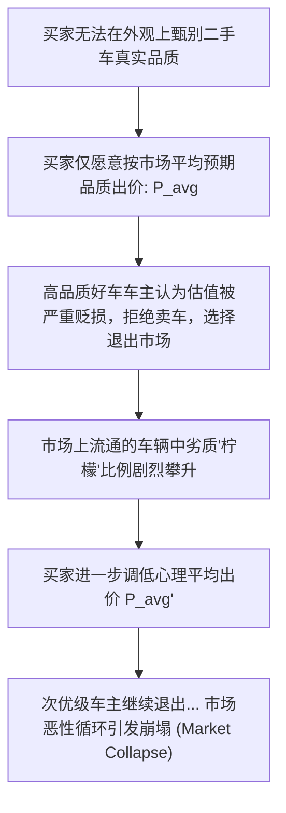
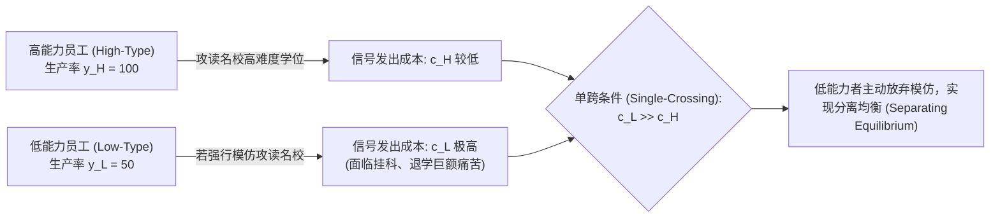

# Lec 19 信息不对称：逆向选择与信号传递（Information Asymmetry: Adverse Selection and Signaling）

> MIT 15.010 · Economic Analysis for Business Decisions · 模块四：机制设计与信息经济学

## TL;DR

- 事前信息不对称引发逆向选择，阿克洛夫“柠檬市场”模型揭示了劣币驱逐良币乃至引发市场全面瓦解的微观机理。
- 商业保险领域的“死亡螺旋”是逆向选择的典型表现，统一定价必然导致低风险优质客群退出与高赔付亏损。
- 斯彭斯信号传递机制的核心在于单跨条件：发送信号的边际成本对高品质类型必须显著低于低品质伪装者。
- 甄别机制通过设计包含免赔额与自负费用的非线性合约菜单，迫使拥有私有信息的主体主动暴露其真实类型。

## 信息不对称与逆向选择

在传统竞争理论中，完全信息假设买卖双方对商品的品质、规格了如指掌。而在现实交易中，**交易一方掌握着另一方无法直接获知的事前关键私有特征（Hidden Characteristics）**。

::: definition 逆向选择 (Adverse Selection)
在达成契约之前，由于交易双方信息分布不对称，拥有信息优势的一方往往是潜在风险更高、品质更差的主体；**平均价格机制将导致高品质商品或低风险客户被系统性挤出市场，导致留存交易的主体结构持续劣化**。
:::

| 信息类型 | 发生时序 | 经济学表现 | 典型治理机制 |
| :--- | :--- | :--- | :--- |
| **隐藏特征（Hidden Characteristics）** | **签约前（Pre-Contract）** | **逆向选择（Adverse Selection）** | 信号传递（Signaling）、信息甄别（Screening）、资质认证 |
| **隐藏行动（Hidden Actions）** | **签约后（Post-Contract）** | **道德风险（Moral Hazard）** | 绩效挂钩、监控审计、长期信誉抵押（见 [Lec 18](./lec18.md)） |

## 阿克洛夫柠檬市场模型（Akerlof's Market for Lemons）

乔治·阿克洛夫（George Akerlof，2001 年诺贝尔经济学奖）在 1970 年发表的开创性论文，以二手车市场为切入点揭示了逆向选择的灾难性后果。在美式俚语中，“柠檬（Lemon）”代指暗藏缺陷的二手破车，而“李子（Plum）”代表保养优良的好车。

### 数理推导与市场萎缩机制

在 Recitation 10 的标准模型中：
- 设市场上优质好车的车主保留底价为 8,000 美元，买家对其估值为 10,000 美元；
- 瑕疵劣质车（柠檬）的车主保留底价为 4,000 美元，买家对其估值为 5,000 美元；
- 设好车与劣质车在市场中的初始客观各占 50%（$q = 0.5$）。

若信息完全不对称，买家无法拆开底盘验证，只能按期望值出价：

$$\bar{P} = 0.5 \times 10,000 + 0.5 \times 5,000 = 7,500\text{ 美元}$$

::: theorem 柠檬市场的解体崩溃
此时面临极为尴尬的微观现实：
- 买家开出的均价为 7,500 美元；
- 劣质车主欢欣雀跃（其底价仅 4,000 美元），争相将柠檬推向市场；
- **而好车车主的底价是 8,000 美元，绝不愿以 7,500 美元贱卖，优质好车在一夜之间全部撤出二手市场**！
- 买家发现市场上只剩下柠檬，重新调整预期，出价暴跌至 5,000 美元；
- **原本能够创造巨大社会福利（10,000 - 8,000 = 2,000 美元）的高端交易完全绝迹，劣币彻底驱逐良币**。
:::

### 商业保险领域的“死亡螺旋（Death Spiral）”

逆向选择在医疗健康与人寿保险行业中表现得最为残酷：
1. 若商业保司推行单一统一定价，对自身健康缺乏信心的慢性病或高危患者参保意愿极强，而年轻力壮的低风险健康人群认为保费高昂，选择不参保；
2. 实际赔付率远超精算师预期，保司被动大幅上调下一年度保费；
3. 保费的进一步攀升再次逼退次健康的较好客群，导致资金池中剩下的人群病患率更高；
4. 这一“保费上浮 $\to$ 优质客户流失 $\to$ 赔付率恶化 $\to$ 再次加价”的正反馈循环被称为**保险死亡螺旋**，最终导致私人商业保险市场彻底消失。

## 斯彭斯教育信号传递模型（Spence Signaling Model）

迈克尔·斯彭斯（Michael Spence，诺贝尔奖得主）指出，拥有私有信息的高品质方可以通过采取某种**具备成本代价的可观测行动（Costly Signal）**，向外界证明自己的真实资质。

::: definition 信号传递的单跨条件 (Single-Crossing Property)
一个行为能够成为可信信号的唯一前提是：**发送该信号所付出的边际成本，对高品质主体而言必须严格且显著地低于对低品质伪装者而言的边际成本**。若伪装的成本极低（人人都能零成本伪造该信号），信号将沦为毫无辨识度的纯噪音。
:::

### 羊皮纸效应与文凭信号

在劳动力市场中，名校高难度理工科毕业证书常被视为高智商、自律与学习能力的典型信号：
- 即使大学里学到的部分理论课程在未来的具体工作中并不直接增加边际生产率；
- 只要低能力者要想从该学府混毕业所承受的熬夜痛苦与挂科退学风险（$c_L$）远高于高能力者（$c_H$）；
- 雇主向持有该文凭者开出高薪就是完全理性的，这一状态被称为**分离均衡（Separating Equilibrium）**。

### 商业世界的两大约束信号机制

1. **极其苛刻的长周期质保承诺（Warranties）**：现代汽车（Hyundai）早期打入美国市场时，为了打破“廉价易坏韩系车”的固有偏见，率先推出了“10 年 / 10 万英里动力总成动力保修”。这一信号具有极强的单跨性——只有对自身发动机质量有绝对信心的车企才敢提供；若是劣质柠檬车企跟风模仿，海量的退换与返修索赔会在两年内将其直接搞破产。
2. **烧钱广告与无理由退换（Money-Burning Advertising）**：邀请全球顶流代言人在黄金时段砸下数亿美元广告，且广告内容没有任何具体参数。这种“公开烧钱”向消费者传递了一个不可逆信号：“我们建立了一个昂贵的品牌商誉资产，我们期望靠产品复购在未来 10 年收回投资，若产品欺诈导致客户流失，我们自身承担的损失比你大得多！”

## 甄别机制与信息中介（Screening & Intermediaries）

当不具备信息优势的一方（如保司、银行）占据主导地位时，其可以通过设计**差异化合约菜单（Menu of Contracts）**，诱导拥有私有信息的主体“对号入座”：

- **自付免赔额（Deductibles）在车险中的运用**：
  - 合约 A：高保费 + 零免赔额（发生任何事故全赔）$\to$ 驾驶习惯差、事故率高的马路杀手主动选择；
  - 合约 B：极低保费 + 5,000 元高免赔额（小刮蹭自理，仅防大灾难）$\to$ 驾驶技术高超、极度自律的稳健司机主动选择。
- **第三方信誉验证中介的崛起**：Carfax 车辆历史记录、穆迪/标普信用评级机构、米其林餐厅指南，通过建立中立的独立审计机制，有效平抑了市场的柠檬折扣，促成了海量原本无法交割的高价值贸易。

## 我的理解

::: insight 商业信誉是不可伪造的长期看涨期权
15.010 的不对称信息理论，彻底揭示了商业世界中“信誉（Reputation）”的经济学生产力：
1. **打破逆向选择是商业创新的永恒沃土**：互联网平台（如淘宝的担保交易支付宝、Airbnb 的房东房客双向信用评价、二手车直营平台的 200 项官方检测保真）之所以能催生数万亿美元的庞大市场，本质上全是在干同一件事——**通过制度与算法设计，彻底打碎信息不对称的壁垒，让原本注定瓦解的柠檬市场重新长出高价值繁荣的良品生态**。
2. **警惕“伪信号”导致的破窗效应**：很多初创团队在融资后，热衷于租用豪华陆家嘴写字楼、买热搜虚假繁荣，企图向市场释放实力强大的“假信号”。然而在成熟资本与大企业采购眼里，只要该信号不需要真实的核心技术交付能力或不可逆质押物作为支撑，它就违背了单跨条件。一旦被市场识破为廉价幌子，企业不仅无法获得溢价，反而会被永久打入丧失商业信誉的柠檬黑名单。
:::
