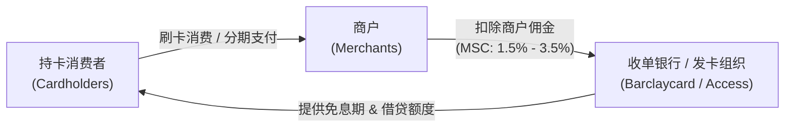

# Lec 2 市场界定与战略决策（Defining the Market and Market Strategy）

> MIT 15.010 · Economic Analysis for Business Decisions · 模块一：市场基准与成本基础

## TL;DR

- SSNIP 测试（假想垄断者测试）是现代反垄断与商业竞争界定相关市场的黄金量化法则。
- 临界损失分析将需求价格弹性与企业边际贡献率连接起来，量化判定提价是否具有盈利性。
- 英国信用卡行业案例揭示了双边平台市场的交叉补贴机制：循环借贷客群的利息收入实质上补贴了免息转账客群。
- 忽视客群异质性与单边收费的战略调整，容易诱发严重的逆向选择并引爆行业价格均衡解体。

## 假想垄断者测试与 SSNIP 法则

在商业并购审查与企业战略定位中，如何科学界定“相关市场”是一个核心法律与商业问题。美国司法部（DOJ）和联邦贸易委员会（FTC）提出的 **SSNIP 测试（Small but Significant and Non-transitory Increase in Price）** 提供了标准量化框架。

::: definition SSNIP 测试与假想垄断者判定
假设某一狭义产品集合由一家独占的“假想垄断者”控制，该垄断者实施**小幅但显著且非临时性的提价**（通常为 5% 或 10%，持续至少 1 年）。
- 若提价后，由于消费者大量转向外围产品或外部地域，导致该垄断者的利润出现**下降**，则说明当前市场定义过窄，必须将这部分替代产品纳入相关市场，并重复测试。
- 直至扩大到某一产品集合，使假想垄断者提价 5% 仍然能够实现**盈利**，此时该产品与地域集合即被确立为**最小相关市场（Smallest Relevant Market）**。
:::

### 临界损失分析（Critical Loss Analysis）

为了量化 SSNIP 是否盈利，Recitation 1 引入了临界损失模型。设企业原价格为 $P$，单位边际成本为 $MC$，原销量为 $Q$。假定价格上调比例为 $t = \Delta P / P$（如 $5\%$），销量下降比例为 $\Delta Q / Q$。

企业原边际利润率为 $m = \frac{P - MC}{P}$。提价后的利润变化为：

$$\Delta \Pi = (P(1+t) - MC) Q(1 - \frac{\Delta Q}{Q}) - (P - MC)Q$$

令 $\Delta \Pi \ge 0$，可推导得出使得提价不亏损的最大允许销量下滑门槛——**临界损失率（Critical Loss, $CL$）**：

$$CL = \frac{t}{t + m} = \frac{\Delta P / P}{\Delta P / P + \frac{P - MC}{P}}$$

::: theorem 临界损失与实际需求反应的比较
1. 若预估的实际销量损失率 $\frac{\Delta Q}{Q} < CL$，则提价 5% 能够增加利润，该产品集合构成一个独立的相关市场。
2. 若预估的实际销量损失率 $\frac{\Delta Q}{Q} > CL$，则提价导致利润受损，说明外部替代品构成了强力牵制，市场范围必须进一步向外扩展。
:::

::: example 高毛利 vs 低毛利行业的临界损失差异
- **高毛利软件企业**（$m = 80\%$）：若提价 $t = 5\%$，其临界损失为 $CL = \frac{0.05}{0.05 + 0.80} \approx 5.88\%$。只要销量下滑超过 $5.88\%$，提价即陷入亏损。因此高毛利企业对销量流失极度敏感，更难将单一狭义品类界定为独立市场。
- **低毛利商贸零售**（$m = 10\%$）：若提价 $t = 5\%$，其临界损失为 $CL = \frac{0.05}{0.05 + 0.10} \approx 33.3\%$。即使销量下滑 $30\%$，提价仍然有利可图。
:::

## 经典商业案例：20 世纪 80 年代后期的英国信用卡产业

80 年代后期的英国信用卡市场由两大核心发卡组织主导：巴克莱银行旗下的 **Barclaycard（Visa 阵营）** 与四大清算银行联合设立的 **Access（MasterCard 阵营）**，二者联合垄断了全英 90% 以上的发卡量与商户受理网络。

### 双边平台机制与交叉补贴结构

英国信用卡系统是一个典型的双边网络平台（Two-Sided Platform），其资金与利润流动结构如下：

在收入端，发卡银行面临两类特征截然不同的消费者群体：

| 客户细分类别 | 行为模式 | 收入来源 | 银行成本与盈利表现 |
| :--- | :--- | :--- | :--- |
| **转账型客户 (Transactors)** | 到期全额还款，充分利用长达 56 天的免息期 | 仅贡献微薄的商户刷卡佣金分成，零利息收入 | 银行承担资金垫付成本与清算成本，**单客贡献净亏损** |
| **循环借贷客户 (Revolvers)** | 每月仅偿还最低还款额，持续滚存高额未偿余额 | 支付高达 25%–30% 的年化借贷利率（APR） | 扣除资金成本与坏账拨备后，**贡献全行业 80% 以上利润** |

### 行业零年费平衡的破局与逆向选择陷阱

在长期竞争中，由于 Barclaycard 与 Access 均不收取任何持卡年费，全行业的竞争形成了一种脆弱的默契平衡：**用借贷客户产生的高额息差，交叉补贴转账客户的免费支付服务**。

::: pitfall 单边打破平衡的逆向选择惨剧
1989 年，劳埃德银行（Lloyds Bank）试图打破僵局，率先推出了针对转账客户年费 12 英镑但借贷 APR 显著降低的信用卡产品。该策略预想吸引高负债的循环借贷客户，同时淘汰无利可图的转账客户。
然而实际结果引发了灾难性的**逆向选择（Adverse Selection）**：
- 对利息最敏感、最能产生利润的优质循环借贷客户，往往也是最为保守的传统客户，并未发生大规模跨行迁移；
- 习惯享受免费服务的庞大转账客户群体被 12 英镑年费彻底激怒，发生雪崩式注销并转投竞争对手；
- 劳埃德不仅流失了商户端交易量规模，更丧失了向这些转账客户交叉销售房贷与财富管理产品的入口。
:::

## 习题课要点：需求价格弹性与对数回归工具

在 Recitation 1 中，教授特别强化了微积分与自然对数在需求弹性估计中的应用。弹性是无量纲指标，消除了商品计量单位与货币计价单位的干扰。

::: definition 对数微分求解点弹性
设需求函数为 $Q = f(P)$，根据微积分链式法则：

$$\frac{d \ln Q}{d \ln P} = \frac{d \ln Q}{dQ} \cdot \frac{dQ}{dP} \cdot \frac{dP}{d \ln P} = \frac{1}{Q} \cdot \frac{dQ}{dP} \cdot P = \frac{dQ}{dP} \cdot \frac{P}{Q} = E_d$$

因此，在实证计量经济学中，当需求模型设定为双对数（Log-Log）回归形式时：

$$\ln Q = \alpha - \beta \ln P + \gamma \ln I + \epsilon$$

价格对数项前的回归系数 $-\beta$ 直接等于需求价格弹性 $E_d$，收入对数项前的系数 $\gamma$ 直接等于需求收入弹性 $E_I$。
:::

## 我的理解

::: insight 商业模式洞察：看懂“醉翁之意不在酒”的交叉补贴
英国信用卡案例给现代互联网与数字化战略提供了最经典的教材：
1. **不要试图在每一个客户身上都实现单点盈利**：许多现代平台（如免佣券商 Robinhood、免配送费的电商会员制）看似在某些用户群上单笔亏损，但这些用户是吸引双边市场另一侧（商户端、广告主、订单流做市商）产生暴利的不可或缺的“流动性供给者”。
2. **战略变革必须考虑客群心理门槛**：消费者对“免费”与“1 美元/12 英镑”的心理感知存在巨大的非线性断层。一旦把免费产品强行转为收费，往往会直接摧毁平台网络效应的基础，为对手拱手送上进入通道。
:::
