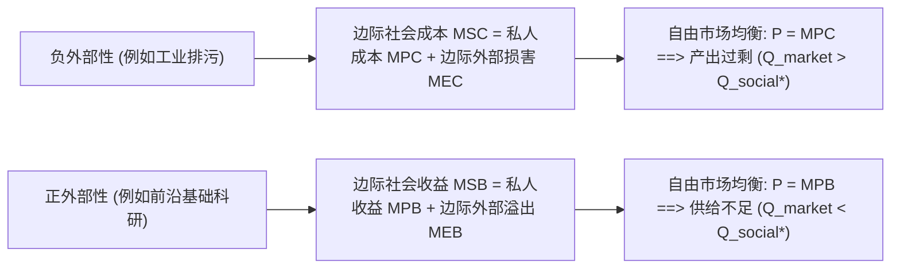
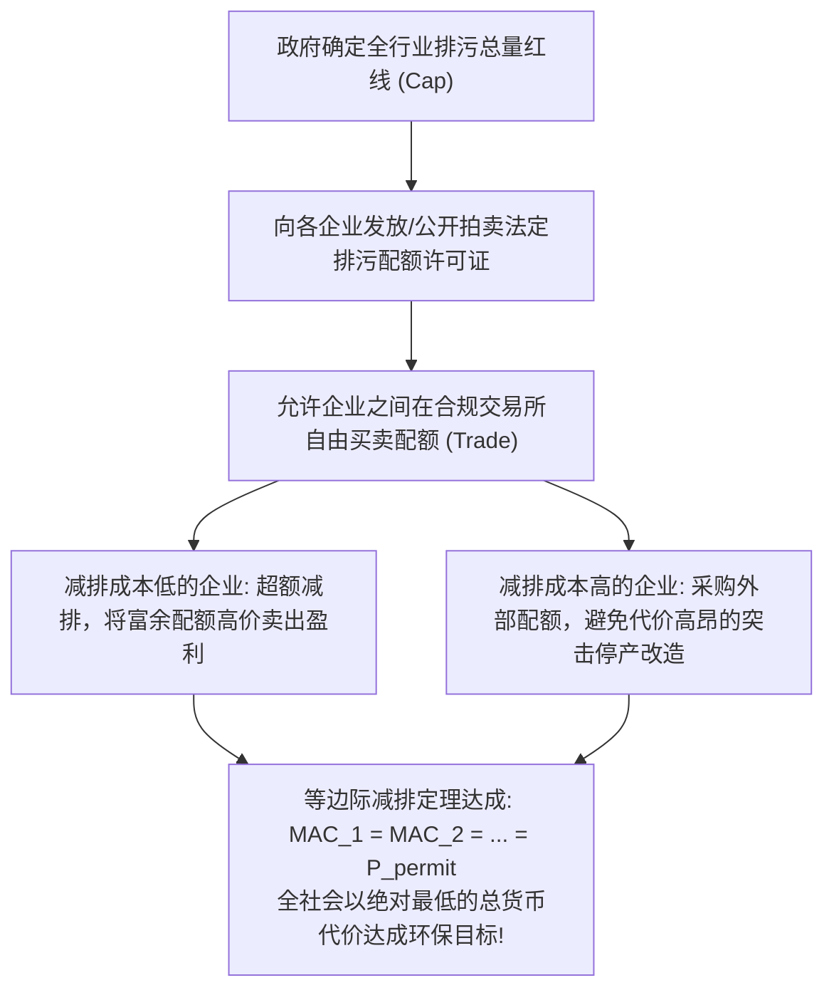

# Lec 20 外部性、公共品与产权配置（Externalities, Property Rights, and Market Structure）

> MIT 15.010 · Economic Analysis for Business Decisions · 模块四：机制设计与信息经济学

## TL;DR

- 外部性的本质是私人成本与社会成本的脱节，负外部性导致自由市场过度产出并造成不可逆的社会福利净损失。
- 庇古税通过将边际外部损害内生化为企业成本，排污权交易体系（Cap-and-Trade）则以市场化机制实现全社会减排成本最小化。
- 科斯定理确立了产权明确在克服外部性中的决定性地位，但在高交易成本与多主体博弈中私人协商往往失效。
- 公地悲剧源于非排他性与竞用性的制度错位，自由准入直接耗散了原本属于全社会的超额经济租金。

## 外部性与私人成本/社会成本的脱节

在福利经济学第一定理成立的前提中，市场价格必须完整涵盖生产与消费该商品所耗费的全部社会资源。当某一经济主体的行为直接对旁观者（第三方）产生未在市场交易中得到货币补偿或收费的影响时，便产生了**外部性（Externalities）**。

::: definition 边际社会成本 (MSC) 与负外部性无谓损失
设企业生产产品的私人边际成本为 $MPC(Q)$，生产过程中向周边环境排放废水废气所造成的边际外部损害为 $MEC(Q)$：

$$MSC(Q) = MPC(Q) + MEC(Q)$$

在自由放任市场中，企业仅在自身利润最大化点（$P = MPC$）处组织生产，产出量为 $Q_{market}$；而全社会最优产量应满足 $P = MSC$，对应产量为 $Q_{social}^*$。
由于 $Q_{market} > Q_{social}^*$，超额生产的单元其真实的社会成本大于社会收益（$MSC > P$），直接造成了**外部性无谓损失（Deadweight Loss）**。
:::

## 治理外部性的三大制度工具

针对负外部性导致的资源错配，现代经济学发展出三种从行政管制到市场驱动的治理范式：

### 1. 庇古税（Pigouvian Taxes）

阿瑟·庇古提出：政府无须微观干预企业的生产细节，只需对每单位排污/产出征收**恰好等于社会最优产量处边际外部损害的特定从量税（$t^*$）**：

$$t^* = MEC(Q_{social}^*)$$

征税后，企业面临的私人边际成本自动被推高为 $MPC + t^* = MSC$。企业在自利追求利润最大化的过程中，自发将产量削减至全社会最优规模 $Q_{social}^*$，成功实现外部性内部化。

### 2. 行政命令限额（Command-and-Control Regulation）

政府环保部门直接对所有企业下达硬性排污上限（例如统一强制减排 30%）。
- **制度缺陷**：不同企业的边际减排成本（Marginal Abatement Cost, $MAC$）差异悬殊；
- 对低成本企业和高成本企业实施“一刀切”的减排指标，无法实现全社会资源最优配置，全社会的总减排经济成本极其高昂。

### 3. 排污权交易体系（Cap-and-Trade / Tradable Permits）

## 科斯定理与产权界定（Coase Theorem）

罗纳德·科斯（Ronald Coase，1991 年诺贝尔经济学奖）对外部性理论作出了革命性的颠覆：**外部性并非单纯是“加害者对受害者施暴”，而是一个相互对立权利的对等问题**。

::: definition 科斯定理 (Coase Theorem)
在**交易成本为零（或极低）** 且**产权界定清晰**的前提下，无论法律最初将产权判定给哪一方（是赋予化工厂排污权，还是赋予下游养殖场拥有清洁水体的权利），**市场各方通过自愿的私人协商与补偿交易，最终必然达成帕累托最优的资源配置**；产权的初始界定仅影响各方之间的财富分配。
:::

::: example 化工厂与养殖场的科斯谈判
- 若法律裁定水体产权归下游养殖场所有：化工厂若要排污，必须向养殖场支付现金赔偿。只要化工厂多排污带来的边际利润大于养殖场的死鱼损失，化工厂就会主动掏钱购买排污补偿，双方在边际增量相等的点停止谈判；
- 若法律裁定化工厂拥有任意排污权：养殖场为了保护鱼群，也会主动筹资向化工厂支付补贴，请求其安装过滤净化设备，最终达成的水质与排污量与前一种裁决完全一致！
:::

### 科斯定理的现实世界边界

科斯定理的精髓恰恰在于**反向提醒人们认识交易成本的普遍存在**。在现实中，私人谈判往往因为以下原因彻底流产，必须依靠公权力法规介入：
1. **利益受损者人数众多且分散**（如全城数十万居民面临汽车尾气），谈判与缔约交易成本高上天际；
2. **搭便车与钉子户敲竹杠（Holdout Problem）**；
3. **信息不对称**：受害者故意夸大损失索要天价赔偿。

## 公共产权资源与公地悲剧（The Tragedy of the Commons）

在 Recitation 9 的经典模型中，自然渔场、公共牧场、地下水资源表现出**公地悲剧（Tragedy of the Commons）**。

| 物品分类矩阵 | 具备排他性 (Excludable) | 不具备排他性 (Non-Excludable) |
| :--- | :--- | :--- |
| **具备竞用性 (Rivalrous)** | **私人物品（Private Goods）** 食物、私家车、商品房 | **公共产权资源（Common Property）** 公海捕捞区、野生森林、清洁大气 $\to$ **公地悲剧** |
| **不具备竞用性 (Non-Rival)** | **俱乐部物品（Club Goods）** 有线电视、高尔夫球场、专有专利 | **纯公共品（Public Goods）** 国防军工、灯塔、基础数学定律 $\to$ **搭便车困境** |

::: theorem 公地悲剧的经济学机理
在公海捕捞中，每多派一艘渔船，不仅抓捕自身份额，更导致全海域鱼群密度下降、其他所有渔船的捕捞成本上升。由于个体不承担这一负外部性，准入一直持续到**平均收益等于边际捕捞成本（$AR = MC$）**。此时全社会对该渔场的边际收益已经远低于成本（$MR < MC$），原本大自然赋予人类的丰富经济地租被无序内卷彻底耗散。
:::

## 公共品供给与萨缪尔森条件

纯公共品具有**非竞用性（一人消费不减少他人消费量）** 与**非排他性（无法低成本排除未付费者享用）**。
- **搭便车困境（Free-Rider Problem）**：每个自私的个体都寄希望于别人掏钱建造国防或点亮灯塔，自己免费蹭用，导致自由市场对公共品的私人供给严重不足甚至为零；
- **萨缪尔森公共品有效供给条件（Samuelson Condition）**：对于公共品，每个人的消费量相同，社会总支付意愿是所有人边际意愿的**垂直加总**，最优供给量要求所有人的边际替代率之和等于边际转换率：
  $$\sum_{i=1}^N MRS_i = MRT$$

## 我的理解

::: insight 商业向善与 ESG 浪潮的硬核经济学注脚
近年来全球资本市场极度关注的 ESG（环境、社会与治理）投资与碳达峰碳中和浪潮，在 15.010 的框架下找到了最底层、最理性的解释：
1. **脱离经济激励的环保倡议是不可持续的**：依靠企业家的个人道德呼吁企业“主动节能减碳”，本质上是在要求企业自愿承担负外部性成本，这直接违背了市场竞争的优胜劣汰法则（恪守道德的企业因成本高昂反而被排污对手淘汰）。唯有通过建立严格的**碳排放权交易市场（Cap-and-Trade）**，将碳排放清晰界定为明码标价的排有价资产，企业才会在追逐自身利润最大化的过程中，自发将减碳技术转化为核心竞争壁垒。
2. **数字化重塑产权与公共品供给**：过去很多由于交易成本过高无法建立产权的公地领域（如城市主干道拥堵），今天通过北斗卫星定位、车载 RFID 与动态拥堵费算法（如伦敦与新加坡的拥堵收费系统），实现了毫秒级的产权界定与负外部性计费。科技的终极价值，正是不断压低交易成本，让科斯式的理性协商与市场配置延伸至人类社会的每一个角落。
:::
