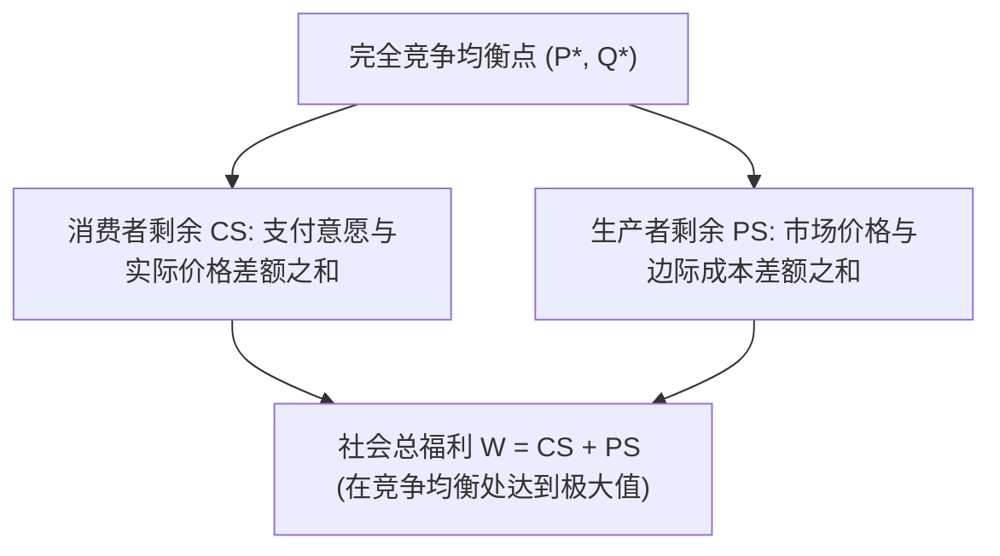
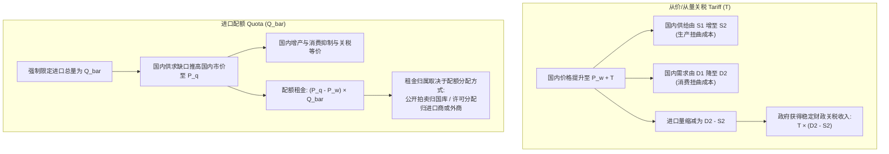

# Lec 3 竞争市场分析与政府干预（Analysis of Competitive Markets and Government Policies）

> MIT 15.010 · Economic Analysis for Business Decisions · 模块一：市场基准与成本基础

## TL;DR

- 完全竞争市场在无外部性条件下实现社会总福利（消费者剩余 + 生产者剩余）最大化，价格扮演资源配置信号。
- 价格上限与价格下限人为切断了供求调节通道，必然产生社会无谓损失（Deadweight Loss）与非价格配给低效。
- 税收归宿取决于供求相对弹性：缺乏弹性的一方（无论是买方还是卖方）将承担绝大部分税收负担。
- 进口配额与等额关税在价格和产量效应上等价，但配额将关税收入转化为配额租金，极易滋生跨国寻租与产业扭曲。

## 竞争市场福利基准与剩余测算

在完全竞争市场中，众多买者与卖者均为价格接受者（Price Takers）。市场出清价格 $P^*$ 与均衡产量 $Q^*$ 由供给曲线 $S(P)$ 与需求曲线 $D(P)$ 的交点决定。

::: definition 消费者剩余与生产者剩余
- **消费者剩余（Consumer Surplus, $CS$）**：消费者愿意支付的总金额减去其实际支付的总金额，几何表现为需求曲线下方、市场价格水平线上方的面积：
  $$CS = \int_0^{Q^*} (P(Q) - P^*) \, dQ$$
- **生产者剩余（Producer Surplus, $PS$）**：生产者因销售商品所获得的收益超出其总可变生产成本的部分，几何表现为价格水平线下方、边际成本曲线（供给曲线）上方的面积：
  $$PS = \int_0^{Q^*} (P^* - MC(Q)) \, dQ = TR - VC$$
:::

在没有任何市场失灵（如外部性、信息不对称、垄断力量）的前提下，自由竞争均衡是帕累托最优的，任何偏离 $Q^*$ 的产量调整都会导致**无谓损失（Deadweight Loss, $DWL$）**。

## 政府价格管制的福利代价

### 1. 价格上限（Price Ceilings）

当政府设定最高限价 $P_{max} < P^*$ 时（例如租金管制或紧急物价冻结）：
- **市场短缺**：需求量激增至 $Q_D$，但厂商供给量萎缩至 $Q_S$，产生供不应求缺口 $Q_D - Q_S$。
- **福利转移与损失**：部分生产者剩余被强制转移给买到商品的消费者，但由于产量从 $Q^*$ 萎缩至 $Q_S$，产生了不可挽回的净损失 $DWL = \Delta B + \Delta C$。
- **非价格配给成本**：排队、黑市交易、配给券寻租等非价格竞争手段，往往会进一步耗散转移给消费者的剩余。

### 2. 价格下限（Price Floors）

当政府设立支持价格或最低保护价 $P_{min} > P^*$ 时（如农产品保护收购价）：
- **市场过剩**：供给量扩张至 $Q_S$，但需求量被抑制至 $Q_D$，产生库存积压 $Q_S - Q_D$。
- **财政沉重负担**：政府若要维持保护价，必须动用公共预算全额收购过剩产出，财政支出为 $P_{min} \times (Q_S - Q_D)$，导致严重的社会资源错配。

## 消费税与税负转嫁率

政府对特定商品征收每单位从量税 $t$。在征税后，买方支付价格 $P_b$ 与卖方实得价格 $P_s$ 之间产生税收楔子（Tax Wedge）：

$$P_b - P_s = t$$

### 税负归宿定理（Tax Incidence Theorem）

Recitation 2 详细推导了税负在买方与卖方之间的分摊比例。设供给价格弹性为 $E_s = \frac{dQ_s}{dP_s} \frac{P_s}{Q}$，需求价格弹性为 $E_d = \frac{dQ_d}{dP_b} \frac{P_b}{Q}$。

市场出清要求 $dQ_s = dQ_d$，即：

$$\frac{dQ_s}{dP_s} dP_s = \frac{dQ_d}{dP_b} dP_b$$

结合 $dP_b - dP_s = dt$，联立求解买方承担的提价幅度与卖方承担的降价幅度：

$$\frac{\Delta P_b}{t} = \frac{E_s}{E_s - E_d} = \frac{E_s}{E_s + |E_d|}$$

$$\frac{-\Delta P_s}{t} = \frac{-E_d}{E_s - E_d} = \frac{|E_d|}{E_s + |E_d|}$$

::: theorem 弹性与税负归宿准则
1. **买方税负占比**：$\frac{\Delta P_b}{t}$ 随需求缺乏弹性（$|E_d| \to 0$）或供给极具弹性（$E_s \to \infty$）而趋近于 1。例如成瘾性香烟或急需胰岛素，买方几乎全额承担税赋。
2. **卖方税负占比**：$\frac{-\Delta P_s}{t}$ 随供给缺乏弹性（$E_s \to 0$）或需求极具弹性（$|E_d| \to \infty$）而趋近于 1。例如短期内无法转产的远洋游艇或土地，资本持有方承担绝大部分税赋。
3. **税收归宿与法定纳税人无关**：无论税收法律上是由零售商代扣还是由消费者直接缴纳，两者的最终经济分摊比例完全一致。
:::

## 进口关税 vs 进口配额的商业与福利比较

在开放经济中，国内市场面临恒定的国际市场价格 $P_w$。

### 美国食糖配额案例（US Sugar Quota Case）

美国长期实施严格的进口食糖配额制度以保护国内糖农：
1. **价格严重倒挂**：美国国内原糖价格被维持在约每磅 22 美分，而国际原糖市场现货价常年在每磅 8 美分左右。
2. **福利损失与利益集团再分配**：
   - **消费者总损失**：全美食品饮料企业与居民每年因高糖价承受超过 20 亿美元的超额支出；
   - **国内糖农获益**：甜菜和甘蔗种植主获得的生产者剩余增长约 10 亿美元；
   - **全社会净福利损失（DWL）**：包含低效国内生产替代高效进口的生产扭曲，以及消费抑制产生的净福利死重，每年超过 8 亿至 10 亿美元。
3. **衍生商业影响**：
   - **下游制造业外迁**：由于糖价成本高昂，大量糖果和烘焙制造企业（如 Brach's、Life Savers）被迫将工厂由美国本土迁往加拿大或墨西哥。
   - **替代品意外繁荣**：ADM（Archer Daniels Midland）等大型农业加工巨头凭借高糖价保护，大规模研发并推广了高果糖玉米糖浆（HFCS），彻底改写了美国软饮料行业的原料结构。

## 我的理解

::: insight 商业决策启示：政策不仅是合规负担，更是产业价值链的重构者
商业高管在分析政府干预政策时，不能仅停留在“反对税收或限制”的被动抱怨，而应洞察政策引发的相对价格结构变动：
1. **供求弹性的不对称创造战略定价空间**：当行业面临环保税、能源附加费或关税冲击时，拥有强品牌黏性与低需求弹性的高端品牌能够实现 100% 的成本转嫁；而缺乏定价权的中低端代工厂则必须硬生生吞下全部成本，加速行业洗牌。
2. **非市场性壁垒下的套利与技术替代**：美国食糖配额催生了玉米糖浆百亿美元级产业，这证明了扭曲性政策往往会在产业边界处创造巨大的跨品类替代机会。具备敏锐经济学直觉的战略家，往往能在监管壁垒造成的价差缝隙中挖掘出全新的商业模式。
:::
