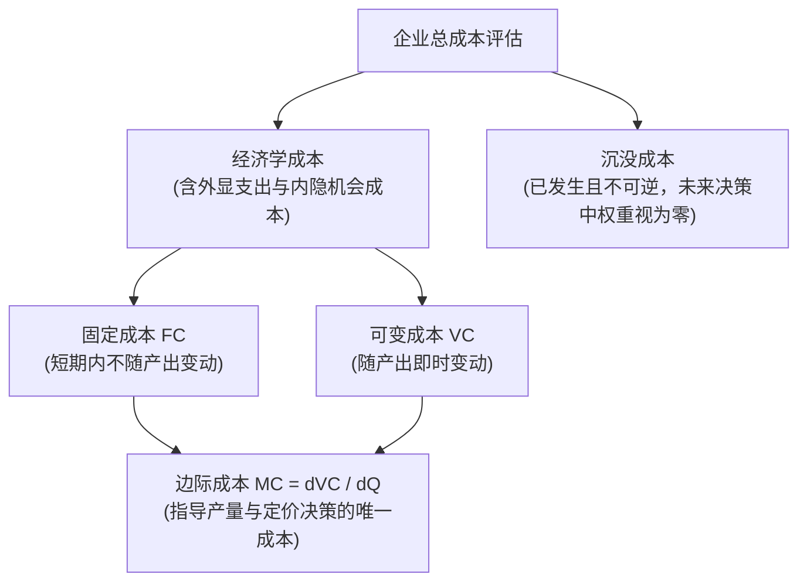
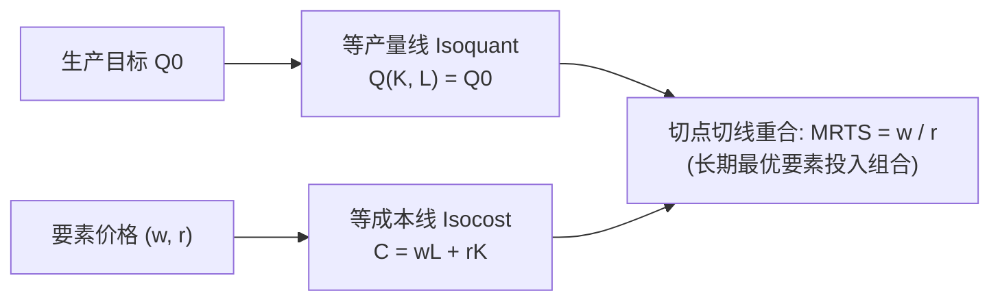

# Lec 4 生产与成本分析 I（Production and Cost I: Cost Concepts and Optimization）

> MIT 15.010 · Economic Analysis for Business Decisions · 模块一：市场基准与成本基础

## TL;DR

- 区分会计成本与经济成本是商业决策的分水岭，沉没成本在事前沉没后必须彻底从未来决策中剔除。
- 边际报酬递减规律决定了短期成本曲线的几何形态：边际产量达峰对应边际成本触底，边际成本穿过平均可变成本与平均总成本的最低点。
- 长期生产中所有要素均可调整，成本最小化的最优要素配置原则要求各要素边际产量与要素价格之比完全相等。
- 长期平均成本曲线是无数短期平均成本曲线的下包络线，企业需根据长期目标产量规划最优资本规模。

## 生产函数与边际报酬递减规律

企业将生产要素（主要是资本 $K$ 与劳动 $L$）转化为产出 $Q$ 的技术关系由生产函数刻画：

$$Q = F(K, L)$$

在短期（Short Run）分析中，资本规模固定为 $\bar{K}$，产出仅取决于劳动投入量 $L$。

::: definition 劳动的边际产量与平均产量
- **边际产量（Marginal Product of Labor, $MP_L$）**：增加一单位劳动投入带来的追加产出：
  $$MP_L = \frac{\partial Q}{\partial L}$$
- **平均产量（Average Product of Labor, $AP_L$）**：单位劳动投入的平均产出：
  $$AP_L = \frac{Q}{L}$$
:::

::: theorem 边际报酬递减规律（Law of Diminishing Marginal Returns）
在技术水平和其他生产要素固定不变的条件下，连续增加某种可变要素的投入，超过某一临界点后，追加该要素所带来的边际产量必然趋于下降（$\frac{\partial^2 Q}{\partial L^2} < 0$）。
:::

$MP_L$ 与 $AP_L$ 之间存在确定的数学关系：
- 当 $MP_L > AP_L$ 时，平均产量处于上升阶段；
- 当 $MP_L < AP_L$ 时，平均产量处于下降阶段；
- 当 $MP_L = AP_L$ 时，平均产量达到极大值点（几何上表现为原点出发与总产量曲线相切的射线斜率）。

## 关键成本概念的辨析与实操陷阱

管理者在研读财务报表时必须时刻警惕会计准则与经济逻辑的冲突。

### 1. 会计成本 vs 经济成本（Opportunity Cost）

- **会计成本（Accounting Cost）**：财务准则（GAAP/IFRS）记录的实际外显历史货币支出加上按固定年限摊销的折旧。
- **经济成本（Economic Cost）**：企业将资源投入当前用途所放弃的**次优替代机会的潜在价值（Opportunity Cost）**。

::: example 自有办公楼与创始人薪资的经济成本
一家创业公司使用创始人自有的一处商业地产作为总部，财务账面上租金支出显示为零。但在经济学评估中，该决策的真实成本必须包含该地产对外出租可获得的现行市场租金（如每年 50 万美元）。同样，创始人放弃原顶级投行 100 万美元年薪创业，若公司未发放薪资，该 100 万美元也是该公司的隐性经济成本。若忽视机会成本，账面看似微利的企业实际上处于巨大的经济亏损中。
:::

### 2. 沉没成本的决策规避（Sunk Cost Fallacy）

::: pitfall 沉没成本谬误与协和飞机困境
**沉没成本（Sunk Cost）** 是指已经发生且无法通过任何手段回收的支出。
- **决策法则**：前瞻性理性决策只关注**未来的增量现金流与增量收益**。沉没成本在边际上等于零，绝不能作为“继续投入以捞本”的理由。
- **经典惨剧**：英法联合研发“协和式超音速客机（Concorde）”时，尽管中途市场测算已经证明由于油耗极高且噪音过大无法商业化盈利，但两国政府因“前期已砸入数十亿巨款不能浪费”而执意推进，最终造成更惨烈的数十亿美元额外亏损。
:::

## 短期成本结构与生产力的对应转换

设短期固定成本为 $FC$，劳动工资率为 $w$，短期总成本函数为：

$$TC(Q) = FC + VC(Q) = FC + w \cdot L(Q)$$

边际成本（Marginal Cost, $MC$）与平均可变成本（Average Variable Cost, $AVC$）可以直观表达为劳动生产率的倒数：

$$MC = \frac{d TC}{dQ} = \frac{d VC}{dQ} = \frac{w \cdot dL}{dQ} = \frac{w}{MP_L}$$

$$AVC = \frac{VC}{Q} = \frac{w \cdot L}{Q} = \frac{w}{AP_L}$$

::: theorem 生产与成本的镜像对称关系
1. 当边际产量 $MP_L$ 递增时，边际成本 $MC$ 处于递减阶段；
2. 当 $MP_L$ 达到峰值时，边际成本 $MC$ 触及最低点；
3. 随着边际报酬递减规律生效，$MP_L$ 持续下降，直接导致边际成本 $MC$ 陡峭攀升；
4. 边际成本曲线 $MC$ 自下而上穿过 $AVC$ 曲线和 $AC$（平均总成本）曲线各自的**最低点**。
:::

## 长期成本最小化与等产量线

在长期（Long Run）中，企业可以自由调整资本 $K$ 和劳动 $L$ 的投入配比。

### 1. 边际技术替代率（MRTS）

等产量线（Isoquant）刻画了产出固定为 $Q_0$ 时所有可能的技术要素组合。其切线斜率定义为**边际技术替代率（Marginal Rate of Technical Substitution, $MRTS$）**：

$$MRTS_{LK} = -\frac{dK}{dL}\bigg|_{Q=Q_0} = \frac{MP_L}{MP_K}$$

### 2. 成本最小化条件

设单位资本租金价格为 $r$，劳动工资率为 $w$。总成本约束线（Isocost）方程为 $C = wL + rK \implies K = \frac{C}{r} - \frac{w}{r} L$。

企业求解在产出达到 $Q_0$ 条件下的最小支出：

$$\min_{K, L} wL + rK \quad \text{s.t.} \quad F(K, L) = Q_0$$

构造拉格朗日函数 $\mathcal{L} = wL + rK - \lambda (F(K, L) - Q_0)$，一阶最优条件要求：

$$\frac{\partial \mathcal{L}}{\partial L} = w - \lambda MP_L = 0 \implies \lambda = \frac{w}{MP_L}$$

$$\frac{\partial \mathcal{L}}{\partial K} = r - \lambda MP_K = 0 \implies \lambda = \frac{r}{MP_K}$$

联立消除拉格朗日乘子 $\lambda$，得到核心配置定理：

$$\frac{MP_L}{w} = \frac{MP_K}{r} \iff MRTS_{LK} = \frac{MP_L}{MP_K} = \frac{w}{r}$$

::: definition 等边际原则
企业最优的生产要素组合要求：**花费在每一种要素上的最后一元钱所产生的边际产量必须严格相等**。拉格朗日乘子 $\lambda$ 的经济学含义即为该产量水平下的**长期边际成本（$\lambda = MC$）**。
:::

### 3. 包络定理与规模扩张路径

- **生产扩展线（Expansion Path）**：随着目标产出不断放大，不同产量水平下的长期成本最小化切点连接形成的轨迹。
- **包络定理（Envelope Theorem）**：长期平均成本曲线（$LRAC$）是无数条短期平均成本曲线（$SRAC$）的**下包络线（Lower Envelope）**。短期内因资本无法调整，企业只能沿着特定的 $SRAC$ 生产；长期中企业可以根据预期订单规模选择最适宜的资本容量 $\bar{K}$，使得短期平均成本曲线刚好与长期包络线相切。

## 我的理解

::: insight 破除企业资源配置中的两大会计枷锁
从 15.010 的生产与成本模型中，管理者应淬炼出两套对抗组织惯性的心智模型：
1. **彻底戒断沉没成本依赖**：在企业内部，研发项目的负责人最常使用的说辞是“我们已经投入了三年时间和五千万元，现在放弃就全打水漂了”。经济学要求管理者反问：“站在今天这个时点，如果未来再追加两千万元，其边际增量收益是否超过将这两千万投给其他机会？”如果答案是否定的，项目必须立即关停，沉没成本不可作为谈判筹码。
2. **警惕要素相对价格变动下的要素配比僵化**：许多传统制造业在劳动密集型时代设计了流水线，当劳动力成本上升（$w$ 上涨）且智能化设备成本下降（$r$ 下降）时，如果企业仍习惯于修补旧设备并继续依赖人工，就违背了 $\frac{MP_L}{w} = \frac{MP_K}{r}$ 的最优化准则。战略转型不是技术噱头，而是对生产要素相对价格变动的必然边际调整。
:::
