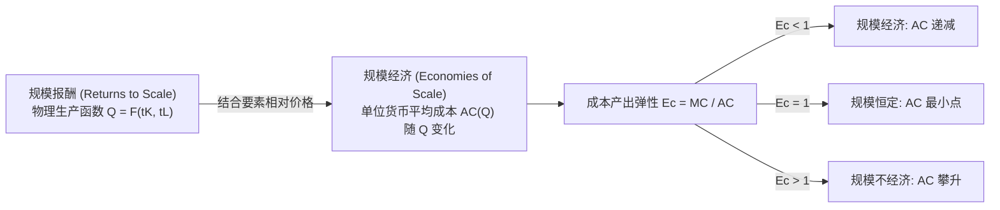
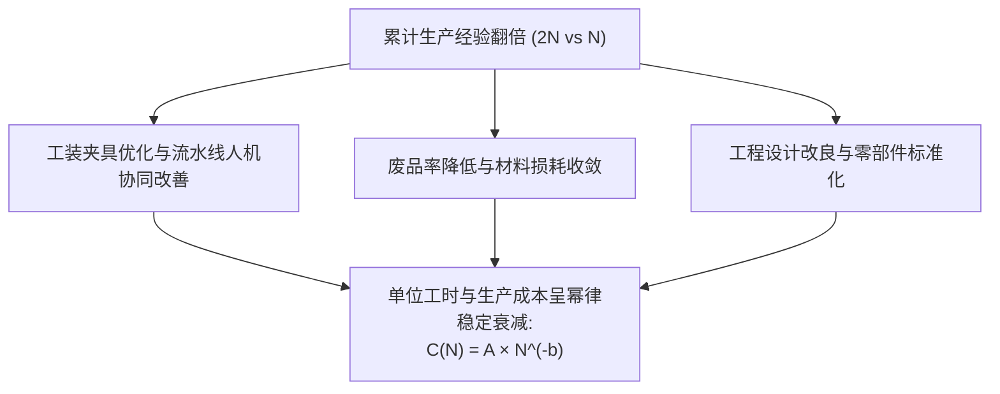

# Lec 5 资本成本、规模经济与学习曲线（Production and Cost II: Capital, Scale, Scope and Learning）

> MIT 15.010 · Economic Analysis for Business Decisions · 模块一：市场基准与成本基础

## TL;DR

- 资本使用成本由真实的经济折旧与资本占用机会成本构成，排除了会计直线折旧与通胀干扰。
- 规模报酬衡量技术要素等比放大带来的物理产出倍增，规模经济则通过成本弹性（$MC/AC$）衡量单位货币成本的节约。
- 范围经济刻画了联合生产多种产品的成本优势，是企业推行多业务共享平台与多元化战略的数理依据。
- 学习曲线度量随历史累计总产量翻倍带来的动态成本下降，是企业实施激进渗透定价与构筑先发壁垒的战略武器。

## 资本使用成本与航空资产评估

在重资产行业（如航空运输、集成电路制造、远洋航运）中，厂房与大型机器设备构成了总支出的绝对大头。企业管理层绝不能采用财务报表上的历史购置价或固定的税法折旧年限作为决策依据，而必须计算**资本使用成本（User Cost of Capital）**。

::: definition 资本使用成本 (User Cost of Capital, $UC$)
拥有并在一特定时期（通常为一年）内使用特定物理资本资产所产生的真实经济成本：

$$UC = \text{经济折旧 (Economic Depreciation)} + (\text{真实资金利率} \times \text{期初资产现行市值})$$

若用符号表示，设资产当期市场价值为 $P_K$，物理磨损与技术过时导致的实际经济贬值率为 $\delta$，扣除通胀后的真实资本机会成本（真实折现率）为 $r$：

$$UC = (\delta + r) P_K$$
:::

### 费雪效应与实际利率转化

在通胀环境中，名义借贷利率 $i$ 与预期通胀率 $\pi$ 的关系由费雪方程（Fisher Equation）决定：

$$1 + i = (1 + r)(1 + \pi) \implies r \approx i - \pi$$

在测算资本成本时，必须使用**实际利率 $r$** 与**资产当期置换市值 $P_K$**，避免将通货膨胀带来的账面利息与实际物理磨损重复计算。

::: example 航空客机机队的持有成本与租赁决策
达美航空（Delta）与联合航空（United）在评估波音 777 客机运营成本时，面临购买与湿租/干租的选择：
- 假设一架二手波音 777 当前二手市场公允价值为 $P_K = 1\text{ 亿美元}$；
- 年经济折旧率约为 $\delta = 6\%$（由于机体金属疲劳与新型低油耗发动机迭代引发的市价自然回落）；
- 航空公司的加权平均资本成本（WACC）扣除通胀后的真实机会成本为 $r = 8\%$；
- 则该客机每年的年化资本使用成本为：
  $$UC = (0.06 + 0.08) \times 1\text{ 亿美元} = 1,400\text{ 万美元/年}$$
若按每年运营 3,500 飞行小时测算，纯资本折旧与利息的边际成本高达每小时 4,000 美元。若飞机白天处于闲置停场状态，即使完全没有燃油与机组开销，企业每小时仍在真实损失巨额资本成本。
:::

## 规模经济与规模弹性

管理者必须严格区分**生产层面的规模报酬（Returns to Scale）** 与 **成本层面的规模经济（Economies of Scale）**。

### 1. 规模报酬的技术定义

当所有生产要素按同等比例 $t > 1$ 扩张时，产出变动 $F(tK, tL)$ 与 $t F(K, L)$ 的对比：
- **规模报酬递增（IRS）**：$F(tK, tL) > t F(K, L)$；
- **规模报酬不变（CRS）**：$F(tK, tL) = t F(K, L)$；
- **规模报酬递减（DRS）**：$F(tK, tL) < t F(K, L)$。

对于柯布-道格拉斯函数 $Q = A K^\alpha L^\beta$，规模报酬直接由指数和决定：$\alpha + \beta > 1$ 为递增，$= 1$ 为不变，$< 1$ 为递减。

### 2. 规模经济与成本产出弹性（Scale Elasticity）

在现实商业中，要素价格并非无限供给，且不同要素比例可能动态调整。经济学通过**成本产出弹性（Cost-Output Elasticity, $E_C$）** 度量规模经济：

$$E_C = \frac{\% \Delta TC}{\% \Delta Q} = \lim_{\Delta Q \to 0} \frac{\Delta TC / TC}{\Delta Q / Q} = \frac{dTC}{dQ} \cdot \frac{Q}{TC} = \frac{MC}{AC}$$

::: theorem 规模经济判定准则
1. **$E_C < 1$（等价于 $MC < AC$）**：产量每增加 1%，总成本上升不足 1%，平均总成本 $AC$ 持续下降，企业处于**规模经济（Economies of Scale）** 区间。
2. **$E_C = 1$（等价于 $MC = AC$）**：平均成本达到最低点，对应企业的**有效规模产量（Efficient Scale）**。
3. **$E_C > 1$（等价于 $MC > AC$）**：产量每增加 1%，总成本上升超过 1%，平均总成本 $AC$ 上扬，企业陷入**规模不经济（Diseconomies of Scale）**（通常由大企业病、层级官僚协同摩擦引起）。
:::

## 范围经济与协同效应度量

许多企业并非单一产品制造商，而是同时生产相关联的多元产品矩阵。

::: definition 范围经济 (Economies of Scope, $SC$)
单个企业联合生产两种或多种产品所耗费的总成本，严格小于由多个独立企业分别单独生产各产品所耗费的总成本之和。
:::

范围经济程度 $SC$ 的量化公式为：

$$SC = \frac{TC(Q_1, 0) + TC(0, Q_2) - TC(Q_1, Q_2)}{TC(Q_1, Q_2)}$$

- **$SC > 0$**：存在范围经济，联合生产能够节约成本；
- **$SC < 0$**：存在范围不经济，业务多元化反而互相干扰拖累；
- **核心驱动因素**：核心投入品的不可分性与可复用性（如亚马逊 AWS 云计算底层机房、银行的线下网点与风控算法、航空公司的轴辐式 Hub-and-Spoke 航线网络）。

## 经验曲线与动态学习效应

管理实践中最常见的认知混淆，是将**规模经济**与**学习效应（Learning Curve）** 混为一谈。

| 比较维度 | 规模经济 (Economies of Scale) | 学习效应 / 经验曲线 (Learning Curve) |
| :--- | :--- | :--- |
| **自变量** | **当期生产速率**（例如：本月生产 10,000 件 vs 5,000 件） | **历史累计产出总量**（例如：累计制造了 100 万件 vs 50 万件） |
| **曲线变动机制** | 沿着固定的短期或长期平均成本曲线滑动 | 将整条平均成本曲线向下方实质性平移 |
| **逆转可能性** | 若下一季度缩减订单，规模经济立即消失，单位成本回升 | 积累的知识、工装改良、良品率提升**不可逆**，成本永久下降 |

### 学习曲线数学模型

设企业生产第 $N$ 单位产品所需的边际工时或直接成本为 $C(N)$：

$$C(N) = A \cdot N^{-b} \quad (b > 0)$$

对数化可得线性回归方程：

$$\ln C(N) = \ln A - b \ln N$$

当累计产量翻倍（由 $N$ 增至 $2N$）时，成本的比值为：

$$\frac{C(2N)}{C(N)} = \frac{A (2N)^{-b}}{A N^{-b}} = 2^{-b} = L$$

参数 $L = 2^{-b}$ 即为**学习率（Learning Rate）**：
- 若 $L = 0.80$（即所谓的“80% 学习曲线”），意味着累计总产量每翻一番，单位制造成本就下降到原来的 80%（降幅为 20%）。
- 此时 $b = -\frac{\ln 0.80}{\ln 2} \approx 0.322$。

::: example 芯片代工与航空制造的战略渗透定价
在波音客机组装和台积电晶圆代工中，80%–85% 的学习曲线极具决定性。
- **抢先降价策略**：若先发企业预知存在强学习曲线，在产品上市初期即使当前实际生产成本为每件 1,000 美元，企业最优策略可能是按 600 美元“亏本”大举接单；
- **封死后发者空间**：通过超低报价迅速堆积累计销量，企业快速滑动到成本曲线下方（降至 400 美元），此时后发进入者将发现自身不仅没有客户，而且永远无法跨过高成本的学习门槛。
:::

## 我的理解

::: insight 商业模式反思：警惕“规模伪崇拜”与“经验诅咒”
在现代商业竞争中，资本运作往往过度神化规模经济，管理者应当守住两条底线：
1. **警惕重资产过度投资制造的“伪规模经济”**：一些共享经济与制造企业为了降低名义单位成本，盲目采购海量设备放大分母。但若市场需求不及预期，闲置产能带来的**资本使用成本 $UC = (\delta + r) P_K$** 会直接将企业现金流彻底拖垮。有效规模必须与真实市场消化能力精准匹配。
2. **防范技术范式转移导致的“经验资产归零”**：学习曲线是一把双刃剑。企业在旧技术架构（如传统内燃机精密加工、胶卷制造）上积累了极深的学习壁垒，一旦产业遭遇颠覆式技术创新（如纯电三电系统、数码传感），积累几十年的制造经验曲线可能在瞬间归零。组织不仅无法复用过去的经验，反而会因沉没技能与旧路径依赖被彻底锁死。
:::
