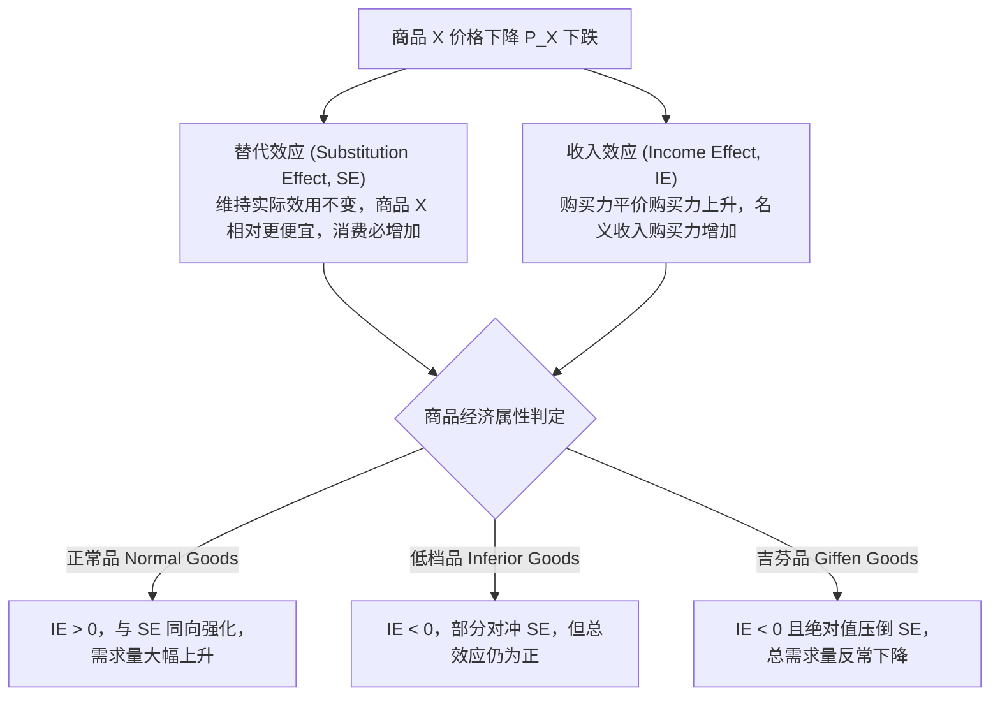

# Lec 6 消费者需求与实证估计（Consumer Demand: Choice Theory and Empirical Estimation）

> MIT 15.010 · Economic Analysis for Business Decisions · 模块二：需求特征与定价获取

## TL;DR

- 消费者选择理论将购买决策分解为效用偏好与预算约束的切点优化，等边际效用准则是最优决策的数理本质。
- 价格变动对需求量的冲击可清晰解构为替代效应与收入效应，二者的叠加方向决定了正常品、劣等品与吉芬商品。
- 市场需求曲线是全市场所有异质消费者个体需求曲线的水平加总，保留了不同分层的支付意愿边界。
- 实证需求函数估计面临严重的内生性与联立方程识别偏误，必须寻找供给外生冲击工具变量以剥离真实需求弹性。

## 消费者效用与预算约束最优化

在微观经济学中，消费者的选择行为建立在理性偏好公理体系之上（完备性、传递性与非饱和性）。消费者对商品组合 $(X, Y)$ 的满足程度由效用函数 $U(X, Y)$ 刻画。

::: definition 无差异曲线与边际替代率 (MRS)
- **无差异曲线（Indifference Curve）**：代表能为消费者带来相同效用水平的所有可能商品组合的几何轨迹，具备向右下方倾斜、凸向原点（边际替代率递减）且互不相交的性质。
- **边际替代率（Marginal Rate of Substitution, $MRS$）**：消费者为了增加一单位商品 $X$ 而自愿放弃的商品 $Y$ 的数量：
  $$MRS_{XY} = -\frac{dY}{dX}\bigg|_{U=U_0} = \frac{MU_X}{MU_Y}$$
  其中 $MU_X = \frac{\partial U}{\partial X}$ 为商品 $X$ 的边际效用。
:::

### 预算约束与最优化切点条件

设商品 $X$ 与 $Y$ 的市价分别为 $P_X$ 与 $P_Y$，消费者可支配收入为 $I$。预算约束线为：

$$P_X X + P_Y Y \le I \implies Y = \frac{I}{P_Y} - \frac{P_X}{P_Y} X$$

预算线的斜率为相对市场价格 $-\frac{P_X}{P_Y}$。消费者求解效用极大化问题：

$$\max_{X, Y} U(X, Y) \quad \text{s.t.} \quad P_X X + P_Y Y = I$$

构造拉格朗日函数 $\mathcal{L} = U(X, Y) - \lambda (P_X X + P_Y Y - I)$，一阶条件为：

$$\frac{\partial \mathcal{L}}{\partial X} = MU_X - \lambda P_X = 0 \implies \lambda = \frac{MU_X}{P_X}$$

$$\frac{\partial \mathcal{L}}{\partial Y} = MU_Y - \lambda P_Y = 0 \implies \lambda = \frac{MU_Y}{P_Y}$$

联立得到效用最大化的黄金法则：

$$MRS_{XY} = \frac{MU_X}{MU_Y} = \frac{P_X}{P_Y} \iff \frac{MU_X}{P_X} = \frac{MU_Y}{P_Y}$$

::: theorem 等边际效用原则
在最优消费点上，**消费者花费在每一种商品上的最后一元货币所带来的边际效用必须严格相等**。乘子 $\lambda$ 即为该收入水平下的**货币边际效用（Marginal Utility of Income）**。
:::

## 需求分解：替代效应与收入效应

当商品 $X$ 的价格 $P_X$ 下降时，对消费量的总效应（Total Effect）可由斯勒茨基（Slutsky）或希克斯（Hicks）方法解构为两个机制截然不同的部分：

| 商品分类 | 收入弹性 $E_I$ | 替代效应 (SE) | 收入效应 (IE) | 价格下降后的总需求量变动 |
| :--- | :--- | :--- | :--- | :--- |
| **正常品 (Normal Good)** | $E_I > 0$（奢侈品 $>1$，必需品 $0<E_I<1$） | 增加 ($+$) | 增加 ($+$) | 显著增加 ($\Delta Q > 0$) |
| **劣等品 (Inferior Good)** | $E_I < 0$ | 增加 ($+$) | 减少 ($-$) | 增加 ($\Delta Q > 0$，SE 占优) |
| **吉芬品 (Giffen Good)** | $E_I \ll 0$（极端劣质主食） | 增加 ($+$) | 剧烈减少 ($--$) | 反常减少 ($\Delta Q < 0$，违背需求定律) |

## 市场需求的水平加总与分层

市场需求曲线反映的是在每一价格水平下全市场所有独立消费者的购买意愿总和。

::: definition 水平加总法则 (Horizontal Summation)
设市场中共有 $N$ 个异质消费者，每个消费者的个体需求函数为 $q_i = d_i(P)$。全市场总需求曲线 $Q(P)$ 为个体购买量的水平代数和：

$$Q(P) = \sum_{i=1}^N q_i(P) = \sum_{i=1}^N \max\{0, d_i(P)\}$$
:::

::: example 离散分层下的需求折点现象
假设市场由企业客户与个人客户构成：
- 企业客户对办公套件需求：$Q_1 = 100 - P$（当 $P \le 100$ 时采购）；
- 个人客户对办公套件需求：$Q_2 = 60 - 2P$（当 $P \le 30$ 时采购）。
市场总需求函数呈现分段折点：
$$Q(P) = \begin{cases} 100 - P, & \text{若 } 30 < P \le 100 \\ 160 - 3P, & \text{若 } 0 \le P \le 30 \end{cases}$$
在 $P = 30$ 处，市场需求曲线发生明显的**折点（Kink）**，需求价格弹性发生阶跃突变。管理者若从高价区间向低价区间降价，一旦跨越 30 元门槛，边际销量吸收率将大幅跳升。
:::

## 商业需求实证估计与内生性识别偏误

企业在利用大数据与历史交易记录估计自身需求曲线时，不能直接对历史价格与销量进行简单的普通最小二乘法（OLS）回归。

### 1. 实证模型设定形式

实证计量中最常用的两种需求函数规格：

1. **线性需求规格（Linear Specification）**：
   $$Q = a - b P + c I + d P_{comp} + \epsilon$$
   优点是直观易解，但其需求弹性随价格和产量的变动而持续变化（$E_d = -b \frac{P}{Q}$）。
2. **双对数恒弹性规格（Log-Log Specification）**：
   $$\ln Q = \alpha - \beta \ln P + \gamma \ln I + \delta \ln P_{comp} + \epsilon$$
   在 Recitation 1 与 4 中被广泛使用，其最大优势在于回归参数直接即为弹性常数（$-\beta = E_d$ 为自价弹性，$\gamma = E_I$ 为收入弹性，$\delta = E_{cross}$ 为交叉弹性）。

### 2. 联立方程识别难题（The Identification Problem）

::: pitfall 直接 OLS 回归的内生性致命陷阱
历史数据中的每一个观测点 $(P_t, Q_t)$，本质上都是当时**供给曲线与需求曲线共同作用的瞬时均衡交点**。
- 若市场上的供给与需求在每个季度同时发生外生平移（例如需求受季节性影响，供给受上游材料价格影响），价格 $P$ 与扰动项 $\epsilon$ 必然存在强相关性（内生性，$\text{Cov}(P, \epsilon) \neq 0$）；
- 直接进行 OLS 回归估计出的系数既不是真实需求曲线，也不是真实供给曲线，而是一条毫无经济学预测价值的“伪回归混合线”。
:::

### 工具变量与两阶段最小二乘法（2SLS）

为了准确识别真实需求曲线，计量经济学要求引入**工具变量（Instrumental Variable, $Z$）**：
1. **相关性条件**：$Z$ 必须与内生变量价格 $P$ 高度相关（例如农产品受极端寒潮影响导致减产，使得化肥原产地电价飙升）；
2. **外生性/排他性条件**：$Z$ 只能通过影响供给侧进而影响价格 $P$，绝不能直接进入消费者对下游最终商品的需求偏好方程中。
通过工具变量法，能够将外生的供给平移作为“试验探针”，在需求曲线保持静止的切片下描摹出其真实斜率。

## 我的理解

::: insight 商业大数据时代的“伪规律”祛魅
在当前互联网大厂与零售巨头普遍推行算法定价与 A/B 测试的背景下，15.010 的需求理论具有极其强烈的现实纠偏价值：
1. **被动历史数据分析充满幸存者偏差**：许多业务分析师直接从数仓中拉取“价格打折与销量激增”的数据，得出“降价永远能显著增厚毛利”的鲁莽结论，往往是因为他们忽略了打折往往集中在假日消费旺季（需求曲线本身外生右移）。若在平季盲目套用这一弹性测算，企业将陷入量价齐跌的亏损深渊。
2. **主动受控实验（A/B Testing）是终极的工具变量**：互联网平台之所以要针对随机抽样的 1% 流量用户做孤立定价灰度测试，本质上就是在人工创造一个绝对外生的“供给扰动变量”，彻底切断环境宏观波动的内生干扰。只有理解了微观计量识别理论，才能设计出真正科学的商业定价试验。
:::
