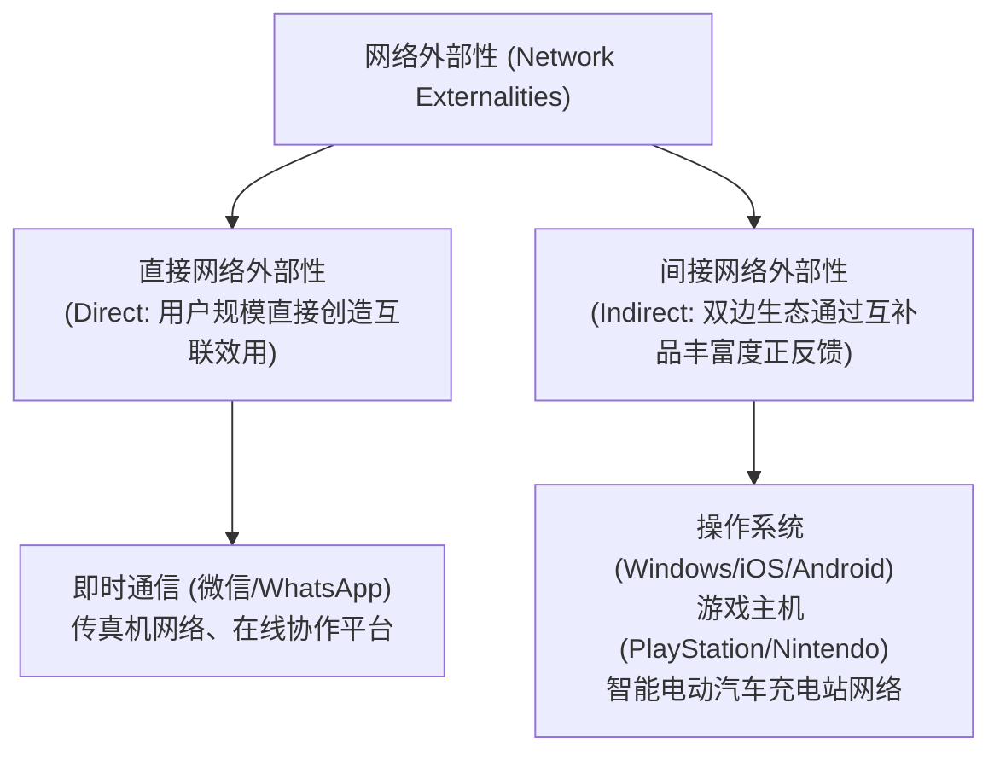
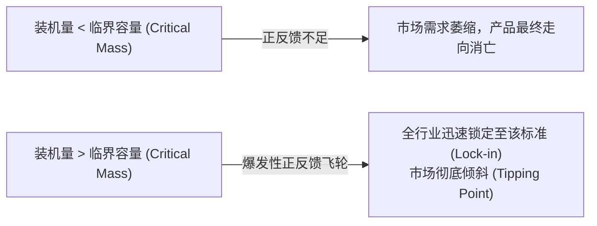

# Lec 7 产品特征、质量与网络外部性（Consumer Demand: Product Characteristics and Network Externalities）

> MIT 15.010 · Economic Analysis for Business Decisions · 模块二：需求特征与定价获取

## TL;DR

- 兰卡斯特特征需求理论将商品解构为属性束，特征价格模型能够精确剥离各物理特征的隐性影子价格。
- 纵向差异化依赖质量层级的普遍认同，横向差异化则通过空间或品味定位迎合消费者的异质偏好。
- 直接网络外部性由用户互联规模驱动，间接网络外部性则通过软硬件生态互补性发挥平台飞轮效应。
- 从众效应促使市场需求曲线弹性显著放大，跨越“临界容量（Critical Mass）”是标准战争中决胜生死的战略分水岭。

## 兰卡斯特特征模型与享乐价格法

传统微观理论将商品视为单一不可分割的物理实体，无法解释为何不同配置的产品能制定截然不同的价格。凯文·兰卡斯特（Kelvin Lancaster）提出的特征方法奠定了现代差异化产品定价的基础。

::: definition 兰卡斯特特征需求理论 (Characteristics Approach)
消费者购买的并非商品物理形态本身，而是该商品所内含的**一组客观效用特征束（Bundle of Attributes）** $Z = (z_1, z_2, \dots, z_m)$。
例如，购买笔记本电脑并非购买“电脑硬件”，而是购买“运算主频 $z_1$、整机便携重量 $z_2$、电池续航时间 $z_3$、屏幕分辨率 $z_4$”等特征组合。
:::

### 享乐价格回归模型（Hedonic Price Regression）

在房地产、汽车、个人电脑及消费电子行业中，企业广泛利用实证计量中的**享乐价格法（Hedonic Pricing）** 来量化每一个产品功能特性的市场支付意愿：

$$\ln P = \alpha + \beta_1 z_1 + \beta_2 z_2 + \dots + \beta_m z_m + \epsilon$$

对某一特征 $z_k$ 求偏导数，即可推导出该特征的**隐性影子价格（Implicit Attribute Price）**：

$$\frac{\partial P}{\partial z_k} = \beta_k \cdot P$$

::: example 智能手机存储容量的影子价格
在高端智能手机市场中，回归模型显示闪存容量对数系数为 $\beta_{\text{storage}} = 0.0015$。若一款基准售价为 800 美元的手机增加 128 GB 存储，消费者为其支付的隐含影子溢价约为：
$$\Delta P \approx 800 \times 0.0015 \times 128 \approx 153.6\text{ 美元}$$
而闪存芯片的物理制造成本仅上升 15 美元，这解释了消费电子巨头为何热衷于通过不同存储规格实现高达 10 倍边际溢价的“刀法精准”的产品线设计。
:::

## 垂直差异化 vs 水平差异化战略

企业在规划产品矩阵时，面临两类根本性的差异化维度：

| 差异化类型 | 核心机制 | 消费者共识 | 战略定位与竞争重点 |
| :--- | :--- | :--- | :--- |
| **纵向差异化 (Vertical Differentiation)** | **客观质量与性能层级**（如屏幕清晰度、能耗效率） | 若价格完全相同，所有消费者对产品优劣排序**完全一致** | 追求技术突破与卓越用料，占领高净值客群，靠技术代差获取超额利润 |
| **横向差异化 (Horizontal Differentiation)** | **主观品味、款式与空间距离**（如汽车颜色、咖啡风味） | 即使价格相同，不同消费者根据个体偏好选择**各不相同** | 霍特林（Hotelling）空间定位，避开对手直面竞争，最大化捕获细分生态 |

## 网络外部性的传导机制与分类

在数字化与高科技产业中，单个用户的消费效用与整个系统的用户基础产生强烈的相互作用。

::: definition 网络外部性
当一位消费者对某项产品或服务的需求量与支付意愿，直接取决于购买或使用同一产品的**其他消费者总数量**时，该产品即表现出网络外部性（Network Externalities）。
:::

### 1. 直接 vs 间接网络外部性

- **直接网络外部性（Direct Externalities）**：由物理互联直接产生。根据梅特卡夫定律（Metcalfe's Law），一个包含 $n$ 个节点的网络价值与可能的连接对数成正比，即 $V \propto n(n-1) \approx n^2$。典型案例包括电话网络、社交平台与加密货币账本。
- **间接网络外部性（Indirect Externalities）**：由双边平台（Two-Sided Markets）上的互补商品引发。硬件平台的用户基数越大，第三方软件开发者与配件厂商越愿意为其开发生态；互补品越繁荣，反过来进一步推升消费者对该硬件平台的购买意愿，形成跨边正向飞轮。

### 2. 从众效应 vs 虚荣效应对需求弹性的扭曲

Recitation 4 重点推导了正负外部性对市场需求曲线斜率与弹性的实质影响：

- **从众效应（Bandwagon Effect / Positive Externality）**：消费者希望“随大流”或受流行趋势带动，别人买得越多，自己支付意愿越高。
  - **数理机制**：价格下降引发的销量增长包含两个部分：基础价格效应，加上用户基数扩张引发的二次需求曲线向外平移。
  - **结果**：**市场实际需求曲线比无外部性的纯个体需求加总曲线更加平坦，需求价格弹性显著放大**。
- **虚荣效应（Snob Effect / Negative Externality）**：消费者追求独特性与身份排他性，买该产品的人越多，高端买家的效用反而越低（如限量版机械表、定制高定服装）。
  - **结果**：**市场实际需求曲线变得极为陡峭，需求价格弹性被大幅压低**，企业提价往往不会导致销量剧烈缩水。

## 临界容量与技术标准战争

在具备显著强网络外部性的市场中，产业演进往往呈现出“胜者通吃（Winner-Takes-All）”的非线性特征。

### 标准战争的五大决胜战略

在经典案例中（如 JVC VHS vs 索尼 Betamax、微软 Windows vs IBM OS/2、蓝光 Blu-ray vs HD-DVD），技术的纯物理优劣往往退居次席，战略操作决定生死：

1. **激进渗透定价（Aggressive Penetration Pricing）**：在产品推向市场初期，以极低价格甚至全免费（补贴）模式迅速获取原始装机量，不惜短期亏损以跨越临界门槛。
2. **构筑互补品生态联盟（Alliances with Complementors）**：通过让利、提供免费 SDK、直接入股等手段，绑定头部内容提供商与第三方软件开发商（如索尼当年拉拢好莱坞主流制片厂全面支持蓝光）。
3. **向下兼容与转换成本降低（Backward Compatibility）**：新一代系统全面向下兼容既有存量资产，降低用户从旧系统升级的心理摩擦与资产沉没壁垒。
4. **预期管理与自证预言（Expectations Management）**：通过宣布海量订单意向、发布技术蓝图、巨额营销攻势，向市场各方灌输“我必将成为行业标准”的不可逆心理预期。

## 我的理解

::: insight 技术至上主义的破产与平台网络治理
在商业史中，技术上更先进的产品在标准战中惨败的案例屡见不鲜：
1. **Betamax 败给 VHS 的核心教训**：索尼的 Betamax 录像机在画面分辨率、色彩还原度上均显著优于 JVC 的 VHS，但索尼固守单一封闭标准，且磁带单盘录制时长仅 1 小时（无法完整录制一场美式橄榄球赛）；而 JVC 采取开放授权策略，联合日立、松下等形成庞大制造阵营，并将录制时长延长至 2 小时，最终凭借压倒性的外部性飞轮将索尼彻底逐出家用录像带市场。
2. **从“单点产品设计”跃迁为“系统规则设计”**：对于现代科技平台的创业者而言，如果你的商业构想依赖间接网络外部性，你的工作就绝不仅仅是编写一段出色的代码，而是要像中央银行行长一样，精心设计双边生态之间的补贴机制、分成结构与声誉规则，确保在冷启动阶段跨过生死时速的临界容量。
:::
