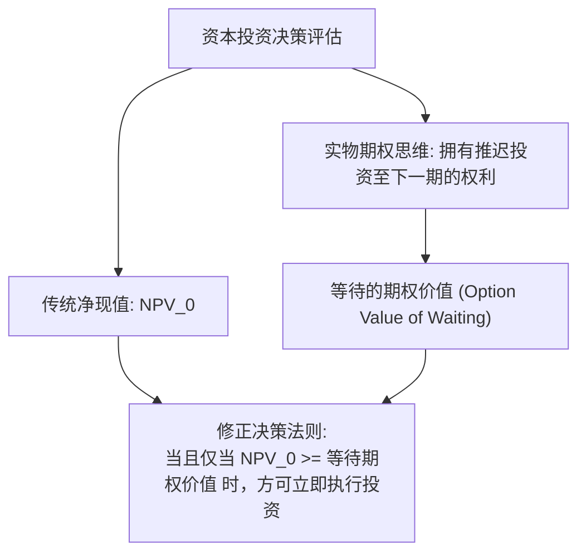

# Lec 8 跨期决策、不确定性与实物期权（Time, Uncertainty, and Real Option Value）

> MIT 15.010 · Economic Analysis for Business Decisions · 模块二：需求特征与定价获取

## TL;DR

- 跨期决策通过净现值（NPV）将未来不确定现金流贴现至当前，贴现率本质是放弃的同期资本市场机会成本。
- 预期效用理论解释了商业决策中的风险厌恶倾向，确定性等价与风险溢价量化了企业对不确定性的对冲成本。
- 传统净现值法则（NPV > 0 即投资）在面对不可逆资本投入时存在重大缺陷，忽略了放弃“等待期权”的隐性机会成本。
- 实物期权理论表明，当市场未来波动剧烈且投资具有时间灵活性时，延后投资以获取增量信息往往创造更大价值。

## 跨期决策与净现值法则

企业的所有重大战略规划（厂房建设、新药研发、跨国并购）都涉及跨越多个会计周期的资金流动：即期支付初始资本开支，在未来的漫长时间内陆续获取现金流入。

::: definition 净现值 (Net Present Value, NPV)
设项目初始投资支出为 $I_0$，未来第 $t$ 期产生的预期净现金流为 $CF_t$，企业面临的资本成本（贴现率）为 $r$，项目存续期为 $T$ 年：

$$NPV = -I_0 + \sum_{t=1}^T \frac{CF_t}{(1+r)^t}$$
:::

在标准财务决策中，**基准投资法则（NPV Rule）** 要求：
- 若 $NPV > 0$，项目创造经济增加值，应当执行；
- 若 $NPV < 0$，项目损害股东财富，应当放弃；
- 贴现率 $r$ 绝不能使用无风险国债利率，必须根据项目现金流的系统性市场风险调整为加权平均资本成本（WACC）。

## 不确定性与预期效用理论

现实商业环境充满随机波动，管理者面临的不是确定的未来数字，而是自然状态的概率分布。

### 1. 圣彼得堡悖论与效用函数的凹性

若仅按数学期望值（Expected Value, $EV = \sum p_i x_i$）评估风险，无法解释现实中为何人们愿意购买商业财产保险，或为何理性的跨国企业愿意放弃高期望收益的高波动项目。

在经济学思想史上，经典的“圣彼得堡悖论”最早揭示了数学期望在决策评估中的失灵：掷一枚硬币直至首次出现正面，若在第 $n$ 次掷出正面，玩家将获得 $2^n$ 元奖金。虽然该博弈的数学期望收益为无穷大（$\sum_{n=1}^\infty \frac{1}{2^n} \cdot 2^n = \infty$），但现实中没有任何理性决策者愿意支付数千元甚至上万元参与这一赌局。

这一现象说明，人类对财富的心理感知并非线性的，而是存在边际满足感递减规律。冯·诺依曼与摩根斯坦（von Neumann & Morgenstern）在此基础上提出了**预期效用理论（Expected Utility Theory）**：决策者最大化的是最终财富的预期效用，而非财富本身的数学期望。个人的风险偏好特征直接由其效用函数的几何曲率（二阶导数符号）所决定：

```mermaid
flowchart LR
    A["不确定财富前景 (W1, p; W2, 1-p)"] --> B["期望财富 EV = pW1 + (1-p)W2"]
    A --> C["期望效用 E[U] = pU(W1) + (1-p)U(W2)"]
    B & C --> D{"效用函数曲率 U''(W)"}
    D -->|U''(W) < 0 严格下凹| E["风险厌恶 (Risk Averse): E[U] < U(EV)"]
    D -->|U''(W) = 0 线性| F["风险中性 (Risk Neutral): E[U] = U(EV)"]
    D -->|U''(W) > 0 严格上凸| G["风险喜好 (Risk Loving): E[U] > U(EV)"]
```

在商业管理实战中，绝大多数企业所有者与职业经理人在面临重大资产风险时均表现为严格的风险厌恶型，这也构成了现代企业风险对冲、资本结构规划与衍生品套期保值交易的微观理论基石。

### 2. 确定性等价与风险溢价

对于一位具有风险厌恶倾向的商业决策者（$U''(W) < 0$）：

::: definition 确定性等价与风险溢价
- **确定性等价（Certainty Equivalent, $CE$）**：决策者认为与其承担该随机财富前景完全等效的确定性现金金额：
  $$U(CE) = E[U(W)] = \sum_{i=1}^n p_i U(W_i)$$
- **风险溢价（Risk Premium, $RP$）**：决策者为了摆脱该风险而自愿放弃的期望收益差额：
  $$RP = E[W] - CE$$
:::

::: example 风险溢价的数理计算
设某高管面临一项投资前景：50% 概率收益为 100 万元，50% 概率收益为零（期望财富 $E[W] = 50\text{ 万元}$）。该高管的效用函数为 $U(W) = \sqrt{W}$。
1. 计算预期效用：
   $$E[U(W)] = 0.5 \times \sqrt{1,000,000} + 0.5 \times \sqrt{0} = 0.5 \times 1,000 + 0 = 500$$
2. 求解确定性等价 $CE$：
   $$\sqrt{CE} = 500 \implies CE = 500^2 = 250,000\text{ 元 (25 万元)}$$
3. 风险溢价为：
   $$RP = 50 - 25 = 25\text{ 万元}$$
该高管宁愿拿确定的 25 万元现金，也不愿去博弈期望为 50 万元的随机前景。商业保险公司正是通过将这种风险溢价转化为保费收入来实现盈利的。
:::

### 3. 阿罗-普拉特风险厌恶度量

为了消除效用函数正线性仿射变换的影响，经济学采用二阶导数比值度量风险态度：
- **绝对风险厌恶度（Arrow-Pratt Absolute Risk Aversion, $ARA$）**：
  $$ARA(W) = -\frac{U''(W)}{U'(W)}$$
- **相对风险厌恶度（Relative Risk Aversion, $RRA$）**：
  $$RRA(W) = -W \frac{U''(W)}{U'(W)}$$

## 实物期权与等待的价值（Value of Waiting）

在 MIT 15.010 课程中，对传统财务学最大的颠覆是对**实物期权（Real Options）** 的解析。传统资本预算模型隐含了一个极其严苛且通常错误的假设：**投资决策是“要么现在投，要么永远不投（Now or Never）”的静态选择**。

而在现实中，绝大多数商业投资具备三大核心特征：
1. **不可逆性（Irreversibility）**：厂房、定制设备具有高度专用性，一旦投入即变为巨额沉没成本，无法在二级市场上无损变现；
2. **持续不确定性（Ongoing Uncertainty）**：未来产品价格、政策监管与市场需求在下一期会暴露出更多信息；
3. **时机选择灵活性（Timing Flexibility）**：企业拥有“暂缓观望、推迟到下一期再决策”的权利。



::: theorem 实物期权修正投资准则
当投资具有不可逆性且可以延期时，**立即执行投资的真实机会成本不仅包含资本支出 $I_0$，还必须计入因立即投资而永久灭失的“等待期权价值（Option Value of Waiting）”**：

$$\text{扩展有效净现值} = \text{传统 } NPV_0 - \text{等待期权价值}$$

因此，仅仅 $NPV_0 > 0$ 不再是立即开工的充分条件。只有当即期投资的收益大幅超过等待到下一期获取增量信息所带来的期权溢价时，立即开工才是经济上最优的。
:::

::: example 海底油田开采的等待期权
假定某石油公司获得一块深海油田的开采权，当前原油价格为每桶 50 美元，立即投入开采的钻井不可逆资本成本为 1 亿美元，按当前油价计算的预期现金流现值为 1.05 亿美元：
- **传统 NPV 视角**：$NPV_0 = 1.05 - 1.00 = 500\text{ 万美元} > 0$。传统财务部门建议立即开工。
- **实物期权视角**：若等待 1 年，下一年由于地缘局势，油价有 50% 概率暴涨至 80 美元（现金流现值增至 1.8 亿美元），有 50% 概率跌至 20 美元（现金流现值跌至 4,000 万美元）。
  - 若跌至 20 美元，公司选择放弃开采，损失为 0；
  - 若暴涨至 80 美元，公司执行开采，下一年净收益为 $1.8 - 1.0 = 8,000\text{ 万美元}$。
  - 假定贴现率为 10%，等待 1 年后的期望现值为：
    $$\text{等待价值} = \frac{0.5 \times 8,000 + 0.5 \times 0}{1 + 0.10} \approx \frac{4,000}{1.10} \approx 3,636\text{ 万美元}$$
立即开工只能获得 500 万美元，而推迟 1 年观望的期权价值高达 3,636 万美元！若贸然开工，企业将直接净损失超过 3,100 万美元的期权价值。
:::

## 我的理解

::: insight 商业不确定性中的进攻性“留白”
实物期权理论彻底重构了管理学对“不确定性”的认知：
1. **波动率不仅是风险，更是价值的源泉**：在传统金融学中，方差和波动率往往被视为必须回避的负面风险；但在期权世界中，因为期权持有方享受收益上行空间而封死了下行亏损，**标的资产波动越大，期权的价值反而越高**。在科技产业与前沿研发领域，高波动环境赋予了具备柔性决策能力的企业极大的战略溢价。
2. **战略灵活性的定价**：许多高管在做产能规划时盲目追求超大单体规模以榨取规模经济，却完全牺牲了灵活性（如建设只能生产单一车型的庞大冲压流水线）。在需求易变的商业周期中，采用模块化设计、短期租赁生产线或外包试点，虽然单件名义边际成本稍高，但它内嵌了随时止损或翻倍扩张的实物期权，其综合价值远超僵化的重资产投资。
:::
