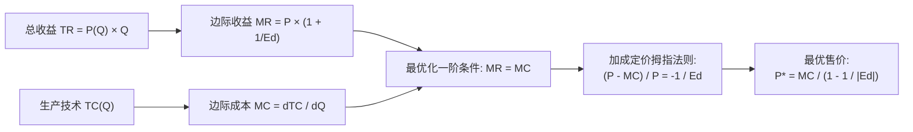

# Lec 9 市场力量与最优加成定价（Market Power and Markup Pricing）

> MIT 15.010 · Economic Analysis for Business Decisions · 模块二：需求特征与定价获取

## TL;DR

- 市场力量指企业将销售价格维持在边际成本之上的能力，勒纳指数从数理上建立了加成率与需求价格弹性的倒数关系。
- 边际收益等于边际成本（MR = MC）是利润最大化的普适准则，垄断企业永远不会在需求缺乏弹性的区间经营。
- 针对拥有多制造基地的企业，最低成本生产原则要求将订单分配至各工厂，使得各厂的边际成本完全相等并等于全集团的边际收益。
- 垄断带来的社会福利净损失不仅包含产量压缩引起的无谓死重损失，更涵盖企业为维持行政壁垒所耗费的非生产性寻租成本。

## 市场力量的来源与勒纳指数测度

在完全竞争市场中，个别厂商只是价格接受者（Price Taker），其面临的需求弹性为无穷大（$E_d \to -\infty$），定价被锁定在边际成本上（$P = MC$）。当市场上存在进入壁垒（专利保护、专有资源、规模经济、网络效应）时，企业获得了自主制定市场价格的自由度。

::: definition 市场力量 (Market Power) 与勒纳指数 (Lerner Index)
**市场力量**衡量一家企业在不流失全部客户的前提下，将价格制定在边际成本之上的自由度。
经济学使用**勒纳指数（Lerner Index, $L$）** 对市场力量进行标准化量化测度：

$$L = \frac{P - MC}{P}$$

- 在完全竞争下，$P = MC \implies L = 0$；
- 勒纳指数 $L$ 介于 $0$ 与 $1$ 之间，数值越大，表明企业的定价权越强，市场结构越偏离完全竞争。
:::

## 垄断利润最大化与加成定价黄金法则

在微观分析中，垄断企业面临向右下方倾斜的市场总需求曲线 $P(Q)$。其总收益为 $TR(Q) = P(Q) \cdot Q$，总成本为 $TC(Q)$。

企业的利润最大化目标函数为：

$$\max_Q \Pi(Q) = TR(Q) - TC(Q)$$

对产量 $Q$ 求一阶导数并令其为零：

$$\frac{d\Pi}{dQ} = \frac{dTR}{dQ} - \frac{dTC}{dQ} = MR - MC = 0 \implies MR = MC$$

### 1. 边际收益公式与价格弹性关联

Recitation 5 详细展开了微积分链式法则的推导过程：

$$MR = \frac{d(P \cdot Q)}{dQ} = P + Q \cdot \frac{dP}{dQ} = P \left(1 + \frac{Q}{P} \frac{dP}{dQ}\right)$$

由需求价格弹性定义 $E_d = \frac{dQ}{dP} \frac{P}{Q}$，可知其倒数为 $\frac{1}{E_d} = \frac{Q}{P} \frac{dP}{dQ}$。代入可得：

$$MR = P \left(1 + \frac{1}{E_d}\right)$$

### 2. 定价经验法则（The Markup Rule of Thumb）

将 $MR = P \left(1 + \frac{1}{E_d}\right)$ 与 $MR = MC$ 联立：

$$P \left(1 + \frac{1}{E_d}\right) = MC \implies \frac{P - MC}{P} = -\frac{1}{E_d}$$

用绝对值弹性 $|E_d|$ 表示，可解得**最优加成价格公式**：

$$P = \frac{MC}{1 - \frac{1}{|E_d|}} = MC \cdot \left(\frac{|E_d|}{|E_d| - 1}\right)$$

成本加成率（Markup over Cost）定义为：

$$\text{Markup} = \frac{P - MC}{MC} = \frac{1}{|E_d| - 1}$$

::: theorem 垄断定价的三条核心推论
1. **需求越缺乏弹性，最优加成比例越高**：当 $|E_d| = 1.2$ 时，加成系数为 $\frac{1}{0.2} = 5$ 倍（售价定为边际成本的 6 倍）；当 $|E_d| = 5$ 时，加成系数降为 $\frac{1}{4} = 25\%$（售价定为 $1.25 \times MC$）。
2. **垄断者永远不会在缺乏弹性的区间经营**：若 $|E_d| < 1$（需求缺乏弹性），则 $1 + \frac{1}{E_d} < 0 \implies MR < 0$。边际成本 $MC > 0$，等式 $MR = MC$ 在数学上不可能成立。若当前处于缺乏弹性区间，企业只需提高价格，不仅能增加总收益，而且能削减产量降低总成本，使总利润单调递增。
3. **边际成本决定价格下限，需求弹性决定价格上限**：任何脱离需求弹性评估的单纯会计“成本加成”定价，在商业逻辑上都是不完备的。
:::

## 多工厂垄断生产配置（Multi-Plant Monopoly）

当跨国公司拥有两家或多家位于不同地区、生产工艺与成本函数各异的工厂（例如工厂 1 的成本为 $C_1(q_1)$，工厂 2 的成本为 $C_2(q_2)$）时，如何分配产出？

设集团总产量为 $Q = q_1 + q_2$，全集团面临市场需求曲线 $P(Q)$。利润最大化问题为：

$$\max_{q_1, q_2} \Pi = P(q_1 + q_2)(q_1 + q_2) - C_1(q_1) - C_2(q_2)$$

分别对 $q_1$ 与 $q_2$ 求偏导数并令其为零：

$$\frac{\partial \Pi}{\partial q_1} = MR(Q) - MC_1(q_1) = 0 \implies MR(Q) = MC_1(q_1)$$

$$\frac{\partial \Pi}{\partial q_2} = MR(Q) - MC_2(q_2) = 0 \implies MR(Q) = MC_2(q_2)$$

::: definition 多工厂协同生产法则
对于多工厂垄断企业，利润最大化的必要条件是：**无论各工厂历史固定投资规模有多大，必须将订单动态调度至各厂，使得每一家正在运行的工厂的边际成本完全相等，并共同等于整个市场总产量下的边际收益**：

$$MC_1(q_1^*) = MC_2(q_2^*) = \dots = MC_k(q_k^*) = MR(Q^*)$$
:::

::: example 多工厂调度反常识案例
工厂 1 设备先进，平均成本很低，但在高负荷下其边际成本迅速上升；工厂 2 设备老旧，但产能富余，边际成本相对平缓。许多非理性的厂长倾向于“将所有订单塞满工厂 1”。根据经济学准则，只要工厂 1 生产最后一台产品的边际成本超过了工厂 2，企业就应当立即将后续订单转移给工厂 2，以实现全集团综合总成本最小化。
:::

## 市场力量的社会成本：死重损失与寻租消耗

垄断在带来超额经济利润的同时，对整个社会经济系统造成了双重福利损耗：

1. **哈伯格无谓损失三角形（Harberger Deadweight Loss）**：由于垄断企业将价格抬升至 $P^* > MC$，导致生产和消费规模被人为压缩在有效竞争产出 $Q_c$ 之下。那些支付意愿高于边际成本但低于垄断价格的潜在交易无法达成，造成社会纯净福利净灭失。
2. **图洛克寻租耗散（Tullock Rent-Seeking Costs）**：垄断所带来的超额利润（垄断租金，Monopoly Rents）会吸引潜在进入者，而既有在位巨头为了阻击竞争，往往会将这部分超额利润的大头用于非生产性开销——例如游说立法机构设立准入牌照、雇佣顶级公关打舆论战、开展马拉松式专利诉讼等。这些为争夺和保卫租金所耗散的社会资源，往往同等甚至超过哈伯格三角形本身的规模。

## 我的理解

::: insight 商业实战：警惕“会计成本加成”对利润的隐蔽吞噬
在咨询项目中，许多制造与零售高管常常自豪地介绍他们的定价体系：“我们全公司统一执行严格的成本加成法，所有产品在核算全成本后统一上浮 20% 出厂”。从 15.010 的视角审视，这种做法存在双重灾难：
1. **对高黏性产品严重让利**：对于专利壁垒极高、替代品极少的产品（$|E_d| \approx 1.2$），最优定价应该上浮 500%（加成 5 倍），而企业只加成 20%，拱手放弃了数十亿美元的消费者剩余捕获机会。
2. **对高弹性产品自寻死路**：对于面临激烈竞争的红海标准化品类（$|E_d| \approx 10$），最优加成仅为 11%，若强行加成 20%，由于消费者极度敏感，销量将断崖式暴跌，反而引发工厂开工不足、固定成本分摊进一步被动推高、被迫继续加价的死亡螺旋。

科学的战略定价，必须将“财务记账”与“商业定价”在组织架构上物理隔离：成本核算只负责算出底线的增量边际成本 $MC$，而最终价格的拍板权，必须交由能够精准量化需求弹性 $|E_d|$ 的战略市场团队。
:::
